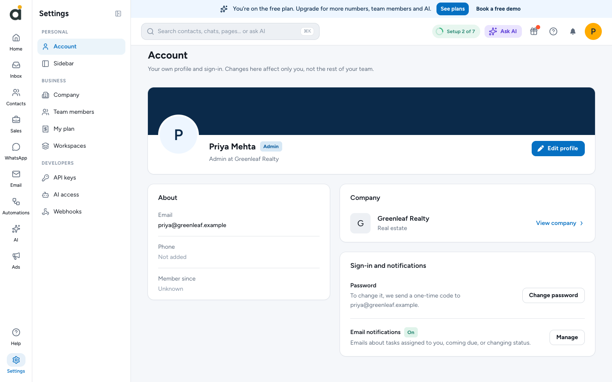
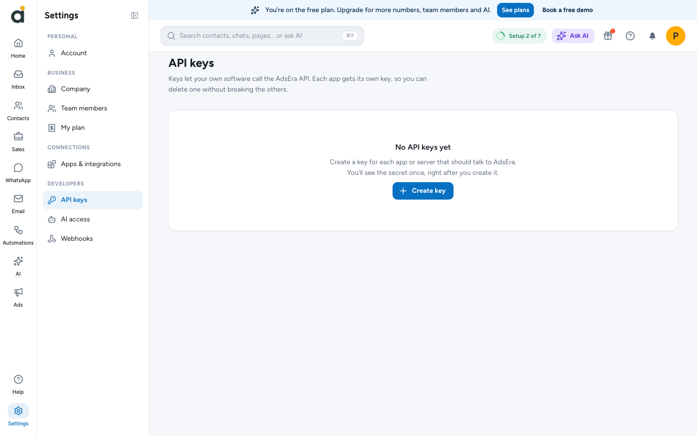

Your Account Settings page is where you can manage all your personal details, update your security credentials, and create API keys for connecting AdsEra to other applications.

**Want to manage profile? [Go to the AdsEra Profile Page &rarr;](https://app.adsera.in/dashboard/company)**

## How to Access Account Settings

You can easily navigate to your account settings from the main dashboard.

1.  Log in to your AdsEra dashboard.
2.  Click **Settings** at the bottom of the menu on the left.
3.  Click **Account**.

---
## Account Tabs

<Tabs>
<Tab title="Information">

The **Information** tab allows you to update your personal details and profile picture.

### Profile Photo

You can upload a custom photo to personalize your account.
- **To upload:** Click on the camera icon overlaying your current avatar.
- **File types:** `*.jpeg`, `*.jpg`, `*.png`, `*.gif`
- **Max size:** 3.1 MB

### Personal Details

Update your user information using the fields provided:
- **First Name:** Your first name.
- **Last Name:** Your last name.
- **Email Address:** This field is linked to your account and **cannot be changed**.
- **Country:** Your country of residence.
- **Phone Number:** Your contact phone number.

After making your desired changes, click the **Save Changes** button to apply them.

</Tab>

<Tab title="Password">

### Change Password
The **Password** tab allows you to securely change the password for your AdsEra account. For your security, this process requires email verification.

<Steps>
    <Step title="Start the Verification Process">
        Click the **Verify** button. This will send a one-time password (OTP) to your registered email address (`shubham@adsera.in`).
    </Step>
    <Step title="Enter the OTP">
        Check your email for the OTP, and enter it on the verification screen that appears.
    </Step>
    <Step title="Set Your New Password">
        Once verified, you will be prompted to enter and confirm your new password.
    </Step>
</Steps>

</Tab>

<Tab title="API Key">

This tab allows you to generate and manage API keys. API keys are used to integrate your AdsEra account with third-party applications and services securely.

### Creating an API Key

<Steps>
    <Step title="Create a New App">
        Click the **+ Create app** button to open the API key creation dialog.
    </Step>
    <Step title="Configure Your Key">
        In the pop-up window, provide the following details:
        - **App Name:** A descriptive name for your key (e.g., "My Custom CRM").
        - **Never Expire:** Check this box if you want the key to be valid indefinitely.
        - **End date:** If "Never Expire" is unchecked, select a date when the key should automatically expire.

    </Step>
    <Step title="Generate and Save Your Key">
        Click **Submit**. Your new API Key and Secret will be generated and displayed.
    </Step>
</Steps>

<Warning>
  **Important:** Your **API Secret** will only be displayed **once**, immediately after creation. Make sure to copy it and store it in a secure location like a password manager. **You will not be able to retrieve it again.**
</Warning>

Once created, your API key will appear in a list on this tab, allowing you to manage or delete it in the future.

</Tab>
<Tab title="Notifications">

Choose which notifications you get by email, for example **Email me about tasks** (when a task is assigned to you or is due). In-app notifications always show in the bell at the top of the page. To post alerts to your team's Slack channel, see [Slack](/help/integrations/slack).

</Tab>

<Tab title="AI Access">

Connect Claude, ChatGPT, Cursor or Claude Code to your AdsEra account, and create personal access keys. See [Use AdsEra from Claude, ChatGPT or Cursor](/help/ai/connect-ai-apps).

</Tab>

<Tab title="Webhook">

Send AdsEra events (such as incoming messages and status updates) to your own server. Add your webhook URL, and send a test event to check that your server receives it. See the [API reference](/api-reference/introduction).

</Tab>

</Tabs>