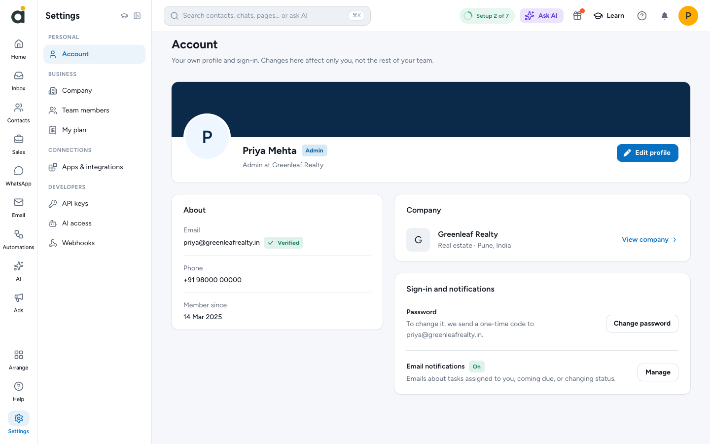
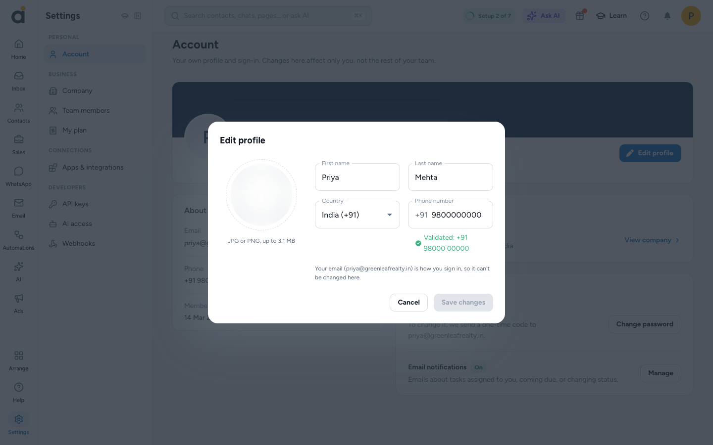
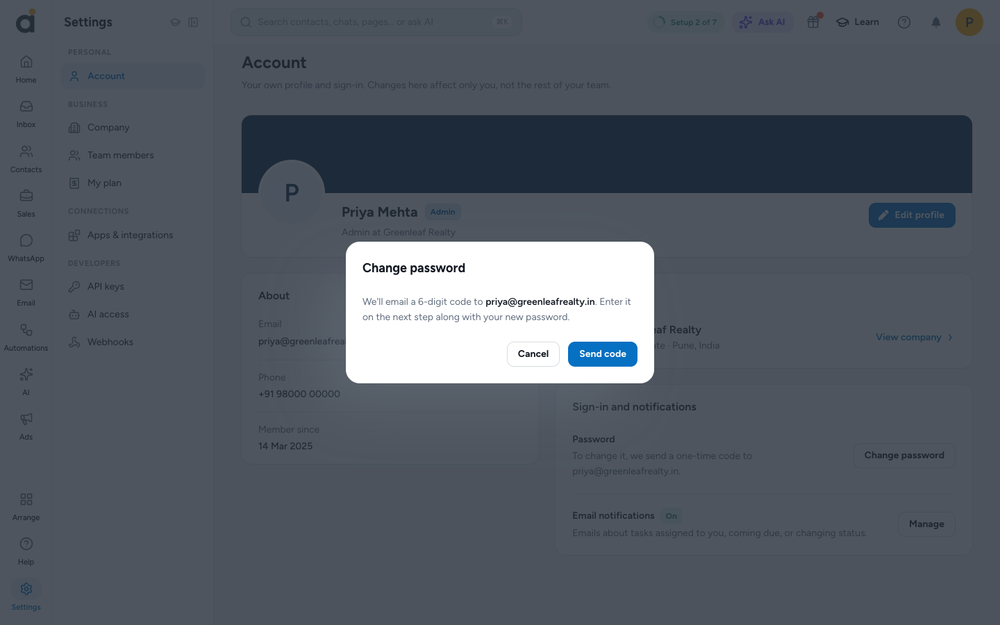
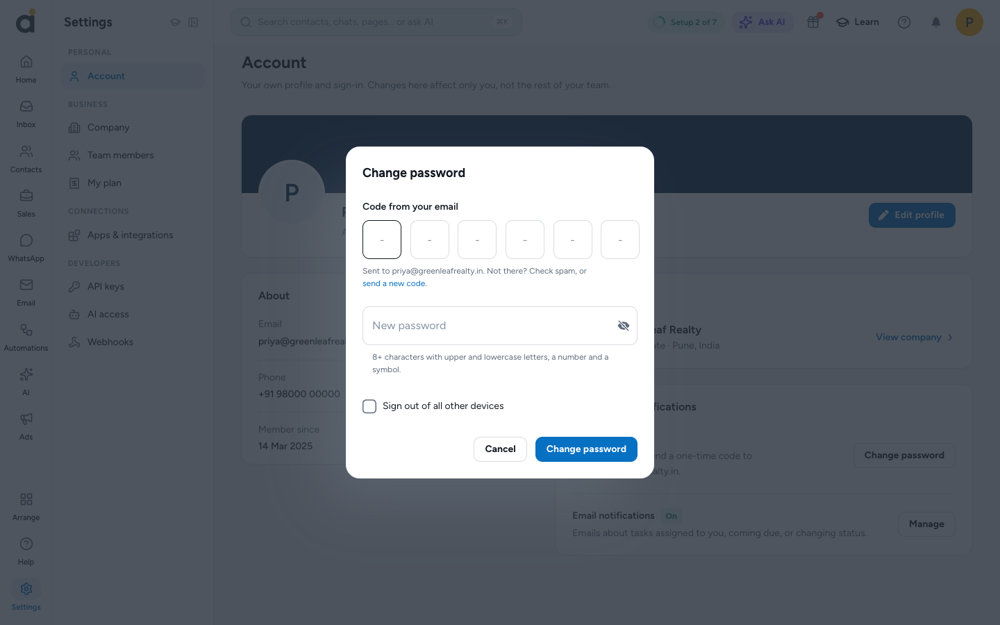
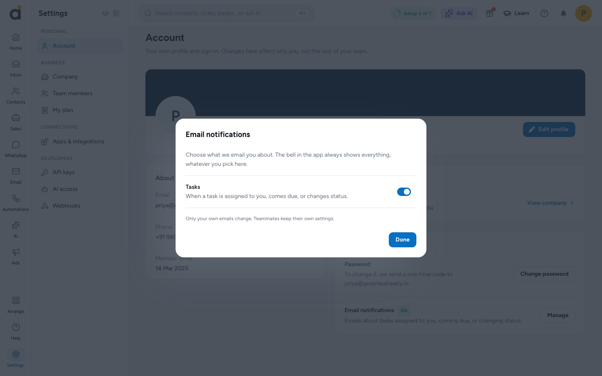

Your **Account** page is about you: your name, photo and phone, the email you sign in with, your password and the emails AdsEra sends you. Everyone on your team has their own Account page, so nothing you change here changes anything for them.

<Note>
  Looking for **API keys**, **AI access** or **Webhooks**? They used to be tabs on this page. Each one is now its own page under **Settings → Developers**: see [API keys](/help/account/api-keys), [Connect AI apps](/help/ai/connect-ai-apps) and [Webhooks](/help/account/webhooks).
</Note>

## Where to find it

Click **Settings** (the gear at the bottom of the menu on the left), then **Account** under **Personal**. Or click your photo in the top-right corner and pick **Settings**.

[Open your Account page &rarr;](https://app.adsera.in/setting/user/account)

## What's on the page

| Part | What it shows |
| --- | --- |
| **Top** | Your photo, name and role: **Admin** or **Team member**, and the company you work in. **Edit profile** is on the right. |
| **About** | **Email**: the email you sign in with (a green **Verified** tag once it's confirmed). **Phone**. **Member since**: the day your login was made. |
| **Company** | Your business name, industry and city. Admins see **View company**, which opens [Company](/help/account/company). |
| **Sign-in and notifications** | **Password** with **Change password**, and **Email notifications** (On or Off) with **Manage**. |

A row you haven't filled in shows **Not added**.

## Change your name, phone or photo

<Steps>
<Step title="Click Edit profile">
At the top of the Account page.

</Step>
<Step title="Change your photo (optional)">Click the round photo and pick a picture from your computer or phone. **JPG or PNG, up to 3 MB.**</Step>
<Step title="Change your name or phone">Type in **First name**, **Last name** or **Phone number** (pick the country first).</Step>
<Step title="Click Save changes">The button stays grey until you change something. You see "Profile updated" and the new photo shows straight away.</Step>
</Steps>

| Field | What it's for | Example | Required? |
| --- | --- | --- | --- |
| Photo | Shown to your team next to your name, in chats you handle and in the top bar. | A clear photo of your face | No |
| First name | Your first name. | Priya | Yes |
| Last name | Your last name. | Mehta | No |
| Phone number | How your team can reach you. | +91 98000 00000 | Yes |

Your sign-in **email** can't be changed here. If you need a different email, write to [contact@adsera.in](mailto:contact@adsera.in).

## Change your password

AdsEra doesn't ask for your old password. It emails you a 6-digit code instead, so this also works if you signed up with Google and never had a password.

<Steps>
<Step title="Click Change password">Under **Sign-in and notifications**.</Step>
<Step title="Click Send code">
The window says where the code goes: the email you sign in with.

</Step>
<Step title="Type the code and your new password">
One digit in each box under **Code from your email**. Then type the **New password**.

</Step>
<Step title="Sign out of other devices (optional)">Tick **Sign out of all other devices** if you might still be signed in somewhere else, like an old phone or a shared computer. You stay signed in where you are.</Step>
<Step title="Click Change password">You see "Password changed".</Step>
</Steps>

A new password needs **8 or more characters** with **a capital letter, a small letter, a number and a symbol** (like ! or @). If one is missing, the box says which, for example "Add a number".

## Choose which emails you get

<Steps>
<Step title="Click Manage next to Email notifications">

</Step>
<Step title="Turn Tasks on or off">On: AdsEra emails you when a task is assigned to you, comes due, or changes status. It saves the moment you flip the switch ("Task emails turned on").</Step>
<Step title="Click Done">The **Email notifications** row now says **On** or **Off**.</Step>
</Steps>

The bell in the top bar always shows everything, whatever you pick here. Your teammates keep their own settings.

## Troubleshooting

| What you see | What to do |
| --- | --- |
| No code in your email | Check the spam folder. Wait a minute, then click **send a new code** under the code boxes. |
| "Enter all 6 digits." | One of the six boxes is empty. |
| A red message after **Change password** | The code was wrong or too old. Click **send a new code** and try again with the newest code. |
| **Edit profile** or **Change password** isn't there | An admin has turned that off for you in your permissions. Ask an admin in your company. |
| The photo won't upload | Use a JPG or PNG smaller than 3 MB. |

## FAQs

<AccordionGroup>
  <Accordion title="Can I change the email I sign in with?">
    Not from the app. Write to [contact@adsera.in](mailto:contact@adsera.in) from your current email.
  </Accordion>
  <Accordion title="I forgot my password and can't sign in.">
    On the sign-in page, click **Forgot password?**. See [Forgot your password](/help/account/forgot).
  </Accordion>
  <Accordion title="Does changing my profile change anything for my team?">
    No. Only your own name, photo and phone change. Business details are on [Company](/help/account/company).
  </Accordion>
  <Accordion title="Where did the API key and webhook tabs go?">
    They're their own pages now: **Settings → API keys**, **AI access** and **Webhooks**.
  </Accordion>
</AccordionGroup>

## Related

<CardGroup cols={2}>
  <Card title="Company details" icon="building" href="/help/account/company">Your business name, address, GSTIN and time zone.</Card>
  <Card title="Team members" icon="users" href="/help/account/team">Give each teammate their own login.</Card>
  <Card title="Sign in" icon="right-to-bracket" href="/help/account/login">Email or Google sign-in.</Card>
  <Card title="Forgot your password" icon="key" href="/help/account/forgot">Reset it from the sign-in page.</Card>
</CardGroup>
