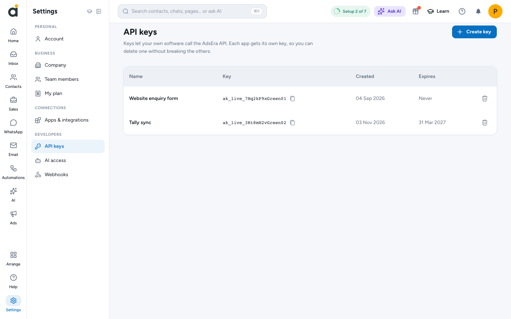
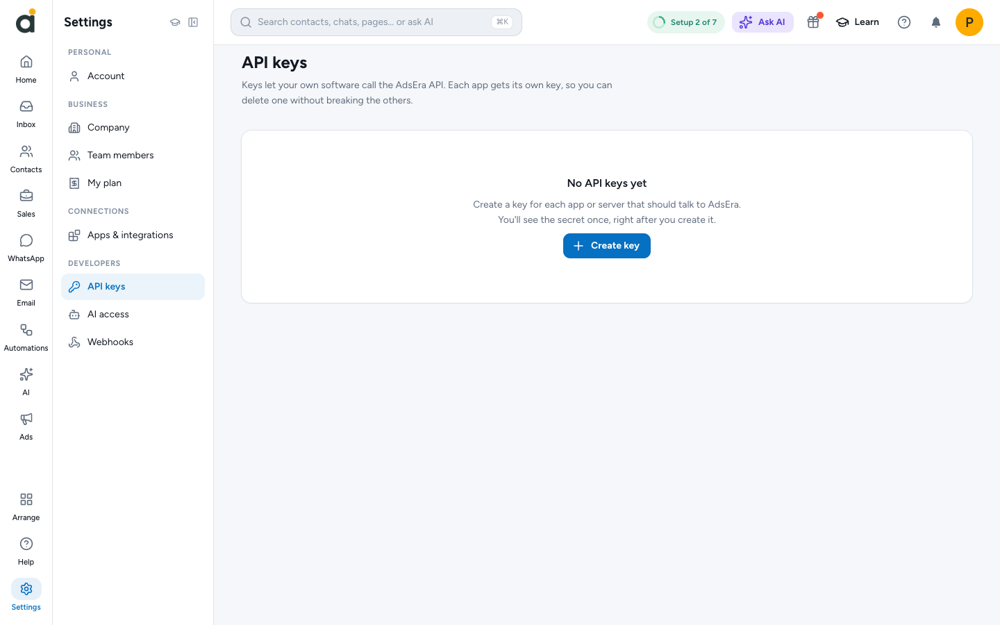
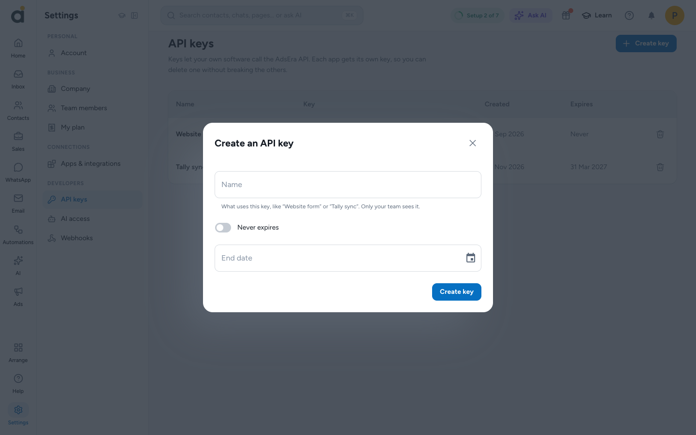
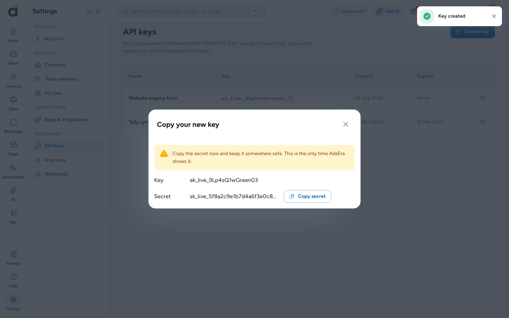
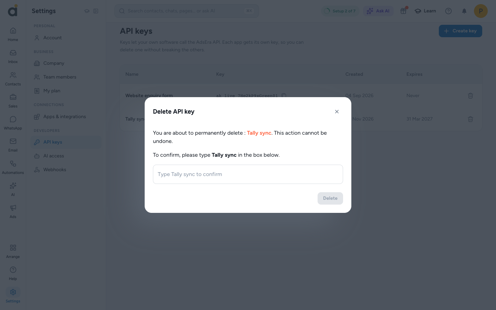

An **API key** lets your own website or software talk to AdsEra: for example, a website form that adds each enquiry as a contact, or your accounting software that reads orders. You only need one if a developer is connecting something to AdsEra. You don't need it to use AdsEra yourself.

A key has two parts: the **key** (like a username) and the **secret** (like a password). Your developer needs both.

## Where to find it

Click **Settings** (the gear at the bottom of the menu on the left), then **API keys** under **Developers**.

[Open API keys &rarr;](https://app.adsera.in/setting/api-keys)

With no keys yet, the page says "No API keys yet" with a **Create key** button.

## Create a key for your developer

<Steps>
<Step title="Click Create key">

</Step>
<Step title="Give it a name">What uses it, like "Website form" or "Tally sync". Only your team sees the name.</Step>
<Step title="Choose when it stops working">Pick an **End date**, or turn on **Never expires**. A key for a short project should have an end date.</Step>
<Step title="Click Create key">You see "Key created".</Step>
<Step title="Copy the secret now">
The window shows the **Key** and the **Secret**. Click **Copy secret**. **This is the only time AdsEra shows the secret.**

</Step>
<Step title="Send both to your developer privately">Use a private message or email to them only, never a group chat or a screenshot.</Step>
</Steps>

| Field | What it does | Example | Required? |
| --- | --- | --- | --- |
| Name | Tells you what uses the key. | Website enquiry form | Yes |
| Never expires | On: the key works until you delete it. Off at the start. | Off | No |
| End date | Off: the key stops working after this day. | 31 Mar 2027 | Yes, when Never expires is off |

Your developer's guide to using the key is the [API introduction](/api-reference/introduction).

## Copy or delete a key

- **Copy** (next to the key): copies the key again. The secret can't be shown again: if it's lost, create a new key and delete the old one.
- **Expires**: **Never**, a date, or a red **Expired …**. An expired key stops working.
- **Delete** (the bin): the "Delete API key" window asks you to type the key's name, then click **Delete**. Anything using that key stops working at once. Delete a key when a developer or an app no longer needs it.

## Troubleshooting

| What you see | What to do |
| --- | --- |
| "Pick an end date, or turn on Never expires." | Turn **Never expires** on, or pick a date. |
| "Give the key a name, like “Website form”" | Type a name. |
| Your developer says the key doesn't work | Check it hasn't expired. If the secret was lost, create a new key. |
| You can't see API keys in the menu | You need the API keys permission. Ask an admin. |

## FAQs

<AccordionGroup>
  <Accordion title="Is an API key the same as AI access?">
    No. AI apps like Claude or ChatGPT connect through **AI access**, where you sign in and click Allow. See [Connect AI apps](/help/ai/connect-ai-apps).
  </Accordion>
  <Accordion title="How many keys can I have?">
    Make one per app or developer, so you can delete one without breaking the others.
  </Accordion>
</AccordionGroup>

## Related

<CardGroup cols={2}>
  <Card title="Webhooks" icon="webhook" href="/help/account/webhooks">Send AdsEra events to your system.</Card>
  <Card title="API introduction" icon="code" href="/api-reference/introduction">For your developer.</Card>
  <Card title="Connect AI apps" icon="robot" href="/help/ai/connect-ai-apps">Claude, ChatGPT and Cursor.</Card>
  <Card title="Use AdsEra with your own CRM" icon="plug" href="/api-reference/connect-your-crm">For your developer.</Card>
</CardGroup>
