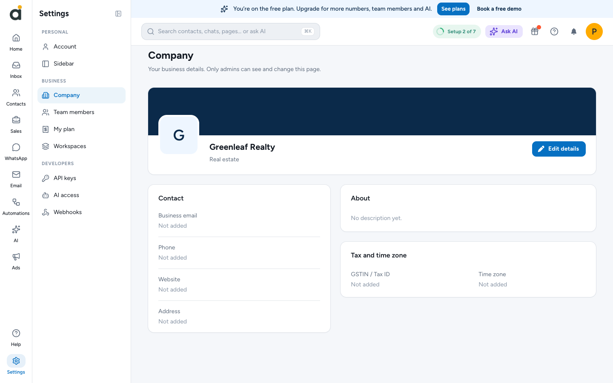
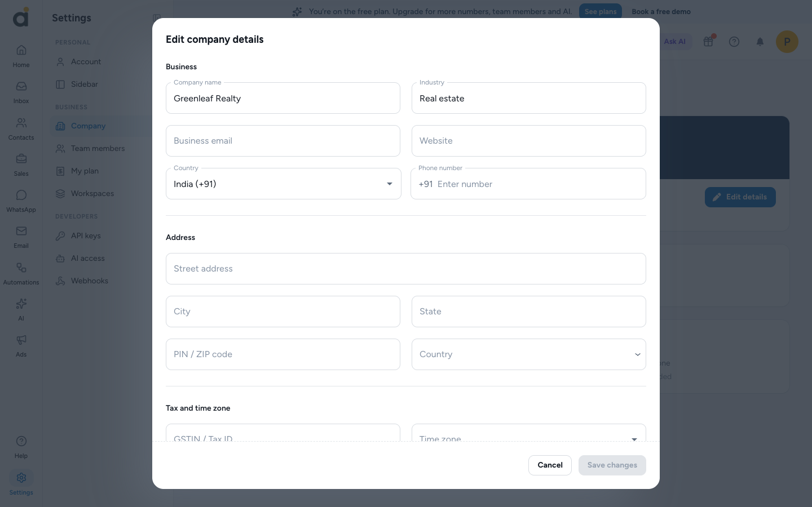

The **Company Settings** page allows you to manage the core details of your organization within AdsEra. Keeping this information accurate is important for billing, timezone-specific campaign scheduling, and overall account management.

**Want to manage billing & company profile? [Go to the AdsEra Company Page &rarr;](https://app.adsera.in/dashboard/company)**

### Navigating to Company Settings

You can access your company's settings directly from the main header bar in your dashboard.

Click **Settings** at the bottom of the menu on the left, then **Company**. (You can also click your **profile picture** in the top-right corner and choose **Company**.)

---

## Company Information Form

Click **Edit details** to change your company's details in one form.

### Basic Details
<ResponseField name="Name" type="string" required>
  The official name of your company or organization.
</ResponseField>

<ResponseField name="Email Address" type="string" required>
  The primary email address for your company. This may be used for billing and important notifications.
</ResponseField>

<ResponseField name="Phone Number" type="string" required>
  Your company's primary contact phone number, including the country code.
</ResponseField>

<ResponseField name="Website" type="string" required>
  The URL of your company's official website (e.g., `https://adsera.in`).
</ResponseField>

<ResponseField name="Industry" type="string" required>
  The industry your business operates in (e.g., "Information Technology", "E-commerce").
</ResponseField>

### Location & Timezone
<ResponseField name="Address" type="string" required>
  The physical street address of your company.
</ResponseField>

<ResponseField name="Country" type="string" required>
  The country where your company is located.
</ResponseField>

<ResponseField name="State/Region" type="string" required>
  The state, province, or region.
</ResponseField>

<ResponseField name="City" type="string" required>
  The city where your company is based.
</ResponseField>

<ResponseField name="Zip/Code" type="string" required>
  The postal or zip code for your address.
</ResponseField>

<ResponseField name="Time Zone" type="string" required>
  Select your company's primary time zone. This is crucial for accurate campaign scheduling and reporting.
</ResponseField>

### Billing & Invoicing
<Note>
  "Accuracy in your billing details isn't just about numbers; it's about seamless operations. The information here ensures your invoices are correct and your service remains uninterrupted."
</Note>

<ResponseField name="GST (TAX ID)" type="string">
  Your company's Goods and Services Tax number or other relevant tax identification number. This will appear on all official invoices.
</ResponseField>

<ResponseField name="About" type="string">
  A brief description of your company. This is for internal reference.
</ResponseField>

---

### Saving Your Changes

After you have finished updating your company's information, click the **Save Changes** button at the bottom of the page to apply your updates.