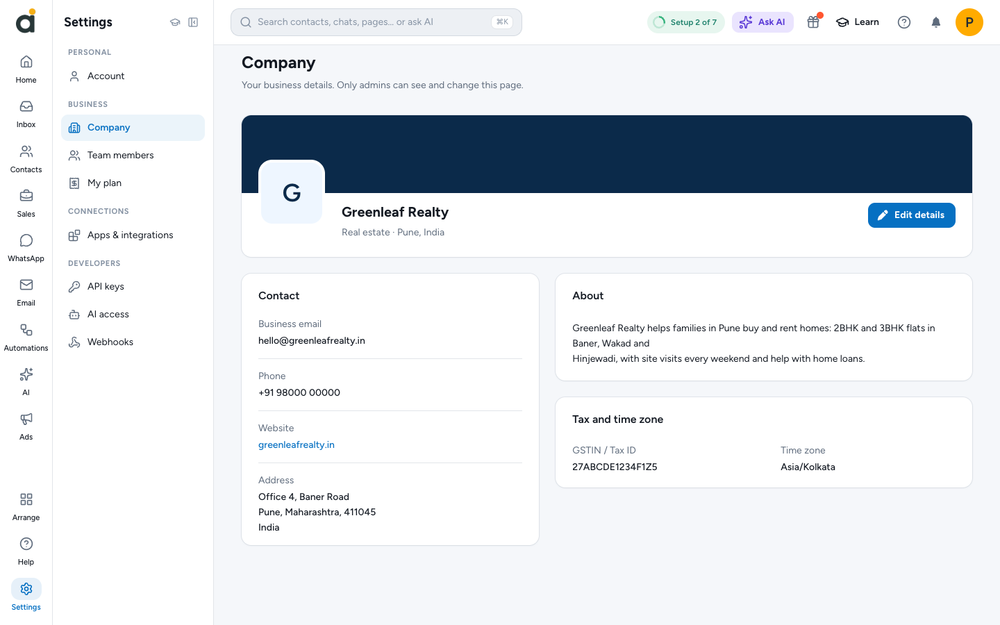
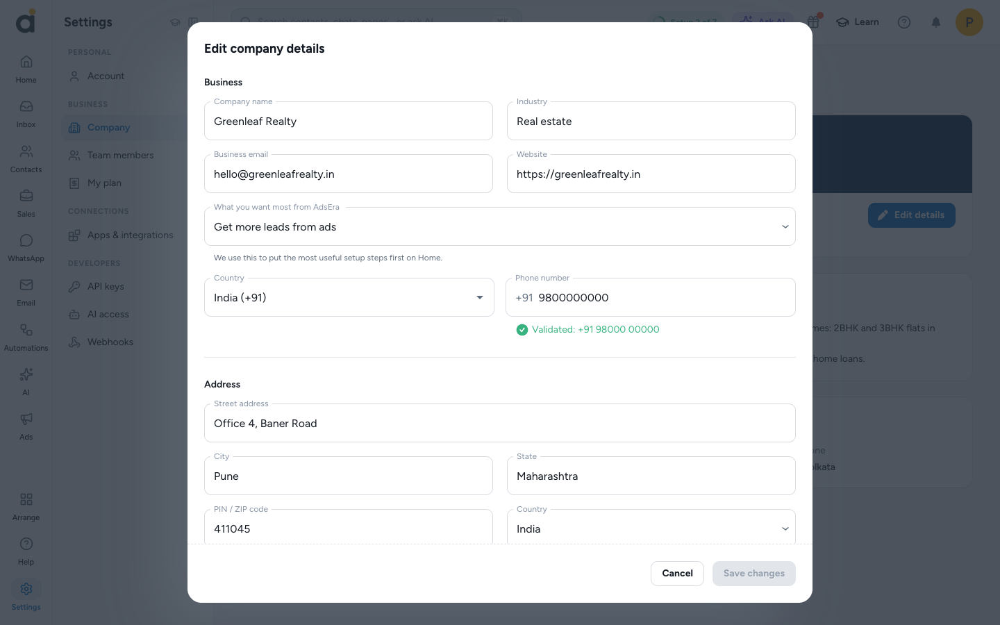
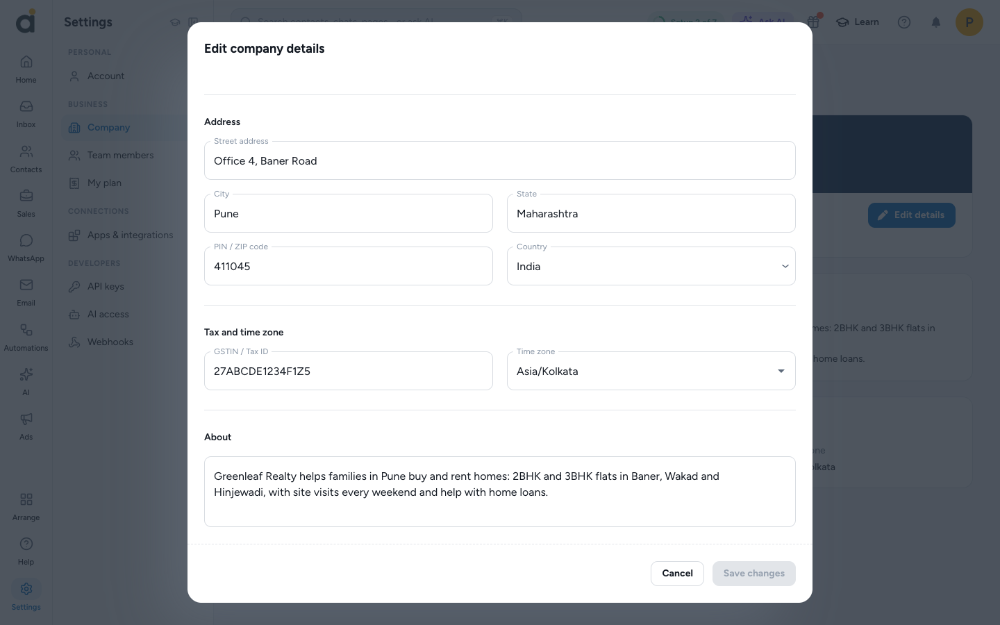

The **Company** page holds your business details: name, industry, business email and phone, website, address, GSTIN and time zone. It also has one choice that changes AdsEra for you: **What you want most from AdsEra**, which decides the order of the setup steps on Home.

Only **admins** can see and change this page. Team members don't see it in their menu.

## Where to find it

Click **Settings** (the gear at the bottom of the menu on the left), then **Company** under **Business**. Or click your photo in the top-right corner and pick **Company**.

[Open Company &rarr;](https://app.adsera.in/setting/company)

| Part | What it shows |
| --- | --- |
| **Top** | Your business name, industry and city, and **Edit details**. |
| **Contact** | **Business email**, **Phone**, **Website** (click to open it) and **Address**. |
| **About** | A few lines on what you do, or "No description yet." |
| **Tax and time zone** | **GSTIN / Tax ID** and **Time zone**. |

## Change your company details

<Steps>
<Step title="Click Edit details">
The **Edit company details** window opens with four groups: Business, Address, Tax and time zone, About.

</Step>
<Step title="Fill in Business">Company name, Industry, Business email, Website and Phone number. Pick **What you want most from AdsEra**.</Step>
<Step title="Fill in Address, Tax and time zone, About">
Scroll down in the window.

</Step>
<Step title="Click Save changes">It stays grey until you change something. You see "Company details updated".</Step>
</Steps>

### Every field

| Field | What it's for | Example | Required? |
| --- | --- | --- | --- |
| Company name | Your business name across AdsEra. | Greenleaf Realty | Yes |
| Industry | What kind of business you are. | Real estate | Yes |
| Business email | Your company's main email. **Invoices are emailed here** (and to the person who asks). | hello@greenleafrealty.in | Yes |
| Website | Your website. | https://greenleafrealty.in | Yes |
| What you want most from AdsEra | Puts the most useful setup steps first on Home. Choices: **Get more leads from ads**, **Reply faster on WhatsApp**, **Send offers and updates**, **Follow up with every lead**. | Get more leads from ads | No |
| Phone number | Your business phone. Pick the country first. | +91 98000 00000 | Yes |
| Street address | Your office address. | Office 4, Baner Road | Yes |
| City | | Pune | Yes |
| State | | Maharashtra | Yes |
| PIN / ZIP code | | 411045 | Yes |
| Country | | India | Yes |
| GSTIN / Tax ID | Your GST number. | 27ABCDE1234F1Z5 | No |
| Time zone | The time zone AdsEra uses for your business: booking times, task reminder emails and Closer's sending times. | Asia/Kolkata | No |
| About | A few lines on what you do. | We help families in Pune buy and rent homes. | No |

<Tip>
  The GSTIN printed on your **AdsEra invoices** comes from **Settings → My plan → Billing details**. If you want it on invoices, add it there too. See [Plan and billing](/help/account/plan).
</Tip>

## What "What you want most" changes

It only changes the **order** of the **Get started** steps on Home. All steps stay; the ones that matter most for your goal come first. For example, **Get more leads from ads** puts *Connect WhatsApp*, *Switch on Addy* and *Welcome message* first, while **Send offers and updates** puts *Contacts*, *Template* and *Broadcast* right after *Connect WhatsApp*.

## Troubleshooting

| What you see | What to do |
| --- | --- |
| "Enter your website" (or another "Enter …") | That field is needed. Fill it in. |
| **Save changes** stays grey | Nothing has changed yet. |
| You can't find **Company** in the menu | Only admins see it. Ask an admin in your company. |
| "Could not load your company details." | Click **Try again**. If it keeps happening, write to contact@adsera.in. |

## FAQs

<AccordionGroup>
  <Accordion title="Who can change the company details?">
    Only admins. Make someone an admin in [Team members](/help/account/team).
  </Accordion>
  <Accordion title="Does the time zone change when my broadcasts go out?">
    A scheduled broadcast goes out at the date and time you pick when you schedule it. The company time zone is used for things like booking times, task reminder emails and when Closer sends.
  </Accordion>
  <Accordion title="Why are there two places for GSTIN?">
    **Company** is your profile. **My plan → Billing details** is what's printed on your AdsEra invoices. Fill in both.
  </Accordion>
</AccordionGroup>

## Related

<CardGroup cols={2}>
  <Card title="Plan and billing" icon="receipt" href="/help/account/plan">Billing details, GSTIN on invoices, and invoices.</Card>
  <Card title="Team members" icon="users" href="/help/account/team">Make someone an admin.</Card>
  <Card title="Your account" icon="user" href="/help/account/account">Your own profile and password.</Card>
  <Card title="The dashboard" icon="house" href="/help/dashboard">The Get started steps on Home.</Card>
</CardGroup>
