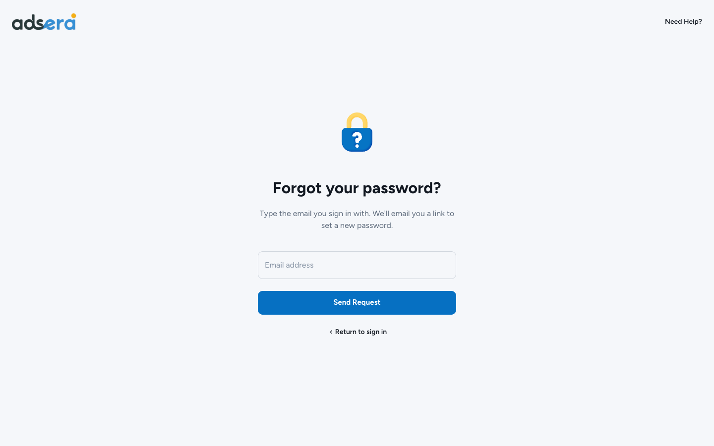
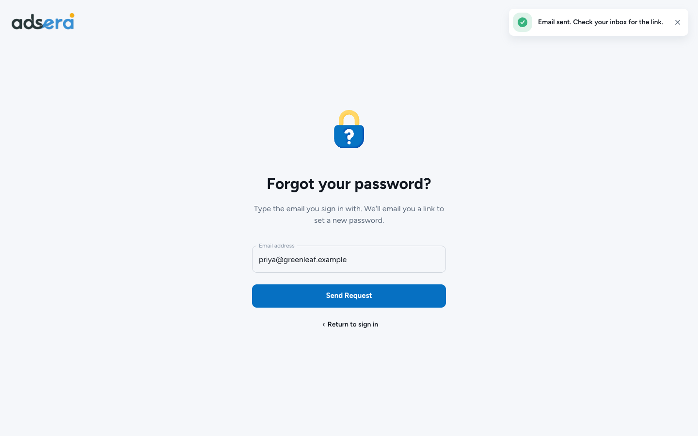
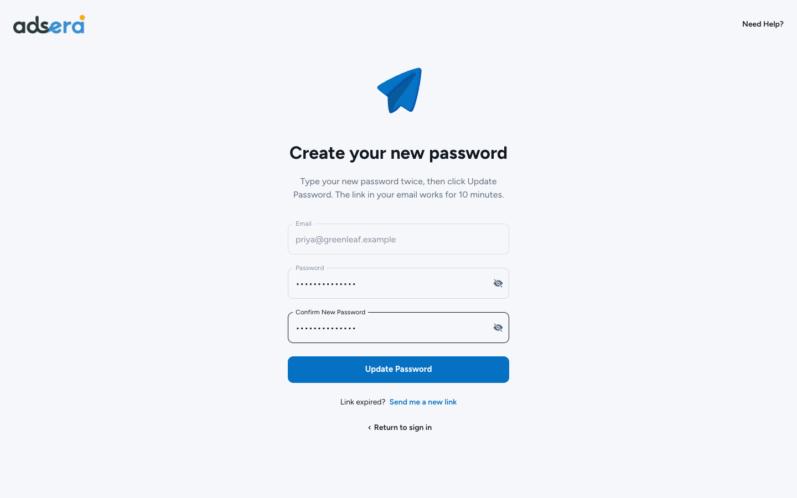

Forgot your password? Ask for a link by email, open it, and type a new password. It takes a minute.

**Where:** on the sign-in page click **Forgot password?**, or open [app.adsera.in/auth/reset-password](https://app.adsera.in/auth/reset-password).

<Steps>
<Step title="Type your email">
  On **Forgot your password?**, type the **Email address** you sign in with and click **Send Request**.

  
</Step>

<Step title="Check your email">
  A message at the bottom of the page says the email was sent.

  

  Open the email from AdsEra and click the link. The link works for **10 minutes**. No email? Look in spam.
</Step>

<Step title="Choose a new password">
  The link opens **Create your new password**. Your email is already filled in. Type the new **Password**, type it again in **Confirm New Password**, and click **Update Password**.

  

  Link too old? Click **Send me a new link** on the same page.
</Step>

<Step title="Sign in">
  AdsEra takes you back to the sign-in page. Sign in with your email and the new password.
</Step>
</Steps>

## Password rules

At least 8 characters, with a capital letter, a small letter, a number and a symbol like @ $ #. For example: `Greenleaf@2026`.

## Troubleshooting

| What you see | What to do |
| --- | --- |
| No email arrives | Check spam. The page says the email was sent even if no AdsEra login uses that email (so nobody can test which emails exist): check you typed the email you sign in with. |
| "Too many reset requests. Try again later." | You asked several times in a row. Wait a while, then use the newest email only. |
| The link says it has expired | Links work for 10 minutes. Click **Send me a new link**, or start again from **Forgot password?**. |
| "Passwords must match" | The two password boxes are different. Type the same password in both. |
| You're a team member and never had a password | Ask your admin for the first password, or use this page with the email they added you with. |

## FAQs

<AccordionGroup>
<Accordion title="What happens to AI apps I connected?">
  A new password signs out the AI apps you connected in **Settings → AI access**. Connect them again. See [Connect AI apps](/help/ai/connect-ai-apps).
</Accordion>
<Accordion title="I signed up with Google. Do I need this?">
  No. Click **Continue with Google** on the sign-in page.
</Accordion>
</AccordionGroup>

## Related

<CardGroup cols={2}>
  <Card title="Sign in" icon="arrow-right-to-bracket" href="/help/account/login">Back to the sign-in page.</Card>
  <Card title="Account" icon="user" href="/help/account/account">Change your password while signed in.</Card>
</CardGroup>
