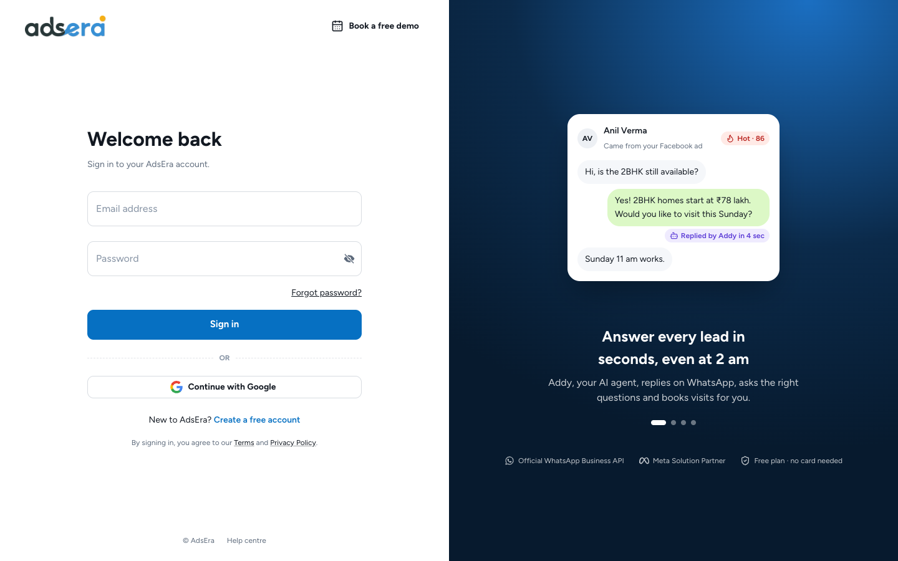

Sign in at **app.adsera.in** with the email and password of your login, or with the Google account you signed up with. Each teammate has their own login (an admin adds them in [Team members](/help/account/team)).

[Open the sign-in page &rarr;](https://app.adsera.in/auth/login)

## Sign in with your email

<Steps>
  <Step title="Type your Email address">The email of your login. A team member uses the email their admin added them with.</Step>
  <Step title="Type your Password">Click the eye to see what you typed.</Step>
  <Step title="Click Sign in">Home opens.</Step>
</Steps>

## Sign in with Google

Click **Continue with Google** under the form, pick your Google account and allow it. This works if you signed up with Google, or if your login uses the same email as your Google account.

## Other links on the page

| Link | What it does |
| --- | --- |
| **Forgot password?** | Reset a forgotten password. See [Forgot your password](/help/account/forgot). |
| **Create a free account** | Make a new AdsEra account. See [Create your account](/help/account/register). |
| **Terms**, **Privacy Policy** | Our terms and privacy policy. |

## A yellow message above the form

If AdsEra signed you out (for example your password was changed with **Sign out of all other devices**, or an admin disabled your account), a yellow message above the form says why. Close it with the ×.

## Troubleshooting

| What you see | What to do |
| --- | --- |
| A red message after **Sign in** | The email or password is wrong. Check for spaces, or use **Forgot password?**. |
| "Your account has been disabled. Ask an admin in your workspace to turn it back on." | An admin turned your login off. Ask them to click **⋮ → Enable account** in Team members. |
| Google sign-in opens a new account | You used a different Google account. Sign out of Google and pick the one with your AdsEra email. |

## Related

<CardGroup cols={2}>
  <Card title="Forgot your password" icon="lock-keyhole" href="/help/account/forgot">Reset it by email.</Card>
  <Card title="Create your account" icon="user-plus" href="/help/account/register">Sign up for AdsEra.</Card>
  <Card title="Your account" icon="user" href="/help/account/account">Change your password once you're in.</Card>
  <Card title="Team members" icon="users" href="/help/account/team">Give teammates their own login.</Card>
</CardGroup>
