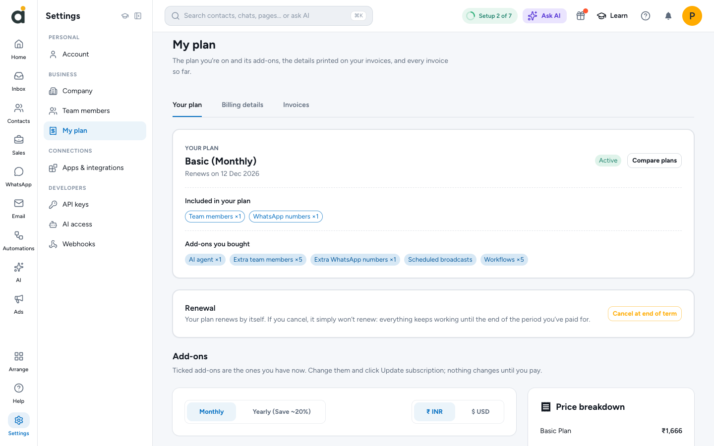
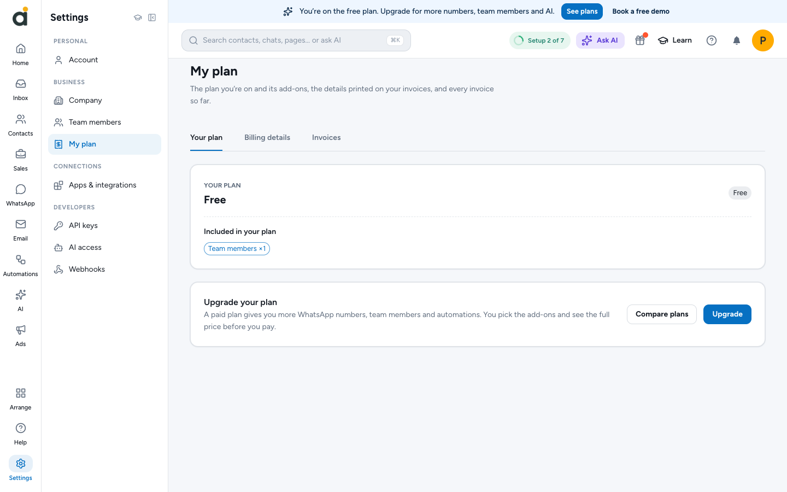
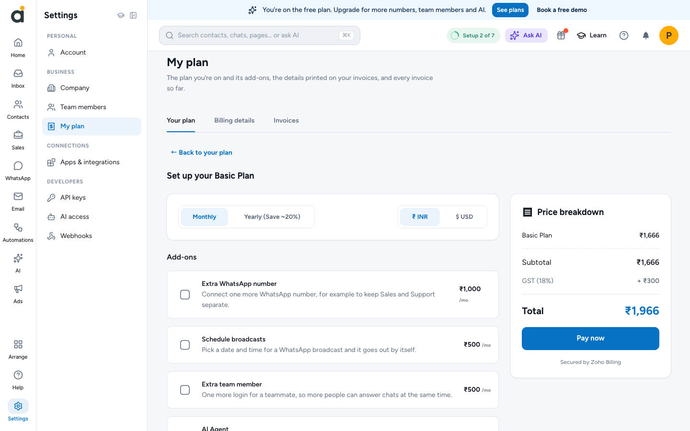
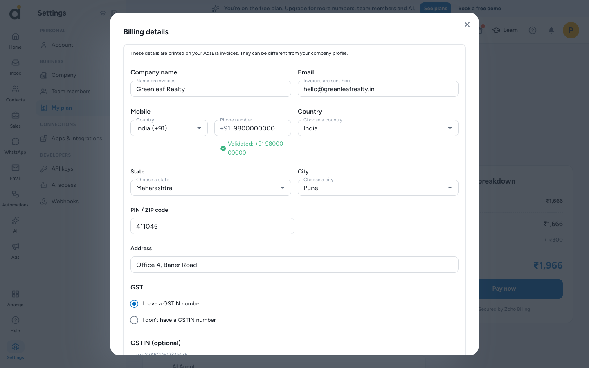
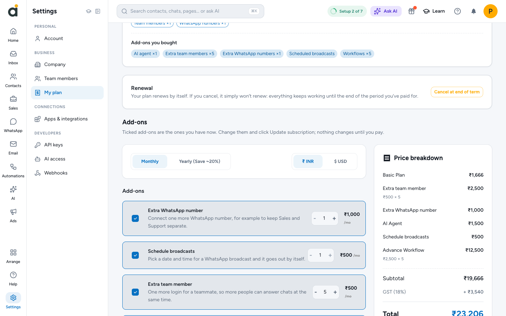
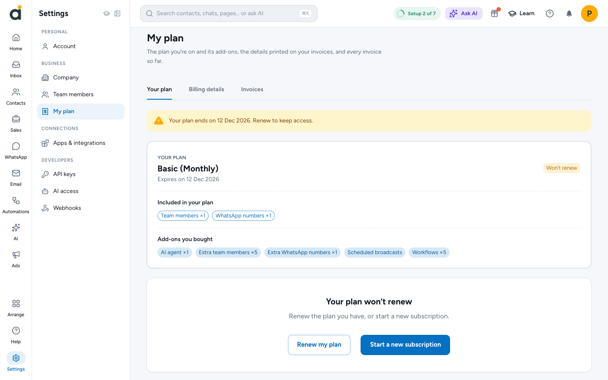
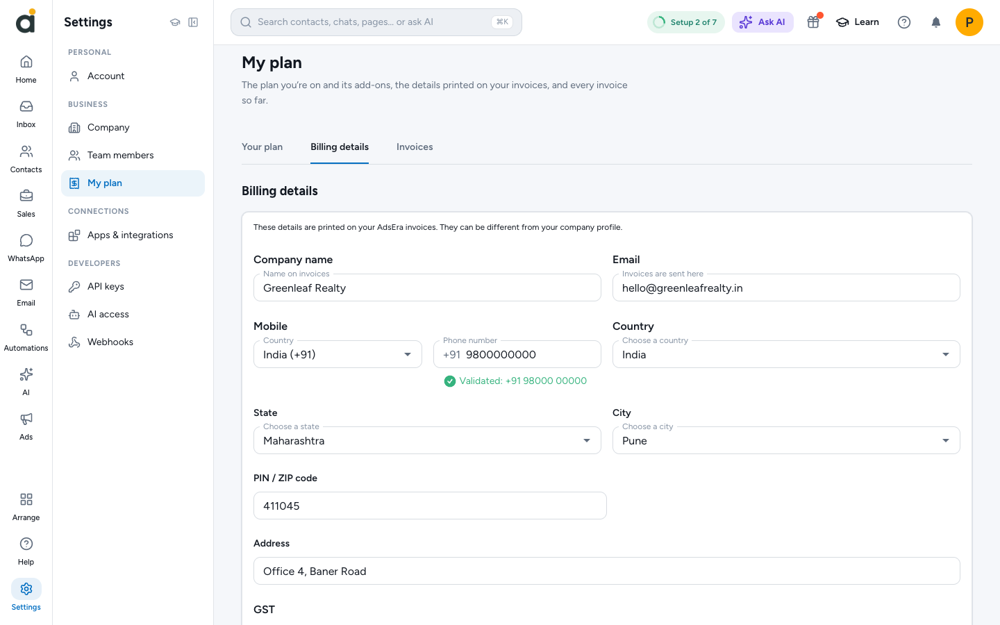
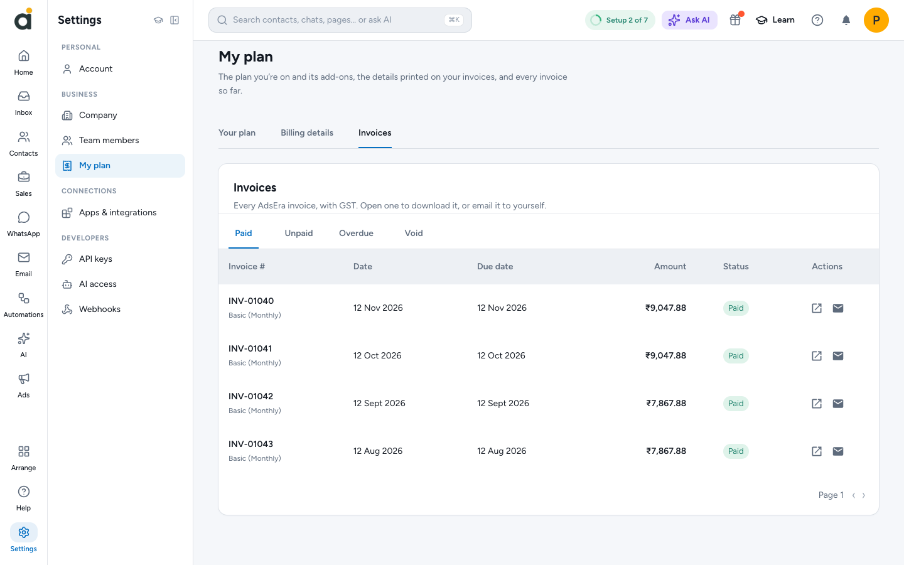
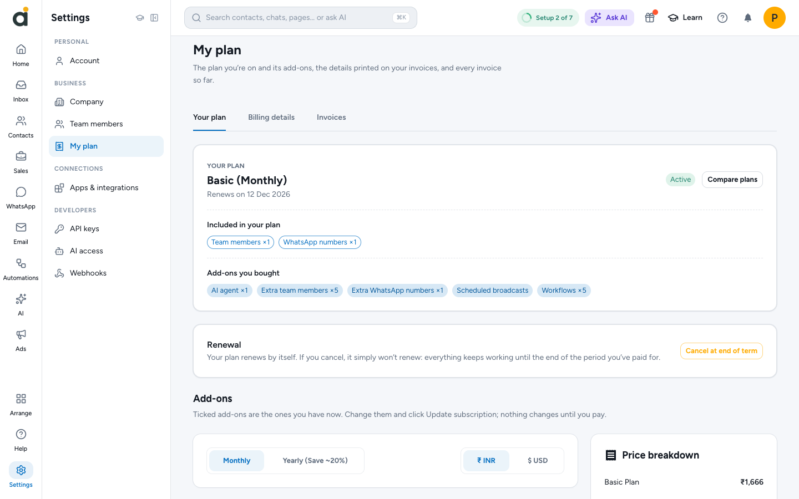

**My plan** is where you see what you pay for and change it: your plan and when it renews, the add-ons you have, the details printed on your invoices, and every invoice so far.

Only **admins** (and team members given the "Plan & add-ons" permission) see it. For prices and what each plan includes, see [Pricing & Plans](/help/introduction/price).

## Where to find it

Click **Settings** (the gear at the bottom of the menu on the left), then **My plan** under **Business**. Or click your photo in the top-right corner and pick **My plan**.

[Open My plan &rarr;](https://app.adsera.in/setting/my-plan)

The page has three tabs: **Your plan**, **Billing details** and **Invoices**.

## Your plan

| Part | What it shows |
| --- | --- |
| **Your plan** | The plan you're on, for example **Basic (Monthly)**, and **Renews on** (or **Expires on**) a date. |
| Status | **Active**, **Won't renew** (you cancelled; it still works until the date), **Cancelled**, **Expired**, **Payment due** (a payment failed) or **Free**. |
| **Included in your plan** | What the plan itself includes, like **Team members ×1** and **WhatsApp numbers ×1**. |
| **Add-ons you bought** | Extras you pay for, like **Extra team members ×5** or **Scheduled broadcasts**. |
| **Compare plans** | Opens the **Choose your plan** page with every plan. |
| **Renewal** | Your plan renews by itself. **Cancel at end of term** stops the renewal. |
| **Add-ons** | Every add-on you can buy; the ticked ones are the ones you have. |

<Note>
  The app shows the plans as **Basic** and **Advance**. On the pricing page they are called **Growth** and **Pro**: they're the same plans.
</Note>

### On the free plan

If you haven't bought a plan yet, **Your plan** says **Free** and shows **Upgrade your plan** with two buttons: **Compare plans** and **Upgrade**. Nothing is charged until you finish paying.

## Upgrade to a paid plan

<Steps>
<Step title="Click Upgrade">On **My plan** (or click **See plans** in the bar at the top of AdsEra).</Step>
<Step title="Pick monthly or yearly, and the currency">
**Monthly** or **Yearly (Save ~20%)**, and **₹ INR** or **$ USD**.

</Step>
<Step title="Tick the add-ons you want">Nothing is ticked at the start. Use **+** and **−** for how many (for example 3 extra team members).</Step>
<Step title="Check the Price breakdown">The plan, each add-on, **GST (18%)** for INR, and the **Total**.</Step>
<Step title="Click Pay now">
A window asks for your **Billing details** (the name, address and GSTIN on your invoice). Click **Save billing details**, then pay in the secure payment window.

</Step>
<Step title="Close the payment window when it's done">You see "Payment submitted. Refresh the page to see your updated plan." Refresh, and **Your plan** shows the new plan.</Step>
</Steps>

**← Back to your plan** takes you back without paying.

## Add, remove or change add-ons

On a paid plan, scroll down to **Add-ons**. The ticked ones are what you pay for now.

1. Tick an add-on to add it, untick to remove it, or change how many with **+** / **−**.
2. The **Price breakdown** shows the new total for each period.
3. Click **Update subscription** and pay. It stays grey until you change something. Nothing changes until you pay.

| Add-on | What it gives you |
| --- | --- |
| **Extra WhatsApp number** | Connect one more WhatsApp number, for example to keep Sales and Support separate. |
| **Schedule broadcasts** | Pick a date and time for a WhatsApp broadcast and it goes out by itself. |
| **Extra team member** | One more login for a teammate. |
| **AI Agent** | Addy, the AI agent that answers on your WhatsApp number. |
| **Advance Workflow** | More [workflows](/help/automation/workflows). |

Prices per add-on are on [Pricing & Plans](/help/introduction/price). On a **yearly** plan you can't switch back to monthly here.

## Cancel, renew or restart

- **Cancel at end of term** (under **Renewal**): asks first, then your plan **won't renew**. Everything keeps working until the end of the period you've paid for. The status becomes **Won't renew**.
- When a plan won't renew, has ended, or a payment failed, **Your plan** shows two choices:

| Choice | What it does |
| --- | --- |
| **Renew my plan** | Pay for the same plan and add-ons again. |
| **Start a new subscription** | Start a new **Basic Plan** subscription and tick the add-ons again from scratch. |

- A few days before your plan ends, a bar at the top of AdsEra says "Your plan ends on …" with **Renew now**, which opens the renewal straight away.

## Billing details (GSTIN on invoices)

The **Billing details** tab holds what's printed on your AdsEra invoices. It can be different from your [Company](/help/account/company) page.

| Field | What it's for | Example | Required? |
| --- | --- | --- | --- |
| Company name (Name on invoices) | Your business name on the invoice. | Greenleaf Realty | Yes |
| Email | Where invoices go. | hello@greenleafrealty.in | Yes |
| Mobile | | +91 98000 00000 | Yes |
| Country, State, City | Pick from the lists. | India, Maharashtra, Pune | No |
| PIN / ZIP code, Address | | 411045, Office 4, Baner Road | No |
| GST | **I have a GSTIN number** or **I don't have a GSTIN number**. | I have a GSTIN number | Yes |
| GSTIN | Printed on the invoice so you can claim input credit. | 27ABCDE1234F1Z5 | No |
| Other tax ID | Only if you have no GSTIN (for example a VAT number outside India). | | No |

Click **Save billing details**. You see "Billing details saved". The next invoices use them.

## Invoices

- Pick **Paid**, **Unpaid**, **Overdue** or **Void** (cancelled).
- The **open** button opens the invoice in a new tab: download or print it there.
- The **envelope** (paid invoices) emails it to your company email and to you: "Invoice sent to your company email and your own."
- Use **‹** and **›** at the bottom for older invoices.

## Compare plans

Click **Compare plans** on your plan card. It opens **Choose your plan**: every plan with its price, and three boxes underneath:

- **WhatsApp message charges**: Meta charges for some WhatsApp messages (such as marketing templates), separately from your AdsEra plan. **See Meta's rates**.
- **Not sure which plan?** **Book a free call** with our team.
- **How plans work**: **Read the guide** (the pricing page).

The arrow next to **Choose your plan** takes you back to AdsEra.

## Troubleshooting

| What you see | What to do |
| --- | --- |
| **Update subscription** is grey | You haven't changed an add-on yet. |
| "Your last payment didn't go through" | Click **Renew my plan** and pay again. |
| The plan didn't change after paying | Refresh the page. If it still shows the old plan after a few minutes, write to contact@adsera.in with the invoice number. |
| My plan isn't in your menu | Only admins (or members given the Plan & add-ons permission) see it. |
| No invoices | You haven't paid for a plan yet, or you're on the wrong tab (try **Paid**). |

## FAQs

<AccordionGroup>
  <Accordion title="Will I lose my contacts or chats if I change or cancel my plan?">
    No. Your contacts, chats and automations stay as they are.
  </Accordion>
  <Accordion title="Is GST added?">
    Yes, 18% GST is added for payments in INR. Put your GSTIN in **Billing details** to have it on the invoice.
  </Accordion>
  <Accordion title="Does AdsEra charge for WhatsApp messages?">
    Meta charges for some WhatsApp messages, separately from your plan. AdsEra adds no markup.
  </Accordion>
  <Accordion title="What happens when I cancel?">
    Your plan won't renew. Everything keeps working until the end of the period you paid for.
  </Accordion>
</AccordionGroup>

## Related

<CardGroup cols={2}>
  <Card title="Pricing & Plans" icon="tags" href="/help/introduction/price">Prices and what each plan includes.</Card>
  <Card title="AI credits" icon="bolt" href="/help/ai/credits">Credits for Addy, Closer and Ask AI.</Card>
  <Card title="Team members" icon="users" href="/help/account/team">Use your extra team member seats.</Card>
  <Card title="Company details" icon="building" href="/help/account/company">Your business profile.</Card>
</CardGroup>
