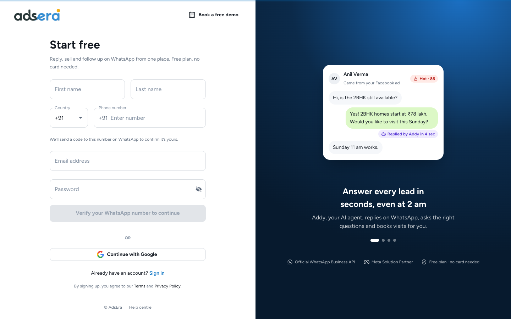
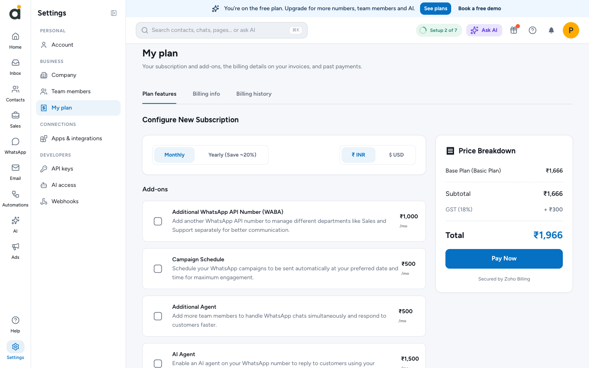

Welcome to AdsEra! Creating an account is a simple, multi-step process. You can either register with your **email and password** or use your **Google account** for a faster setup.

**Ready to create your account? [Go to the AdsEra Registration Page &rarr;](https://app.adsera.in/auth/register)**

Follow the guide below that matches your preferred method.

---

<Tabs>
<Tab title="Email & Password Signup">

Fill in one short form and confirm your WhatsApp number. That's it: no email code, and no card needed.

### Step 1: Fill in the form

<Steps>
    <Step title="Your name">
        Enter your **First name** and **Last name**.
    </Step>
    <Step title="Your WhatsApp number">
        Pick your country code and enter your **phone number**. AdsEra sends a code to this number **on WhatsApp**. Type it in to confirm the number is yours.
    </Step>
    <Step title="Email and password">
        Enter your **Email address** and choose a **Password**.
    </Step>
    <Step title="Create your account">
        Click **Create my account**. The button turns on once your WhatsApp number is confirmed.
    </Step>
</Steps>

<Info>
  Didn't get the WhatsApp code? Check the number and country code, then ask for a new code.
</Info>

---

### Step 2: Tell us about your business

The first time you open AdsEra, three quick questions help us show you the best way to start: what kind of business you run, how many people will use AdsEra, and what you want most from it. You can skip them. See [Dashboard](/help/dashboard).

---

### Step 3: Choose a plan when you're ready

You start on the free plan, with a **Get started** checklist on Home. To send messages and use the full platform, choose a plan (**Growth** or **Pro**) under **Billing**. See [Pricing & Plans](/help/introduction/price). Your registration is now complete!

</Tab>

<Tab title="Sign-up with Google">

This method allows you to create an account using your existing Google profile, which simplifies the initial steps.

### Step 1: Authenticate with Google

Begin by selecting the Google sign-up option on the registration page.

1.  Click **Continue with Google**.
2.  A pop-up window will appear. Choose the Google account you wish to use.
3.  Grant the necessary permissions to link your Google account with AdsEra.

---

### Step 2: Provide Additional Details

After authenticating with Google, we just need a few more details to complete your profile.

<Steps>
    <Step title="Enter Company and Phone">
        Fill in your **Company name** and **Phone number**. Your country should be pre-selected.
    </Step>
    <Step title="Save Your Information">
        Click the **Save** button to finalize your account details.
    </Step>
</Steps>

---

### Step 3: Select Your Plan

Just like with the email sign-up, you'll be directed to the **Plans & Subscriptions** page after saving your details.

Your account starts with limited access. Choose a plan under **Billing** to send messages and use the full platform. Your registration is now complete!

</Tab>
</Tabs>

---

### Next Steps

<CardGroup>
  <Card title="Sign In to Your Account" icon="key" href="/help/account/login">
    Now that your account is created, learn how to sign in.
  </Card>
</CardGroup>