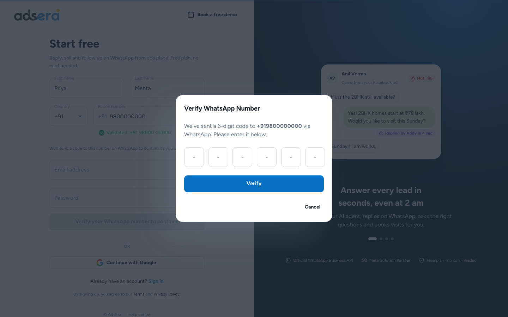
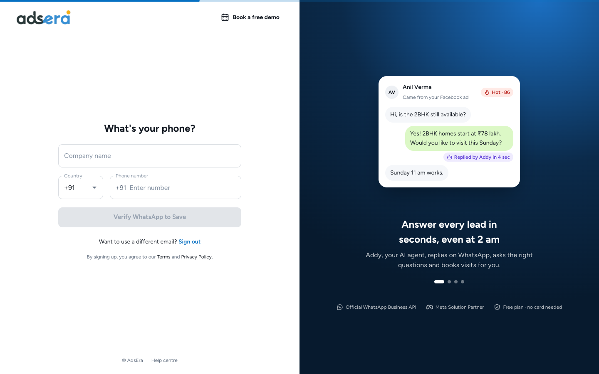

You can sign up in two ways: with your **email and a password**, or with **Continue with Google**. Both ask you to confirm your WhatsApp number with a 6-digit code sent on WhatsApp. There is no email code and no card needed.

**Where:** [app.adsera.in/auth/register](https://app.adsera.in/auth/register). The sign-up page is called **Start free**.

<Tabs>
<Tab title="Sign up with email">

<Steps>
<Step title="Your name">
  Enter your **First name** and **Last name**.
</Step>
<Step title="Your WhatsApp number">
  Pick your country code and type your **phone number**. When you leave the phone box, AdsEra sends a 6-digit code to this number **on WhatsApp**, and the **Verify WhatsApp Number** window opens.

  

  Type the code (one digit per box) and click **Verify**. The phone box then locks, so you can't change the number by mistake.
</Step>
<Step title="Email and password">
  Enter your **Email address** and choose a **Password**.
</Step>
<Step title="Create your account">
  Click **Create my account**. Until the number is confirmed, the button says **Verify your WhatsApp number to continue** and can't be clicked.
</Step>
</Steps>

</Tab>

<Tab title="Sign up with Google">

<Steps>
<Step title="Continue with Google">
  Click **Continue with Google** and pick your Google account in the window that opens.
</Step>
<Step title="Company and phone">
  AdsEra asks for two more details: your **Company name** and your **Phone number** (the country is picked for you).

  
</Step>
<Step title="Confirm the number, then Save">
  When you leave the phone box, the same **Verify WhatsApp Number** window asks for the 6-digit code sent on WhatsApp. Until the number is confirmed, the button says **Verify WhatsApp to Save**. After that, click **Save**.
</Step>
</Steps>

</Tab>
</Tabs>

## The fields

| Field | What to enter | Example | Required? |
| --- | --- | --- | --- |
| **First name** / **Last name** | Your own name | Priya / Mehta | Yes |
| **Phone number** | Your WhatsApp number, with the right country code | +91 98000 00000 | Yes |
| **Email address** | The email you'll sign in with | priya@greenleafrealty.in | Yes |
| **Password** | At least 8 characters, with a capital letter, a small letter, a number and a symbol like @ $ # | Example@123 | Yes |
| **Company name** (Google sign-up only) | Your business name | Greenleaf Realty | Yes |

## What happens next

1. **Tell us about your business.** The first time you open AdsEra, three quick questions (what kind of business you run, how many people will use AdsEra, what you want most) help us show you the best way to start. You can skip them. See [Dashboard](/help/dashboard).
2. **Your plan.** Your account starts without a paid plan (the app shows **Free**), with a **Get started** checklist on Home. When you're ready, click **See plans** in the bar at the top or go to **Settings → My plan → Upgrade**. See [Plan and billing](/help/account/plan) and [Pricing & Plans](/help/introduction/price).

## Troubleshooting

| What you see | What to do |
| --- | --- |
| No WhatsApp code arrives | Check the number and the country code. Then click in the phone box and leave it again to get a new code. The number must have WhatsApp. |
| "Please provide a valid WhatsApp number" | This number doesn't have WhatsApp, or the country code is wrong. Use a number that has WhatsApp. |
| "All codes are required" | One of the six boxes is empty. Type every digit. |
| "Invalid OTP" | The code is wrong or old. Close the window, leave the phone box again for a new code, and type the newest one. |
| The button stays grey | The WhatsApp number isn't confirmed yet. Finish the code step first. |
| "Password must contain…" | Add what the message asks for: a capital letter, a number or a symbol. |
| It says the email is already registered | You already have an account. [Sign in](/help/account/login), or use [Forgot password](/help/account/forgot). |

## FAQs

<AccordionGroup>
<Accordion title="Why does AdsEra need my WhatsApp number?">
  To check that the number is really yours. It doesn't connect this number to AdsEra: you connect your business number later in **WhatsApp → Numbers & profile**.
</Accordion>
<Accordion title="Do I need a card to sign up?">
  No. You choose a plan later, from **Settings → My plan**.
</Accordion>
<Accordion title="Can my team sign up on their own?">
  No. Team members don't sign up: an admin adds them in **Settings → Team members** and sets their first password. See [Team members](/help/account/team).
</Accordion>
</AccordionGroup>

## Related

<CardGroup cols={2}>
  <Card title="Sign in" icon="key" href="/help/account/login">Sign in to your account.</Card>
  <Card title="Forgot password" icon="lock-keyhole" href="/help/account/forgot">Set a new password.</Card>
</CardGroup>
