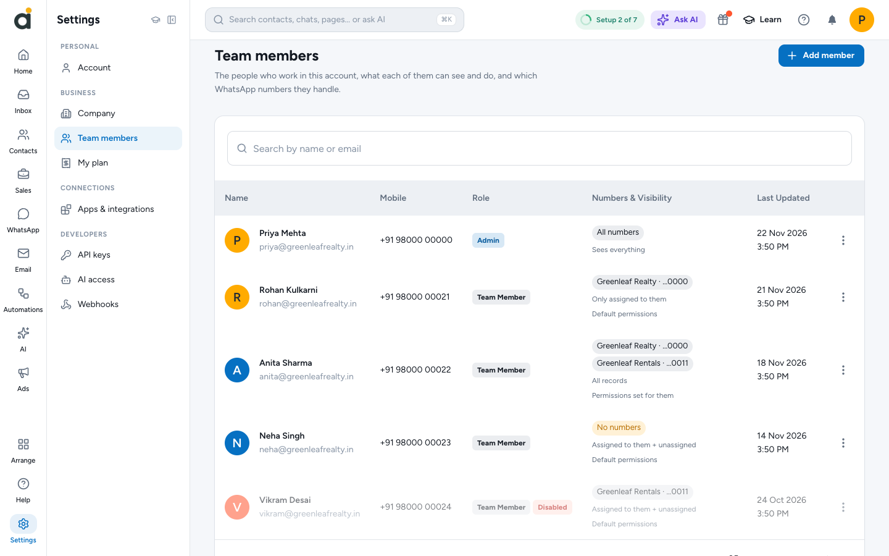
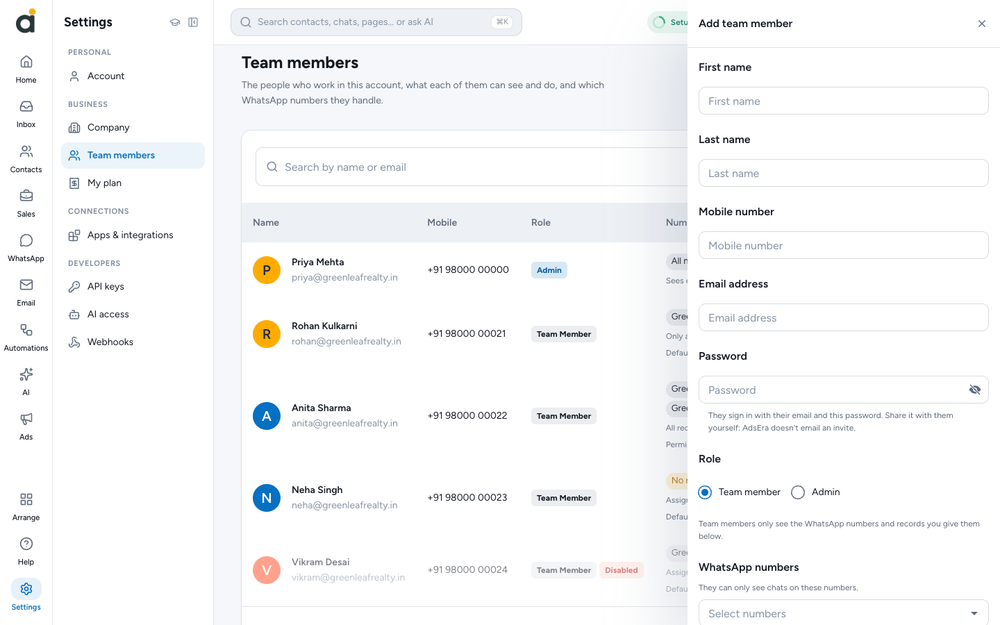
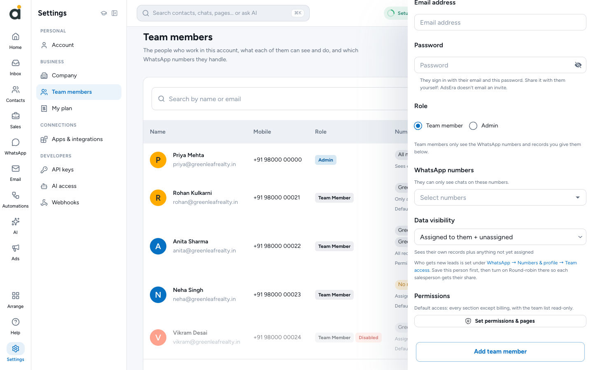
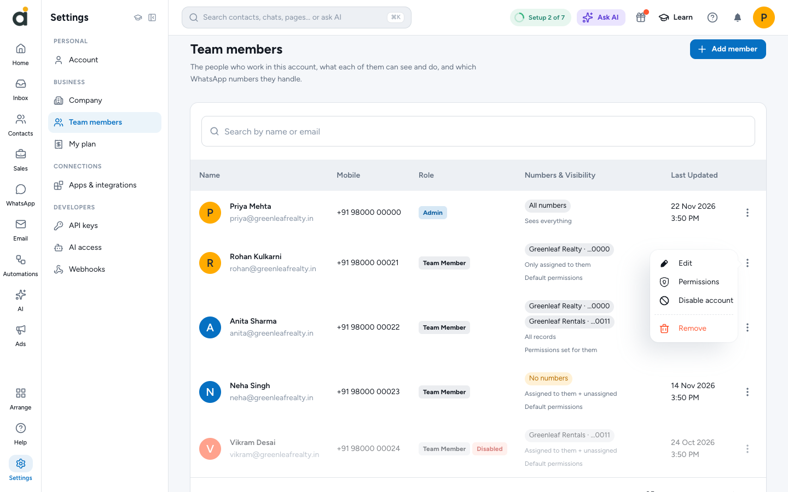
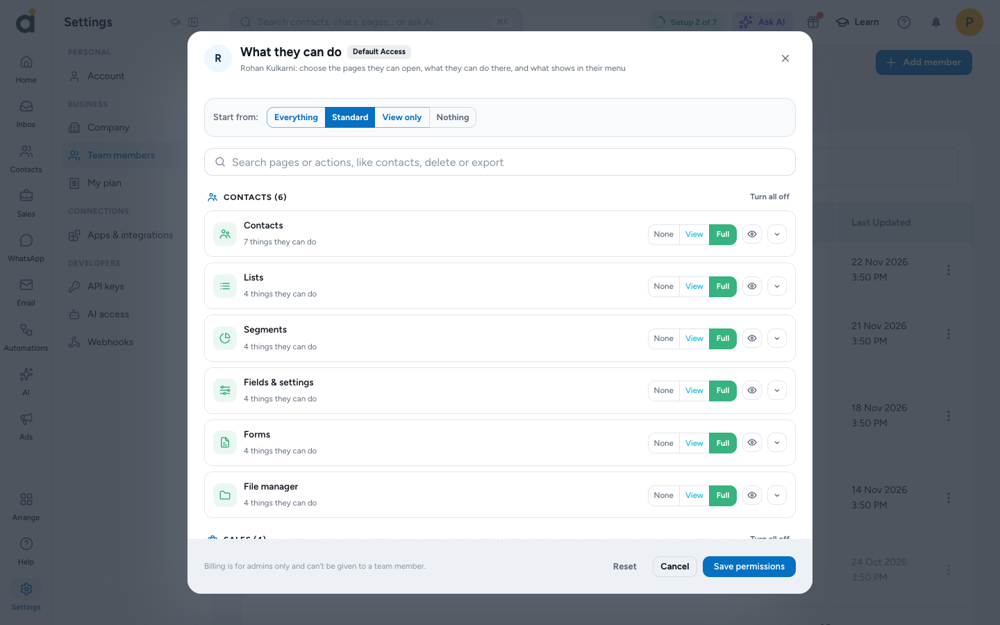
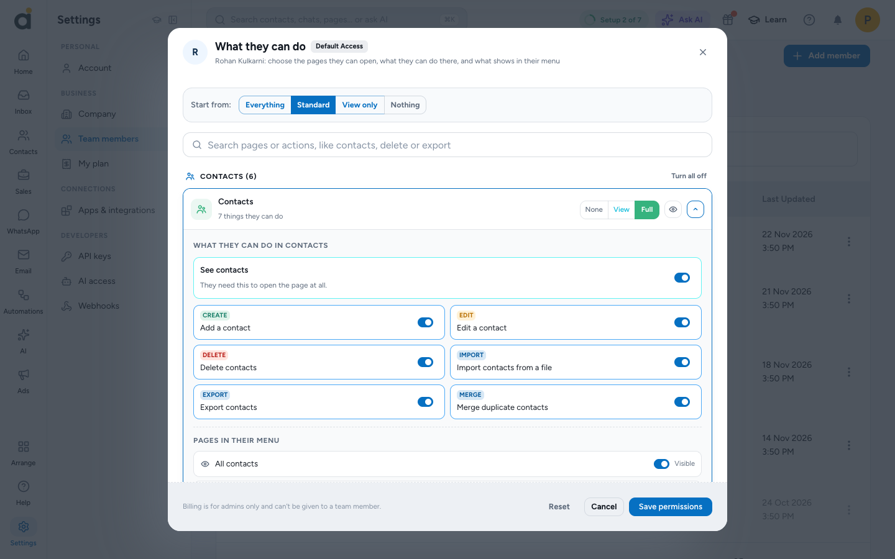
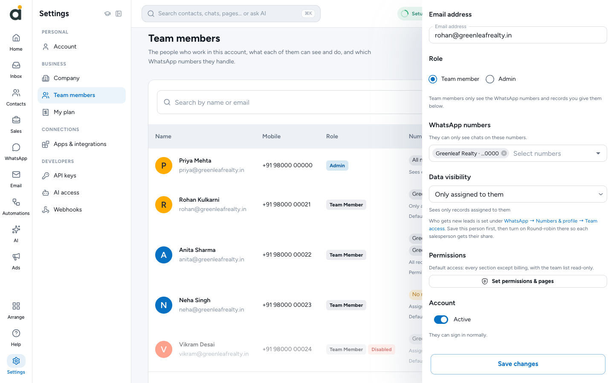
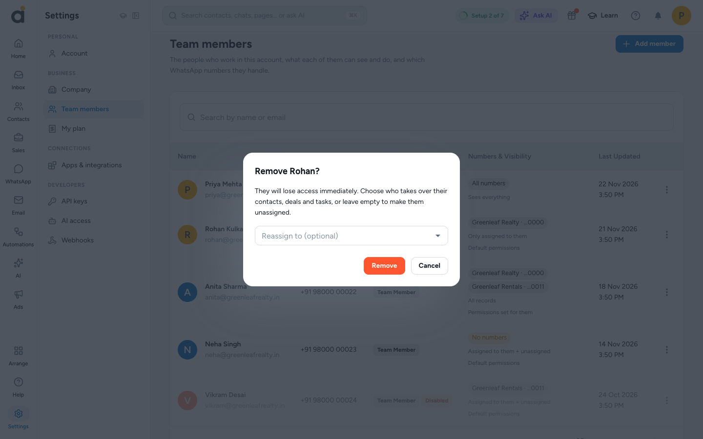

Give everyone who works in AdsEra their **own login**. Then you can see who replied to which customer, hand chats and leads to the right person, and decide what each person can see and do.

This page answers the questions every owner asks: *How do I add my staff? Can my staff see all chats? What can an admin do that a team member can't? My teammate says "no access": why?*

## Where to find it

Click **Settings** (the gear at the bottom of the menu on the left), then **Team members** under **Business**. Or click your photo in the top-right corner and pick **Team members**.

[Open Team members &rarr;](https://app.adsera.in/setting/agents/list)

### What each column means

| Column | What it shows |
| --- | --- |
| **Name** | Their name and the email they sign in with. |
| **Mobile** | Their mobile number. |
| **Role** | **Admin** or **Team member**. A red **Disabled** means they can't sign in. |
| **Numbers & visibility** | Their WhatsApp numbers (an admin with none picked shows **All numbers**; a team member with none shows an orange **No numbers**: they see no WhatsApp chats). Under it: whose records they see (**Sees everything**, **All records**, **Assigned to them + unassigned**, **Only assigned to them**), and **Default permissions** or **Permissions set for them**. |
| **Last updated** | When their details were last changed. |
| **⋮** | **Edit**, **Permissions**, **Disable account** / **Enable account**, **Remove**. |

Type in **Search by name or email** to find someone.

## Admin or Team member?

| | Admin | Team member |
| --- | --- | --- |
| WhatsApp numbers | Every number. | Only the numbers you pick for them. |
| Contacts, chats, deals, tasks | Everything. | What their **Data visibility** allows. |
| Pages they can open | Every page, including **Company**, **My plan** (billing) and **Team access** on numbers. | The default access, or the permissions you set for them. Billing only if you give them the **Plan & add-ons** permission. |
| Can add and change team members | Yes. | Only if you give them that permission. |

Make someone an admin only if you'd trust them with billing and every customer.

## Add a team member

<Steps>
<Step title="Click Add member">
Top right of the Team members page. A window opens on the right.

</Step>
<Step title="Type their details">**First name**, **Last name**, **Mobile number**, and the **Email address** they'll sign in with.</Step>
<Step title="Set a first password">Type a **Password** for them. AdsEra **doesn't email an invite**: send them the email and password yourself (privately). They can change it under **Settings → Account → Change password** after they sign in.</Step>
<Step title="Pick the Role">**Team member** or **Admin**. See the table above.</Step>
<Step title="Pick their WhatsApp numbers and Data visibility">

</Step>
<Step title="Click Add team member">You see "Team member added". They can sign in straight away.</Step>
</Steps>

### Every field

| Field | What it does | Example | Required? |
| --- | --- | --- | --- |
| First name | Shown to your team, and to customers in chats they handle. | Rohan | Yes |
| Last name | | Kulkarni | Yes |
| Mobile number | Their own mobile. | +91 98000 00021 | Yes |
| Email address | The email they sign in with. It can't already have an AdsEra account. | rohan@greenleafrealty.in | Yes |
| Password | Their first password. Only when adding someone. | (you choose) | Yes |
| Role | **Team member** or **Admin**. | Team member | Yes |
| WhatsApp numbers | The numbers whose chats they see and answer. For an admin, this only makes them eligible for automatic lead assignment. | Greenleaf Realty · …0000 | No |
| Data visibility | Whose contacts, chats, deals and tasks they see (team members only). | Only assigned to them | No (default: Assigned to them + unassigned) |
| Permissions | **Set permissions & pages**: what they can do. | Default access | No |

### Data visibility

| Choice | What they see | Use it when |
| --- | --- | --- |
| **All records** | Every contact, chat, deal and task on their WhatsApp numbers. | A manager, or a small team that shares everything. |
| **Assigned to them + unassigned** (the default) | Their own, plus anything not given to anyone yet. | Salespeople pick up new leads from a shared pool. |
| **Only assigned to them** | Only what's given to them. | Each salesperson must see only their own leads. |

<Tip>
  "Only their own leads" needs one more setting, so new leads are given out: **Round-robin** under **WhatsApp → Numbers & profile → Team access**. The line under Data visibility links straight there. See [Give each salesperson their own leads](/help/sales/own-leads).
</Tip>

## Set what they can do (permissions)

Every team member starts with the **default access**: every page except billing, with the team list read-only. To change it:

<Steps>
<Step title="Click ⋮ on their row, then Permissions">
(Or **Set permissions & pages** in the Add / Edit window.)

</Step>
<Step title="Start from a preset">
**Everything**, **Standard**, **View only** or **Nothing**. Then change single pages.

</Step>
<Step title="Set each page">Each page has **None** (closed to them), **View** (they can look) or **Full** (they can do everything there). **Turn all on** / **Turn all off** does a whole group.</Step>
<Step title="Fine-tune a page (optional)">
Click the arrow on a page to tick single actions (for example **Export contacts** or **Delete contacts**) and to hide pages from their menu.

</Step>
<Step title="Click Save permissions">You see "Permissions updated". It works the next time they open a page.</Step>
</Steps>

- **Reset** puts back what was saved. **Back to default access** (in the Edit window) clears what you set.
- Billing (**My plan**) is for admins, unless you give a team member the **Plan & add-ons** permission.
- Admins have no permissions to set: they can do everything.

## Change someone's details or role

Click **⋮ → Edit**. Change any detail, role, numbers or data visibility. **Account** has a switch: **Active** (can sign in) or **Disabled**. Click **Save changes**. You can't change their password here: they change it themselves.

## Disable or remove someone

- **⋮ → Disable account**: they can't sign in and are signed out straight away. Their contacts, deals and tasks stay with them. **⋮ → Enable account** undoes it. You see "Account disabled".
- **⋮ → Remove**: asks first. Pick who takes over their contacts, deals and tasks under **Reassign to (optional)**, or leave it empty to make them unassigned. Click **Remove**. They lose access at once.

You can't disable or remove yourself.

## Limits

- Each plan includes a number of team members (your own login counts). When every seat is used, **Add member** is grey and says "Your plan includes 6 team members, all in use." Add an **Extra team member** on **Settings → My plan**. See [Plan and billing](/help/account/plan).

## Troubleshooting

| What you see | What to do |
| --- | --- |
| **Add member** is grey | Every seat on your plan is used. Add an **Extra team member** on My plan, or remove someone. |
| "User already exists Please Login" | That email already has an AdsEra login. Use another email for them. |
| A teammate says "You don't have permission to …" | Their permissions don't include that page or action. Open **⋮ → Permissions** and turn it on. |
| A teammate sees no WhatsApp chats | Their row says **No numbers**. **⋮ → Edit** and pick their WhatsApp numbers. |
| A teammate can't see a lead | Their Data visibility hides it (it's someone else's, or unassigned with **Only assigned to them**). Assign it to them, or change their Data visibility. |
| A teammate can't sign in | Their row says **Disabled**: **⋮ → Enable account**. Or they forgot the password: they can use **Forgot password?** on the sign-in page. |

## FAQs

<AccordionGroup>
  <Accordion title="Does my teammate get an email invite?">
    No. You set their first password and tell them yourself. They sign in at app.adsera.in.
  </Accordion>
  <Accordion title="Can my staff see all chats?">
    Only the chats on the WhatsApp numbers you pick for them, and only the records their Data visibility allows. Admins see everything.
  </Accordion>
  <Accordion title="What can an admin do that a team member can't?">
    Billing (My plan), Company details, Team access on numbers, and everything else, on every number. A team member can do only what their permissions allow.
  </Accordion>
  <Accordion title="Someone is leaving. What do I do?">
    Disable their account first (they can't sign in, their work stays). When you've moved their leads, **Remove** them and pick who takes over.
  </Accordion>
</AccordionGroup>

## Related

<CardGroup cols={2}>
  <Card title="Give each salesperson their own leads" icon="user-lock" href="/help/sales/own-leads">Data visibility plus Round-robin.</Card>
  <Card title="Plan and billing" icon="receipt" href="/help/account/plan">Add an extra team member.</Card>
  <Card title="Your account" icon="user" href="/help/account/account">Change your own password.</Card>
  <Card title="Team inbox" icon="inbox" href="/help/inbox/team">Assign chats to teammates.</Card>
</CardGroup>
