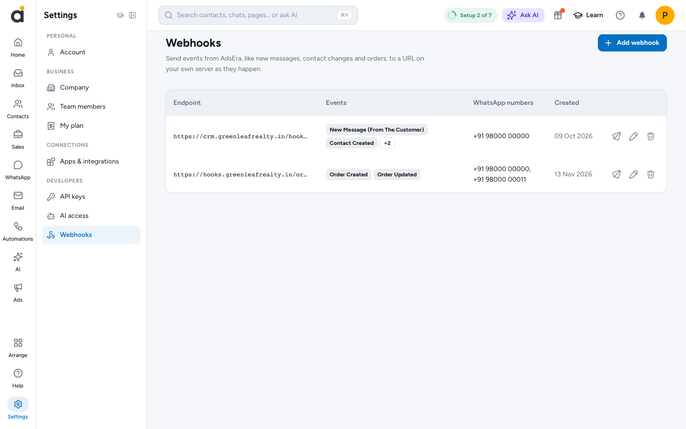
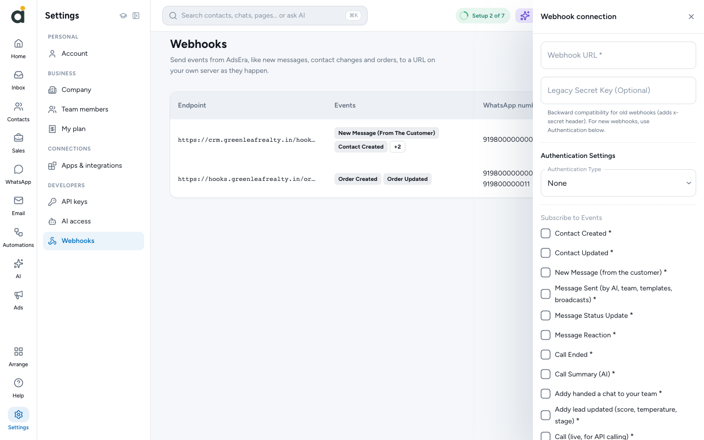
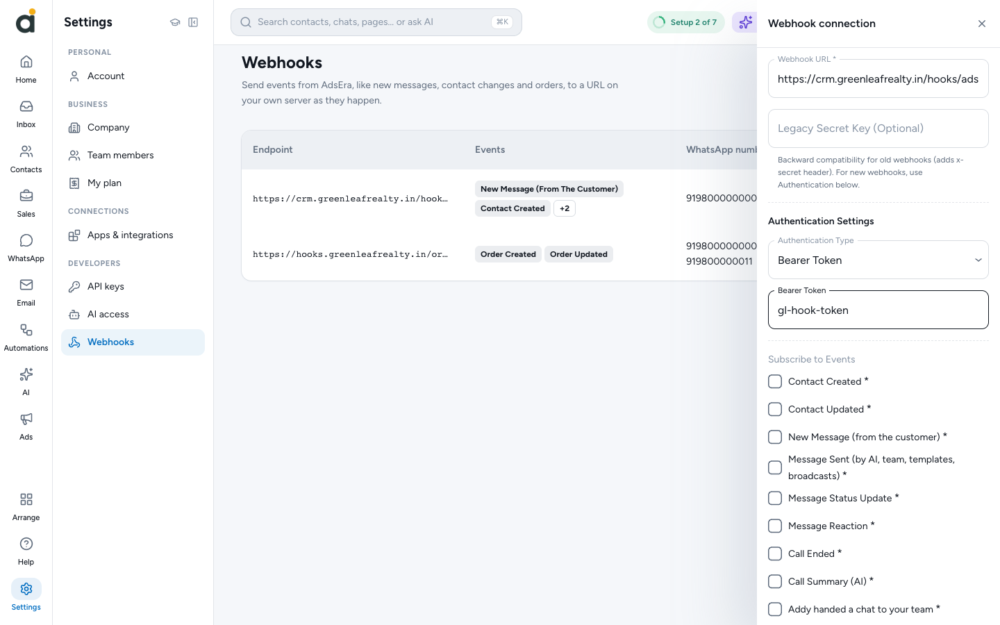

A **webhook** sends what happens in AdsEra (a new customer message, a new contact, a finished call, an order) to an address on your own server, the moment it happens. Your developer gives you that address. You only need this if a developer is connecting your own system to AdsEra.

## Where to find it

Click **Settings** (the gear at the bottom of the menu on the left), then **Webhooks** under **Developers**.

[Open Webhooks &rarr;](https://app.adsera.in/setting/webhooks)

| Column | What it shows |
| --- | --- |
| **Endpoint** | The address events are sent to. |
| **Events** | What it sends. **+2** means more: point at it to see them. |
| **WhatsApp numbers** | Whose messages it sends. |
| **Created** | When it was added. |

With none yet, the page says "No webhooks yet" with **Add webhook**.

## Add a webhook

<Steps>
<Step title="Click Add webhook">
The **Webhook connection** window opens.

</Step>
<Step title="Paste the Webhook URL">The `https://` address your developer gives you.</Step>
<Step title="Pick the Authentication Type">
Ask your developer. **None**, **Basic Auth** (Username and Password), **Bearer Token**, or **Custom Headers** (Header Name and Header Value, **Add header** for more).

</Step>
<Step title="Tick the events">Tick only what your system uses. See the table below.</Step>
<Step title="Pick the WhatsApp numbers">Message events only arrive for the numbers you pick here. **New Message** and **Message Status Update** need at least one.</Step>
<Step title="Click Save webhook">You see "Webhook added" (or "Webhook saved" after an edit).</Step>
</Steps>

### The events

| Event | Sent when |
| --- | --- |
| Contact Created | A new contact is added. |
| Contact Updated | A contact changes. |
| New Message (from the customer) | A customer sends you a WhatsApp message. |
| Message Sent (by AI, team, templates, broadcasts) | AdsEra sends a WhatsApp message. |
| Message Status Update | A message is delivered, read or fails. |
| Message Reaction | A customer reacts to a message. |
| Call Ended | A WhatsApp call ends. |
| Call Summary (AI) | The AI summary of a call is ready. |
| Addy handed a chat to your team | Addy passes a chat to a person. |
| Addy lead updated (score, temperature, stage) | Addy changes a lead's score, temperature or stage. |
| Call (live, for API calling) | Live call events, for developers building their own calling. |
| Order Created / Order Updated | A WhatsApp order comes in or changes. |

**Legacy Secret Key (Optional)** is only for old webhooks: it adds an `x-secret` header. For new ones, use **Authentication Type**. The full details of each event are in the [developer guide](/api-reference/webhooks/overview).

## Test, edit or delete

- **Send a test event** (paper plane): AdsEra sends a sample and says "Test delivered: HTTP 200 in 184 ms", or "Test not delivered: …" with the reason.
- **Edit** (pencil): change the address, events or numbers.
- **Delete** (bin): asks first, then stops sending there.

## Troubleshooting

| What you see | What to do |
| --- | --- |
| "Must be a valid URL" | Paste the full address, starting with `https://`. |
| "At least one event is required" | Tick an event. |
| "Pick at least one WhatsApp number for New Message or Message Status Update events." | Pick a number under **WhatsApp numbers**. |
| "Test not delivered" | Your server didn't answer, or answered with an error. Send the message to your developer. |

## Related

<CardGroup cols={2}>
  <Card title="Webhooks for developers" icon="code" href="/api-reference/webhooks/overview">Payloads, security and retries.</Card>
  <Card title="API keys" icon="key" href="/help/account/api-keys">Let your software call AdsEra.</Card>
</CardGroup>
