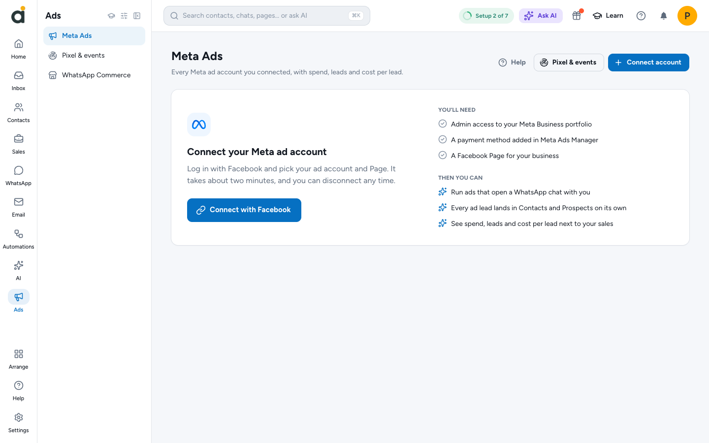
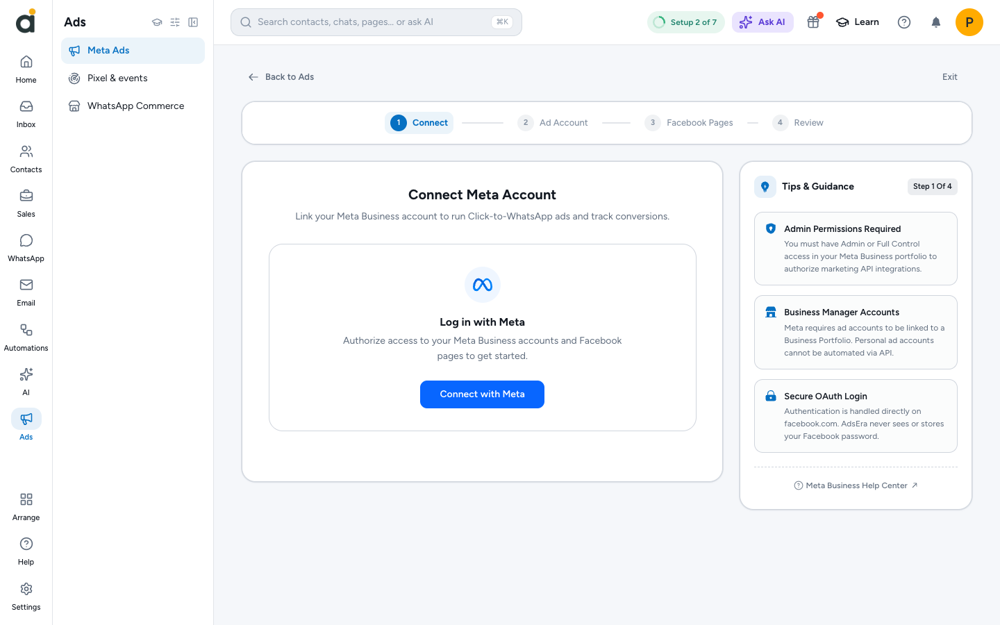
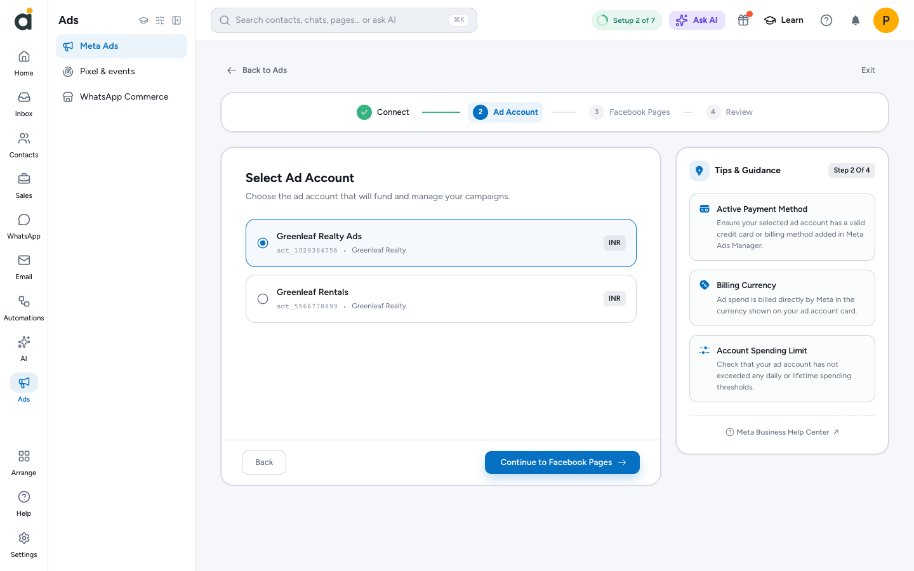
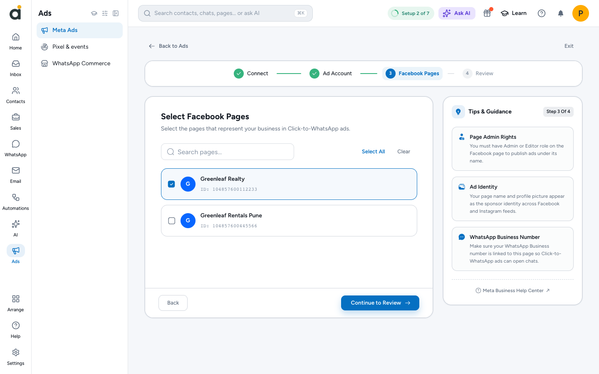
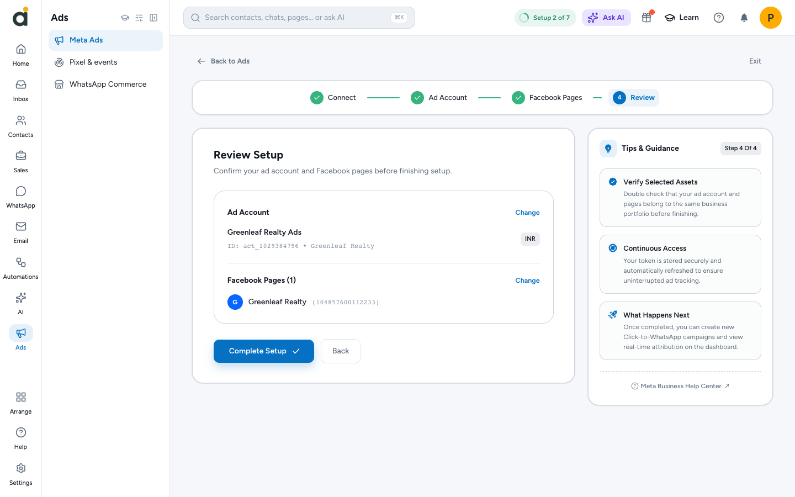
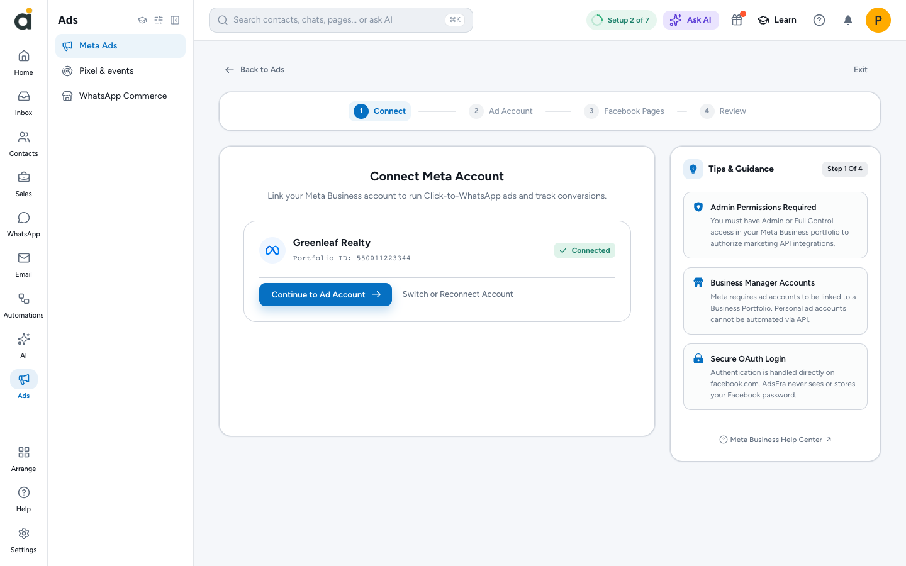
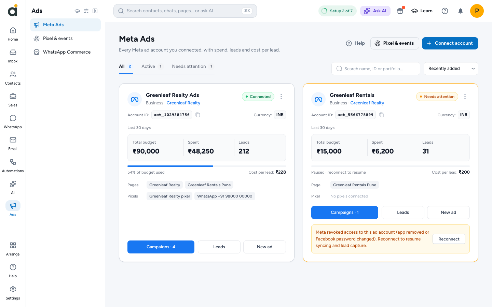
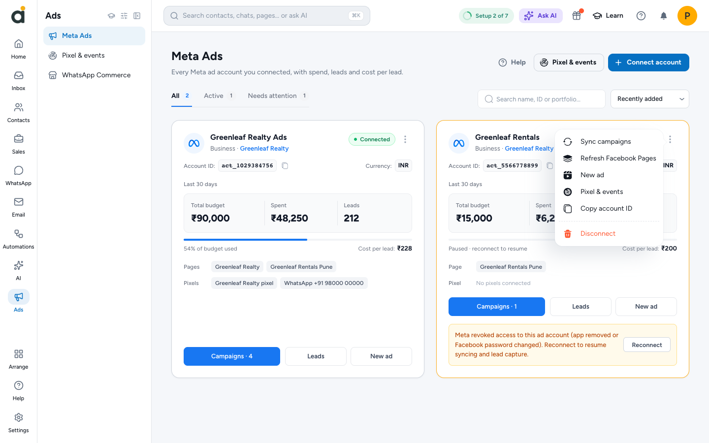
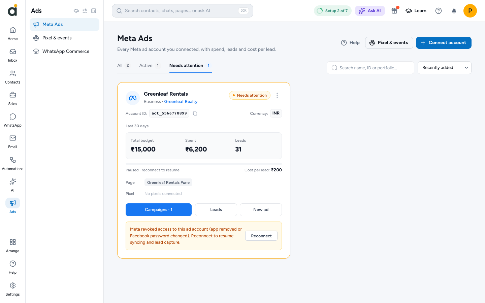
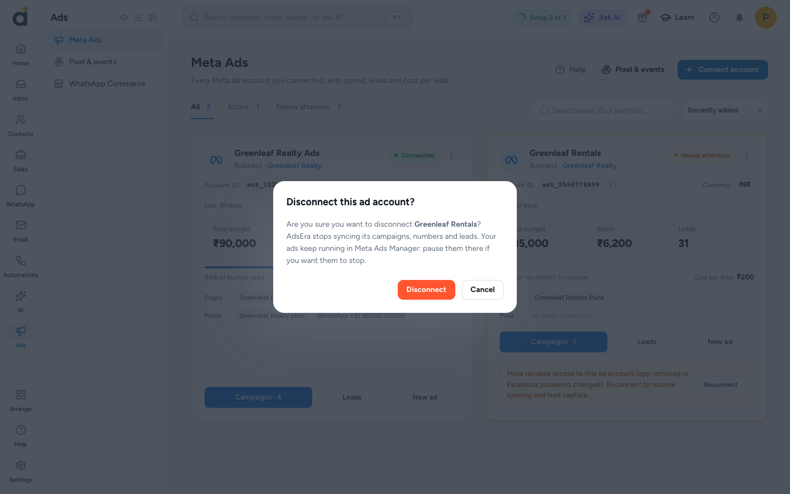

Connect your Meta (Facebook and Instagram) ad account to see what each ad spends and how many leads it brings, build ads that open a WhatsApp chat, and get every ad lead into Contacts on its own. It takes about two minutes.

**Where:** **Ads → Meta Ads**. [Open it →](https://app.adsera.in/dashboard/meta/ads)

## Before you start

| You need | Why |
| --- | --- |
| A Facebook login that is an **admin** of your business on Meta (your *Business portfolio*) | Only admins can give AdsEra access. A personal ad account with no business can't be connected. |
| An ad account with a **payment method** in Meta Ads Manager | Meta bills your ads directly, in the currency shown on the card. |
| A **Facebook Page** for your business | Ads show under the Page's name and picture. Lead forms belong to the Page. |
| For WhatsApp ads: your **WhatsApp number** connected in AdsEra and linked to the Page | So a tap on the ad opens a chat with you. |

<Note>
Meta Ads, Pixel & events, Facebook Pages, WhatsApp Commerce and WhatsApp Pay need the **Meta business agent, ads & commerce** permission (Settings → Team members). Admins have it; a team member without it doesn't see the Ads menu.
</Note>

## Connect your first ad account

<Steps>
<Step title="Click Connect with Facebook">
On **Ads → Meta Ads**. The connect page opens with three steps across the top: ad account, Facebook Pages, review.

</Step>
<Step title="Click Connect with Meta and log in">
A Facebook window opens. Log in, click **Continue as …**, tick your business, your ad account and your Page, then **Save**. AdsEra never sees your Facebook password. If the window doesn't open, allow pop-ups for app.adsera.in.
</Step>
<Step title="Pick the ad account">
Click the ad account your ads run from. Each shows its business and currency. Then click **Continue to Facebook Pages**.

</Step>
<Step title="Tick your Facebook Pages">
Tick each Page your ads run from (**Select All** ticks them all; **Search pages…** finds one). Click **Continue to Review**.

</Step>
<Step title="Check and click Complete Setup">
**Change** goes back to a step. After **Complete Setup** you are back on Meta Ads and the account shows with its numbers.

</Step>
</Steps>

The right side of each step has **Tips & Guidance** (admin rights, payment method, Page roles) and a link to Meta's Business Help Center.

### Add another ad account or more Pages

Click **Connect account** at the top of Meta Ads. Your business shows as **Connected**, so you don't log in again: click **Continue to Ad Account** and repeat the steps. To use a different Facebook login, click **Switch or Reconnect Account**.

## The Meta Ads page

| Part | What it shows |
| --- | --- |
| **All / Active / Needs attention** | Every account, the ones syncing fine, the ones Meta logged out. The number is how many. |
| **Search name, ID or portfolio…** | Finds an account by its name, ID, business or Page. |
| **Recently added / Account name** | The order of the cards. |
| Card title | The ad account's name and its business. **Connected** or **Needs attention**. |
| **Account ID**, **Currency** | Meta's ID (act_…), with a copy button, and the account's currency. |
| **Last 30 days: Total budget, Spent, Leads** | The budget of its running campaigns, what you spent and how many leads came (chats from WhatsApp ads plus lead forms filled in). |
| Budget bar | How much of the budget is used. |
| **Cost per lead** | Spent divided by leads. |
| **Pages**, **Pixels** | The Facebook Pages it advertises as, and the pixels that get your updates ([Pixel & events](/help/ads/pixel-events)). |
| **Campaigns · N** | Opens the account's page: [Which ads bring leads](/help/ads/results). |
| **Leads** | Opens the account's Leads tab. |
| **New ad** | Starts the [ad builder](/help/ads/create). |

**Pixel & events** at the top opens [Pixel & events](/help/ads/pixel-events).

### The ⋮ menu

| Item | What it does |
| --- | --- |
| **Sync campaigns** | Brings in campaigns made in Meta Ads Manager and updates spend and leads. |
| **Refresh Facebook Pages** | Picks up Pages you added or renamed on Meta. |
| **New ad** | Opens the ad builder for this account. |
| **Pixel & events** | Opens Pixel & events. |
| **Copy account ID** | Copies the act_… ID, which Meta support asks for. |
| **Disconnect** | Stops syncing this account (it asks first). |

## Fix an account that needs attention

An account shows **Needs attention** when Meta stopped AdsEra's access, usually after a Facebook password change, the AdsEra app being removed in Facebook settings, or the login expiring. The orange box says *Meta revoked access to this ad account … Reconnect to resume syncing and lead capture*. While it needs attention, its numbers and leads stop syncing; your ads keep running on Meta.

Click **Reconnect**. The connect page opens with *Reconnecting Greenleaf Rentals …*: log in with the Facebook account that has access to it, keep the same ad account ticked, and click **Complete Setup**.

## Disconnect an ad account

**⋮ → Disconnect**, then **Disconnect** in the box.

AdsEra stops syncing its campaigns, numbers and leads. **Your ads keep running in Meta Ads Manager**: pause them there if you want them to stop. You can connect it again any time.

## Troubleshooting

| Problem | Fix |
| --- | --- |
| The Facebook window doesn't open | Allow pop-ups for app.adsera.in and click again. |
| My ad account isn't in the list | In the Facebook window, tick it under ad accounts. It must belong to a business portfolio, and you must be its admin. |
| **Continue to Facebook Pages** stays grey | Click an ad account first. |
| My Page isn't listed | Tick it in the Facebook window, or use **Refresh Facebook Pages** later. You need Admin or Editor on the Page. |
| *Meta connection expired. Please use the Connect button below* | Click **Switch or Reconnect Account** and log in again. |
| Leads stopped coming in | The account probably shows **Needs attention**: reconnect it. |

## FAQs

<AccordionGroup>
<Accordion title="Does AdsEra charge for ads?">
No. Meta bills your ad spend directly to the payment method in your ad account.
</Accordion>
<Accordion title="Can I connect more than one ad account?">
Yes. Click **Connect account** for each.
</Accordion>
<Accordion title="Will connecting change my running ads?">
No. AdsEra reads them. It only changes an ad when you do something (turn it off, change a budget, publish a new ad).
</Accordion>
<Accordion title="Who in my team can see the ads?">
Members with the **Meta business agent, ads & commerce** permission (Settings → Team members).
</Accordion>
</AccordionGroup>

## Related

<CardGroup cols={2}>
<Card title="Which ads bring leads" icon="chart-line" href="/help/ads/results">Campaigns, reports and leads per ad.</Card>
<Card title="Create a WhatsApp ad" icon="wand-magic-sparkles" href="/help/ads/create">The 6-step ad builder.</Card>
<Card title="Pixel & events" icon="radar" href="/help/ads/pixel-events">Tell Meta which leads became customers.</Card>
<Card title="Facebook Pages and lead forms" icon="facebook" href="/help/ads/pages">Your Pages, posts and instant forms.</Card>
</CardGroup>
