The ad builder makes a Facebook and Instagram ad without opening Meta Ads Manager. The most useful kind for most businesses is a **WhatsApp ad**: a tap opens a chat with your number, where your team or Addy answers at once, and the person lands in Contacts and Prospects with the ad they came from.

**Where:** **Ads → Meta Ads**, then **New ad** on an ad account's card (or **New Ad** on the account's page). [Open Meta Ads →](https://app.adsera.in/dashboard/meta/ads)

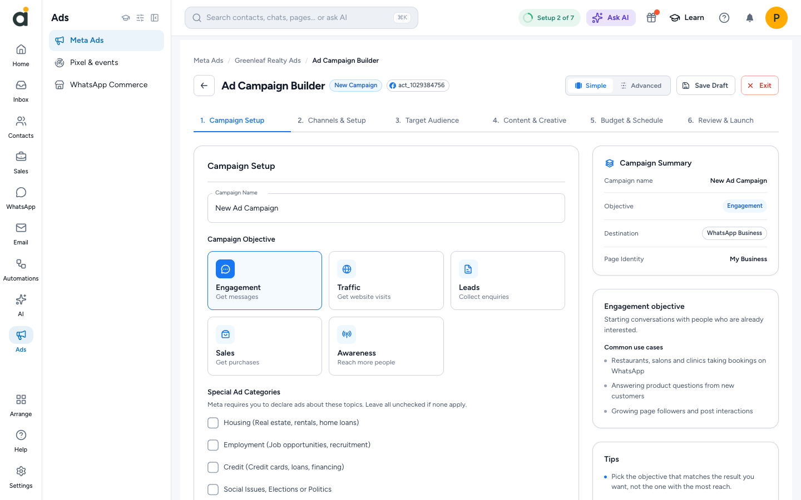

## Before you start

- A connected ad account ([Connect your Meta ad account](/help/ads/connect)) with a payment method in Meta.
- A Facebook Page connected to it.
- For a WhatsApp ad: your WhatsApp number connected in AdsEra (WhatsApp → Numbers & profile). The builder checks it is linked to the Page.
- A clear photo or a short video.

## The screen

| Part | What it does |
| --- | --- |
| Top line | **Ad Campaign Builder**, **New Campaign** (or the campaign you are editing) and the ad account. |
| **Simple / Advanced** | **Simple** (default): one ad set with one ad and the choices most businesses need. **Advanced**: several ad sets and ads, campaign budget, bidding, attribution and ad schedules. Switch any time; nothing is lost. |
| **Save Draft** | Saves where you are, at any step. |
| **Exit** | Leaves. If you have changes it asks: discard, save as a draft, or **Keep Editing**. |
| The 6 steps | Click a done step to go back to it. **Back** / **Next** at the bottom, with *Step N of 6*. |
| Right side | A summary of your choices, tips for the step, and on later steps the audience size and the ad preview. |

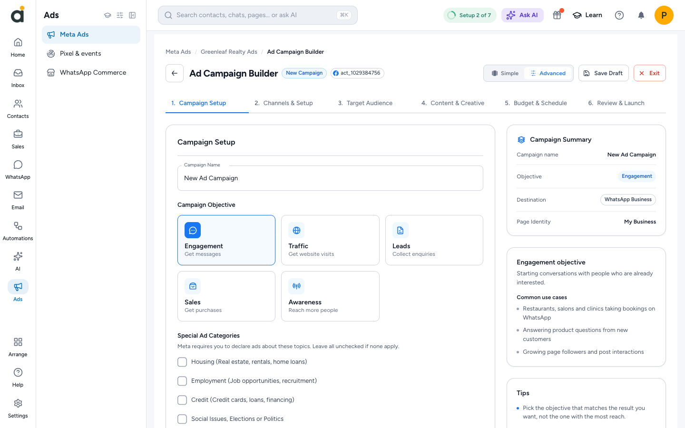

## Step 1: Campaign Setup

| Field | What to pick | Example |
| --- | --- | --- |
| **Campaign Name** | Only you see it. Put the project and month in it. | 2BHK Kharadi, June |
| **Campaign Objective** | What you want people to do. See below. | Engagement |
| **Special Ad Categories** | Tick if your ad is about **Housing** (homes, rentals, home loans), **Employment**, **Credit** (loans, cards) or **Social Issues, Elections or Politics**. Meta requires it by law; targeting is then limited (no age or pin-code narrowing for housing). Leave all unticked if none apply. | Housing, for a real-estate ad |
| Campaign type | **Standard Auction (Recommended)** gives you control. **Advantage+ Campaign** lets Meta decide budget and audience. | Standard Auction |

| Objective | Use it to | Where people can go (step 2) |
| --- | --- | --- |
| **Engagement** | Get WhatsApp messages | WhatsApp |
| **Traffic** | Get website visits | Website, WhatsApp |
| **Leads** | Collect enquiries | Meta Instant Form, WhatsApp, website |
| **Sales** | Get purchases (needs a pixel on your website for website sales) | Website, WhatsApp |
| **Awareness** | Reach more people | Website |

<Warning>
The objective can't be changed after the campaign is published: it shows **Objective locked**. Make a new campaign instead.
</Warning>

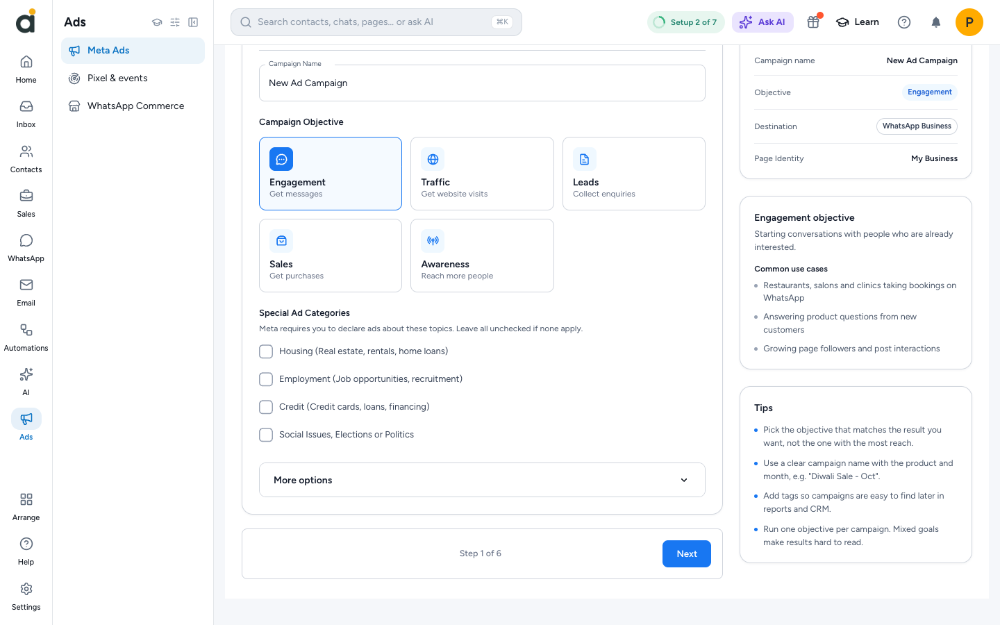

## Step 2: Channels & Setup

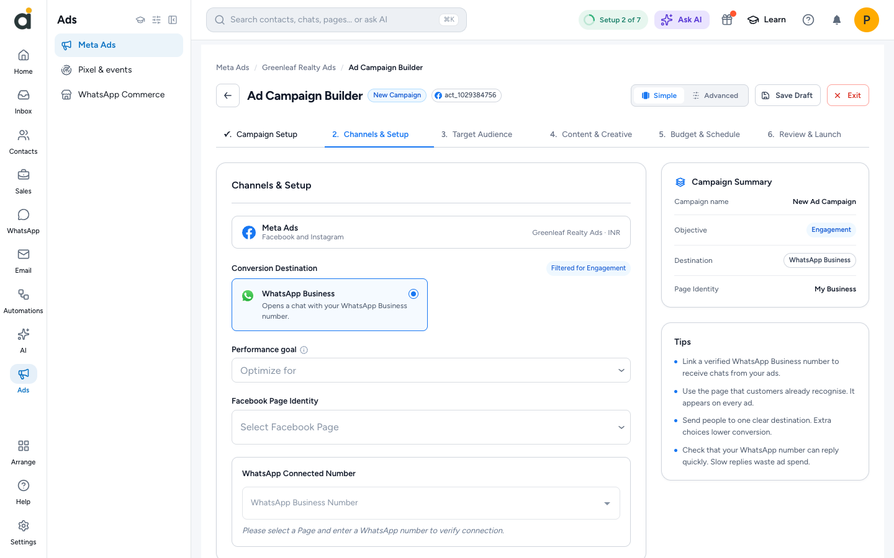

| Field | What it does |
| --- | --- |
| **Meta Ads** | Shows on Facebook and Instagram, for the ad account at the right. |
| **Conversion Destination** | **WhatsApp Business** (opens a chat with your number), **Website / Landing Page** (opens your site), **Meta Instant Form** (a form inside Facebook and Instagram). Only the ones that fit your objective show. |
| **Performance goal** | What Meta optimises for, like conversations or link clicks. Keep the recommended one; it can't be changed after publishing. |
| **Facebook Page Identity** | The Page your ad shows as (its name and picture). |
| **WhatsApp Connected Number** | The number that gets the chats. AdsEra checks it is linked to the Page. If not, it shows how to link it with a code Meta sends to the number. |
| Website (website ads) | The page address, with optional tracking tags. |
| Lead form (form ads) | Pick one of your [instant forms](/help/ads/pages#lead-forms) or make one. |

## Step 3: Target Audience

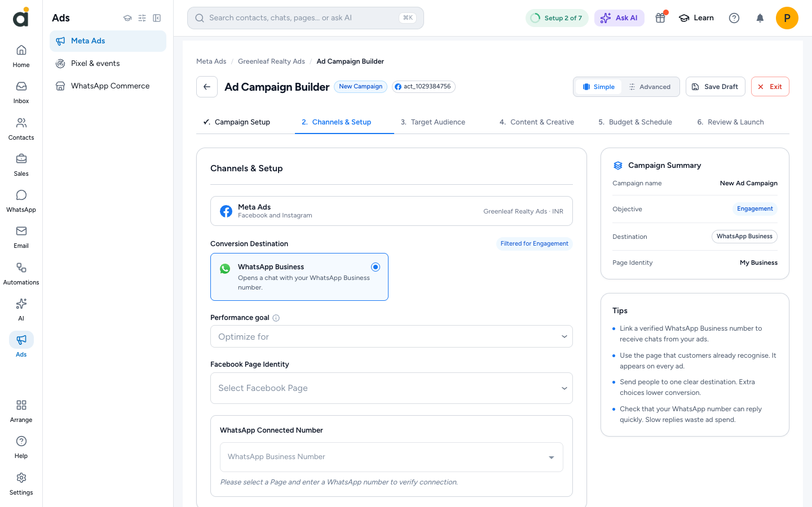

| Field | What it does | Example |
| --- | --- | --- |
| **Include Custom / Lookalike Audiences** | People you already know (site visitors, past leads) or people like them. Optional. | WhatsApp leads lookalike 1% |
| **Target Locations** | Countries, states, cities or areas. Type to search. | Pune |
| **Age Range** | Drag the two dots. Housing ads must stay 18–65. | 25–55 |
| **Genders** | **All Genders**, **Men Only**, **Women Only**. Housing ads must be all. | All Genders |
| **Detailed Targeting** | Interests and behaviours. Optional: fewer is better, Meta finds people itself. | Real estate, Home loans |
| **More targeting options** | Devices (**Mobile**, **Desktop**), **Languages**, places, interests and audiences to **Exclude**, and placements (**Advantage+ Placements (Recommended)** lets Meta pick feeds, stories, reels). | Hindi, Marathi |
| **Save Audience** | Keeps these choices to reuse next time. | |

The right side shows the **audience breadth gauge** (Specific ↔ Broad), the **Estimated Audience Size**, the estimated daily reach and conversations for your budget, and a targeting checklist.

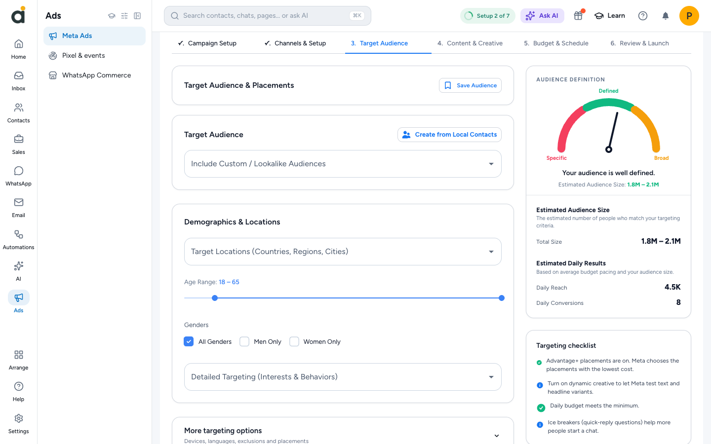

## Step 4: Content & Creative

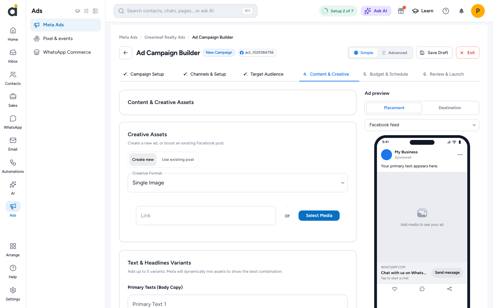

| Field | What it does | Tip |
| --- | --- | --- |
| **Create new** / **Use existing post** | A new ad, or a post already on your Page or Instagram. | A post that did well makes a good ad. |
| **Creative Format** | One picture or video, or a carousel of several. | |
| **Select Media** | Upload or pick the picture or video. A check says if its size fits Meta's rules. | Bright, clear, the product in front. |
| **Primary Text** | The main words above the picture. **Add Primary Text Variant** adds up to 5 versions; Meta shows the best. | Offer first: “2BHK in Kharadi from ₹68 lakh. Free site visit.” |
| **Headline** | The bold line under the picture. **Add Headline Variant** adds versions. | A short benefit. |
| **Ad Name** (Advanced) | Only you see it. | |

### The WhatsApp conversation

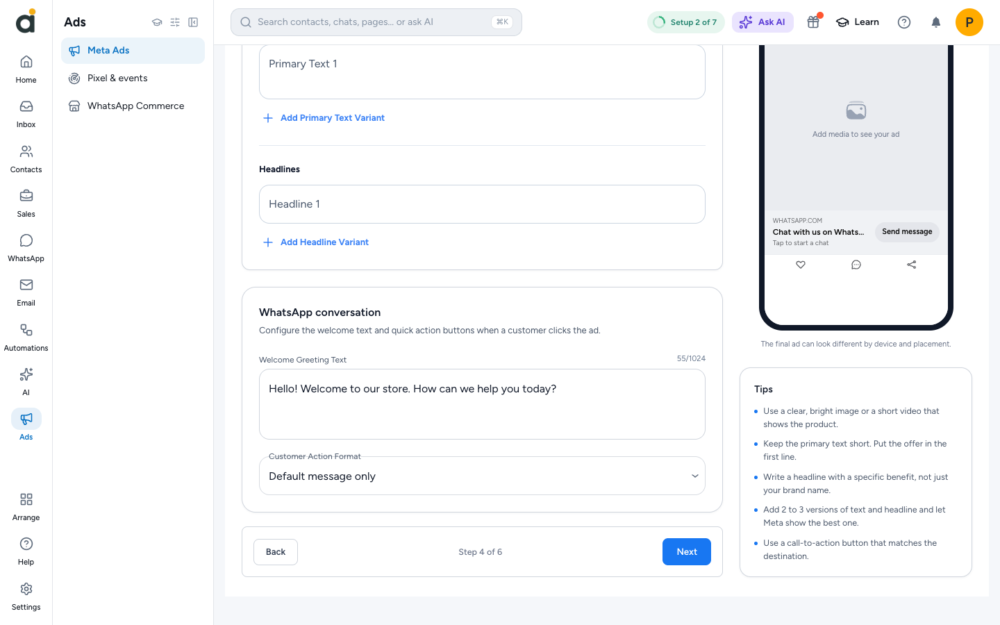

| Field | What it does |
| --- | --- |
| **Welcome Greeting Text** | The first message people see when the chat opens (up to 1,024 characters). |
| **Customer Action Format** | **Default message only**; **Autofill text message** (their reply box is pre-filled, they just tap send); **Ice Breakers (Quick replies - max 3)** (buttons like “Price list”, “Book a visit”); **WhatsApp Flow (Advanced)** (opens one of your [WhatsApp Flows](/help/automation/whatsapp-flows)). |

The phone on the right shows the ad; pick the placement (Facebook feed, Instagram stories…) or **Destination** to see the chat.

## Step 5: Budget & Schedule

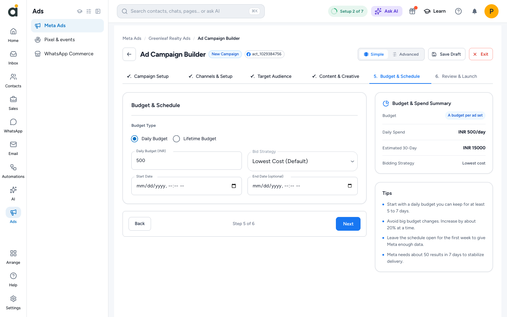

| Field | What it does | Example |
| --- | --- | --- |
| **Budget Type** | **Daily Budget**: up to this much a day. **Lifetime Budget**: a total spread over the dates (needs an end date). | Daily Budget |
| **Daily Budget (INR)** | In rupees. Meta may spend a little more on a good day and less on others; the weekly total stays within 7 × the daily budget. | 500 |
| **Bid Strategy** | Keep **Lowest Cost (Default)**. Advanced options set a cost cap or a bid cap. | Lowest Cost |
| **Start Date** | When it starts. | Tomorrow, 9:00 am |
| **End Date (optional)** | Leave empty to keep it running. | |

The right side shows the daily spend, an estimate for 30 days, and tips: start with a budget you can keep for at least 5 to 7 days, change it by about 20% at a time, and give Meta a week to learn.

## Step 6: Review & Launch

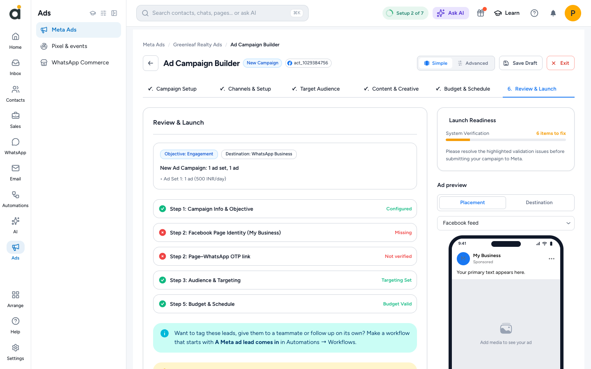

- Each step shows **Configured** / **Targeting Set** / **Budget Valid** (green) or what is **Missing** / **Not verified** (red). Go back to that step to fix it.
- **Launch Readiness** counts the items left to fix; a yellow box lists them under **Resolve before publishing**.
- **Ad preview** shows the ad in each placement, and where it leads.
- A blue note reminds you that tagging, assigning or following up these leads is done with a workflow that starts with **A Meta ad lead comes in** ([Workflows](/help/automation/workflows)).

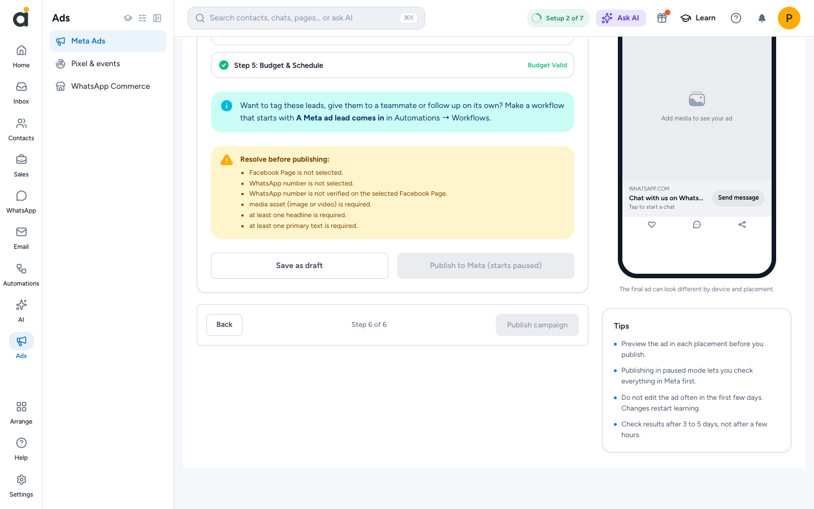

| Button | What happens |
| --- | --- |
| **Save as draft** | Keeps it in AdsEra. Nothing goes to Meta. |
| **Publish to Meta (starts paused)** | Creates the campaign on Meta, **paused**. Meta reviews new ads, usually within a few hours. Turn it on from the [campaigns table](/help/ads/results#campaigns-tab) when you are ready. |

## Drafts

**Save Draft** (top) works at any step. The next time you click **New ad**, the builder asks: **Unfinished draft** — *You saved a draft in an earlier session* — with the campaign name, how far you got, the objective and when you last saved. Click **Resume draft** to carry on, or **Discard draft** to start fresh (it is deleted for good).

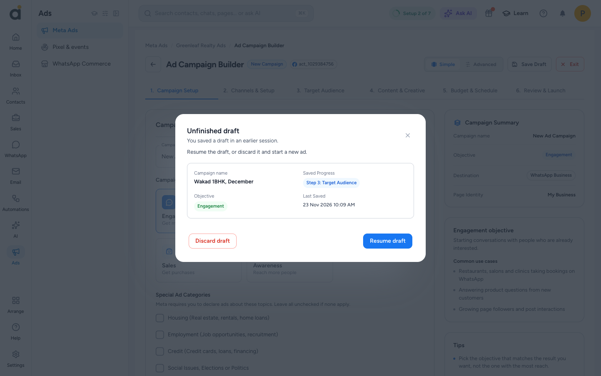

Editing a published campaign (⋮ → **Edit creative**) opens it in the builder; **Save changes to Meta** updates it. While Meta is still publishing it, editing is locked for a moment.

## Troubleshooting

| You see | Fix |
| --- | --- |
| **Step 2: Facebook Page Identity — Missing** | Pick a Page in step 2. No Page in the list? Connect one: Meta Ads → Connect account. |
| **Page–WhatsApp OTP link — Not verified** | The WhatsApp number isn't linked to the Page. Follow the link steps in step 2: Meta sends a code to the number; type it in. |
| Estimated audience shows — | Add a location in step 3. |
| **Publish** stays grey | Fix everything under **Resolve before publishing**. |
| Meta rejected the ad | Open it in Meta Ads Manager for Meta's reason (often text on the picture, or a Housing ad without the Housing category). Fix it with **Edit creative**. |

## FAQs

<AccordionGroup>
<Accordion title="How much should I spend?">
Start with ₹300–₹500 a day for a week. Look at **Cost per lead** on the account's page, then raise the budget of the ads with the lowest cost per lead by about 20% at a time.
</Accordion>
<Accordion title="Why does it publish paused?">
So you can check it in Ads Manager first. Turn it on with the switch in the campaigns table.
</Accordion>
<Accordion title="Who answers the chats?">
Your team in the Inbox, or Addy if you switched it on ([Addy](/help/ai/addy)).
</Accordion>
<Accordion title="Do ad leads become contacts?">
Yes. Everyone who messages from the ad, or fills in the form, is added to Contacts with the ad they came from, and shows in Prospects.
</Accordion>
</AccordionGroup>

## Related

<CardGroup cols={2}>
<Card title="Which ads bring leads" icon="chart-line" href="/help/ads/results">Turn ads on, change budgets, read results.</Card>
<Card title="Pixel & events" icon="radar" href="/help/ads/pixel-events">Teach Meta which leads became customers.</Card>
<Card title="Facebook Pages and lead forms" icon="facebook" href="/help/ads/pages">Instant forms for lead ads.</Card>
<Card title="Workflows" icon="diagram-project" href="/help/automation/workflows">Follow up ad leads automatically.</Card>
</CardGroup>
