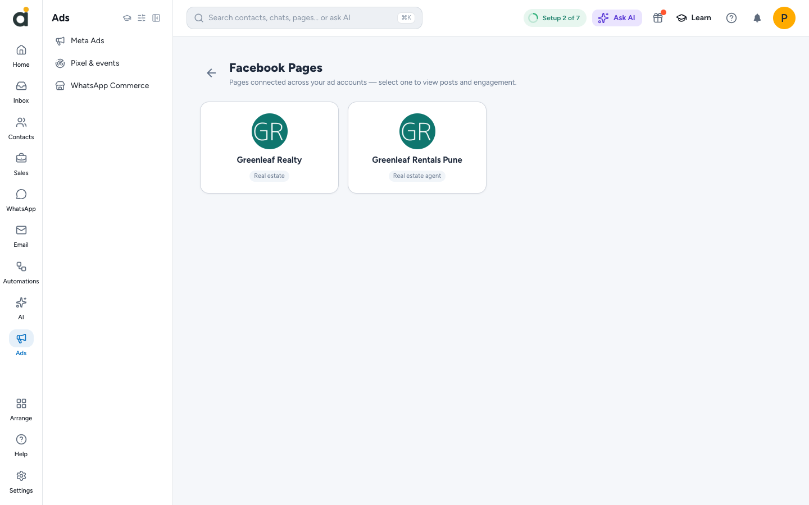
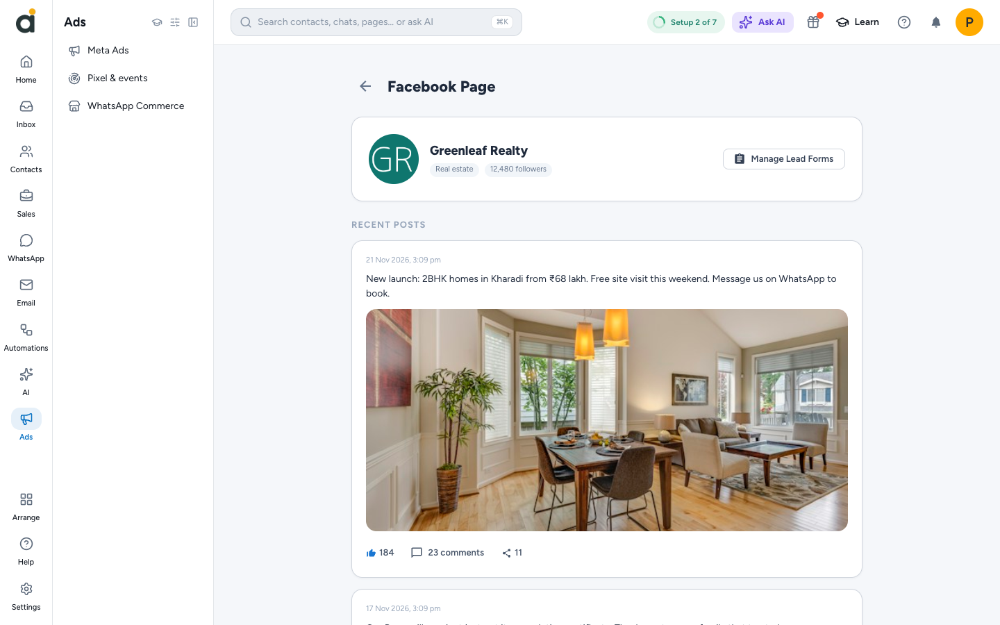
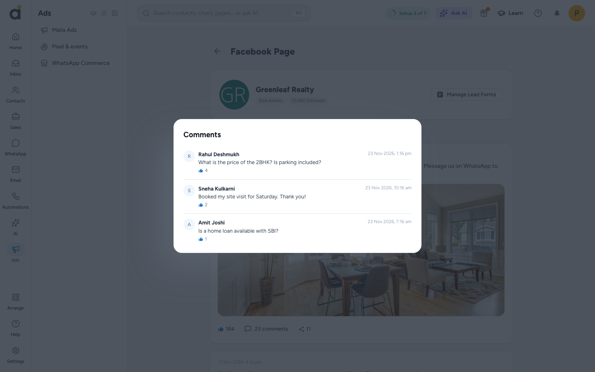
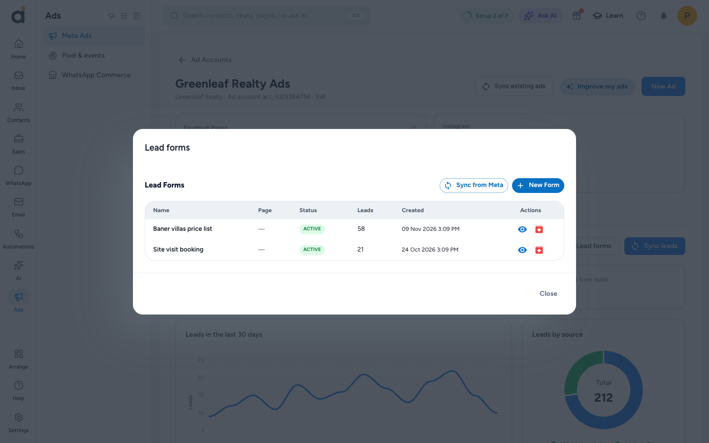

Your ads show under a **Facebook Page**: its name and picture. Instant forms (lead forms) also belong to a Page. AdsEra shows the Pages connected to your ad accounts, their recent posts, and the forms.

**Where:** open an ad account (**Ads → Meta Ads → Campaigns**) and click the **Facebook Pages** box. [Open Facebook Pages →](https://app.adsera.in/dashboard/meta/pages)

## Your Pages

One card per Page, with its picture, name and category. Click one to open it. No Pages? It says *No Facebook Pages connected yet*: connect one with **Meta Ads → Connect account** (tick the Page).

## One Page

| Part | What it shows |
| --- | --- |
| Name, category, **followers** | The Page as people see it. |
| **Manage Lead Forms** | Opens the Leads tab of the ad account this Page belongs to, where **Lead forms** lives. |
| **Recent posts** | Your latest posts with the date, text, pictures or video, likes, comments and shares. Click **N comments** to read them. |

<Tip>
A post that people liked and shared makes a good ad: in the ad builder, step 4, pick **Use existing post**.
</Tip>

## Instagram

Instagram accounts show on the ad account's page, in the **Instagram** box. One that says **Not linked to any page** can't run ads: click **Link**, pick the Page and save. See [Which ads bring leads](/help/ads/results#link-instagram-to-a-page).

## Lead forms

Instant forms are forms people fill in without leaving Facebook or Instagram; Facebook fills in their name, phone and email for them. Every answer comes into AdsEra as a lead and a contact.

**Where:** the ad account's page → **Leads** → **Lead forms** (or **Manage Lead Forms** on a Page).

| Column / button | What it is |
| --- | --- |
| **Name**, **Page**, **Status**, **Leads**, **Created** | Each form with its Page, whether it is active, how many leads it brought and when it was made. |
| Eye | **View questions**. |
| Archive | Stops the form being picked for new ads. Ads already using it keep working. |
| **New Form** | Opens **Create Lead Form**. |
| **Sync from Meta** | Brings in forms you made in Meta. |

### Make a form

<Steps>
<Step title="Click New Form">
**Create Lead Form** opens.
</Step>
<Step title="Name it and pick the Page">
**Form Name** (only you see it, like *Baner villas price list*) and the **Facebook Page** it belongs to.
</Step>
<Step title="Add the questions">
For each question pick the **Type**: a ready-made one Facebook fills in (full name, phone, email, city…) or **Custom Question** with your own **Question text**. Tick **Multiple choice / dropdown** to give choices (at least 2). **Add Question** adds another.
</Step>
<Step title="Click Create Form">
Use it in the ad builder: objective **Leads**, destination **Meta Instant Form**.
</Step>
</Steps>

<Note>
Keep forms short: name and phone, plus one question that helps you call back (like *When do you plan to buy?*). Each extra question loses people.
</Note>

## Related

<CardGroup cols={2}>
<Card title="Connect your Meta ad account" icon="link" href="/help/ads/connect">Add Pages to AdsEra.</Card>
<Card title="Which ads bring leads" icon="chart-line" href="/help/ads/results">Leads from each form and ad.</Card>
<Card title="Create a WhatsApp ad" icon="wand-magic-sparkles" href="/help/ads/create">Use a form or a post in an ad.</Card>
<Card title="Pixel & events" icon="radar" href="/help/ads/pixel-events">Tell Meta which form leads became customers.</Card>
</CardGroup>
