When someone comes from your Meta ad, Meta only knows they clicked. It doesn't know that Rahul booked a site visit a week later, or that Sneha paid a token amount. **Pixel & events** tells Meta. Meta then shows your ads to more people like the ones who became customers, and each good lead costs you less.

You set it up once. After that AdsEra sends the updates by itself, every time a lead moves forward.

**Where:** **Ads → Pixel & events**, or **Pixel & events** at the top of **Meta Ads**. [Open it →](https://app.adsera.in/dashboard/meta/ads/pixel-events)

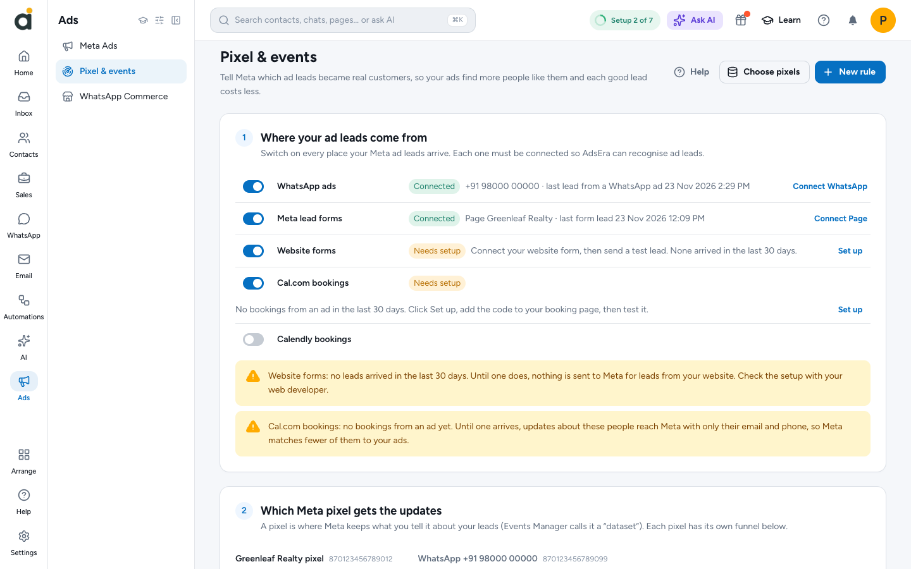

<Note>
You need a connected Meta ad account first ([Connect your Meta ad account](/help/ads/connect)). The page needs the **Meta business agent, ads & commerce** permission (Settings → Team members). Admins have it.
</Note>

## Words on this page

| Word | What it means |
| --- | --- |
| **Pixel** | The place in Meta where your updates are kept. Meta's Events Manager calls it a **dataset**. Most businesses have one main pixel, plus one WhatsApp pixel if they run WhatsApp ads. |
| **Event** (update) | One thing you tell Meta about one person, like **Lead**, **Schedule** or **Purchase**. |
| **Rule** | When something happens to a lead in AdsEra, send this event. For example: *when a deal moves to Site visit, send Schedule*. |
| **Funnel stage** | A step from new lead to customer: Initial Lead → … → Customer. A rule only sends once it sits on a stage. |
| **Meta ad signals** | The same idea inside Addy and Closer (AI): their **Meta ad signals** tabs send to the pixel you set up here. |

## Set it up in 5 steps

<Steps>
<Step title="Switch on your lead sources (step 1 on the page)">
Switch on every place your Meta ad leads arrive, and connect each one. See [Lead sources](#1-where-your-ad-leads-come-from) below.
</Step>
<Step title="Choose your pixel (step 2)">
Click **Choose pixels**, pick the ad account, tick your pixel and click **Save**. See [Choose your pixel](#2-which-meta-pixel-gets-the-updates).
</Step>
<Step title="Add a rule (step 3)">
Click **New rule** and fill the sentence, like *Deal stage → Home sales → changes to Site visit → THEN SEND Standard Schedule → FOR People from Meta ads*. Click **Save**. See [Rules](#3-when-to-tell-meta-rules).
</Step>
<Step title="Switch the rule on">
Drag the rule from **Switched off** onto a funnel stage. You see **Rule is now live**.
</Step>
<Step title="Test it and watch Recent events">
Click the rule, then **Send a test**, and check **Test events** in Meta Events Manager. Every real update then shows under **Recent events**.
</Step>
</Steps>

<Tip>
Start with two rules: **New lead from Meta → Lead** on the first stage, and your first real step (a site visit, a demo or a payment) on a later stage. Meta wants at least two stages, including the first one.
</Tip>

## 1. Where your ad leads come from

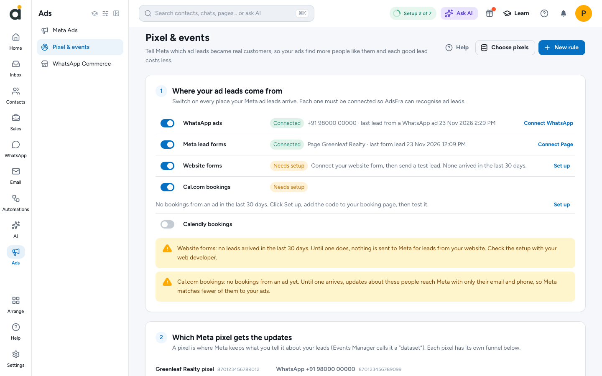

Switch on every place your Meta ad leads arrive. AdsEra uses these to recognise who came from an ad, and sends Meta details that help it match the person (the ad they clicked, their phone and email).

| Source | What it is | What it needs | Button |
| --- | --- | --- | --- |
| **WhatsApp ads** | People who started a chat from an ad that opens WhatsApp. | A WhatsApp number connected in AdsEra. The line shows the number and when the last lead from a WhatsApp ad came in. | **Connect WhatsApp** |
| **Meta lead forms** | People who filled in an instant form on Facebook or Instagram. | Your Facebook Page connected (Meta Ads → Connect account). | **Connect Page** |
| **Website forms** | People who filled in a form on your own website after clicking an ad. | Your web developer sends the form to AdsEra (a link and a secret code). It counts as connected once a lead arrived in the last 30 days. | **Set up** / **Manage** |
| **Cal.com bookings** | People who booked on your Cal.com page from an ad. | Cal.com connected (Apps & integrations) and the AdsEra code on your booking page. | **Connect Cal.com**, **Set up** |
| **Calendly bookings** | The same for Calendly. | Calendly connected and the AdsEra code on your booking page. | **Connect Calendly**, **Set up** |

**Connected** (green) means it works. **Needs setup** (orange) means a step is missing: the line next to it says what. A source that is switched on but not connected shows an orange box under the list, like *"Website forms: no leads arrived in the last 30 days"*. It still works, but Meta matches fewer of those leads to your ads.

### Website forms and bookings (for your web developer)

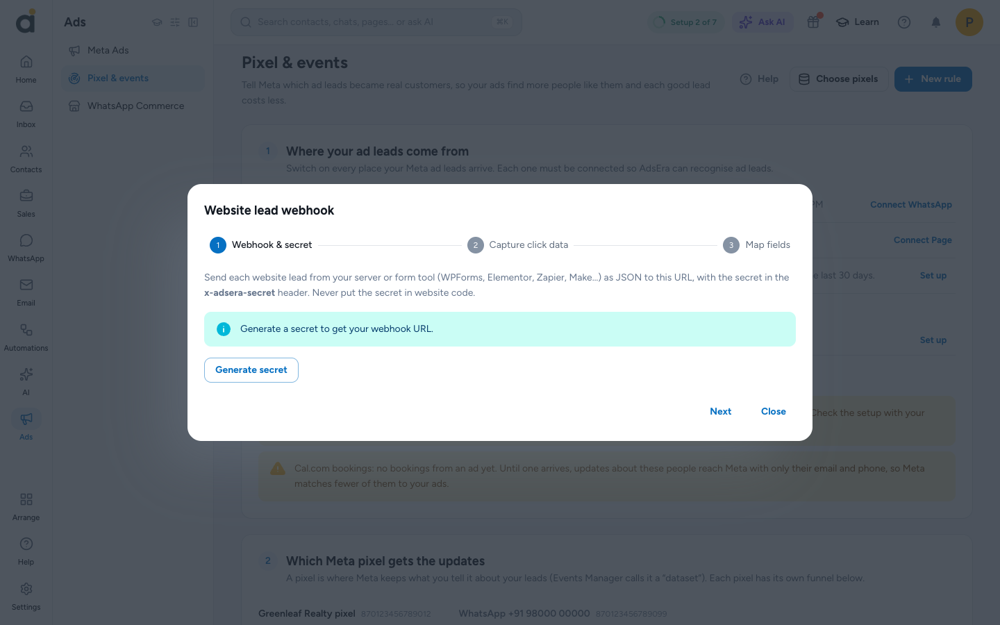

Click **Set up** on **Website forms**. The window gives your developer a link to send each form to, a secret code (shown once: copy it), a ready-made code sample, and lets you match your form's fields to AdsEra fields after the first test lead arrives. Making a new code stops the old one, so AdsEra asks first.

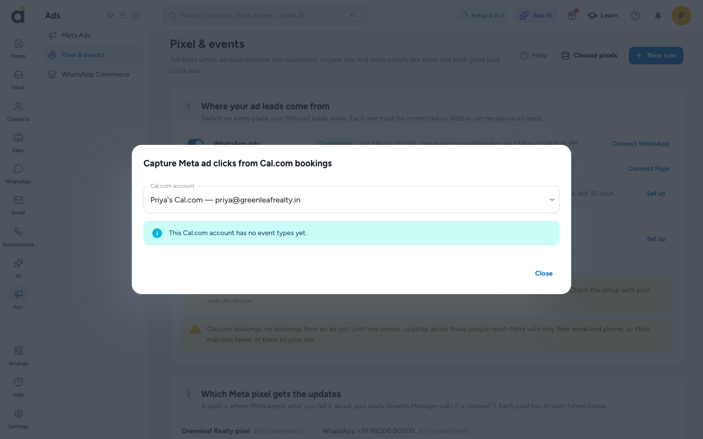

For **Cal.com** and **Calendly**, **Set up** shows the code to add to your booking page, and how to test it with a test click.

## 2. Which Meta pixel gets the updates

Each pixel you choose gets its own tab with its own funnel and rules.

<Steps>
<Step title="Click Choose pixels">
At the top right of the page.

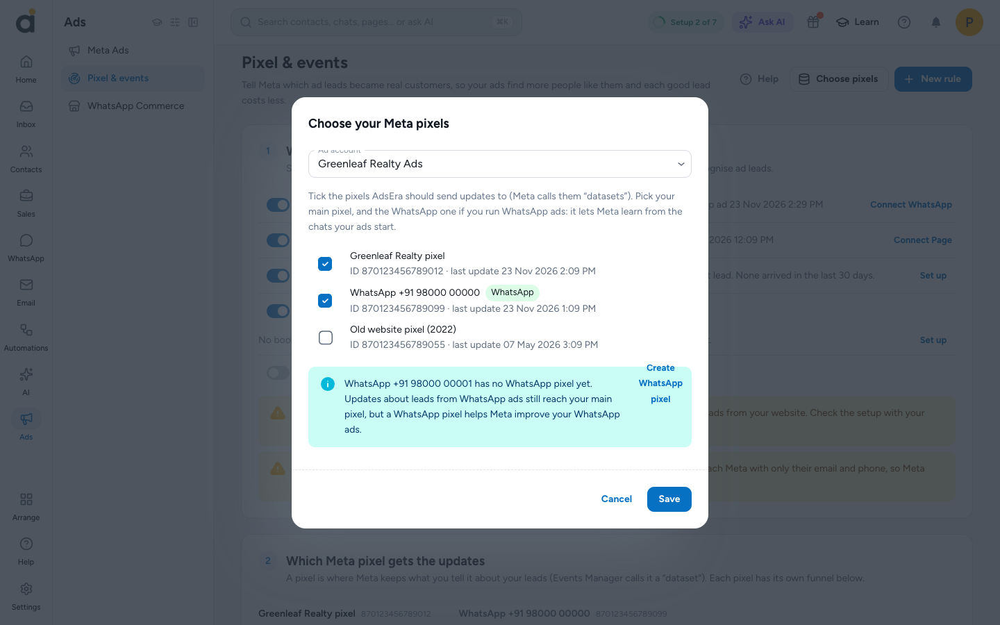
</Step>
<Step title="Pick the Ad account">
Its pixels are listed, with their ID and when they last got an update. A **WhatsApp** chip marks a WhatsApp pixel.
</Step>
<Step title="Tick your pixels">
Tick your main pixel. If you run WhatsApp ads, tick the WhatsApp one too: it lets Meta learn from the chats your ads start.
</Step>
<Step title="No WhatsApp pixel yet?">
If a WhatsApp number has none, a blue box says so. Click **Create WhatsApp pixel**. Then follow the 4 steps shown: open **Business Settings → Datasets** in Meta, select the new pixel, **Connected assets → Add assets → Ad accounts**, tick your ad account and save. Come back and tick it.
</Step>
<Step title="Click Save">
AdsEra checks it can send to each pixel (**Verifying…**). A pixel it can't reach shows a red line with the reason.
</Step>
</Steps>

If a pixel's tab shows **Not receiving**, AdsEra lost access to it (for example the pixel was removed from the ad account in Meta). Its rules are kept but send nothing. Click **Choose pixels** and tick it again; if that fails, give AdsEra access to it again in Meta Business Settings.

No pixel at all? The page shows **Choose at least one pixel to start sending updates to Meta** with **Choose a pixel**:

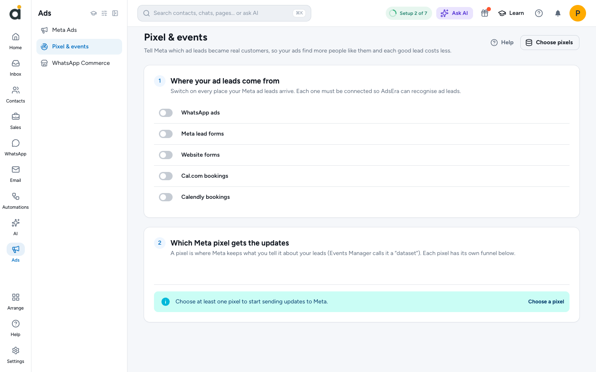

## 3. When to tell Meta: rules

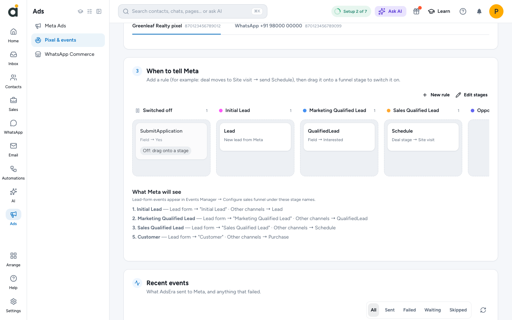

A rule is one sentence: **WHEN** something happens to a lead, **THEN SEND** this event to Meta, **FOR** these people. Click **New rule** (at the top, or above the board).

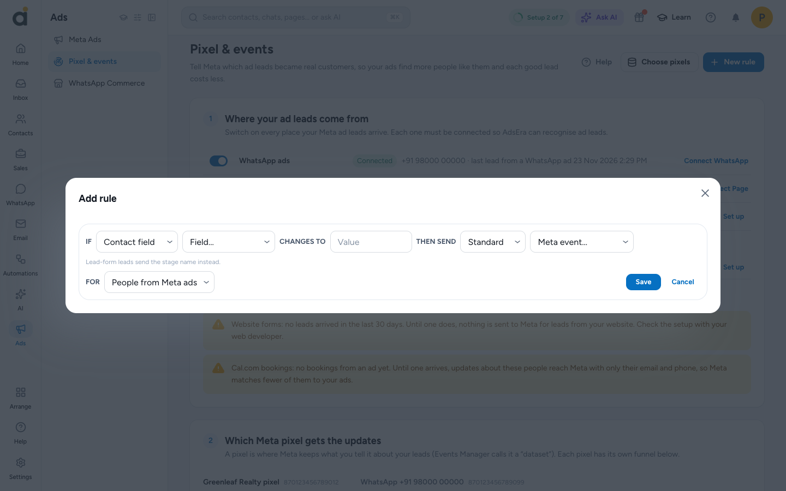

| Part | Choices | What to pick |
| --- | --- | --- |
| **IF** (when) | **Contact field**, **Deal stage**, **New lead from Meta** | See the three kinds below. |
| Field or pipeline | Your contact fields, or your pipelines | The field (like Lead status) or the pipeline (like Home sales). |
| **CHANGES TO** | The field's choices, or the pipeline's stages | The value or stage that matters, like *Interested* or *Site visit*. |
| **THEN SEND** | **Standard** or **Custom** | Keep **Standard**: Meta understands these names. |
| Event | Lead, QualifiedLead, Schedule, SubmitApplication, Purchase, Contact, CompleteRegistration, InitiateCheckout … | Meta's name for what happened. |
| Value (deal rules) | **No value**, **With deal value** | **With deal value** on a sale: Meta learns what the lead was worth. |
| **FOR** | **People from Meta ads**, **Everyone** | Keep **People from Meta ads**. Sending everyone makes Meta aim your ads at the wrong people. |

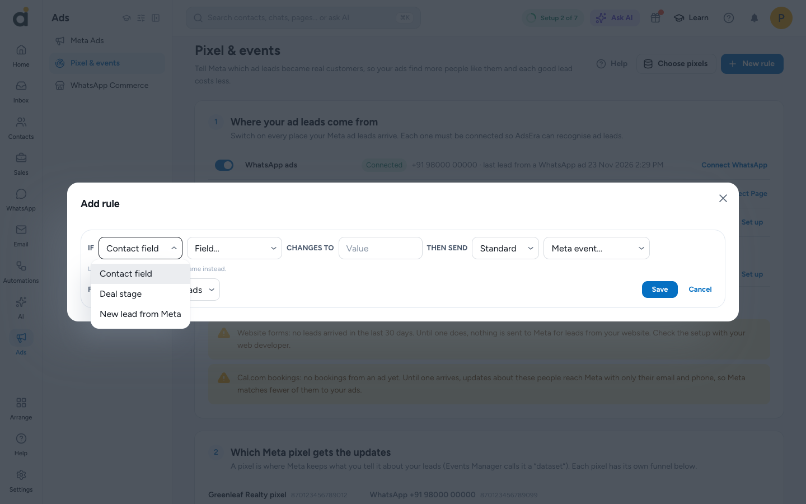

Click **Save**. The rule lands in **Switched off** with the chip **Off: drag onto a stage**. Nothing is sent yet.

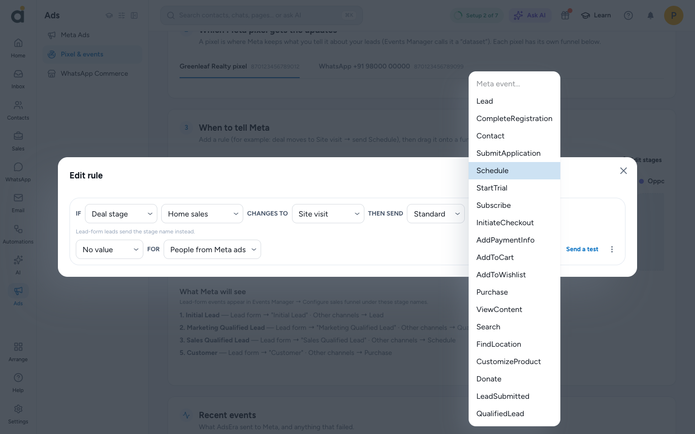

### Rule: a new lead from Meta

Fires once for every new ad lead (from a WhatsApp ad, a lead form, your website form or a booking). Pick **New lead from Meta** in the first box: the sentence becomes *IF New lead from Meta ARRIVES*. Send **Lead**. Put it on the first stage.

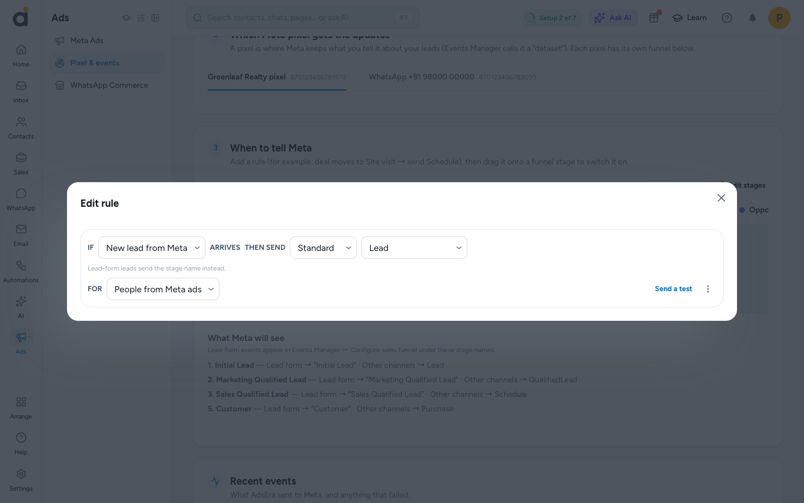

### Rule: a contact field changes

Pick **Contact field**, then the field and the value. Example: *Lead status changes to Interested → QualifiedLead*. A dropdown field shows its choices; any other field takes the exact text you type.

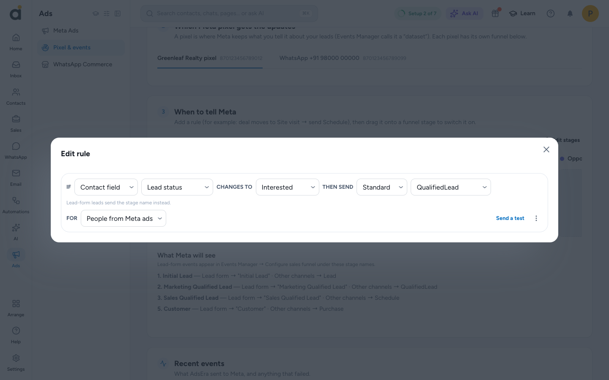

### Rule: a deal moves to a stage

Pick **Deal stage**, then the pipeline and the stage. Example: *Home sales → Site visit → Schedule*. For the stage that means a sale, send **Purchase** and pick **With deal value**.

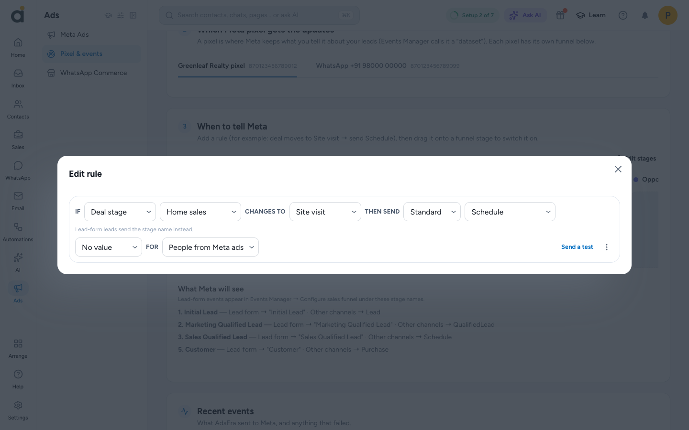

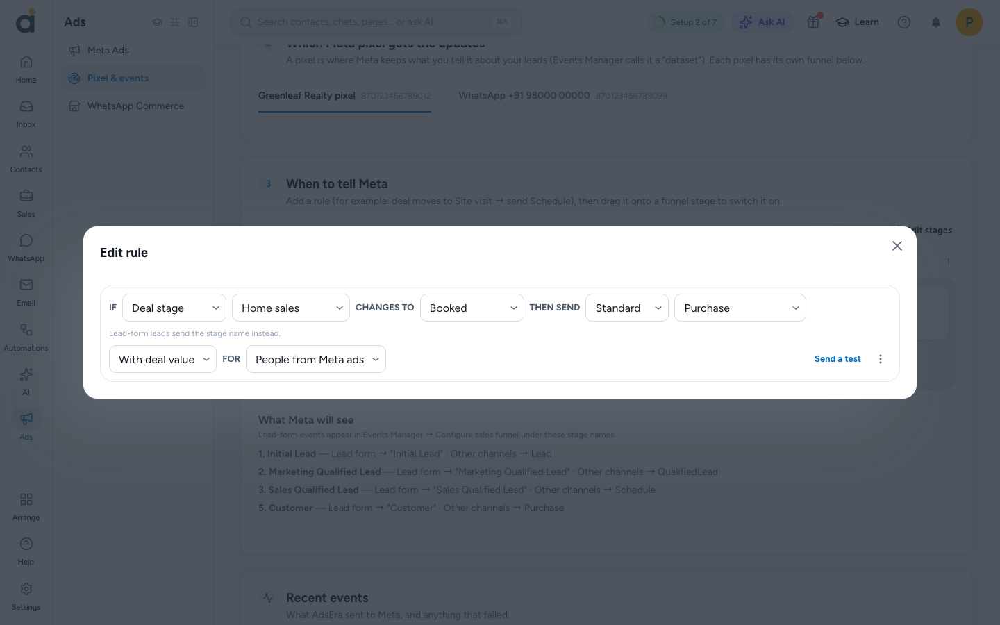

<Note>
**Custom** lets you type your own event name (up to 50 letters, numbers, spaces, _ or -). Lead-form leads always reach Meta under the **stage name** instead, and leads from WhatsApp ads only accept Meta's own events, so for them your custom name goes as a general update. To aim ads at a custom name, make a **Custom Conversion** for it in Meta Events Manager.
</Note>

### Switch a rule on: the funnel board

- **Switched off** (left): rules here send nothing. Drag a rule here to pause it.
- Each column after it is a **funnel stage**, in order: the first is a new lead, the last a customer. Drag a rule onto a stage: **Rule is now live**.
- With rules on only one stage, a blue box says *Meta suggests using at least two stages, including the first one*.

**What Meta will see**, under the board, lists each live stage and the names Meta gets: lead-form leads under the stage name (Meta shows them in Events Manager → Configure sales funnel), other leads under the event names.

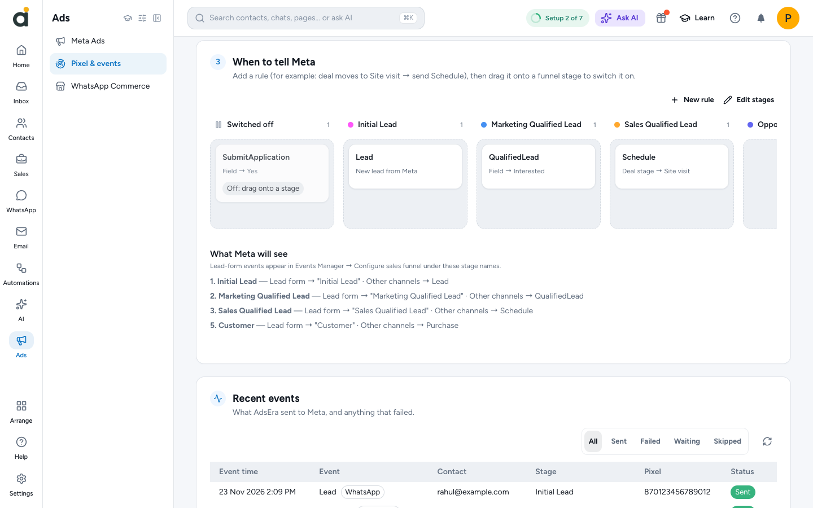

### Rename or reorder the stages

Click **Edit stages**. Change a name (up to 40 letters) or colour, move a stage with the arrows, or delete it (its rules go back to **Switched off**). **Add stage** adds one: up to 10. Click **Save**. A new pixel starts with *Initial Lead, Marketing Qualified Lead, Sales Qualified Lead, Opportunity, Customer*: rename them to your steps, like *New enquiry, Site visit booked, Token paid*.

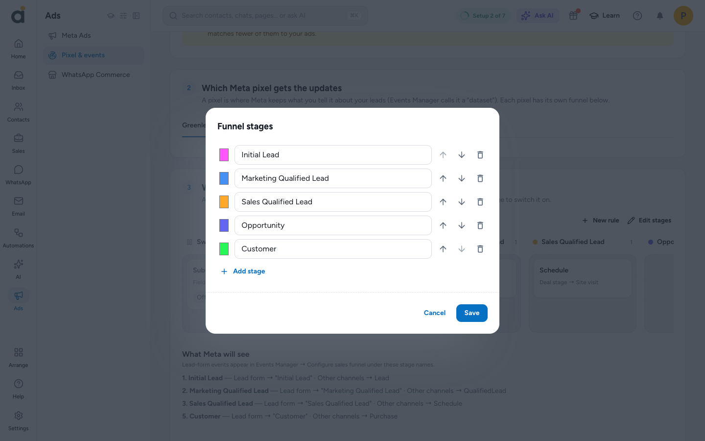

If you edit the funnel in two browser tabs at once, the second save says *The funnel was updated elsewhere* and reloads the latest version.

### Change, test or delete a rule

Click a rule card: **Edit rule** opens. Change any box and **Save** appears. **⋮ → Delete rule** removes it (updates already sent stay in Meta).

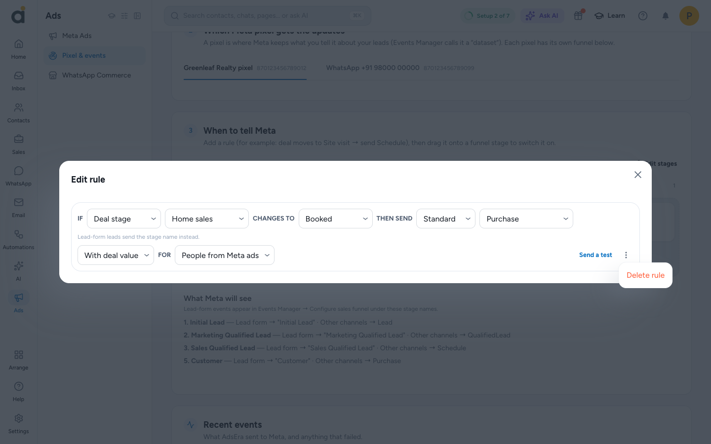

**Send a test** proves the rule reaches Meta:

<Steps>
<Step title="In Meta Events Manager">
Open your pixel → **Test events**. Pick the channel: **CRM** for people from lead forms or WhatsApp ads (no code needed), **Messaging → WhatsApp** for people from WhatsApp ads, **Website** for people from your site or bookings. Copy the test code it shows.
</Step>
<Step title="In AdsEra">
Click the rule, then **Send a test**. Type the **Contact ID** (open the person in Contacts: it is the last part of the page address) and paste the **Test event code**.

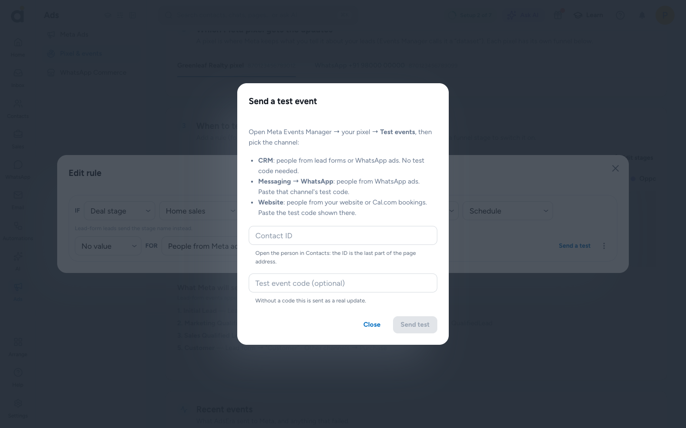
</Step>
<Step title="Click Send test">
Green means Meta got it; it appears in Test events within a minute. Red shows Meta's reason. Without a test code, it is sent as a real update.
</Step>
</Steps>

## Recent events

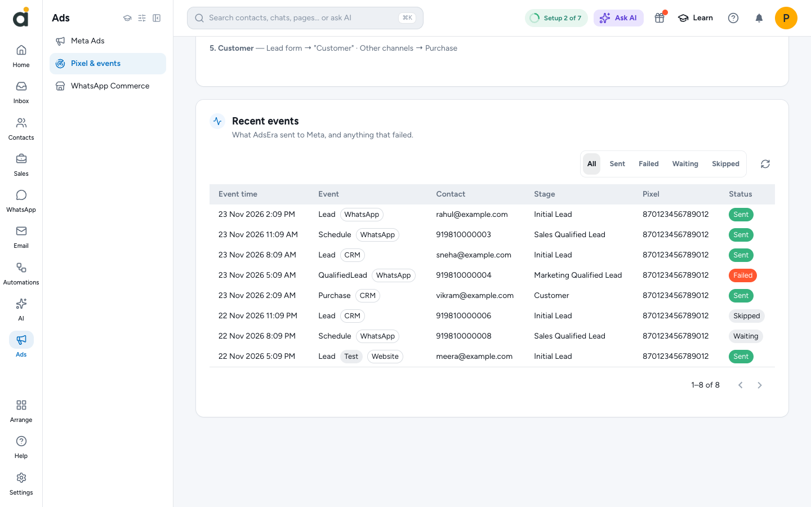

Every update sent to Meta for the chosen pixel, newest first: **Event time**, **Event**, **Contact**, **Stage**, **Pixel** and **Status**. A chip says how it was sent: **WhatsApp** (from a WhatsApp ad chat), **CRM** (lead-form leads), **Website** or **Server**. **Test** marks test sends. Filter with **All / Sent / Failed / Waiting / Skipped**; the round arrow refreshes.

| Status | What it means | What to do |
| --- | --- | --- |
| **Sent** | Meta got it. | Nothing. |
| **Waiting** | About to be sent, usually within a minute. If Meta is busy AdsEra tries again by itself. | Wait. |
| **Failed** | Meta refused it. Hover the status for the reason. | See the table below. |
| **Skipped** | Not sent on purpose: this lead already reached this stage through another rule, so Meta isn't told twice. | Nothing. |

## Troubleshooting

| You see | Why | Fix |
| --- | --- | --- |
| A pixel tab says **Not receiving** | AdsEra lost access to it (removed from the ad account, or the Meta login changed). An alert *Dataset access lost* is also sent. | Assign the pixel to AdsEra again in Meta Business Settings, then **Choose pixels** and tick it. |
| **Failed: stale: event is older than Meta's 7-day limit** | Meta only takes updates from the last 7 days. | Nothing: newer updates go through. |
| **Failed: dataset is no longer selected or is inactive** | The pixel was unticked or lost. | Tick it again under **Choose pixels**. |
| **Failed** with "Page" or "WhatsApp" in the reason | The WhatsApp number isn't linked to the Page that ran the ad. | Link the number to the Page in Meta, or create a WhatsApp pixel. |
| **Needs setup** on WhatsApp ads | No WhatsApp number is connected. | Connect one (WhatsApp → Numbers & profile). |
| **Needs setup** on Meta lead forms | No Facebook Page is connected to an ad account. | Meta Ads → Connect account → tick your Page. |
| **Needs setup** on Website forms | No lead arrived in the last 30 days. | Ask your developer to check the form sends to the link, then send a test lead. |
| **Rule is now live** never shows | The rule is still in **Switched off**. | Drag it onto a stage. |
| *The funnel was updated elsewhere* | Someone saved this funnel in another tab. | It reloads by itself: do your change again. |

## FAQs

<AccordionGroup>
<Accordion title="Do I need this if I only run WhatsApp ads?">
Yes, it helps most there. Meta sees the chat start but not what happened after. Telling it who booked a visit or paid lets it find more people like them.
</Accordion>
<Accordion title="Does it send my customers' details to Meta?">
It sends what Meta needs to match the person to the ad (their phone and email, scrambled before sending, plus the ad they clicked), the event name and, if you choose, the deal value. Pick **People from Meta ads** so only ad leads are sent.
</Accordion>
<Accordion title="How soon does Meta use it?">
Updates reach Meta within a minute. Meta needs a steady flow (tens of events a week) before its ads change noticeably.
</Accordion>
<Accordion title="What is the difference between this and Meta ad signals in Addy or Closer?">
The same pixel. Here you set the rules for your sales steps; Addy's and Closer's **Meta ad signals** tabs send what those AI agents achieve (a qualified lead, a booking) to the pixel you choose here.
</Accordion>
<Accordion title="Can a rule send for a lead that didn't come from an ad?">
Only if you pick **Everyone** under FOR. We don't recommend it.
</Accordion>
</AccordionGroup>

## Related

<CardGroup cols={2}>
<Card title="Connect your Meta ad account" icon="link" href="/help/ads/connect">Connect the ad account and Page first.</Card>
<Card title="Which ads bring leads" icon="chart-line" href="/help/ads/results">Leads and cost per lead for each ad.</Card>
<Card title="Deals and pipelines" icon="filter" href="/help/crm/deal">The deal stages your rules watch.</Card>
<Card title="Addy" icon="robot" href="/help/ai/addy">Meta ad signals from your AI agent.</Card>
</CardGroup>
