Every ad account you connect has its own page: its campaigns with spend and cost per lead, reports for any dates, and the leads with the ad each one came from. This is where you answer *"which ad brings me leads, and what does a lead cost?"*

**Where:** **Ads → Meta Ads**, then **Campaigns** on an account's card. [Open Meta Ads →](https://app.adsera.in/dashboard/meta/ads)

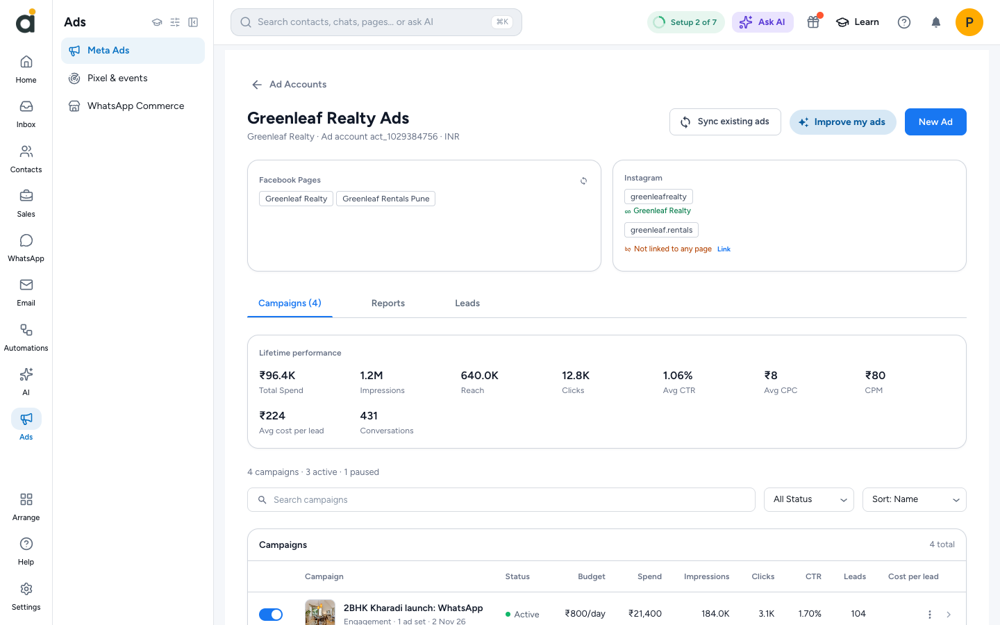

## The top of the page

| Part | What it is |
| --- | --- |
| **Ad Accounts** | Back to Meta Ads. |
| Name and line under it | The ad account, its business, its ID (act_…) and currency. |
| **Sync existing ads** | Brings in campaigns made in Meta Ads Manager. |
| **Improve my ads** | Opens Ask AI on this account: it reads your campaigns and suggests what to change. It asks before changing anything on Meta, and each answer uses AI credits. |
| **New Ad** | Starts the [ad builder](/help/ads/create). |
| **Facebook Pages** | The Pages this account advertises as. The round arrow refreshes them from Meta; click the box for the [Pages and their posts](/help/ads/pages). |
| **Instagram** | Your Instagram accounts. Green with a Page name: linked, ads can use it. **Not linked to any page** + **Link**: see below. |
| **Lifetime performance** | Everything this account ever spent and got: Total Spend, Impressions, Reach, Clicks, Avg CTR, Avg CPC, CPM, **Avg cost per lead** and Conversations. |

### Link Instagram to a Page

An Instagram account can only run ads when it is linked to one of your Facebook Pages. Click **Link** under it, pick the Page and save.

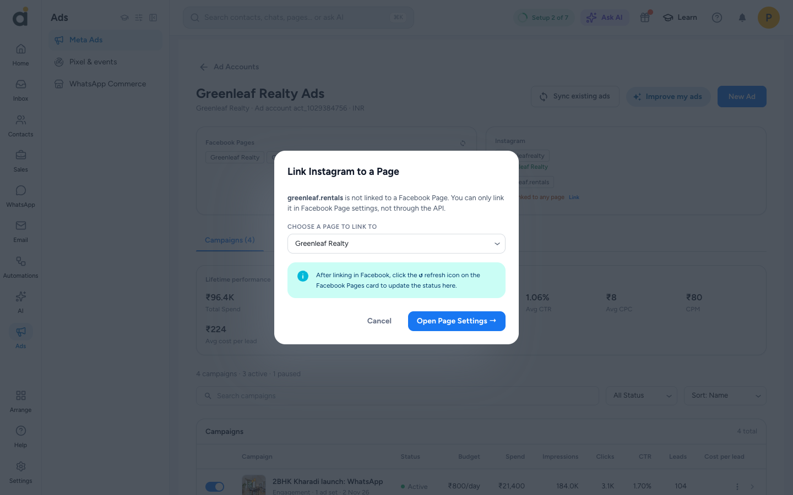

## Campaigns tab

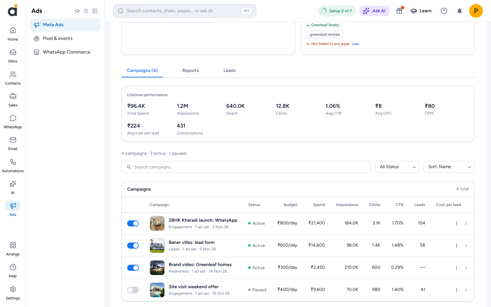

The line above the list counts campaigns, active and paused. **Search campaigns**, **All Status** (All, Active, Paused) and the sort (**Name**, **Spend**, **Impressions**) narrow it down.

| Column | Meaning |
| --- | --- |
| Switch | On (blue) or paused. Click to pause or turn on the campaign on Meta at once. |
| **Campaign** | Its name, picture, goal (Engagement, Leads…), how many ad sets, and when it was made. Click the picture to preview the ad. |
| **Status** | Active, Paused, or **Parent off** for an ad set or ad whose campaign is paused. |
| **Budget** | Per day. |
| **Spend** | What it spent. |
| **Impressions** | How many times it was shown. |
| **Clicks**, **CTR** | Clicks, and clicks per 100 views. |
| **Leads**, **Cost per lead** | Chats started (or forms filled in) and spend divided by them. Only shown when a row in the list has leads: awareness and website ads have none. |

Click a campaign to see its **ad sets** (audience, budget, schedule); click an ad set to see its **ads**. **Campaigns ›** at the top goes back.

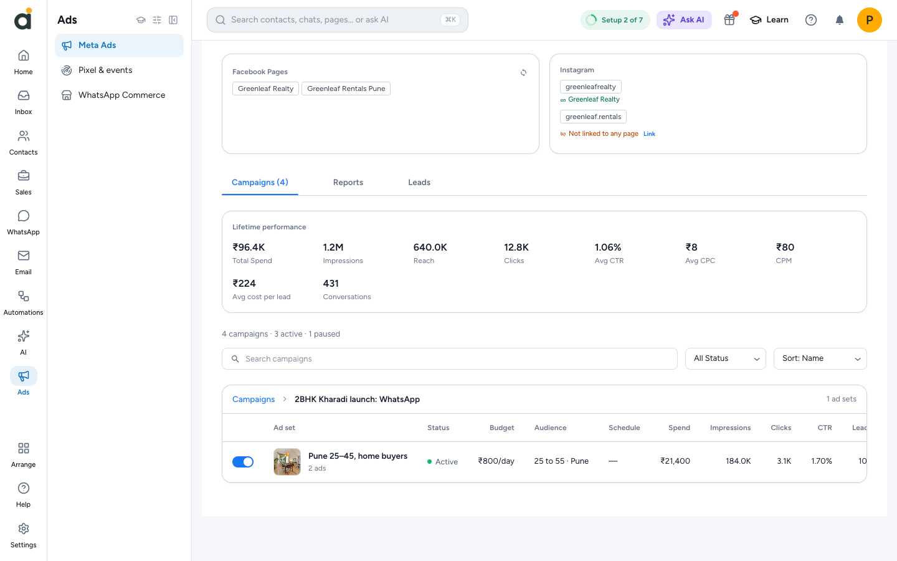

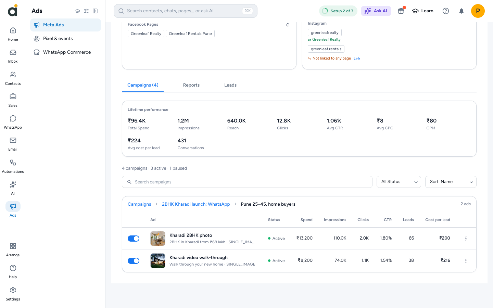

### The ⋮ menu on a campaign

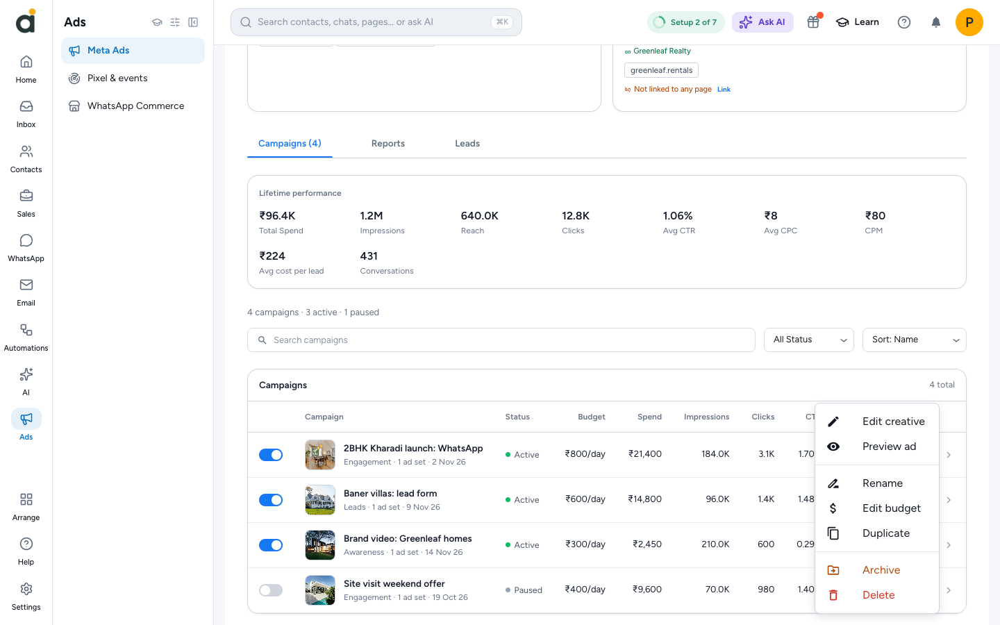

| Item | What it does |
| --- | --- |
| **Edit creative** | Opens the campaign in the ad builder to change its picture and text. |
| **Preview ad** | Shows the ad as people see it. |
| **Rename** | Changes the campaign's name. |
| **Edit budget** | Changes the daily budget (shows the current one). |
| **Duplicate** | Makes a paused copy named “… (Copy)” (on Meta too), to try a new picture or audience. |
| **Archive** | Archives it on Meta: it stops showing for good. |
| **Delete** | Removes it from Meta. It asks first (**Delete Ad?**). |

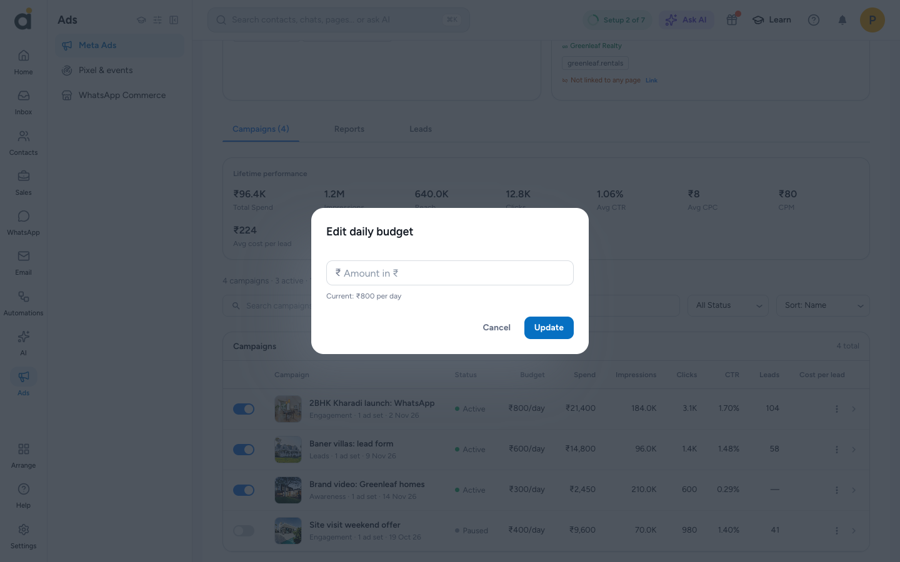

## Leads tab: which ads bring leads

Click **Leads** on the account's card, or the **Leads** tab.

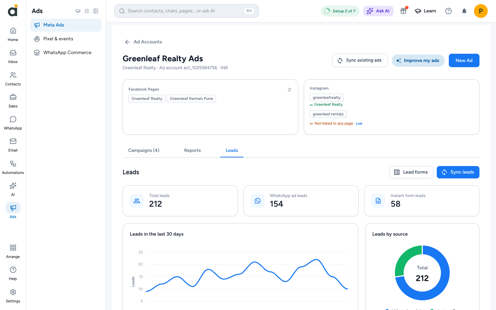

| Part | What it shows |
| --- | --- |
| **Total leads**, **WhatsApp ad leads**, **Instant form leads** | Everyone who came from this account's ads. A WhatsApp ad lead started a chat; an instant form lead filled in a form on Facebook or Instagram. |
| **Leads in the last 30 days** | Leads per day. A drop means an ad stopped or got tired. |
| **Leads by source** | WhatsApp ads against lead forms. |
| **Campaigns / Ad sets / Ads** | Ranked by leads: the top one brings the most. This is the answer to "which ad works". Put more budget behind the top ad, pause the bottom ones. |
| Leads list | Every lead: **Lead** (name), **Contact** (phone, email), **Source**, **Ad ID**, **Date**. The chat icon opens their WhatsApp chat; the form icon shows their form answers. **Search by name, email or phone** finds one. |
| **Sync leads** | Brings in lead-form leads Meta has that AdsEra doesn't yet. |
| **Lead forms** | Your instant forms: see [Lead forms](/help/ads/pages#lead-forms). |

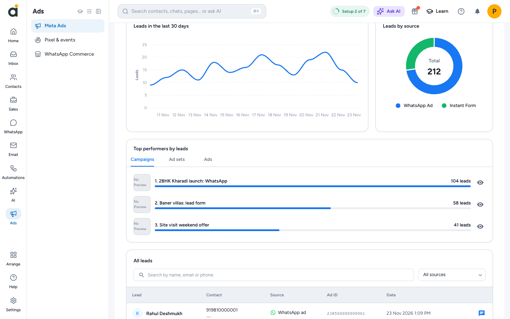

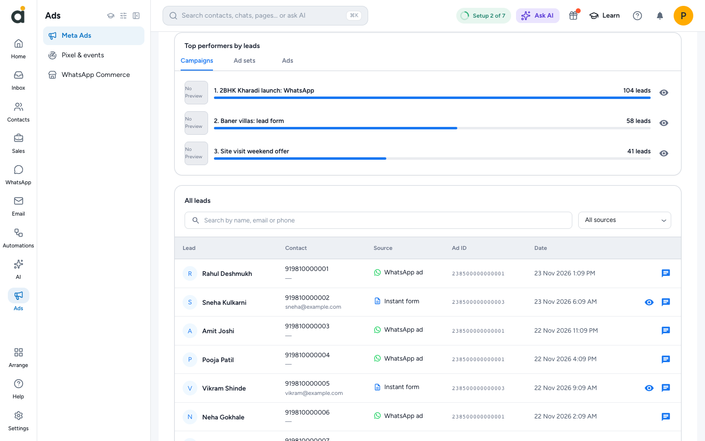

Every lead also lands in **Contacts** and in **Prospects**, with the ad it came from on the contact's page (**Ad leads**).

## Reports tab

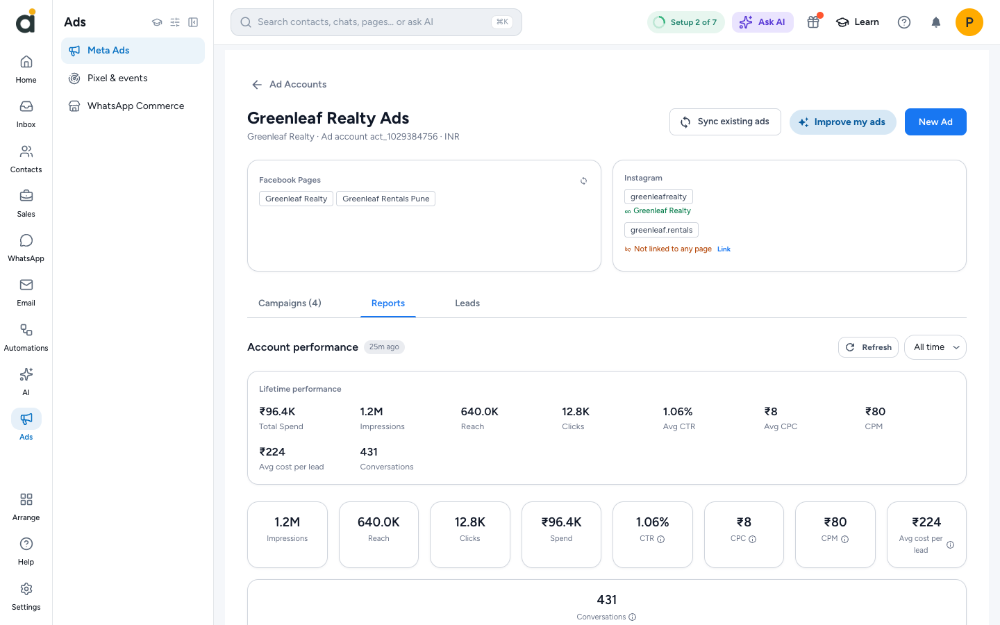

Pick the dates on the right: **Last 7 days**, **Last 30 days**, **Last 90 days**, **This month**, **Last month**, **Last quarter**, **All time** or **Custom Range**. **Refresh** gets fresh numbers from Meta; the chip next to the title says how old they are (you can refresh every 15 minutes).

| Number | Meaning |
| --- | --- |
| **Impressions** | Times your ads were shown. |
| **Reach** | Different people who saw them. |
| **Clicks** | Clicks on your ads. |
| **Spend** | What you spent. |
| **CTR** | Clicks per 100 views. Higher means the ad suits its audience. |
| **CPC** | Cost per click. |
| **CPM** | Cost per 1,000 views. |
| **Avg cost per lead** | Spend divided by conversations started. |
| **Conversations** | WhatsApp chats started within 7 days of seeing or clicking an ad. |

Then the daily trends (spend, impressions, clicks, CTR), and **Audience breakdown**: age and gender (**All / Men / Women**), country, Facebook or Instagram, and placements (feed, stories, reels, marketplace).

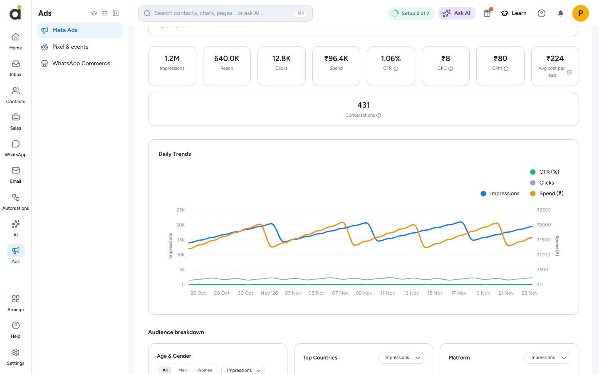

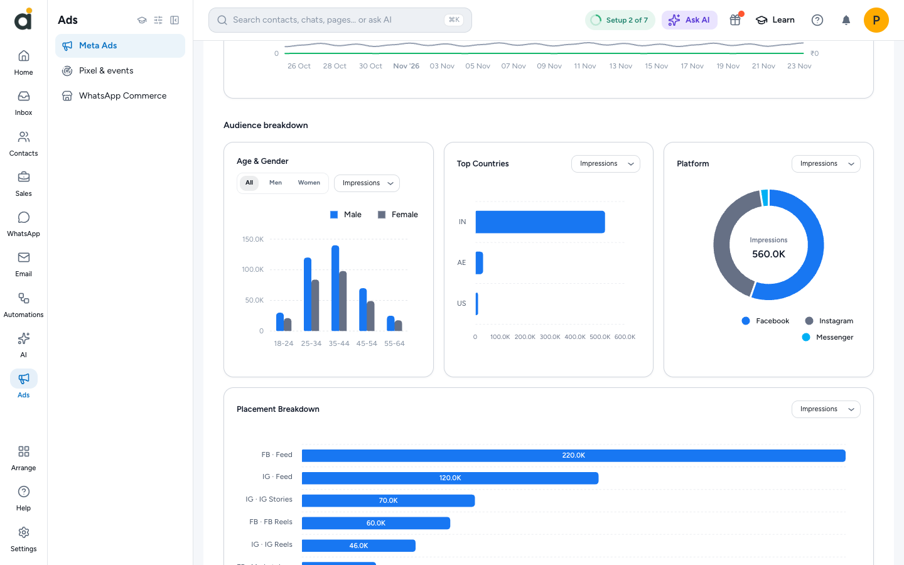

At the bottom, a table compares your campaigns for the dates. **Insights →** on a campaign opens its own page.

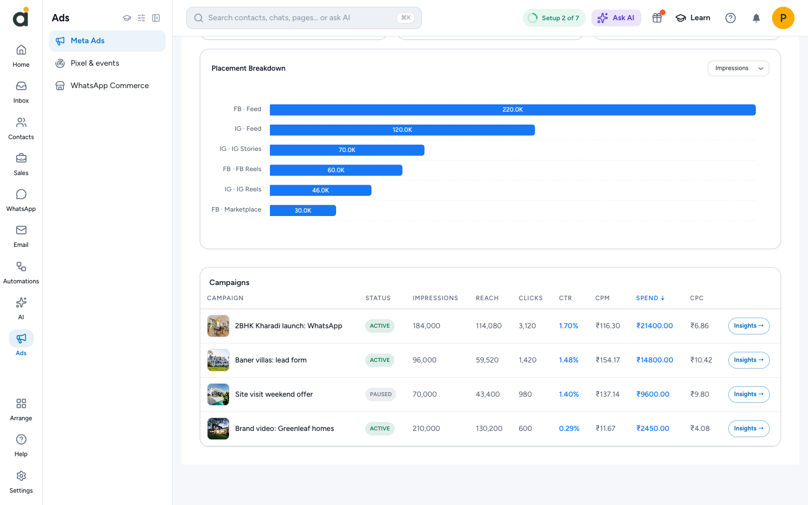

## One campaign's insights

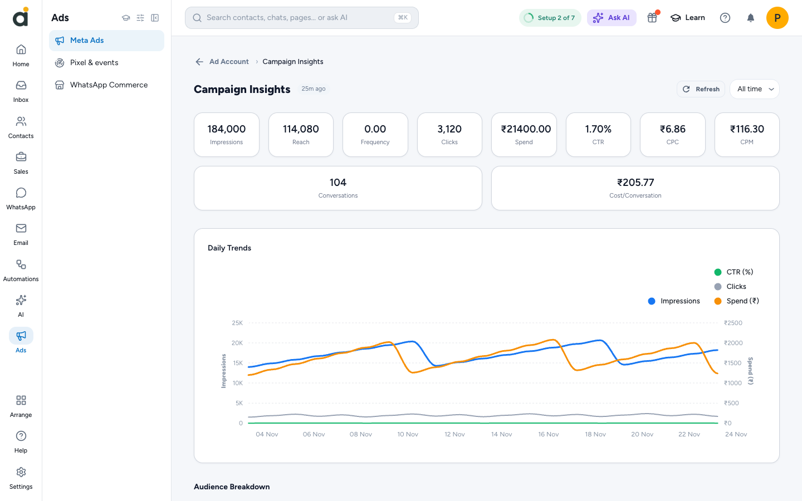

The same numbers for one campaign, plus **Frequency** (how often each person saw it), its audience, and each ad set and ad with their own numbers. Pick the dates at the top right; **Ad Account** goes back.

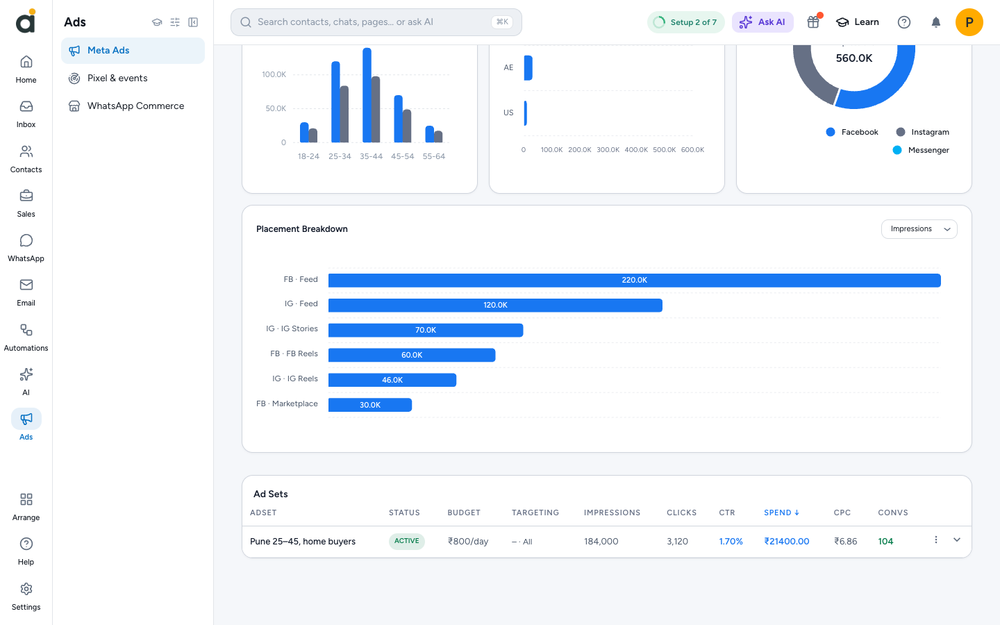

## Troubleshooting

| You see | Why | Fix |
| --- | --- | --- |
| **No Campaigns Yet** | Nothing synced yet. | **Sync Existing Ads** to bring in campaigns from Meta, or **Create Ad**. |
| A banner says numbers are syncing | AdsEra is fetching numbers from Meta in the background. | Wait a minute; the page reloads by itself. |
| *Meta API rate limit reached* | Meta limits how often numbers can be fetched. | They refresh by themselves in about 15 minutes. |
| No Leads or Cost per lead column | No campaign in the list brought leads (awareness or website ads). | Normal. |
| A lead from a lead form is missing | Meta didn't send it yet. | **Sync leads** on the Leads tab. |

## FAQs

<AccordionGroup>
<Accordion title="Why don't AdsEra's numbers match Ads Manager exactly?">
Meta keeps updating numbers for a few days, and AdsEra shows them as of the last refresh (see the chip next to the title). Click **Refresh** for the latest.
</Accordion>
<Accordion title="What counts as a lead?">
A chat started from a WhatsApp ad, or an instant form filled in. Website clicks don't count.
</Accordion>
<Accordion title="Does turning a campaign off here turn it off on Meta?">
Yes, at once.
</Accordion>
</AccordionGroup>

## Related

<CardGroup cols={2}>
<Card title="Create a WhatsApp ad" icon="wand-magic-sparkles" href="/help/ads/create">Build a new ad in 6 steps.</Card>
<Card title="Pixel & events" icon="radar" href="/help/ads/pixel-events">Tell Meta which leads became customers.</Card>
<Card title="Facebook Pages and lead forms" icon="facebook" href="/help/ads/pages">Your Pages, posts and instant forms.</Card>
<Card title="Prospects" icon="bullseye" href="/help/sales/prospects">Work your ad leads one by one.</Card>
</CardGroup>
