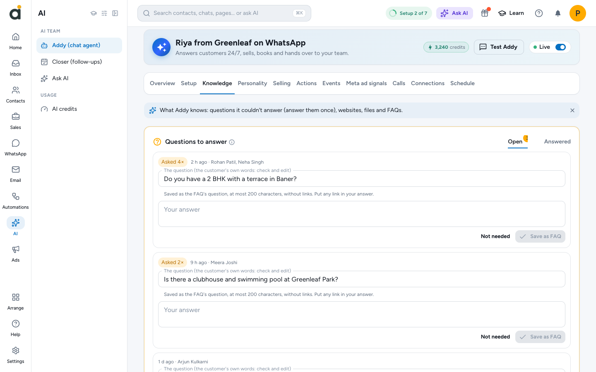
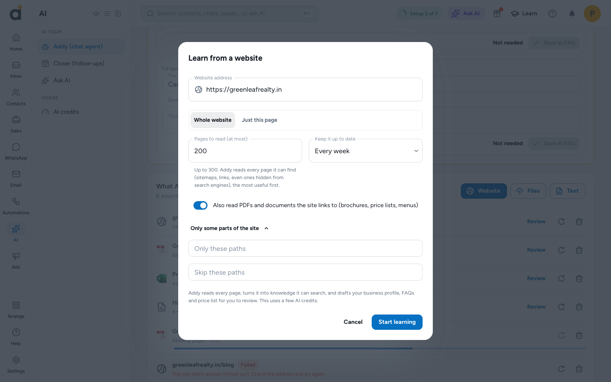
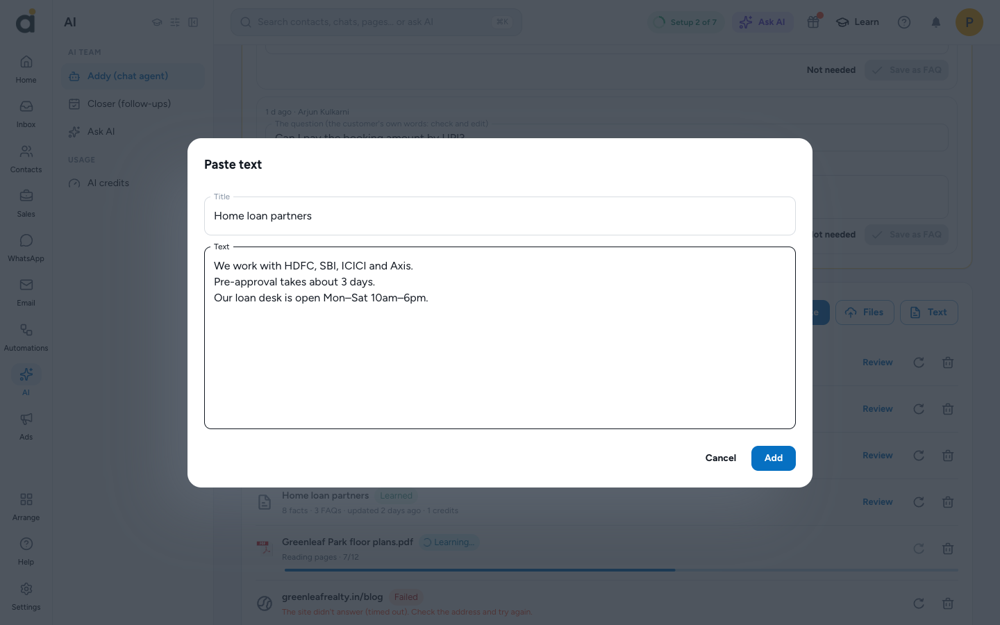
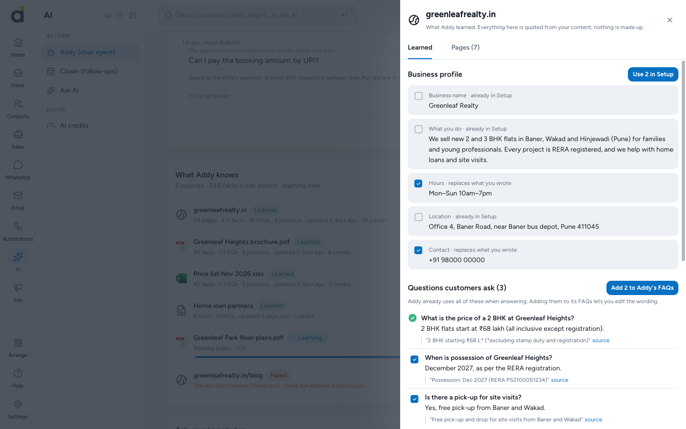
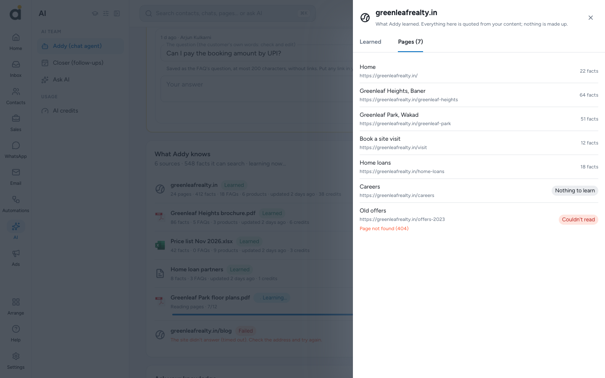
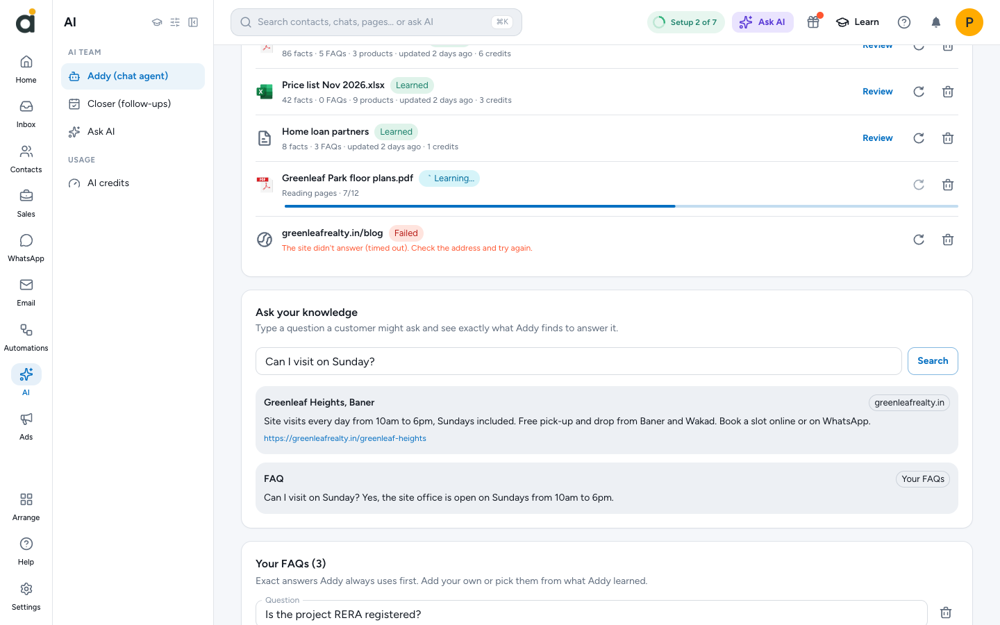
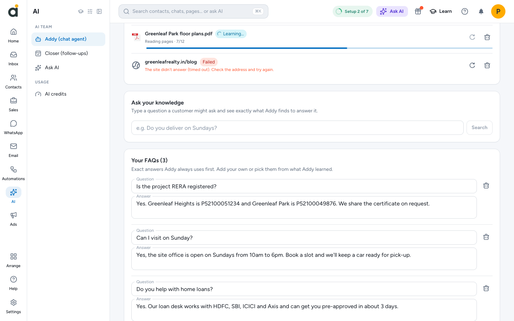

Addy answers customers only from three places: **About your business** (Setup tab), what it learned on the **Knowledge** tab, and **Your FAQs**. It never makes up a price or a date. Teach it well and it answers most questions on its own.

Open **AI → Addy (chat agent) → Knowledge**. Closer uses the same knowledge (**Closer → Setup → Knowledge**).

## Add what Addy should know

<Steps>
<Step title="Your website">
  Click **Website**.

  

  | Field | What it does | Example |
  |---|---|---|
  | Website address | The site or page to read. Required. | https://greenleafrealty.in |
  | Whole website / Just this page | Read every page it can find (the most useful first), or only this address. | Whole website |
  | Pages to read (at most) | Up to 300. | 200 |
  | Keep it up to date | Every day, Every week, Every month, or Never (I'll re-sync myself). | Every week |
  | Also read PDFs and documents the site links to | Brochures, price lists, menus on your site. | On |
  | Only some parts of the site | **Only these paths** (like /projects) or **Skip these paths** (like /blog, /careers). | Optional |

  Click **Start learning**. Addy reads the pages, then drafts your business profile, FAQs and price list for you to review.
</Step>
<Step title="Files">
  Click **Files**, or drop files on the card: brochures, price lists, menus, catalogues. PDF (scanned too), Word, PowerPoint, Excel/CSV, photos (PNG, JPG, WebP), text, Markdown or HTML. Up to 25 MB each, 10 at a time.
</Step>
<Step title="Text">
  Click **Text**, give it a **Title** (like "Home loan partners") and paste at least a few lines: notes, a price list, policies, scripts your team uses. Click **Add**.

  
</Step>
</Steps>

Reading a website or file uses a few AI credits (about 2–5).

### What each status means

| Status | Meaning | What to do |
|---|---|---|
| **Learned** | Ready. The line shows pages, facts, FAQs, products and when it was updated. | Click **Review**. |
| **Learning…** | Reading now; the bar shows how far (like "Reading pages · 7/12"). | Wait. You get a message when it's done. |
| **Waiting** | In the queue. | Wait. |
| **Failed** | The reason shows in red, like "The site didn't answer (timed out)". | Check the address or file and click the refresh icon. |

The refresh icon reads a source again now. The bin removes it: Addy forgets everything it learned from it (FAQs you already added stay).

## Review what Addy learned

Click **Review** next to a learned source. Everything is quoted from your content; nothing is made up.

| Section | What to do |
|---|---|
| **Business profile** | Tick the lines you want and click **Use … in Setup**. It says "replaces what you wrote" when a line would change your text. |
| **Questions customers ask** | Addy already uses all of these. Tick some and click **Add … to Addy's FAQs** to edit their wording later. |
| **How to sell** | Typical customers, questions that qualify a lead, why customers choose you, doubts and answers. **Use in Addy** adds them to [Selling](/help/ai/addy-selling). |
| **Products and prices** | Prices found. **Exact** means read straight from the page's product data. |
| **Pages** (or **Content**) | Every page read, with facts found. **Couldn't read** or **Nothing to learn** shows which gave nothing. |

## Ask your knowledge

Type a question a customer might ask and click **Search**: you see exactly what Addy would answer from. If nothing is found, add a page or file that answers it, or an FAQ.

## Questions to answer

When a customer asks something Addy can't find, it doesn't guess: it tells them your team will check, lists the question under **Questions to answer** and creates a task for your team.

1. Check **The question**: it's the customer's own words. Make it the plain question (at most 200 characters, no links).
2. Write **Your answer** the way you want a customer to hear it (links go here).
3. Click **Save as FAQ**. Addy answers it from now on. **Not needed** drops it.

**Asked 4×** means four customers asked it; the most asked come first. **Answered** shows the ones you answered.

## Your FAQs

Exact answers Addy always uses first. Edit any **Question** or **Answer**, click the bin to remove one, or **Add a question**. Then click **Save** at the top of the page.

## FAQ

<AccordionGroup>
<Accordion title="Does Addy use my whole website at once?">
  It searches what it learned for each question and answers from the best matches. Use Ask your knowledge to see what it finds.
</Accordion>
<Accordion title="I changed my prices. What now?">
  Edit Setup and your FAQs, and click the refresh icon on your website or price list so Addy reads it again.
</Accordion>
<Accordion title="Is my data used to train public AI?">
  Your knowledge is used to answer your own customers. Ask AdsEra support at contact@adsera.in for the details of how it's stored.
</Accordion>
</AccordionGroup>

## Related

<CardGroup cols={2}>
<Card title="Addy, tab by tab" icon="robot" href="/help/ai/addy">Setup, schedule, personality, test.</Card>
<Card title="Addy selling" icon="bullseye" href="/help/ai/addy-selling">Qualify, score, book and sell.</Card>
</CardGroup>
