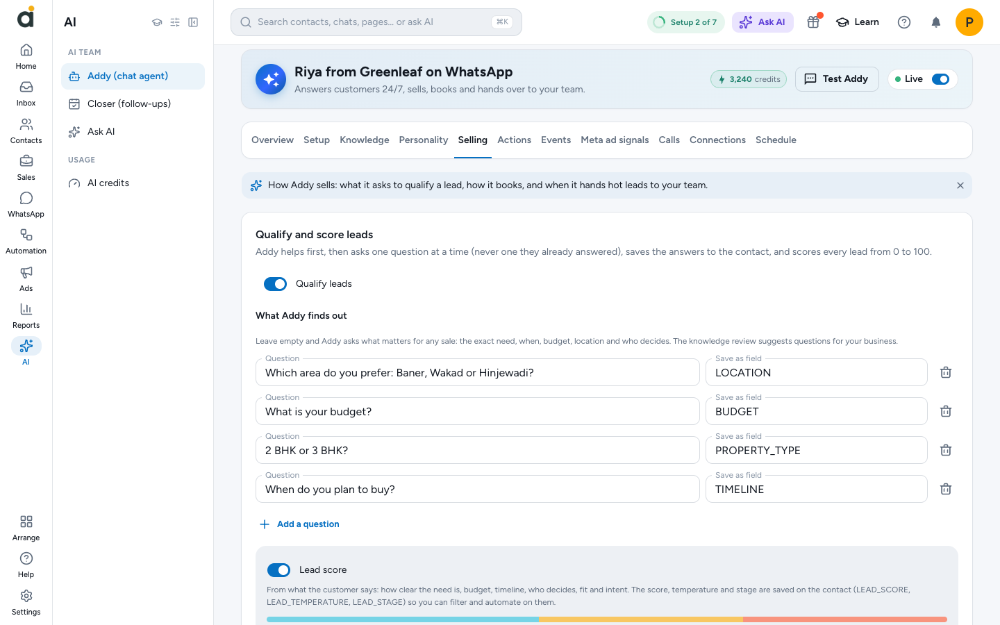
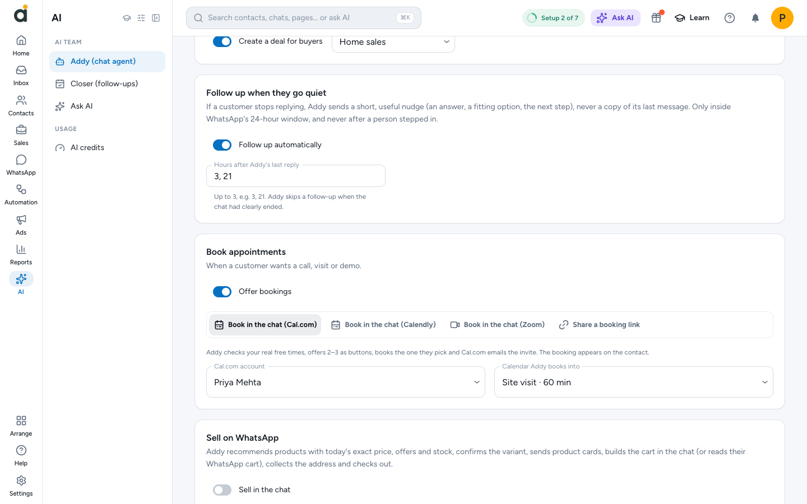
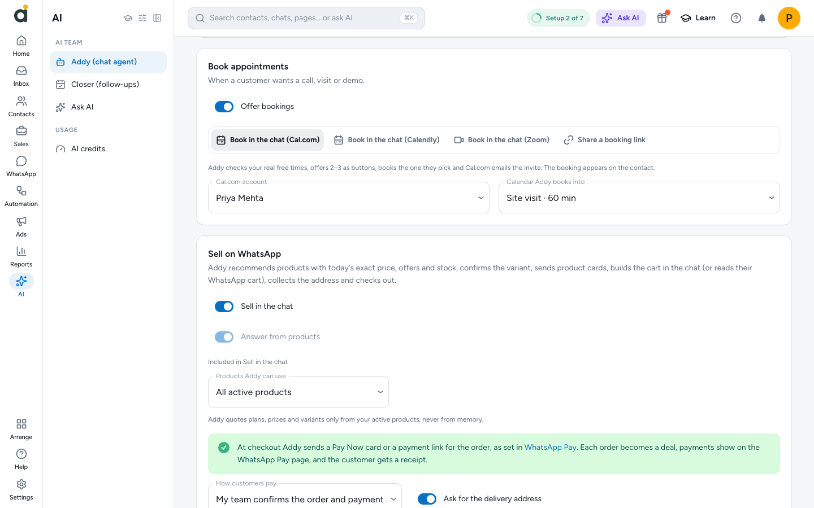
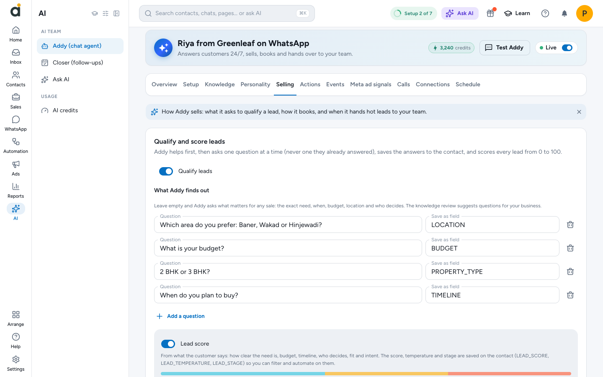

The **Selling** tab decides how Addy turns a chat into a sale. Open **AI → Addy (chat agent) → Selling**. After any change, click **Save** at the top of the page.

## Qualify and score leads

Addy helps first, then asks one question at a time (never one already answered), saves the answers on the contact, and scores every lead from 0 to 100.

| Setting | What it does | Example |
|---|---|---|
| **Qualify leads** | On: Addy asks your questions. | On |
| Question | What Addy asks. Leave the list empty and it asks what matters for any sale: the need, when, budget, location and who decides. | What is your budget? |
| Save as field | The contact field the answer goes into (capitals). | BUDGET |
| **Add a question** | Up to 10. | |
| **Lead score** | Scores from the need, budget, timeline, who decides, fit and intent. The score, temperature and stage are saved on the contact (LEAD_SCORE, LEAD_TEMPERATURE, LEAD_STAGE) so you can filter on them. | On |
| Slider | When a lead is warm and hot (default warm at 40, hot at 70). A hot lead gets a deal, a high-priority task and a "Hot lead" label, and Addy moves on to booking or ordering. | 40 / 70 |
| **Create a deal for buyers** + Pipeline | Addy creates a deal for real buyers. | Home sales |

The knowledge review can suggest questions for your business: see [Teach Addy](/help/ai/addy-knowledge#review-what-addy-learned).

## Follow up when they go quiet

If a customer stops replying, Addy sends a short, useful nudge (an answer, a fitting option, the next step), never a copy of its last message. Only inside WhatsApp's 24-hour window, and never after a person stepped in.

| Setting | Example |
|---|---|
| **Follow up automatically** | On |
| Hours after Addy's last reply | 3, 21 (up to 3 times) |

For leads quiet for days or weeks, use [Closer](/help/ai/closer).

## Book appointments

Switch on **Offer bookings**, then pick how:

| Choice | What Addy does | You need |
|---|---|---|
| **Book in the chat (Cal.com)** | Checks your real free times, offers 2–3 as buttons, books the one picked; Cal.com emails the invite. | Cal.com connected in Connected tools; pick the **Cal.com account** and **Calendar Addy books into**. |
| **Book in the chat (Calendly)** | Same with Calendly. On Calendly plans that can't book directly, Addy sends a one-time link to confirm. | Calendly connected. |
| **Book in the chat (Zoom)** | Offers free times inside your Zoom booking hours, books a Zoom meeting and sends the join link. | Zoom connected; set hours in **Connected tools → Zoom → Booking for Addy**. |
| **Share a booking link** | Sends your link. | **Booking link** (https) and **What it's called**, like "Book a site visit". |

The booking shows on the contact.

## Sell on WhatsApp

| Setting | What it does |
|---|---|
| **Sell in the chat** | Addy recommends products with today's price, offers and stock, confirms the variant, sends product cards, builds the cart, collects the address and checks out. |
| **Answer from products** | Only quote from your products (included when selling is on). |
| Products Addy can use | **All active products**, or **Only selected products**. Addy never quotes from memory. |
| How customers pay | As set in WhatsApp Pay settings; Pay Now card in WhatsApp only; Payment link only; or My team confirms the order and payment. |
| **Ask for the delivery address** | On for things you deliver. |

If none of Addy's numbers has a WhatsApp catalog, Addy can describe products but not send product cards: **Set up the catalog** in WhatsApp → WhatsApp Commerce. Each order becomes a deal and the customer gets a receipt.

## How Addy sells

True reasons to choose you and honest answers to common doubts. Addy uses them when they fit, never to pressure. Closer uses them too.

| Field | Example |
|---|---|
| Your typical customers | IT professionals working in Hinjewadi who want a 2 BHK within 30 minutes of work |
| Why customers choose you (**Add a reason**, up to 10) | RERA registered projects only |
| Doubt / Answer (**Add a doubt**, up to 12) | "Possession may get delayed" / "Greenleaf Park is ready to move." |

## Send results to Meta

The card **Send these results to Meta (Meta ad signals)** opens the Meta ad signals tab: see [Addy → Meta ad signals](/help/ai/addy#meta-ad-signals).

## Hand over to your team

See [Addy → Hand over](/help/ai/addy#hand-over-to-your-team-and-back).

## Related

<CardGroup cols={2}>
<Card title="Addy, tab by tab" icon="robot" href="/help/ai/addy">Setup, schedule, personality, test.</Card>
<Card title="Products" icon="box" href="/help/crm/product">The products Addy quotes from.</Card>
</CardGroup>
