**Addy** is your AI agent on WhatsApp. It answers customers from what you teach it, asks your questions, scores leads, books site visits and calls, sells products, and hands the chat to your team when a person is needed.

Use it when you get more WhatsApp messages than your team can answer quickly, or when customers write at night and on Sundays.

<Note>
  **Addy** is only the WhatsApp agent. The assistant that sets things up for you inside AdsEra is called [Ask AI](/help/ai/ask-ai). Switching Addy off does not switch Ask AI off.
</Note>

## Where to find it

Open **AI → Addy (chat agent)** in the menu on the left. The page has 11 tabs: **Overview, Setup, Knowledge, Personality, Selling, Actions, Events, Meta ad signals, Calls, Connections, Schedule**.

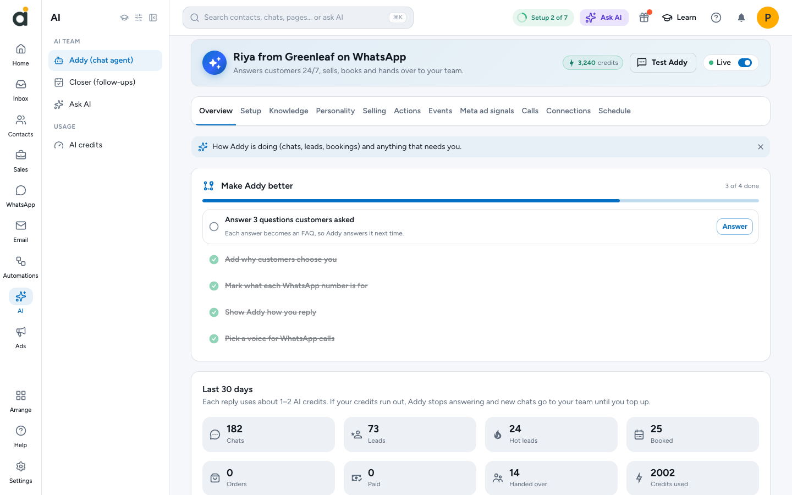

The top of the page always shows:

| Part | What it does |
|---|---|
| Name and line | The name customers see, like **Riya from Greenleaf on WhatsApp**. |
| Credits chip (⚡ 3,240 credits) | AI credits left for your whole account. Click it for details or to top up. |
| **Unsaved changes · Discard · Save** | Appears when you change anything on any tab. Nothing changes for customers until you click **Save**. |
| **Test Addy** | Opens the test chat (see [Test Addy](#test-addy-and-switch-it-on)). |
| **Live / Off** switch | **Live**: Addy answers new messages. **Off**: Addy is paused and your team gets every chat. You can switch it on only after picking a WhatsApp number. |

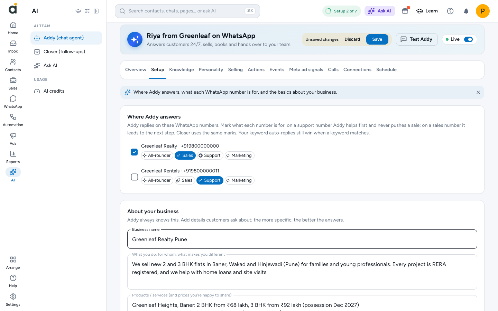

## Set Addy up in 5 steps

<Steps>
<Step title="Pick the numbers and describe your business (Setup tab)">
  Tick the WhatsApp numbers Addy answers on and fill in **About your business**. See [Setup](#setup).
</Step>
<Step title="Teach it (Knowledge tab)">
  Add your website, brochures and price lists. See [Teach Addy](/help/ai/addy-knowledge).
</Step>
<Step title="Choose when it answers (Schedule tab)">
  Pick **Only outside business hours** if your team answers during the day. See [Schedule](#schedule-only-at-night-or-only-in-office-hours).
</Step>
<Step title="Give it your style (Personality tab, optional)">
  Pick a style, a greeting and 2–3 example replies. See [Personality](#personality).
</Step>
<Step title="Test it, save, and switch it on">
  Click **Test Addy**, chat like a customer, then **Save** and switch Addy **Live**.
</Step>
</Steps>

<Tip>In the app, **Learn → AI** has a "Do it with me" lesson for every tab: it points at each field on the real page.</Tip>

## Overview

Before Addy is live, the Overview shows **Get Addy ready**: **Choose the WhatsApp number**, **Teach Addy your business**, **Give it a personality (optional)** and **Try it in the test chat**, each with a button that opens the right tab.

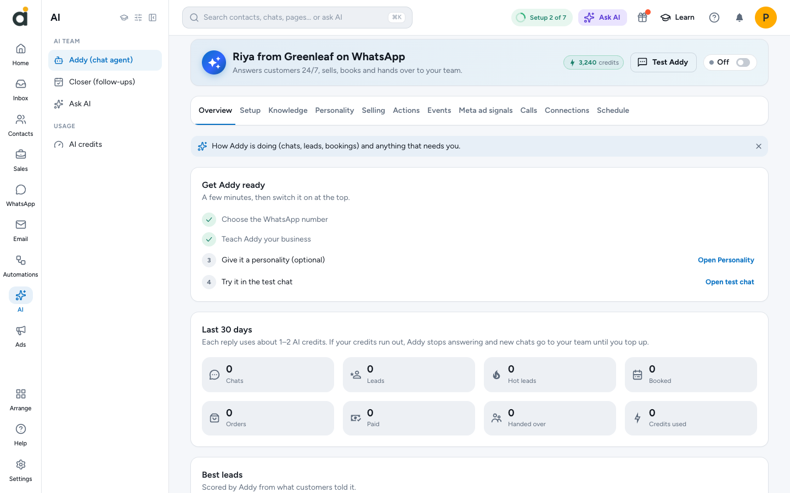

Once Addy is live it shows **Make Addy better**: answer the questions customers asked, add why customers choose you, mark what each number is for, show Addy how you reply, and pick a voice for calls.

| Card | What it shows |
|---|---|
| **Last 30 days** | Chats, Leads, Hot leads, Booked, Orders, Paid, Handed over and Credits used. Each reply uses about 1–2 AI credits. |
| **Best leads** | The best-scored leads (0–100). Red is hot, amber warm, blue cold. The line under each says why, like "Booked a site visit for Saturday; budget ₹70 lakh". |
| **Waiting for your team** | Chats Addy handed over, with the reason and a summary. **Open inbox** opens your chats; **Let Addy reply again** gives the chat back to Addy. |

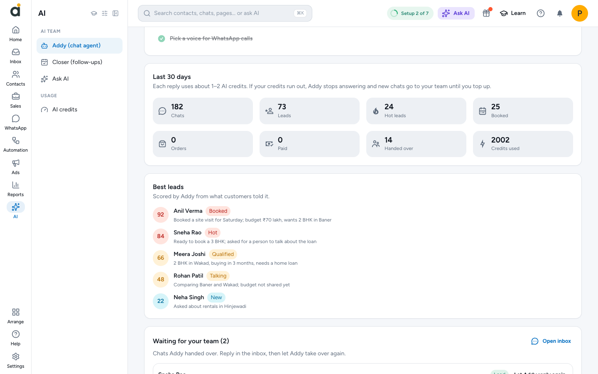

## Setup

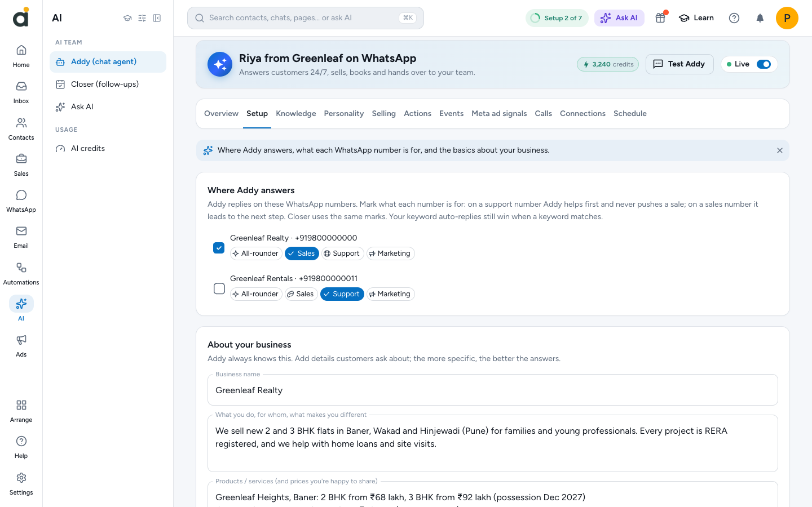

**Where Addy answers**: tick each WhatsApp number Addy should answer on. Under each number, tap what it's for. Tapping saves it at once, and Closer uses the same marks.

| Choice | What Addy does on that number |
|---|---|
| **Sales** | Warm leads, demos, bookings, payments: leads to the next step. |
| **Support** | Helps first and never pushes a sale. |
| **Marketing** | Offers, launches, cold leads. |
| **All-rounder** | Sales, support and updates. |

If Meta's own AI agent is live on a number, it says so in orange: Addy won't answer there. Your keyword auto-replies still win when a keyword matches.

**About your business**: Addy always knows what you write here.

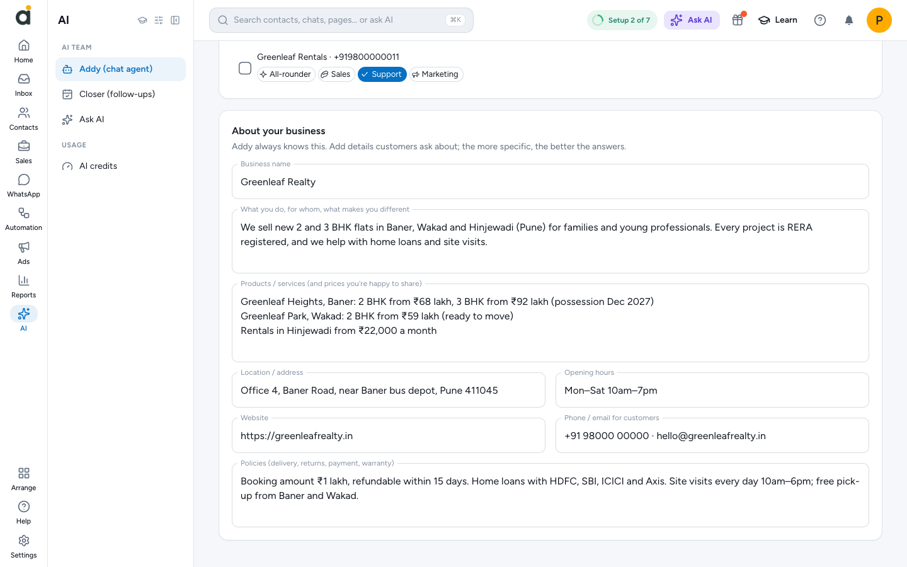

| Field | Example | Needed? |
|---|---|---|
| Business name | Greenleaf Realty | Yes |
| What you do, for whom, what makes you different | New 2 and 3 BHK flats in Baner and Wakad for families and IT professionals | Yes |
| Products / services (and prices you're happy to share) | 2 BHK from ₹68 lakh, 3 BHK from ₹92 lakh | Recommended |
| Location / address | Office 4, Baner Road, Pune 411045 | Recommended |
| Opening hours | Mon–Sat 10am–7pm | Recommended |
| Website | https://greenleafrealty.in | Optional |
| Phone / email for customers | +91 98000 00000 | Optional |
| Policies (delivery, returns, payment, warranty) | Booking amount ₹1 lakh, refundable within 15 days | Optional |

## Schedule: only at night, or only in office hours

Open the **Schedule** tab.

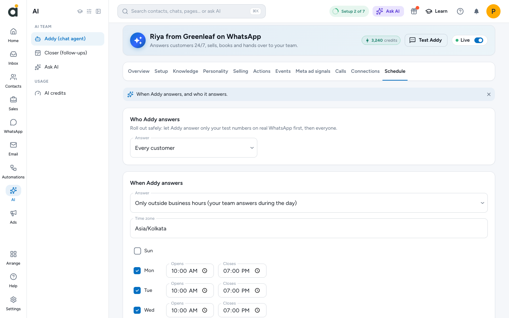

**Who Addy answers**

| Choice | What happens |
|---|---|
| **Every customer** | Addy answers everyone who writes to its numbers. |
| **Only these numbers (testing)** | Addy answers only the **Phone numbers** you list (one per line, with country code, like +91 98000 00000). Everyone else gets your usual auto-replies or your team. Use it to try Addy on your own phones first. |

**When Addy answers**

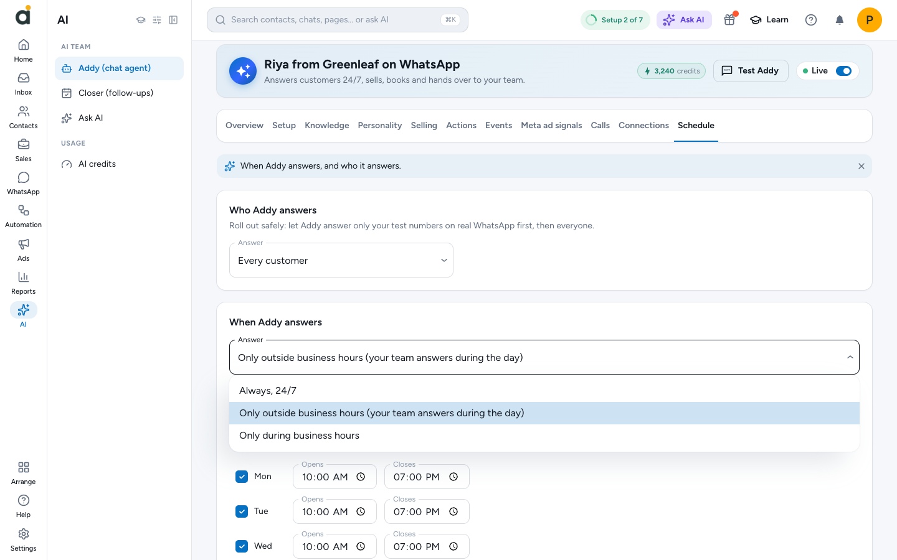

| Choice | What happens |
|---|---|
| **Always, 24/7** | Addy answers all the time. |
| **Only outside business hours (your team answers during the day)** | Your team answers during your hours; Addy answers at night and on days you mark as closed (there is no holiday calendar: untick a day to close it). |
| **Only during business hours** | Addy answers only during your hours. |

For the last two, check the **Time zone** (for India, Asia/Kolkata), tick each working day and set **Opens** and **Closes**. Then click **Save** at the top.

<Warning>
  A day you don't tick counts as **closed all day**: with "Only outside business hours", Addy answers all of that day. If you tick **no day at all**, Addy answers all the time.
</Warning>

These hours are also your team's hours: outside them, when Addy hands a chat over, it tells the customer when your team is back.

## Personality

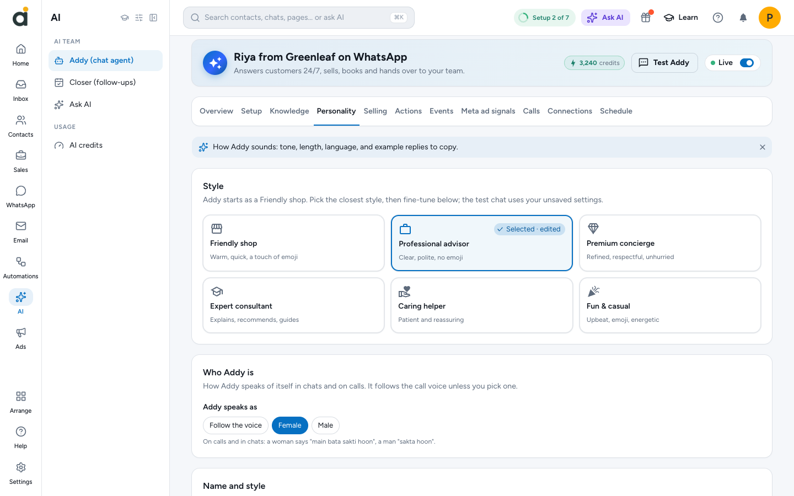

| Setting | Choices |
|---|---|
| **Style** | Friendly shop, Professional advisor, Premium concierge, Expert consultant, Caring helper, Fun & casual. One click sets everything below; you can still change it ("Selected · edited"). |
| **Addy speaks as** | Follow the voice, Female, Male. In Hindi and Hinglish this changes the words ("bata sakti hoon" / "sakta hoon"). |
| **Name customers see** | Like "Riya from Greenleaf". |
| **Tone** | Friendly, Professional, Premium, Expert, Caring, Playful. |
| **Reply length** | Short (1–3 sentences), Balanced (2–5), Detailed. |
| **Wording** | Casual, Natural, Formal. |
| **Addressing customers** | First name, Sir / Ma'am / -ji, No names. |
| **Emoji** | None, A few, More. |
| **Selling style** | Gentle (lets the customer lead), Balanced, Proactive (invites the next step every time). |
| **Language** | Match the customer's language, or always one language (English, Hindi, Hinglish, Marathi, Gujarati, Tamil, Telugu, Kannada, Malayalam, Bengali, Punjabi, Urdu, Arabic). Addy understands every language either way. |
| **Greeting for a new chat** | Addy opens new chats with it, adapted to what they asked. |
| **Sign-off on longer messages** | Like "– Team Greenleaf". |
| **Words to use / Words never to use** | Type one and press Enter. |
| **Reply examples** | Up to 6 pairs of **Customer says** and **Your team replies**. Addy copies the style and length, never the facts. |
| **Anything else** | Rules in your own words that Addy always follows. |

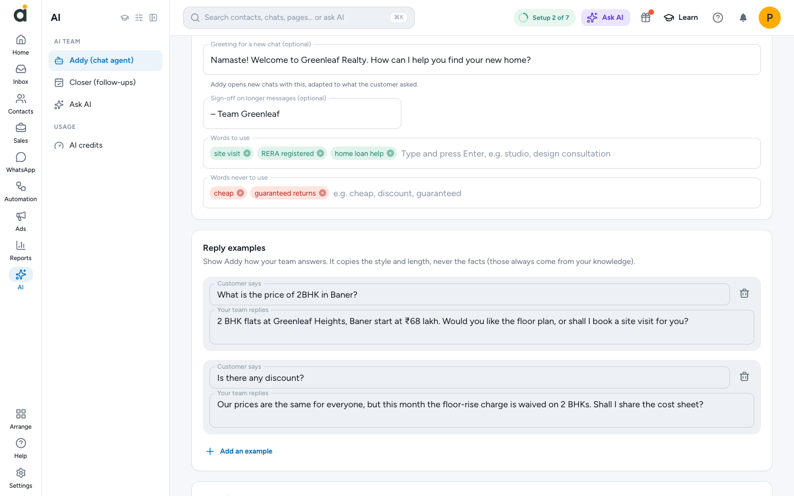

## Test Addy and switch it on

Click **Test Addy** at the top. You chat as a customer; nothing is saved or sent to anyone. The test chat uses the settings on screen, even ones you haven't saved.

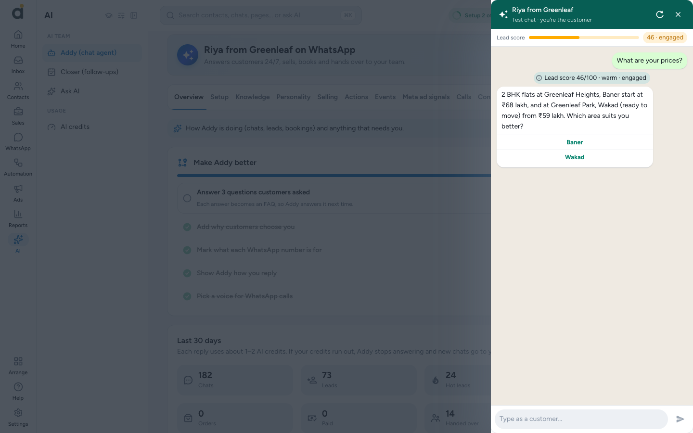

- Tap a sample question or type your own.
- The bar at the top shows the lead score as the chat goes.
- Grey notes show what Addy **would** do: save a detail, score the lead, book a slot, send a quick action, hand over.
- The refresh icon starts over. Each test reply uses AI credits like a real one.

When you're happy, close the test chat, click **Save** if you changed anything, and switch Addy **Live**. Addy answers **new** messages from then on.

## Hand over to your team, and back

Addy always hands over when a customer asks for a person, is upset, wants a refund or a discount, or when it can't find the answer. You can add your own reasons in **Selling → Hand over to your team**:

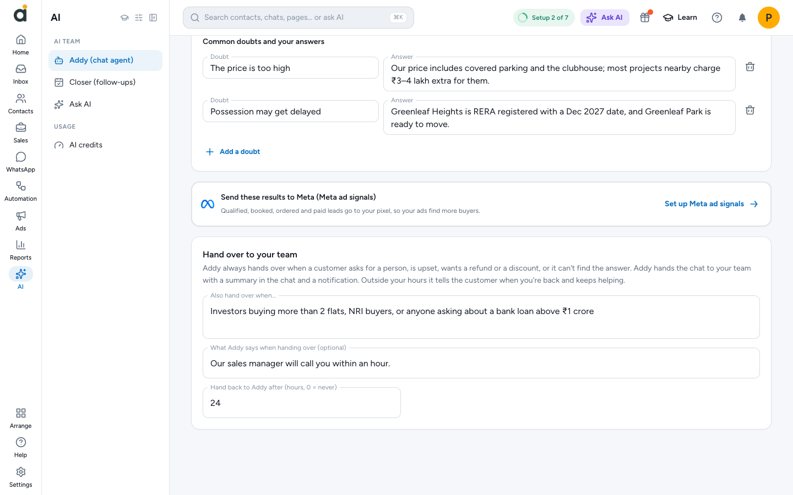

| Field | Example |
|---|---|
| Also hand over when… | Orders above ₹1 lakh, investors buying more than 2 flats |
| What Addy says when handing over (optional) | Our sales manager will call you within an hour. |
| Hand back to Addy after (hours, 0 = never) | 24 |

Your team gets a summary in the chat and a notification. When you reply yourself in the inbox, Addy stops in that chat. Give it back with **Let Addy reply again** on the Overview, or from the chat in the inbox.

## Actions

Ready-made WhatsApp messages Addy sends exactly as you set them up, when the moment fits.

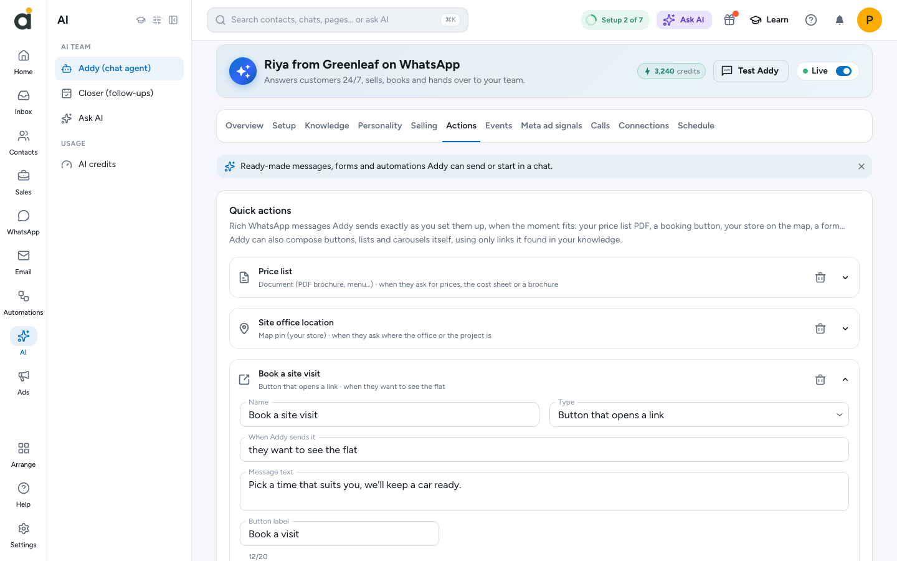

Click **Add a quick action**, give it a **Name** (only you see it), pick the **Type** and write **When Addy sends it** in plain words.

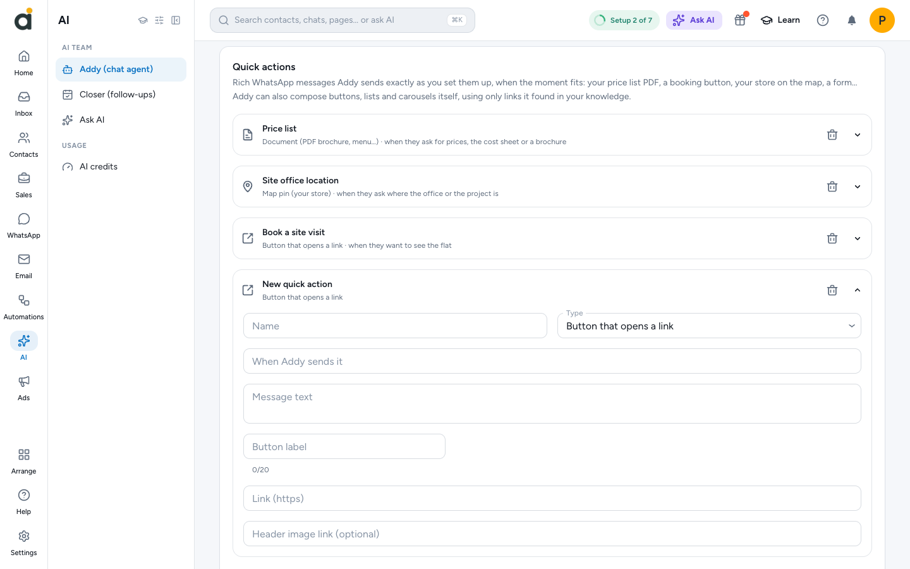

| Type | What you fill in |
|---|---|
| Button that opens a link | Message text, Button label (20 characters), Link (https), Header image link (optional) |
| Document (PDF brochure, menu…) | Caption, Document link (https), File name shown |
| Image | Caption, Image link (https) |
| List of choices | Message text, Button label, up to 10 choices (24 characters) with descriptions (72) |
| Carousel of cards | Message text, 2–10 cards: image link, card text (160), button and button link |
| Map pin (your store) | Latitude, Longitude, Place name, Address (in Google Maps, right-click your store and copy the numbers) |
| Ask for their location | Message text |
| WhatsApp Flow (form) | Message text, Button label, the WhatsApp Flow and its first screen |

**WhatsApp forms**: keep **Let Addy send forms** on. When Addy needs several details at once (address, booking details), it builds a short WhatsApp form and saves the answers on the contact. Forms work only on numbers connected through the official WhatsApp Business API; elsewhere Addy asks the questions one by one.

**Workflows Addy can start**: click **Add a workflow**, pick the **Workflow**, where to **Start at**, the **Name Addy sees** and **When it fits** (like "a hot lead who wants a site visit"). Each runs once per lead. Best for what happens after the chat (emails, reminders, team alerts).

## Events

Your website, shop or billing system sends an event (order shipped, payment received), and Addy tells the customer on WhatsApp in its own words.

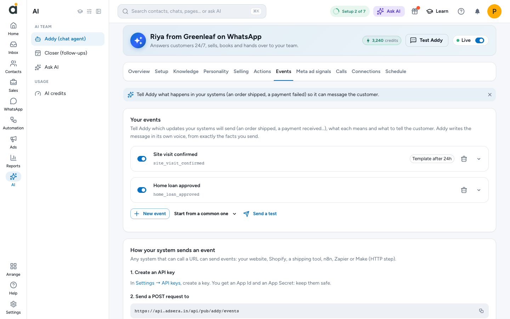

| Field | Example |
|---|---|
| Event name | Site visit confirmed (your system sends it as `site_visit_confirmed`) |
| What happened | A site visit was confirmed by our team. |
| What Addy should tell the customer | Confirm the date, time and pick-up point. |
| Facts your system sends | date, time, pickup_point (press Enter after each) |
| Approved template (after 24 hours) | WhatsApp allows only approved templates once a customer's last message is over 24 hours old. Pick one and fill its variables from the facts; with none, those customers are skipped. |

**Start from a common one** adds ready events: Order confirmed, Order shipped, Out for delivery, Order delivered, Payment received, Appointment reminder, Appointment rescheduled, Refund processed. The switch on each event turns it off.

**How your system sends an event** gives your developer the three steps: an API key from **Settings → API keys**, the address to send to, and an example. WhatsApp Pay payments and Cal.com bookings are handled automatically.

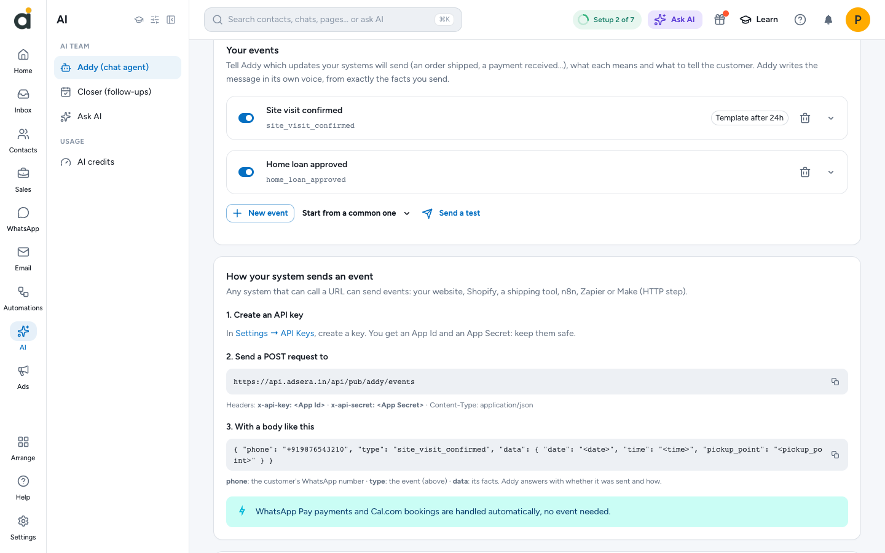

After saving, click **Send a test** and send an event to your own number (message Addy once first, so you're inside the 24-hour window). **Recent events** shows each result:

| Status | Meaning |
|---|---|
| Sent by Addy | Addy wrote and sent the message. |
| Sent as template | Their last message was over 24 hours ago, so the template went. |
| Not sent | With the reason: over 24 hours and no template, no contact with that number, Addy is switched off, the event is turned off, a team member is handling the chat, not in the test numbers list, out of AI credits, or Addy was replying at that moment. |
| Failed | WhatsApp refused it. |

## Meta ad signals

Addy tells Meta which leads from your ads became real customers, so Meta finds more people like them and your cost per customer drops. (Meta calls this the Conversions API.)

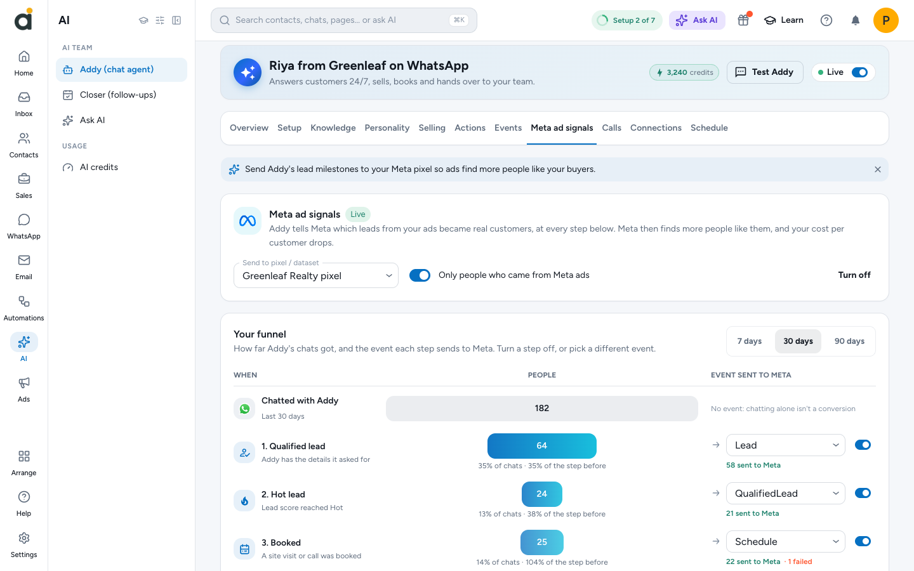

1. Pick the pixel in **Send to pixel / dataset** (set it up first in **Ads → Pixel & events**).
2. Keep **Only people who came from Meta ads** on.
3. In **Your funnel**, each step (Qualified lead, Hot lead, Booked, Started an order, Paid) sends the event on its right. Switch a step off or pick another event.
4. Click **Turn on** (later **Save changes**). **Turn off** stops sending.

**Recent events** shows each event as Sent, Sending, Skipped or Failed. Each person is sent once per step. "Paid" needs a pipeline with a Won stage.

## Calls

Addy can answer WhatsApp calls with a natural voice, using the same knowledge and personality as in chats.

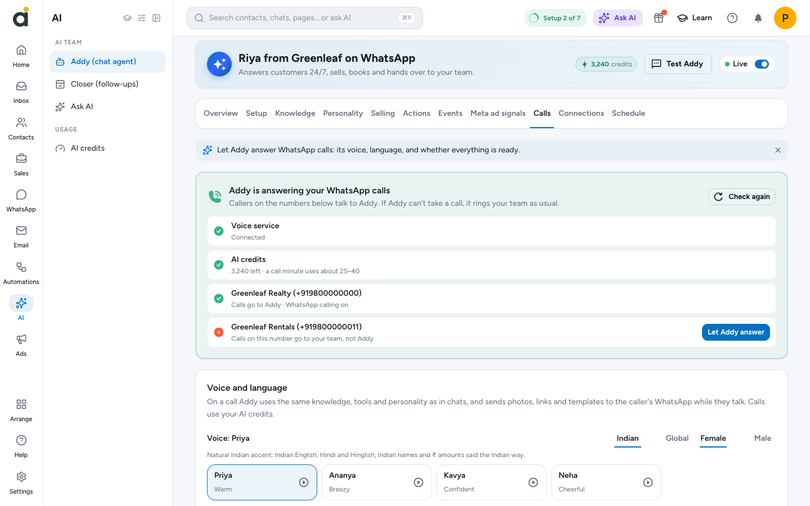

- The top card says **Addy is answering your WhatsApp calls** or **Addy isn't answering calls yet**, and checks the voice service, your AI credits and each number. Click **Let Addy answer** on a number to send its calls to Addy; **Check again** re-checks. Numbers that also use the WhatsApp Business app keep calls in the phone app.
- **Voice**: **Indian** or **Global**, **Female** or **Male**; click the play icon to hear a voice.
- **Language on calls** (Match the caller, or one language) and **Transcript language** (what your team reads).
- **How calls go**: send a short recap on WhatsApp after the call; record calls (Addy tells the caller); **Extra instructions for calls**.
- When a caller asks for a person, Addy rings whoever on your team is online and puts the call through. If nobody picks up it books a "Call back" task.

A call minute uses about 25–40 AI credits; the tab shows the exact figure. **Recent calls** lists each call: click it to read the transcript.

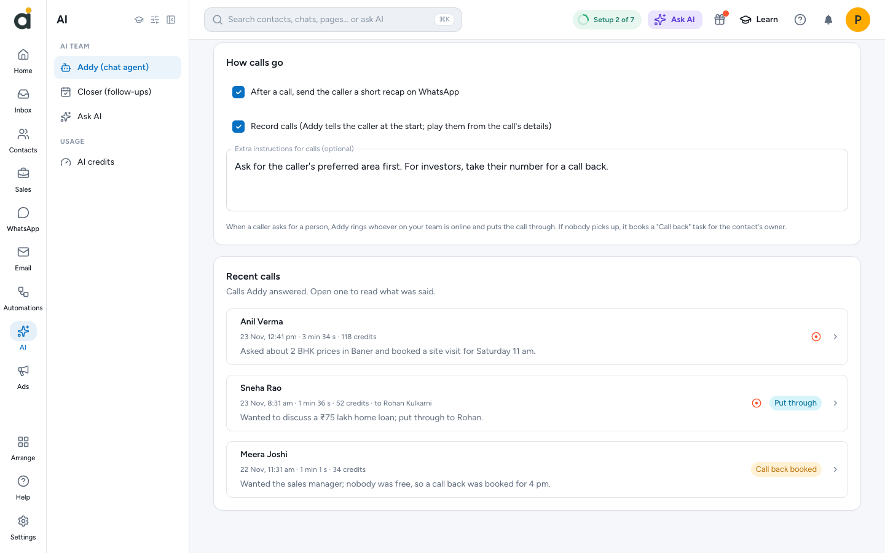

## Connections

Let Addy use your other systems (a stock sheet, orders, bookings) so it answers with live data. Connect the app once in **Marketplace**, then come back to choose what Addy may do with it in customer chats. Anything that changes something is used only after the customer confirms in the chat.

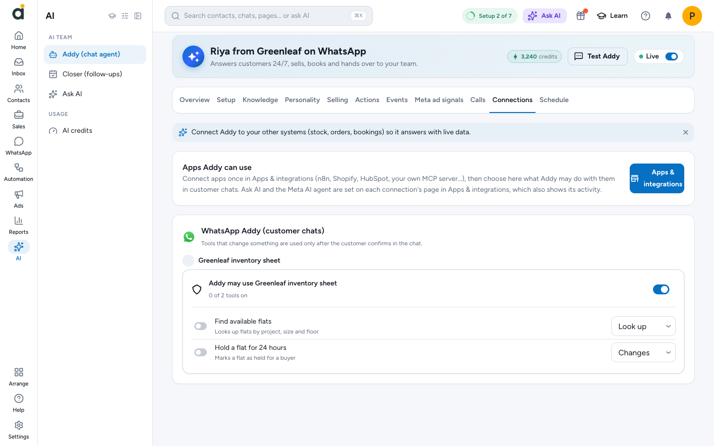

## What Addy costs

Addy uses your account's **AI credits**: about 1–2 credits a reply, 25–40 a call minute, 2–5 to read a website or file. See [AI credits](/help/ai/credits).

When your credits run out, Addy stops answering: keyword replies and flows still run, new chats go to your team, and the admin gets a task "Addy is out of credits". Top up and Addy carries on.

## Troubleshooting

| Problem | Fix |
|---|---|
| The Live switch is grey | Tick a number in **Setup → Where Addy answers** and click **Save**. |
| Addy doesn't answer during the day | **Schedule** is set to **Only outside business hours**. That's on purpose; change it to **Always, 24/7** if you want. |
| Addy answers on Sunday too | Sunday isn't ticked, so it counts as closed. Tick it and set hours. |
| Addy says "I'll check with the team" | It couldn't find the answer. Answer it once in **Knowledge → Questions to answer**. |
| Addy stopped in one chat | Someone on your team replied, or it handed over. Click **Let Addy reply again**. |
| Addy stopped everywhere | Your AI credits ran out, or Addy is **Off**. Check the credits chip. |
| A customer isn't answered | They're not in **Only these numbers (testing)**, or Meta's AI agent is live on that number. |

## FAQ

<AccordionGroup>
<Accordion title="Does Addy answer old chats when I switch it on?">
  No. It answers new messages from then on.
</Accordion>
<Accordion title="Can Addy make up a price?">
  No. It quotes only what you wrote, your knowledge and your products. When it can't find something, it says your team will check.
</Accordion>
<Accordion title="Which languages does Addy speak?">
  It understands every language and, by default, answers in the customer's language. You can fix one language in Personality.
</Accordion>
<Accordion title="How do I stop Addy for one chat?">
  Reply in that chat yourself (or click Take over in the inbox). Addy stays quiet there until you hand it back.
</Accordion>
<Accordion title="Is Addy the same as Ask AI?">
  No. Addy talks to your customers on WhatsApp. Ask AI helps you inside AdsEra.
</Accordion>
</AccordionGroup>

## Related

<CardGroup cols={2}>
<Card title="Teach Addy" icon="book-open" href="/help/ai/addy-knowledge">Website, files, FAQs and questions to answer.</Card>
<Card title="Addy selling" icon="bullseye" href="/help/ai/addy-selling">Qualify, score, book and sell.</Card>
<Card title="Closer" icon="calendar-check" href="/help/ai/closer">Follow up with leads who went quiet.</Card>
<Card title="AI credits" icon="bolt" href="/help/ai/credits">What Addy uses and how to top up.</Card>
</CardGroup>
