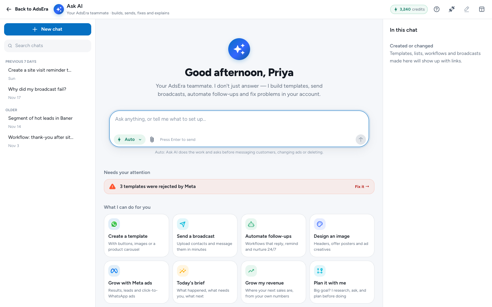
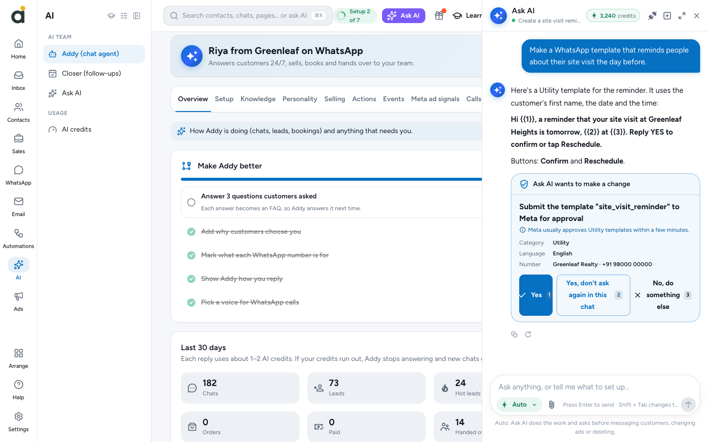
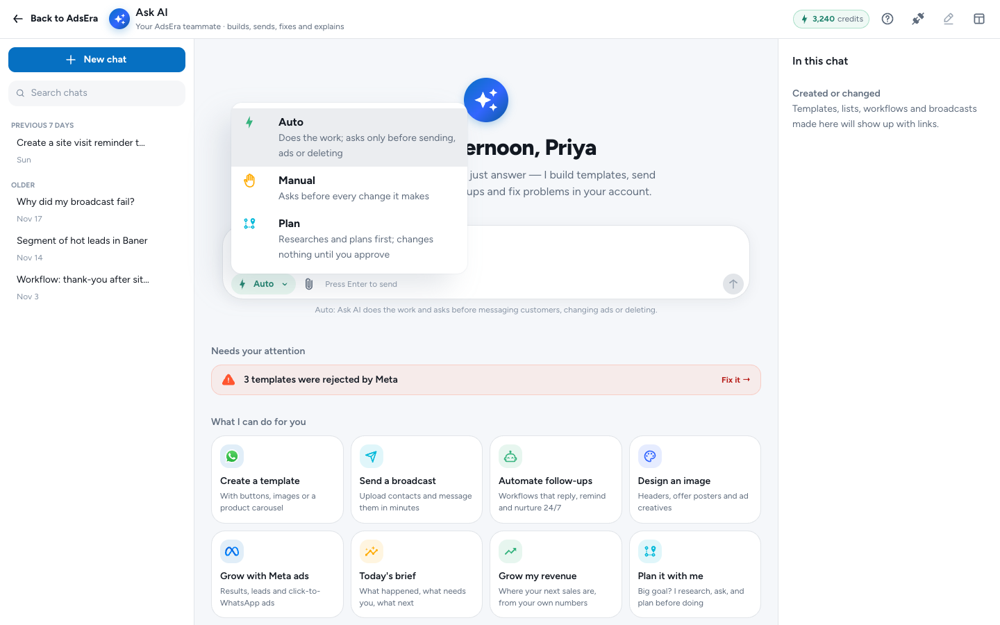
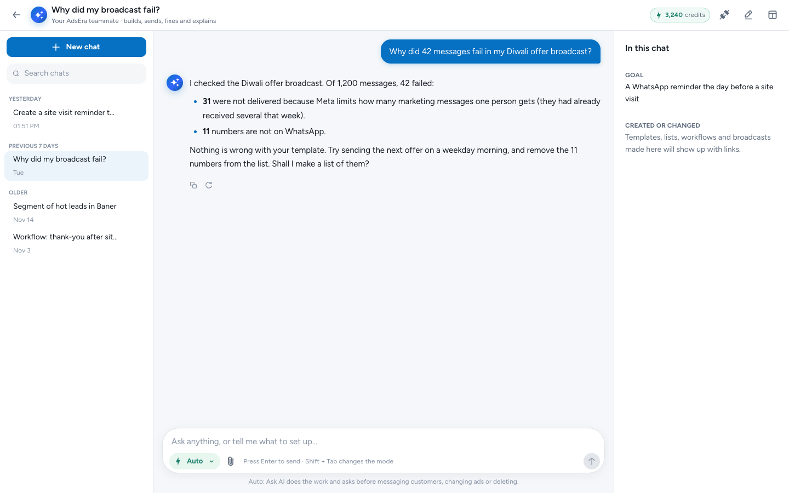
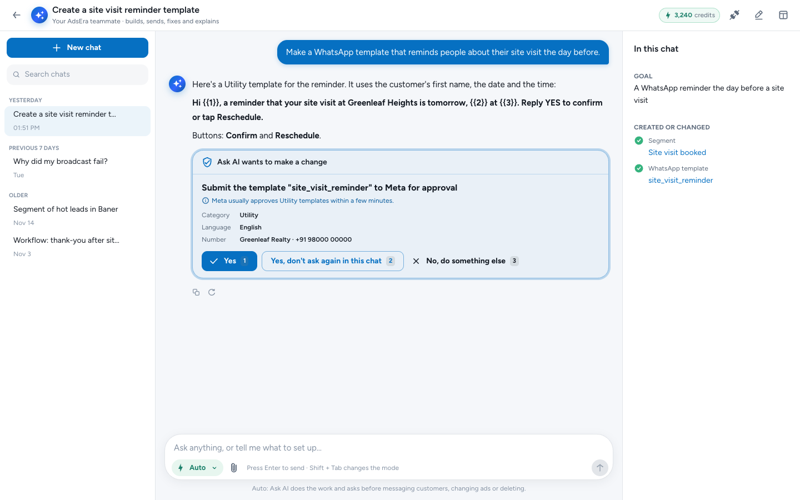
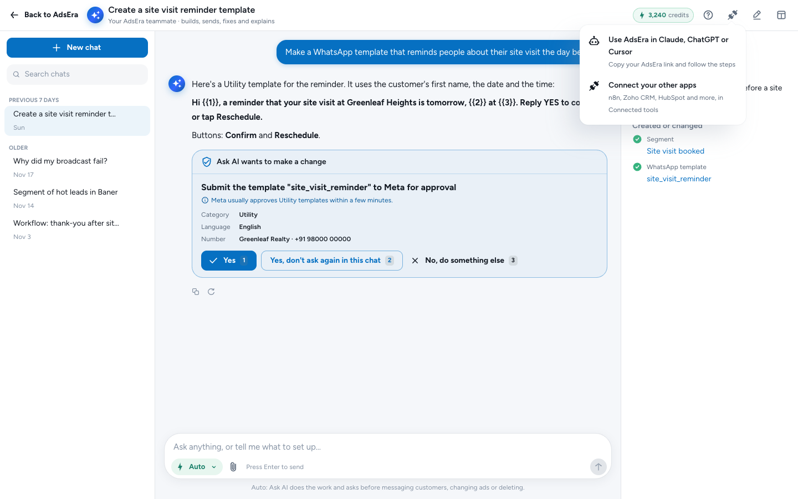

**Ask AI** is the assistant your team chats with inside AdsEra. Ask it about your numbers in plain words, or ask it to do the work: create a template, import contacts and send a broadcast, build a workflow, design an offer image, explain a broadcast report or check your Meta ads.

<Note>
  Ask AI is not [Addy](/help/ai/addy). Addy talks to your customers on WhatsApp; Ask AI helps you and your team inside AdsEra.
</Note>

## Where to find it

- **From any page**: click **Ask AI** at the top (or press **Ctrl J**, **⌘J** on a Mac). It opens beside the page and knows which page you're on.
- **Full page**: **AI → Ask AI** in the menu, with all your chats.
- **Search bar**: click the search at the top (**Ctrl K**, **⌘K**) to jump to a page or chat, or type a question and pick **Ask AI: "…"**.
- **Buttons on pages**: like **Explain & improve** on a broadcast report, **Why did these fail?**, **Improve my ads**, **Organise with AI** in Contacts, or the ✨ icon on a rejected template.

If you don't see **Ask AI**, it's switched off for your account: write to [contact@adsera.in](mailto:contact@adsera.in).

## Ask for something

<Steps>
<Step title="Say what you want">
  Tap an idea (**Create a template**, **Send a broadcast**, **Automate follow-ups**, **Design an image**, **Grow with Meta ads**, **Today's brief**, **Grow my revenue**, **Plan it with me**) or type in your own words, like "Make a WhatsApp template that reminds people about their site visit the day before". **Needs your attention** lists problems it found, with **Fix it**.
</Step>
<Step title="Pick the mode">
  Click the mode button under the box (Shift + Tab also changes it):

  

  | Mode | What it does |
  |---|---|
  | **Manual** | Asks before every change it makes. |
  | **Auto** | Does the work and asks before messaging customers, changing ads or deleting. |
  | **Plan** | Researches and plans first; nothing changes until you approve the plan. |
</Step>
<Step title="Attach a file if it helps">
  The paperclip attaches Excel, CSV, photos, video, PDF or audio, like a contact list to import.
</Step>
<Step title="Press Enter">
  Ask AI shows each step as it works, then answers with links to what it made.
</Step>
</Steps>

## Approve or stop a change

Before Ask AI changes something in your account (submits a template, sends, creates, deletes, books), it shows a card with exactly what it will do and the details, then waits.

| Button | What happens |
|---|---|
| **Yes** (or press 1) | Does it once. |
| **Yes, don't ask again in this chat** (2) | Does it, and the same kind of change without asking for the rest of this chat. |
| **No, do something else** (3) | Stops. Type what you want instead and press Enter. |

For bigger jobs in Plan mode it proposes a plan first; approve it, build it step by step, or ask for changes. Ask AI can only do what your team role allows.

**In this chat** (on the right of the full page) shows the goal, the plan and everything created or changed, with links to open them.

## Your chats

- Chats are on the left of the full page, grouped by date. Click one to carry on.
- **Search chats** finds one by title.
- The pencil renames a chat, the bin deletes it.
- **New chat** (or the pencil icon at the top) starts fresh.

## Connect other apps

The plug icon at the top of Ask AI offers:

- **Use AdsEra in Claude, ChatGPT or Cursor**: see [Use AdsEra from your AI app](/help/ai/connect-ai-apps).
- **Connect your other apps**: n8n, Zoho CRM, HubSpot and more, in **Marketplace**. What Ask AI may do with each app is set on that app's page.

## Credits

Ask AI uses your account's [AI credits](/help/ai/credits): a quick question about 1–5, creating a template or broadcast 10–25, building a whole workflow 30–70, a deep plan 40–80, an image 12. The credits chip at the top shows what's left; click it for details. When credits run out, Ask AI says so and links to top up.

## Troubleshooting

<AccordionGroup>
<Accordion title="&quot;Ask AI is switched off for this account&quot;">
  Write to contact@adsera.in to switch it back on.
</Accordion>
<Accordion title="Ask AI says it can't do something">
  Your team role may not allow it, or the app's page in Marketplace doesn't let Ask AI use that tool. Ask an account admin.
</Accordion>
<Accordion title="A reply is wrong">
  Rate it 👎 and say what went wrong, then try again in other words.
</Accordion>
</AccordionGroup>

## Related

<CardGroup cols={2}>
<Card title="AI credits" icon="bolt" href="/help/ai/credits">What Ask AI uses.</Card>
<Card title="Use AdsEra from your AI app" icon="plug" href="/help/ai/connect-ai-apps">Claude, ChatGPT, Cursor.</Card>
</CardGroup>
