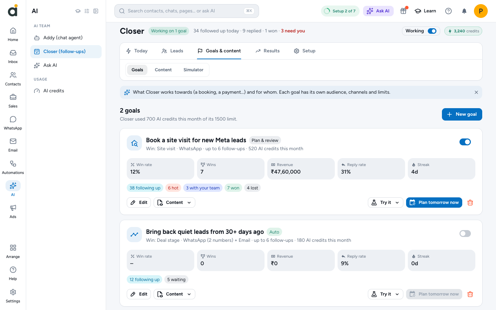
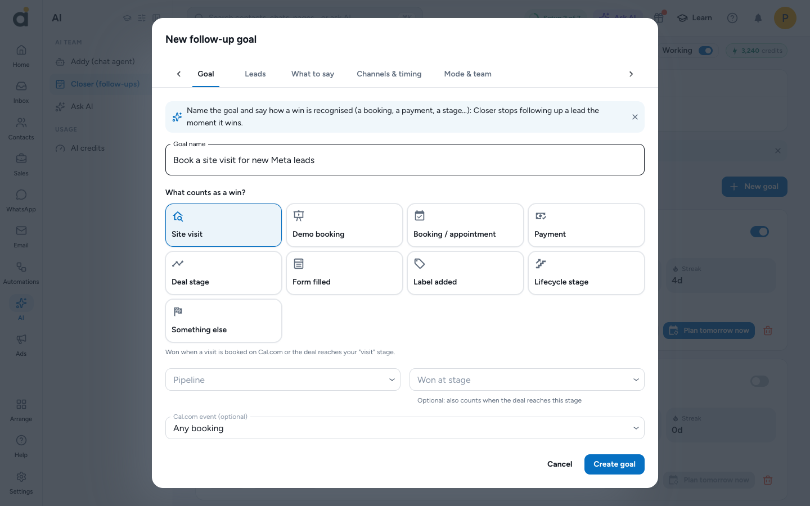
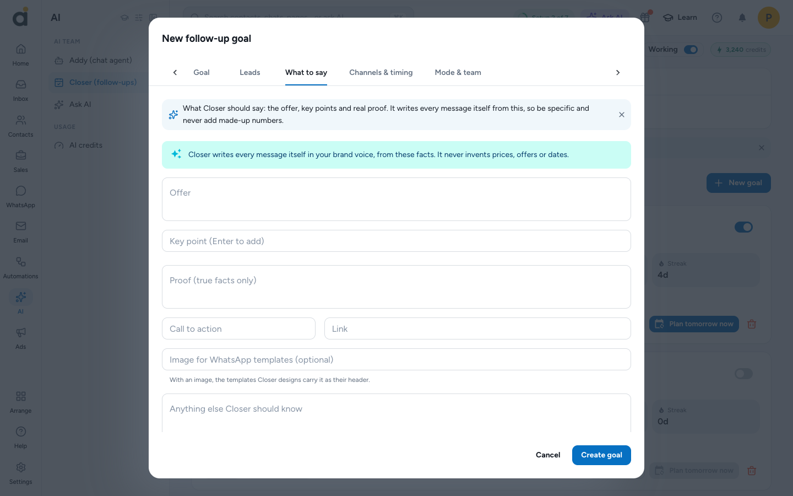
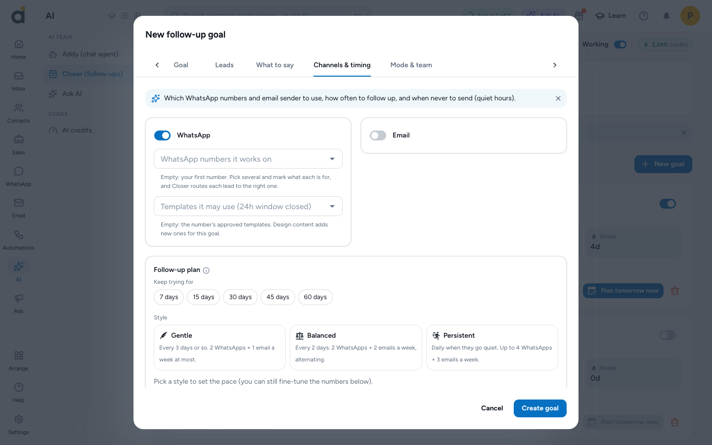
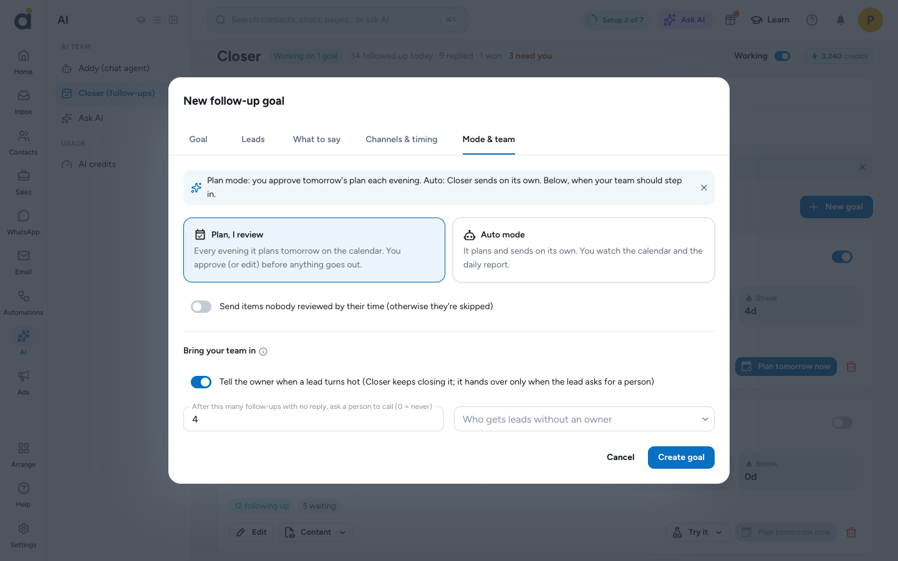
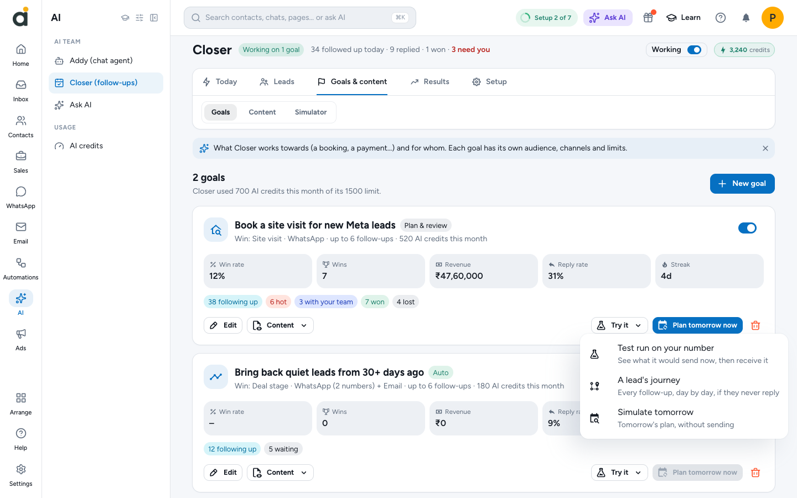
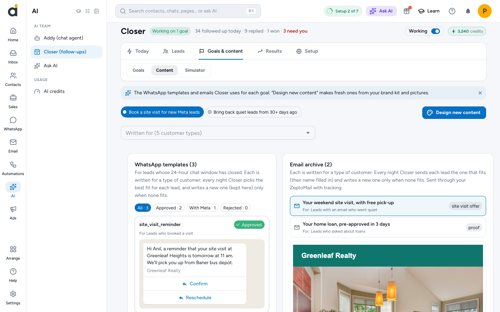
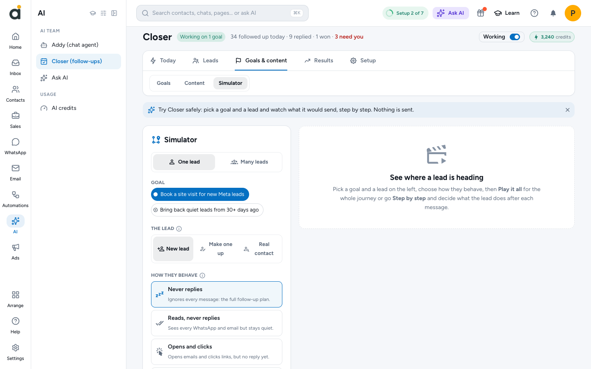

A **goal** is what Closer works towards for a group of leads, like "Book a site visit for new Meta leads". Each goal has its own leads, message, channels, pace and mode.

Open **AI → Closer (follow-ups) → Goals & content → Goals**.

## Create a goal

Click **New goal**. The window has five tabs; the line at the top of each says what to fill in.

<Steps>
<Step title="Goal: the name and the win">
  

  | Field | What it does | Example |
  |---|---|---|
  | Goal name | Required. | Book a site visit for new Meta leads |
  | What counts as a win? | Closer stops following up a lead the moment it wins. | Site visit |
  | Pipeline / Won at stage | For **Site visit**, **Demo booking** and **Deal stage**: the deal stage that counts as won (for Deal stage, empty = when the deal is won). | Home sales / Site visit |
  | Cal.com event | For visits, demos and bookings: the Cal.com event that counts. | Site visit |
  | Label / Lifecycle stage / Product / Only this form / Describe the win | For the other win types. | |

  | Win | Won when |
  |---|---|
  | Site visit | A visit is booked on Cal.com or the deal reaches your visit stage. |
  | Demo booking | A demo is booked on Cal.com or the deal reaches your demo stage. |
  | Booking / appointment | They book on Cal.com. |
  | Payment | A payment request is paid (Pay Now or link); optionally one product. |
  | Deal stage | The deal reaches the stage you pick, or is won. |
  | Form filled | They submit a form (any form, or the one whose code you paste). |
  | Label added | The contact gets a label. |
  | Lifecycle stage | The contact's Lifecycle stage field (filled by a HubSpot sync) reaches a stage, like Customer. |
  | Something else | You describe it; your team marks the lead won. |
</Step>
<Step title="Leads: who Closer follows up">
  

  Closer works on contacts that match **any** of these. Leave everything empty and it works on nobody.

  | Field | What it does |
  |---|---|
  | Specific contacts | Pick people one by one (handy to try Closer on a few first). |
  | Segments, Labels, Lists | Whole groups, like a "Quiet for 30 days" segment. |
  | Lifecycle stages | Contacts at these stages. |
  | Lead sources | Meta instant forms, Click-to-WhatsApp ads, Website (from an ad), Cal.com or Calendly (from an ad). |
  | Known leads who visited my website | From the [website tag](/help/ai/closer#website). |
  | Open deals in pipeline / At stages | Leads with an open deal at these stages. |
  | New contacts only: created in the last … days | For labels, sources, website and pipeline (picked contacts, lists and segments are always included). |
  | Follow up after … hours without a reply | Leads who wrote more recently are left to Addy or your team. |
  | Revive leads that never replied after … days | A fresh restart with a new angle (at most twice; 0 = never). |
  | Never follow up contacts at these lifecycle stages / with these labels | Checked every night. |
</Step>
<Step title="What to say">
  

  Closer writes every message itself in your brand voice, from these facts. It never invents prices, offers or dates.

  | Field | Example |
  |---|---|
  | Offer | Free pick-up for a site visit this weekend |
  | Key point (Enter to add, up to 10) | RERA registered |
  | Proof (true facts only) | 1,200 families moved in since 2016; 4.7★ on Google |
  | Call to action / Link | Book a site visit / https://cal.com/greenleaf/site-visit |
  | Image for WhatsApp templates | An https:// JPG or PNG used as the template header |
  | Anything else Closer should know | |
</Step>
<Step title="Channels & timing">
  

  | Field | What it does |
  |---|---|
  | WhatsApp | On/off. **WhatsApp numbers it works on**: a lead stays on the number they chat on; new warm leads go from Sales numbers, cold ones from Marketing. Empty = your first number. |
  | Templates it may use (24h window closed) | Empty = the number's approved templates. Designing content adds new ones. |
  | Email | On/off. **Send through** ZeptoMail or a mailbox you connected in Email. |
  | Keep trying for | 7, 15, 30, 45 or 60 days. |
  | Style | **Gentle** (every 3 days, 2 WhatsApps + 1 email a week), **Balanced** (every 2 days, 2 + 2), **Persistent** (daily, up to 4 + 3). |
  | Most follow-ups per lead / Hours between follow-ups / Stop after … days without a reply | Fine-tune the pace. |
  | Send at any hour | On: each lead gets the hour they're usually active. Off: pick **Don't send from** and **…until** (quiet hours). |
  | Follow up on Sundays | Off: never on Sundays. |
</Step>
<Step title="Mode & team">
  

  | Field | What it does |
  |---|---|
  | **Plan, I review** | Every evening Closer plans tomorrow; you approve or edit before anything goes out. Optional: **Send items nobody reviewed by their time** (otherwise they're skipped). |
  | **Auto mode** | Closer plans and sends on its own. You watch the plan and the daily report. |
  | Tell the owner when a lead turns hot | A heads-up task; Closer keeps going until the lead asks for a person. |
  | After this many follow-ups with no reply, ask a person to call | 0 = never. |
  | Who gets leads without an owner | The account admin, or a team member. |

  Click **Create goal**. It starts switched **off** so you can try it first.
</Step>
</Steps>

## The goal card

| Part | What it does |
|---|---|
| Chip | **Plan & review** or **Auto**. |
| Line | The win, channels, most follow-ups, AI credits this month. |
| Switch | On: that evening Closer plans tomorrow for this goal. |
| Win rate, Wins, Revenue, Reply rate, Streak | How it's doing. The chips below count its leads by status. |
| **Edit** | The five tabs again. |
| **Content** | **See its templates and emails** or **Design new content** (from your brand kit and pictures; uses AI credits). |
| **Try it** | **Test run on your number** (see it, then receive it), **A lead's journey** (every follow-up, day by day, if they never reply), **Simulate tomorrow** (tomorrow's plan, nothing sent). |
| **Plan tomorrow now** | Plans tomorrow right away (the goal must be on). |
| Bin | Deletes the goal after asking; its planned follow-ups are cancelled. |

## Content

**Goals & content → Content** shows a goal's **WhatsApp templates** (with Meta's status: Approved, Waiting for Meta, Rejected, and who each is for) and its **Email archive** (click one to preview it). Closer sends each lead the one that fits and writes new ones when none fits. A rejected template is replaced. **Design new content** makes fresh ones.

## Simulator

**Goals & content → Simulator** lets you watch what Closer would do. Nothing is sent.

1. **One lead** or **Many leads** (a segment, list or label), and the goal.
2. The lead: **New lead**, **Make one up** (a persona) or **Real contact** (as they really behave).
3. How they behave: Never replies, Reads never replies, Opens and clicks, Replies after the 2nd or 3rd, Books after the 2nd.
4. **What if…**: change WhatsApp, Email, Sundays or the start day just for this run.
5. **Play it all** (the whole journey) or **Step by step** (you decide what the lead does after each message). See it as a timeline, a calendar or on their phone, then **Send the first touch to my phone** if you like.

## Related

<CardGroup cols={2}>
<Card title="Closer every day" icon="calendar-check" href="/help/ai/closer">Needs you, the plan, leads, results, setup.</Card>
<Card title="Segments" icon="filter" href="/help/audiance/segment">Build the group Closer follows up.</Card>
</CardGroup>
