**Closer** is your AI follow-up agent. Every evening it plans tomorrow's follow-ups for each goal you switched on: who to message, on which channel, at the hour they're usually active, with a message written from your offer. Depending on the goal's mode it waits for your approval or sends on its own. It stops a lead the moment they win (book, pay, reach a stage) and hands hot leads to your team.

Use it for leads who stopped replying: new Meta leads who never booked, enquiries quiet for 30 days, deals stuck at a stage.

Open **AI → Closer (follow-ups)**. To set up a goal, see [Closer goals](/help/ai/closer-goals).

## The page

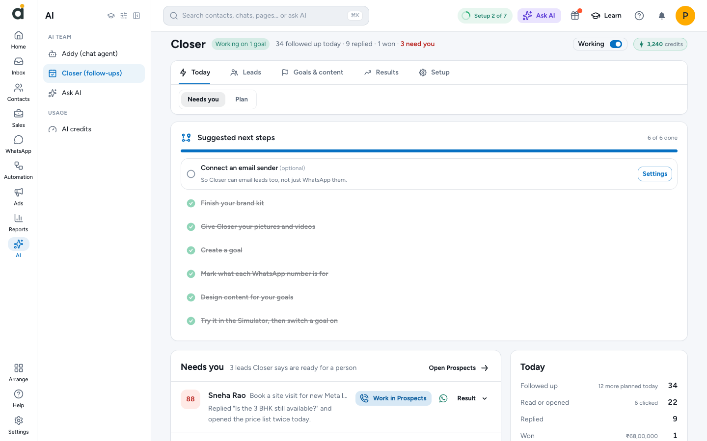

| Part | What it does |
|---|---|
| Status chip | **Working on 1 goal**, **On · no goal switched on** or **Paused**. |
| Today line | Followed up, replied, won today, and how many leads need you. |
| **Working / Paused** switch | Pauses Closer: nothing is planned or sent until you switch it back. |
| Credits chip | AI credits left for the account. |
| Tabs | **Today** (Needs you, Plan), **Leads**, **Goals & content** (Goals, Content, Simulator), **Results** (Performance, Wins & score), **Setup** (Brand kit, Knowledge, Website, Meta ad signals, Settings). |

**Suggested next steps** (on Needs you) lists what's left: finish your brand kit, give Closer your pictures, create a goal, mark what each WhatsApp number is for, design content, try it in the Simulator and switch a goal on, connect an email sender (optional).

## Today → Needs you

Leads Closer says are ready for a person, best first. The number is the **Closer Score** (0–100): how close they are to converting, from what they did. The line says why, like "Replied 'Is the 3 BHK still available?' and opened the price list twice today."

- **Work in Prospects** opens the lead in [Prospects](/help/sales/prospects) to call or message.
- The WhatsApp icon opens the chat right here.
- **Result** logs what happened after you talked:

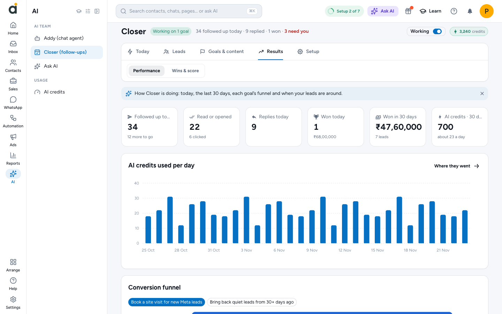

| Result | What Closer does |
|---|---|
| Converted or booked | Asks for the deal value and marks the lead won. |
| Interested, not now | Waits and warms them up later. |
| No answer | Keeps following up. |
| Not interested | Marks the lead lost and cancels its planned follow-ups. |

On the right: **Today** (followed up, read or opened, replied, won), **Tomorrow's plan** (with **Review** when messages wait for you) and **What Closer is doing**, a live feed of every message, reply and win.

## Today → Plan: approve tomorrow's follow-ups

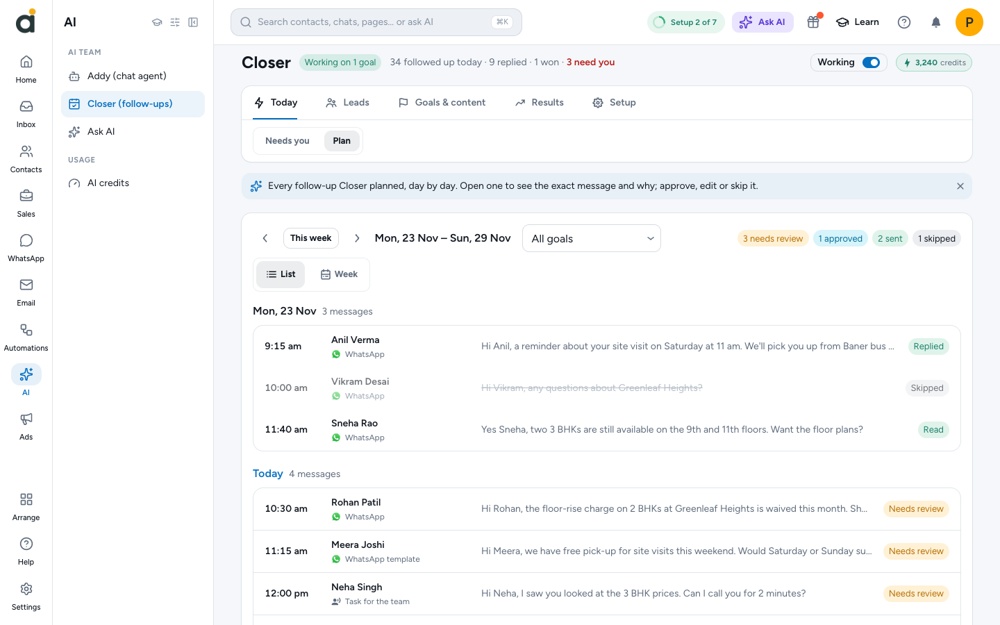

- Arrows and **This week** move between weeks; the box picks one goal or **All goals**.
- Chips count messages **needs review**, **approved**, **sent** and **skipped**.
- **List** shows each day's messages; **Week** shows a calendar (amber = waiting for you).
- **Approve** (top) approves everything waiting this week. On a row, **Approve** or **Skip** one message.
- Click a row to open it:

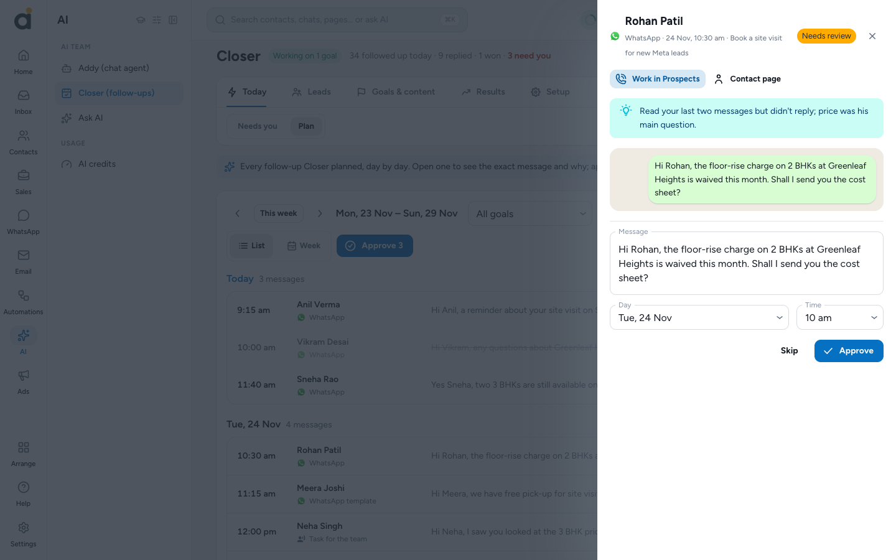

You see why Closer chose it, the exact message (or the template, email or call task), and its results once sent (Delivered, Read, Opened, Clicked, Replied). While it's still planned you can edit the **Message** (or email **Subject**), change the **Day** and **Time**, then **Save changes**, **Approve** or **Skip**.

| Channel | Meaning |
|---|---|
| WhatsApp | A normal message (the lead's 24-hour window is open). |
| WhatsApp template | An approved template (the window is closed). |
| Email | A brand email. |
| Payment request | A payment link or Pay Now. |
| Task for the team | A call or message for a person, with a suggested message. |

| Status | Meaning |
|---|---|
| Needs review | Waiting for you (Plan, I review goals). |
| Approved | Will be sent at its time. |
| Sent / Read / Replied | Gone out, and what the lead did. |
| Skipped | You skipped it, or Closer did (with the reason, like "Addy is handling the chat"). |
| Failed / Cancelled | WhatsApp refused it, or the lead won, opted out or was paused. |

## Leads

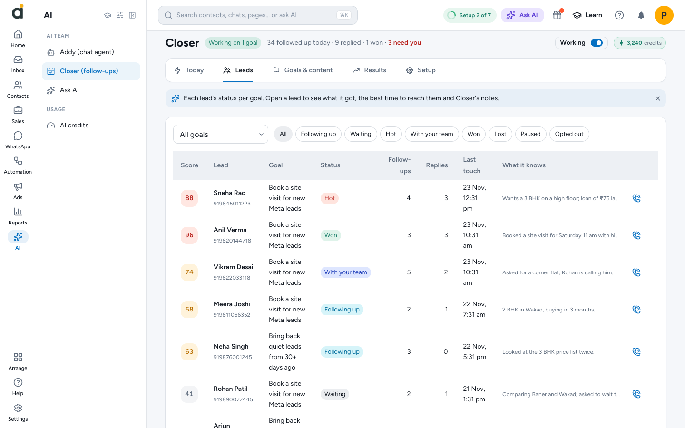

Pick a goal and a status: **Following up, Waiting, Hot, With your team, Won, Lost, Paused, Opted out**. Click a lead to open it:

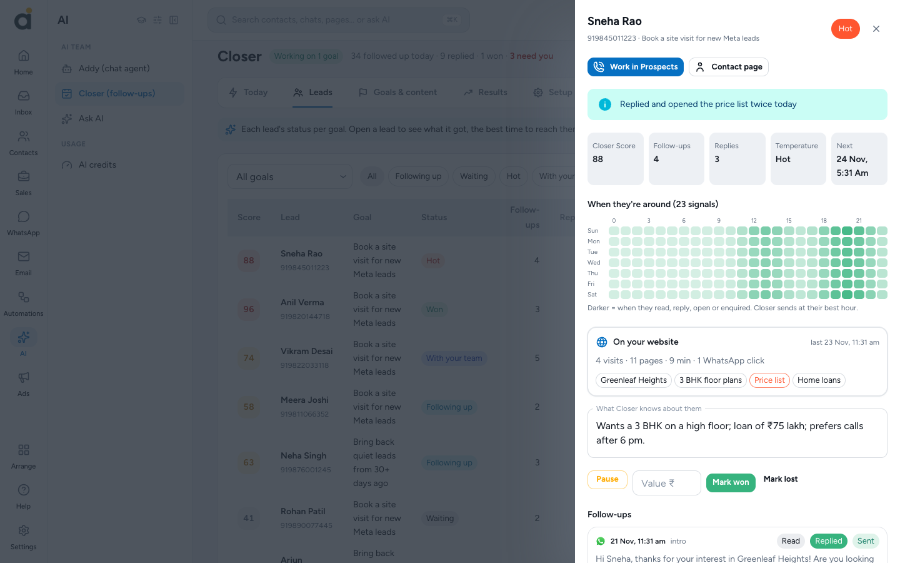

- Closer Score, follow-ups, replies, temperature and the next follow-up.
- **When they're around**: their best hours; Closer sends at their best hour.
- **On your website**: visits, pages and minutes (with the website tag).
- **What Closer knows about them**: its notes. Correct them and click **Save**.
- **Pause**, **Resume**, **Mark won** (type the value in ₹) or **Mark lost**.
- **Follow-ups**: every message it got, with Read and Replied.

## Results

**Performance**: today's numbers, money won in 30 days, **AI credits · 30 days**, **AI credits used per day** (**Where they went** opens the [AI credits](/help/ai/credits) page), each goal's **Conversion funnel** (Leads → Followed up → Engaged → Replied → Hot → Won) and **When your leads are around**.

**Wins & score**: Closer's level and badges (points for reads, clicks, replies, revived leads and wins), each goal's wins, revenue and reply rate, **What works best** (the kinds of message that get replies; Closer uses them more) and the **Daily reports** it sent. **Send yesterday's now** sends the report again.

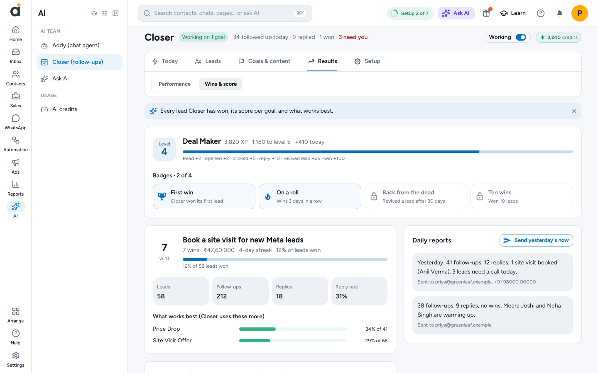

## Setup

### Brand kit

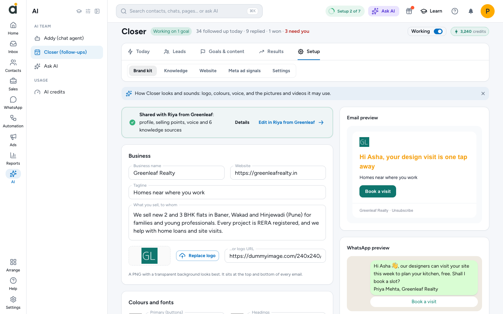

| Section | Fields |
|---|---|
| Business | Business name, Website, Tagline, What you sell, to whom, logo (**Replace logo** or a logo link). |
| Colours and fonts | Primary (buttons), Headings, Accent, Background, Text, Heading font, Body font. |
| Voice and content | Voice, Length, Emoji, Languages, Content style, Words to use, Never say, WhatsApp sign-off, email footer. |
| Creatives | **Upload** pictures and videos, or **Link folders** from the File Manager. Name each one and say when to use it; pick the goals it's for. The bin asks before deleting. |

The previews show an email and a WhatsApp message with your kit. Click **Save brand kit**. If Addy is set up, its profile, selling points and voice are shared with Closer (**Edit in** Addy).

### Knowledge

One knowledge base for Addy and Closer: add a website, files or text (see [Teach Addy](/help/ai/addy-knowledge)). **What Closer uses for a goal** shows the facts each goal pulls in.

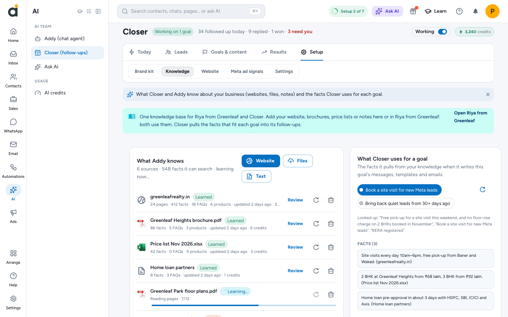

### Website

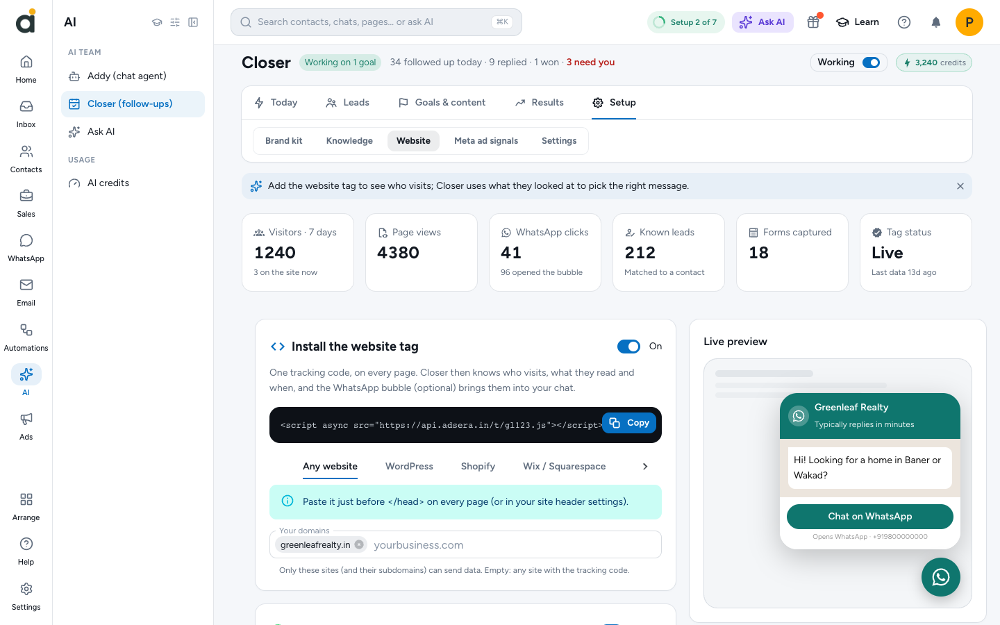

1. Click **Copy** and paste the tracking code before `</head>` on every page (tabs show how for WordPress, Shopify, Wix / Squarespace, Webflow / Framer, Next.js / React).
2. Add **Your domains** (only these can send data).
3. Optional **WhatsApp chat bubble**: the number it opens, title, greeting, message, button, colour, position, delay, pages to hide it on.
4. **Key pages (buying interest)** like /price-list, and whether to recognise visitors from forms they fill and respect "Do Not Track".
5. Click **Save website settings**. The numbers at the top and **Visitors** fill in as people come; Closer uses what they looked at to pick the right message.

### Meta ad signals

Tell Meta which ad leads Closer **Re-engaged**, turned **Hot** or **Converted**, so your ads find more like them. Pick the **Pixel / dataset** (from Ads → Pixel & events), keep **Only leads that came from Meta ads** on, pick the **Meta event** for each step and click **Turn on signals**.

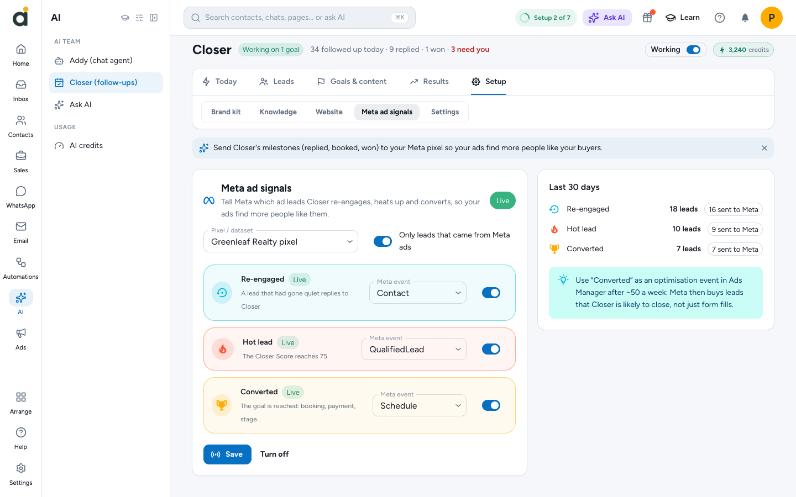

### Settings

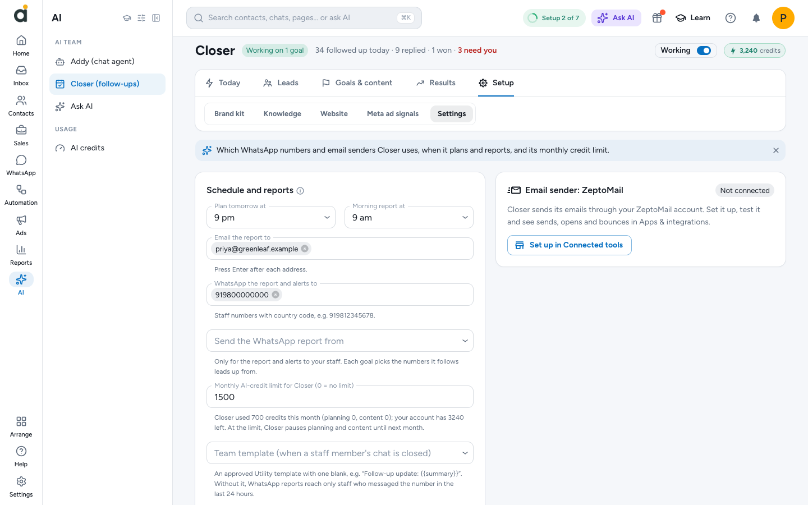

| Field | What it does |
|---|---|
| Plan tomorrow at | The hour Closer plans tomorrow (default 9 pm). |
| Morning report at | The hour it sends the daily report. |
| Email the report to / WhatsApp the report and alerts to | Who gets it (staff numbers with country code). |
| Send the WhatsApp report from | Which of your numbers sends it. |
| Monthly AI-credit limit for Closer (0 = no limit) | At the limit Closer pauses planning and content until next month. |
| Team template | An approved Utility template for staff whose 24-hour window is closed. |

**Email sender**: Closer emails leads one by one through ZeptoMail (set it up in **Marketplace → ZeptoMail**) or a mailbox you connected in Email. These are personal follow-ups, not bulk campaigns.

## What Closer costs

Planning a goal uses about 1–10 AI credits; designing content more. See [AI credits](/help/ai/credits). Set a monthly limit in **Setup → Settings**.

## FAQ

<AccordionGroup>
<Accordion title="When is the first message sent after I switch a goal on?">
  That evening Closer plans tomorrow. In Plan, I review mode, messages go only after you approve them. Click Plan tomorrow now to plan straight away.
</Accordion>
<Accordion title="Will Closer message someone who is chatting with Addy or my team?">
  No. Leads who wrote recently are left to Addy or your team; Closer skips them.
</Accordion>
<Accordion title="How do I stop Closer for one lead?">
  Open the lead in Leads and click Pause, or Mark lost.
</Accordion>
</AccordionGroup>

## Related

<CardGroup cols={2}>
<Card title="Closer goals" icon="flag" href="/help/ai/closer-goals">Create a goal, content, Simulator.</Card>
<Card title="Prospects" icon="phone" href="/help/sales/prospects">Call the leads Closer hands you.</Card>
</CardGroup>
