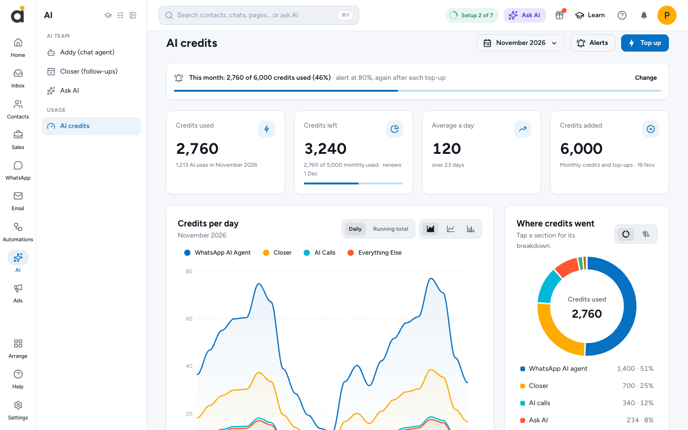
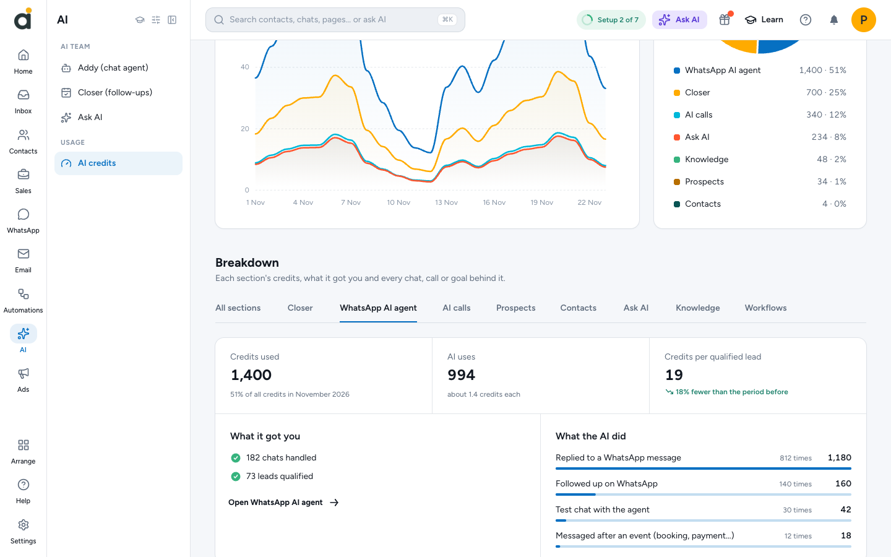
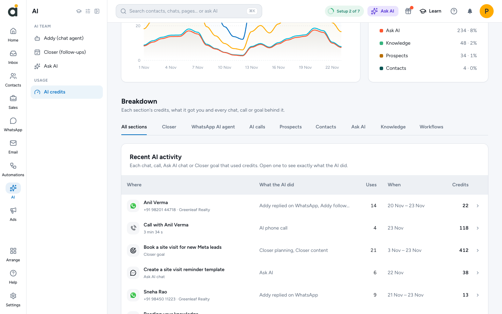
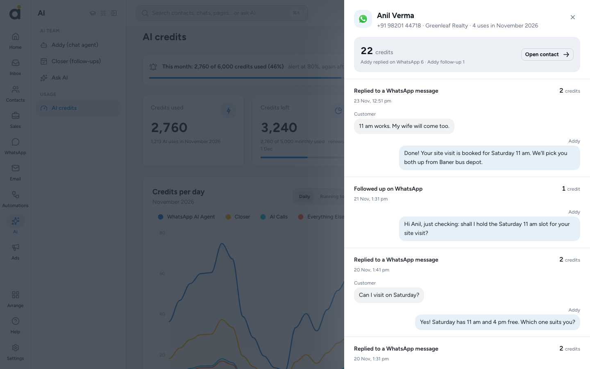
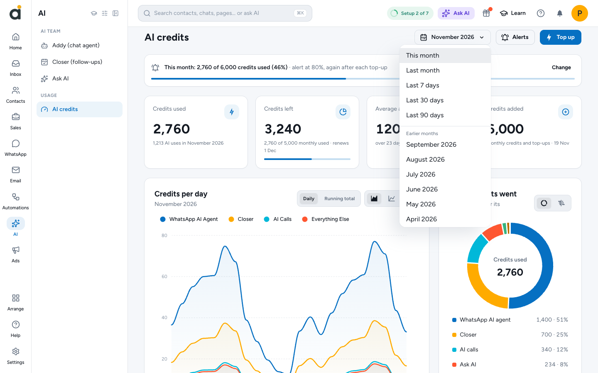
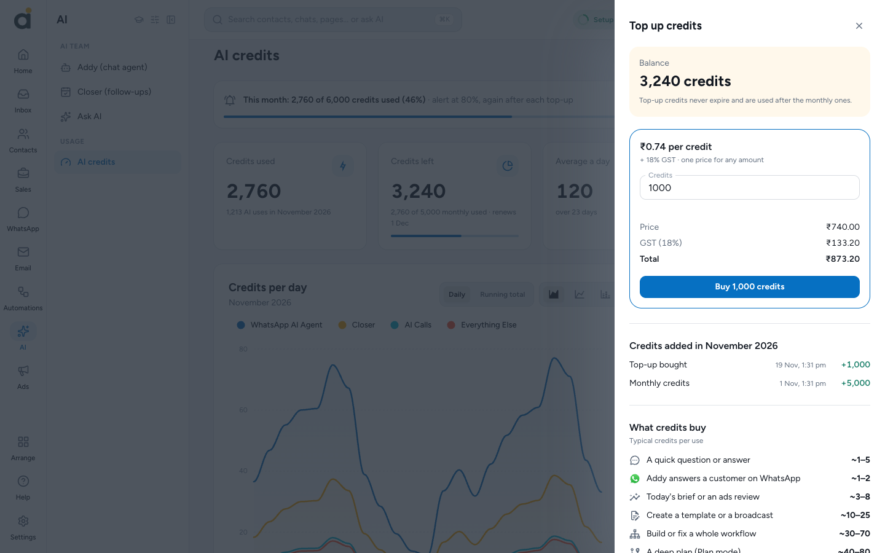
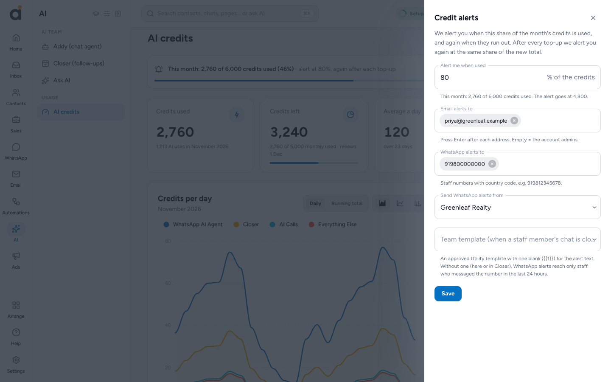

Every AI feature in AdsEra uses **AI credits** from one balance for your whole account: Addy's replies and calls, Closer, Ask AI, contact and chat summaries, Prospects' lead summaries and drafts, reading your website and files, and building workflows with AI.

Each month your plan adds its monthly credits. You can **top up** any time; top-up credits never expire and are used after the monthly ones.

## Where to find it

Open **AI → AI credits** (or click the ⚡ credits chip on Addy, Closer or Ask AI). Only account admins see the usage report.

## What credits buy

Typical credits per use (the **Top up** panel shows the same list):

| Use | Credits |
|---|---|
| Addy answers a customer on WhatsApp | 1–2 |
| A quick question or answer in Ask AI | 1–5 |
| A contact or chat summary | 1 |
| Closer planning a goal | 1–10 |
| Reading a website or file | 2–5 |
| Today's brief or an ads review | 3–8 |
| Create a template or a broadcast with Ask AI | 10–25 |
| Design an image | 12 |
| Addy answering a phone call (per minute) | 25–40 |
| Build or fix a whole workflow | 30–70 |
| A deep plan (Plan mode) | 40–80 |

For example, Addy answering 100 chats of about 8 messages uses roughly 800–1,600 credits.

## Read the page

| Part | What it shows |
|---|---|
| Period (top right) | The month or dates the page covers. |
| **Alerts** / **Top up** | See below. |
| This month bar | Credits used of this month's total, and when the alert goes. |
| **Credits used** | In the period, with the number of AI uses. |
| **Credits left** | What's left now: monthly credits (with the renewal date) plus top-up credits. |
| **Average a day** | Over the days so far. |
| **Credits added** | Monthly credits and top-ups added in the period. |
| **Credits per day** | **Daily** or **Running total**; area, line or stacked bars. The three biggest sections have their own line. |
| **Where credits went** | Each section's share (donut or bars). Click a section to open its breakdown. |

### Breakdown

Tabs: **All sections, Closer, WhatsApp AI agent, AI calls, Prospects, Contacts, Ask AI, Knowledge, Workflows** (and **Other**). A section shows **Credits used**, **AI uses**, **credits per result** (like per qualified lead, per won lead or per call) against the period before, **What it got you** and **What the AI did**.

### Recent AI activity

One row per WhatsApp chat, call, Ask AI chat or Closer goal that used credits: where, what the AI did, uses, when and credits.

Click a row to see every use: what the customer said and what Addy answered, the follow-ups Closer planned, or your Ask AI question and its answer, each with its credits. **Open contact**, **Open Closer** or **Open workflow** takes you there. (A row shows its first 1,000 uses.)

## Pick the period

Click the month at the top right: **This month**, **Last month**, **Last 7 days**, **Last 30 days**, **Last 90 days**, an earlier month, or **Custom range…** (**From** and **To**, both days included, up to a year). Periods follow India time, like the billing cycle.

## Top up

<Steps>
<Step title="Click Top up">
  The panel shows your balance and the price per credit (+ 18% GST, one price for any amount).

  
</Step>
<Step title="Type how many credits">
  The price, GST and total show below. The panel says the smallest and largest top-up.
</Step>
<Step title="Click Buy … credits and pay">
  The credits are added as soon as the payment goes through. If it takes a moment, they show up within a minute.
</Step>
</Steps>

Only an account admin can buy credits.

## Credit alerts

Click **Alerts** to be told before credits run out.

| Field | What it does |
|---|---|
| Alert me when used | The share of the month's credits used, like 80%. You're alerted again when they run out, and after each top-up at the same share of the new total. |
| Email alerts to | Press Enter after each address. Empty = the account admins. |
| WhatsApp alerts to | Staff numbers with country code, like 919800000000. |
| Send WhatsApp alerts from | Which of your numbers sends them (or the same as Closer's reports). |
| Team template | An approved Utility template with one blank, for staff who haven't messaged the number in the last 24 hours. |

Click **Save**.

## When credits run out

- **Addy** stops answering: keyword replies and flows still run, new chats go to your team, and the admin gets a task. It carries on as soon as you top up.
- **Ask AI** says so and links to top up.
- **Closer** stops planning until there are credits again (or until next month if it hit its own monthly limit in Closer → Setup → Settings).

## FAQ

<AccordionGroup>
<Accordion title="Do unused monthly credits carry over?">
  No. Monthly credits renew on the date shown under Credits left. Top-up credits never expire.
</Accordion>
<Accordion title="Can a team member see the usage report?">
  No, only account admins (it shows customer chats).
</Accordion>
<Accordion title="Is there a cheaper rate for more credits?">
  No: one price per credit for any amount.
</Accordion>
</AccordionGroup>

## Related

<CardGroup cols={2}>
<Card title="Addy" icon="robot" href="/help/ai/addy">What Addy uses.</Card>
<Card title="Plans and pricing" icon="tag" href="/help/introduction/price">Monthly credits by plan.</Card>
</CardGroup>
