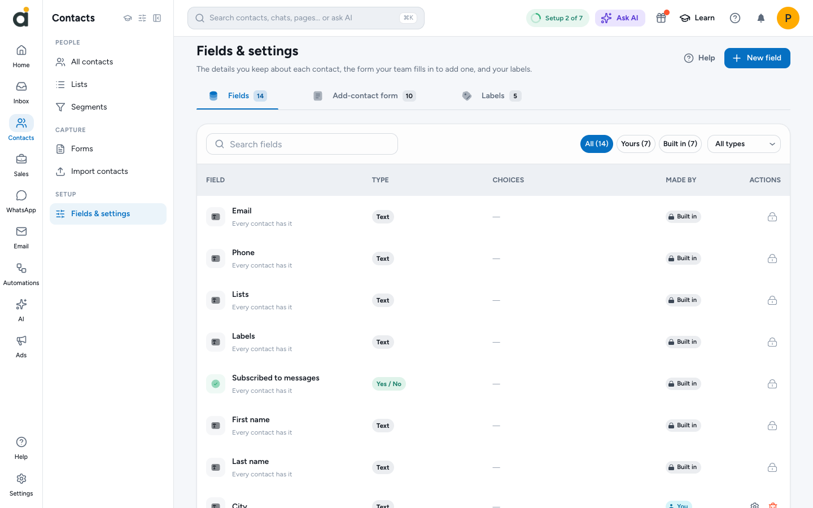
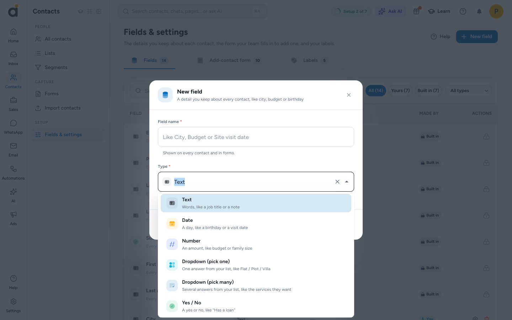
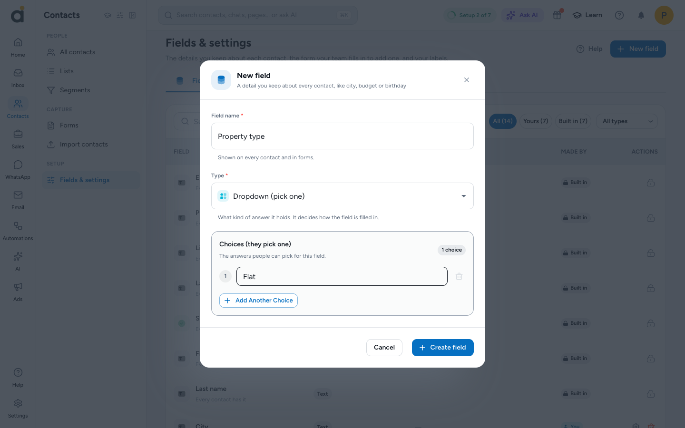
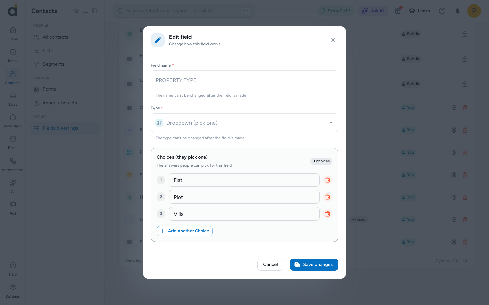
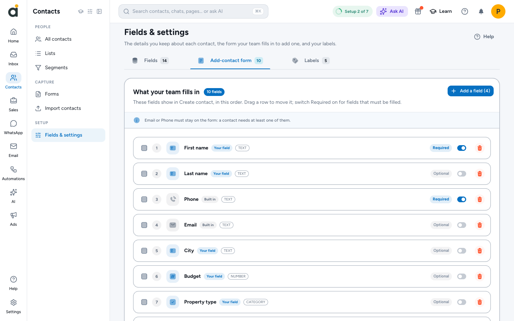

A **field** is a detail you keep about every contact, like **City**, **Budget** or **Site visit date**. Fields show on each contact, in forms and imports, as columns, in filters and in WhatsApp template blanks.

**Where:** **Contacts → Fields & settings**. Three tabs: **Fields**, **Add-contact form** and **Labels**. [Open it →](https://app.adsera.in/dashboard/contact/attributes)

## The Fields tab

| Part | What it shows |
| --- | --- |
| **Search fields** | Finds a field by name or type. |
| **All / Yours / Built in** | Every field, the ones you made, or the ones every account has. |
| **All types** | Show one type only. |
| **Field** | The field's name. "Every contact has it" marks built-in fields. |
| **Type** | Text, Number, Date, Dropdown (pick one), Dropdown (pick many) or Yes / No. |
| **Choices** | The answers of a dropdown. |
| **Made by** | **Built in** (lock) or **You**. |
| ⚙ / bin | Edit or delete one of your fields. Built-in fields show a lock: they can't be deleted. |

Built-in fields: **Email**, **Phone**, **Lists**, **Labels** and **Subscribed to messages** (the WhatsApp and email opt-in), plus **First name** and **Last name**.

## Make a field

<Steps>
<Step title="Click New field">Top right.</Step>
<Step title="Name it">Like "City", "Budget" or "Site visit date". It can't be changed later.</Step>
<Step title="Pick the type">
See the table below. It can't be changed later either.

</Step>
<Step title="Add the choices (dropdowns only)">
Type each choice; **Add Another Choice** adds a row, ✕ removes one.

</Step>
<Step title="Click Create field">It shows on every contact, in Edit columns, imports, forms and filters.</Step>
</Steps>

## The six types

| Type | Holds | Example | Filter it by |
| --- | --- | --- | --- |
| **Text** | Any words | Project: "Greenleaf Heights, Baner" | contains, is, is not, is empty, is known |
| **Number** | An amount | Budget: 6800000 | is more than, is less than, is between, is at least, is at most |
| **Date** | A day | Site visit date: 20 Nov 2026 | in the last N days, more than N days ago, after, before, between |
| **Dropdown (pick one)** | One answer from your list | Property type: Flat / Plot / Villa | is, is not |
| **Dropdown (pick many)** | Several answers from your list | Looking for: 2 BHK + Parking | is, is not |
| **Yes / No** | A tick | Home loan: Yes | is yes / is no |

<Tip>
  Pick **Number** for anything you'll compare (budget, family size) and **Date** for days. A Text field can't be filtered by "more than" or "before", and the type can't be changed later.
</Tip>

## Change or delete a field

- Click ⚙ (**Edit field**) on one of your fields to add, rename or remove dropdown choices, then **Save changes**. The name and type stay as they are.
- Click the bin (**Delete field**) and confirm. The field and its values go from every contact.

## The add-contact form

The **Add-contact form** tab sets what your team fills in when they click **Create contact**: which fields, in what order, and which are required.

<Steps>
<Step title="Open Add-contact form">The second tab.</Step>
<Step title="Add, move or remove fields">**Add a field** puts another field on the form. Drag a row to move it. The ✕ takes it off the form (the field itself stays).</Step>
<Step title="Required or optional">Switch on the fields that must be filled before a contact can be saved.</Step>
<Step title="Click Save changes">The next **Create contact** uses it.</Step>
</Steps>

Email or Phone must stay on the form: a contact needs at least one of them.

## FAQ

<AccordionGroup>
  <Accordion title="I imported a file and got fields in capitals (CITY, BUDGET). Why?">
    Columns you didn't match to a field become new Text fields named after the column. They work like any field and show as "City" and "Budget" on contacts. To filter Budget as a number, make a **Number** field and import the column into it.
  </Accordion>
  <Accordion title="How do I use a field in a WhatsApp template?">
    When you send a broadcast, each blank in the template can be filled from a contact field (like First name or City). See [Template variables](/help/template/variables).
  </Accordion>
  <Accordion title="Can I rename a field?">
    No, not after it's made. Make a new one with the right name and type.
  </Accordion>
</AccordionGroup>

## Related

<CardGroup cols={2}>
  <Card title="Labels" icon="tag" href="/help/audiance/label" />
  <Card title="Filter contacts" icon="filter" href="/help/audiance/filters" />
  <Card title="Import a file" icon="file-import" href="/help/audiance/file" />
  <Card title="Forms" icon="file-pen" href="/help/sales/forms" />
</CardGroup>
