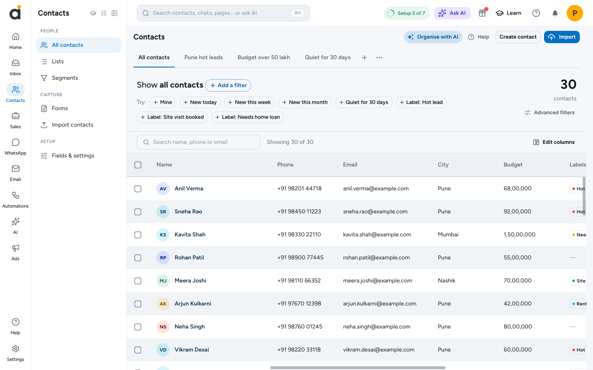
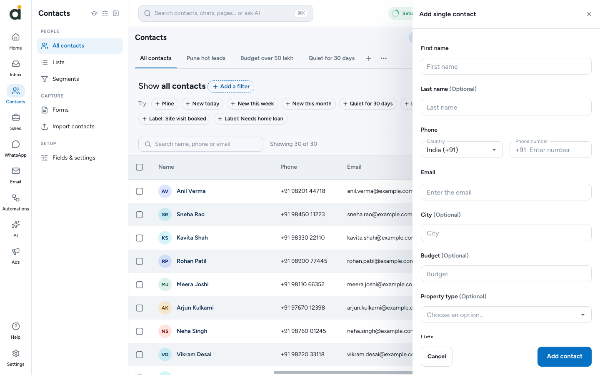
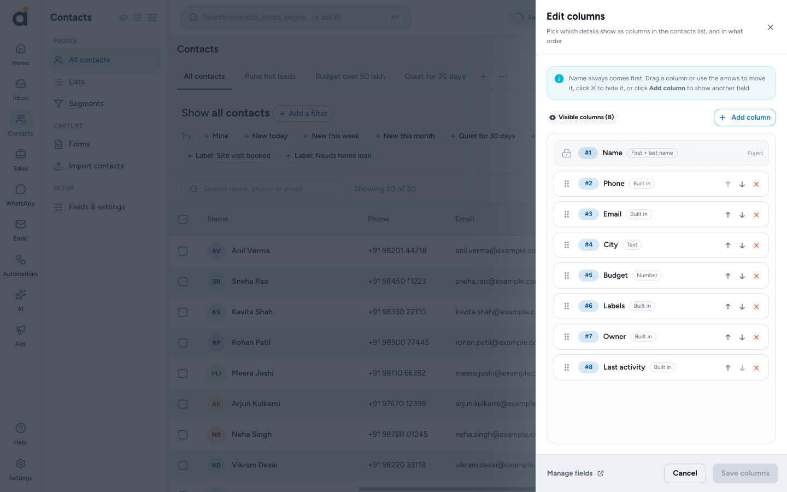
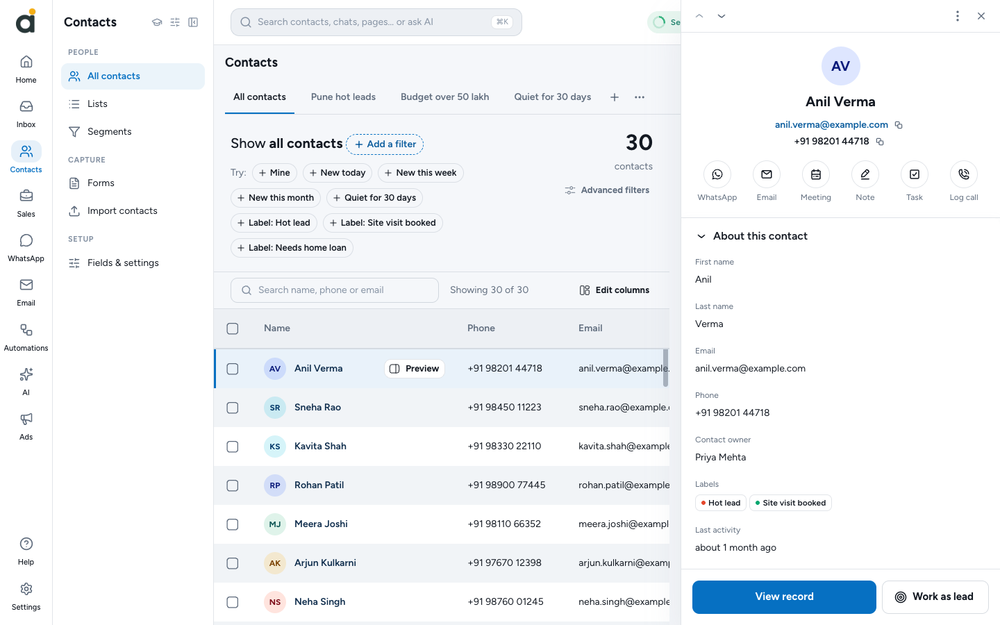
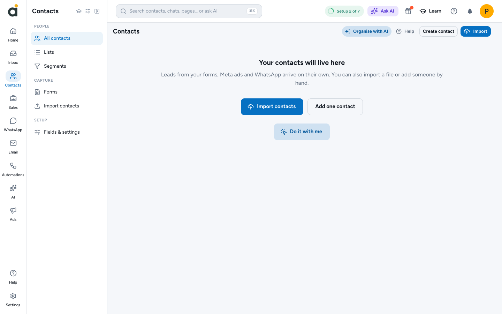

**All contacts** is the list of everyone you talk to. People arrive here from WhatsApp chats, forms, Meta ads and imports, and you can add anyone by hand. From this one page you find the right people, change their details and act on many at once.

**Where:** **Contacts → All contacts** in the left menu. [Open it →](https://app.adsera.in/dashboard/contact/list)

## The parts of the page

| Part | What it does |
| --- | --- |
| **Organise with AI** | Opens Ask AI with a ready question: it suggests useful segments from your fields and labels. |
| **Help** | Help for this page, with every lesson you can do here. |
| **Create contact** | Add one person by hand. See [below](#add-one-contact). |
| **Import** | Add many people from a file, a paste or a Google Sheet. See [Import a file](/help/audiance/file). |
| **Tabs** (All contacts, your segments) | Each tab is a saved [segment](/help/audiance/segment). **+** adds a tab; **⋯** renames, reorders or deletes. |
| **The sentence** ("Show all contacts …") | Your filter. **Add a filter** narrows the list. See [Filter contacts](/help/audiance/filters). |
| **Try:** buttons | One-click filters: **Mine**, **New today**, **New this week**, **New this month**, **Quiet for 30 days**, and your first labels. |
| **The big number** | How many contacts match the filter right now. |
| **Advanced filters** | The same filter as rows, for long filters. |
| **Search name, phone or email** | Finds someone inside the current filter. |
| **Showing N of M** | How many are loaded. More load as you scroll. |
| **Edit columns** | Choose which details show as columns. |

## Add one contact

<Steps>
<Step title="Click Create contact">Top right of the page. The **Add single contact** panel opens.</Step>
<Step title="Fill in the details">Type the **First name**, then the **Phone** (pick the country, then the number) or the **Email**. One of the two is a must. Fill any other fields you like.</Step>
<Step title="Lists, labels and WhatsApp">Pick **Lists** and **Labels** if you want. Leave **WhatsApp Subscription** on **Subscribe** if the person agreed to hear from you on WhatsApp.</Step>
<Step title="Click Add contact">They show at the top of the list.</Step>
</Steps>

| Field | What to enter | Example | Required? |
| --- | --- | --- | --- |
| **First name** | Their first name | Anil | Yes (by default) |
| **Last name** | Their last name | Verma | No |
| **Phone** | Country, then the number | India (+91), 98201 44718 | Phone or email |
| **Email** | Their email | anil@example.com | Phone or email |
| Your fields (City, Budget…) | Whatever you keep | Pune, 6800000 | Your choice |
| **Lists** | Groups to put them in | Pune buyers | No |
| **Labels** | Tags | Hot lead | No |
| **WhatsApp Subscription** | **Subscribe** or **Unsubscribe** | Subscribe | Yes |
| **Email Subscription** | **Subscribe** or **Unsubscribe** | Subscribe | Yes |

Which fields show here, in what order and which are required is set in **Fields & settings → Add-contact form**. See [Fields](/help/audiance/attribute#the-add-contact-form).

<Note>A phone number or email that is already in AdsEra can't be added twice. You'll see "A contact with this phone number already exists": search for them instead.</Note>

## Search and sort

Type in **Search name, phone or email**. It looks inside the current filter, so clear the filter first to search everyone. Click a column heading with arrows (**Phone**, **Email**, **Last activity**, **Created**) to sort by it; click again to flip the order.

## Choose your columns

<Steps>
<Step title="Click Edit columns">Right side, above the list.</Step>
<Step title="Add, move or hide">**Add column** lists every field you can show (like **City** or **Budget**). Drag a row or use the arrows to move it; click ✕ to hide it. **Name** is always first.</Step>
<Step title="Click Save columns">The list changes for you. Each team member chooses their own columns.</Step>
</Steps>

On a small screen the list scrolls sideways: use the scroll bar under the list to see the columns on the right.

## Quick look: the side panel

Click anywhere on a row (not the name) to open the side panel. Click the name to open the [contact's page](/help/audiance/view).

- **WhatsApp / Email / Meeting / Note / Task / Log call** buttons under the name.
- **About this contact**: click any detail to change it. Drag a field by its grip to move it up. **Show all fields** shows the empty ones too.
- **WhatsApp opt-in** switch. See [WhatsApp opt-in](/help/audiance/opt-in).
- **Recent activity**, **Notes**, **Tasks**, **Calls**, **Meetings** and **Meta lead forms**.
- **View record** opens the full page; **Work as lead** opens them in Prospects.
- The arrows at the top move to the previous or next contact.

## Act on many contacts

Tick the box at the start of a row (or the top box for every loaded contact). A bar shows: **Send a broadcast**, **Add to list**, **Add labels** and **More actions**. See [Act on many contacts](/help/audiance/bulk).

## When there are no contacts yet

A new account shows **Your contacts will live here** with **Import contacts**, **Add one contact** and **Do it with me**.

## Troubleshooting

| What you see | Why | What to do |
| --- | --- | --- |
| "A contact with this phone number already exists." | That number is already a contact. | Search for it and update that contact. |
| Someone you imported isn't in the list | A filter or tab is on, or the import is still running. | Click **All contacts**, clear the sentence, and refresh after a minute or two. |
| A column is cut off on the right | The window is narrow. | Scroll the list sideways, or hide a column in **Edit columns**. |
| **Create contact** shows "fill in" errors | A required field is empty. | Fill the fields marked in red, or change what is required in **Add-contact form**. |

## FAQ

<AccordionGroup>
  <Accordion title="What's the difference between a list, a label and a segment?">
    A **list** is a group you fill yourself ("Diwali expo 2026"). A **label** is a tag on a person ("Hot lead"); one person can have many. A **segment** is a saved filter ("City is Pune and Budget more than 50 lakh") that updates by itself. All three can receive a broadcast.
  </Accordion>
  <Accordion title="Do my team members see all contacts?">
    It depends on their role. An admin can limit a team member to their own contacts (or their own and unassigned) in Settings → Team members.
  </Accordion>
  <Accordion title="Can I undo a delete?">
    No. Deleted contacts can't be brought back. Export them first if you're unsure: tick them, then **More actions → Export contacts (.xlsx)**.
  </Accordion>
  <Accordion title="Why are names in capitals (FIRSTNAME) in some places?">
    That's the field's code name from older imports. AdsEra shows it as **First name** in forms and on the contact.
  </Accordion>
</AccordionGroup>

## Related

<CardGroup cols={2}>
  <Card title="Filter contacts" icon="filter" href="/help/audiance/filters" />
  <Card title="Segments" icon="layer-group" href="/help/audiance/segment" />
  <Card title="Act on many contacts" icon="list-check" href="/help/audiance/bulk" />
  <Card title="A contact's page" icon="address-card" href="/help/audiance/view" />
</CardGroup>
