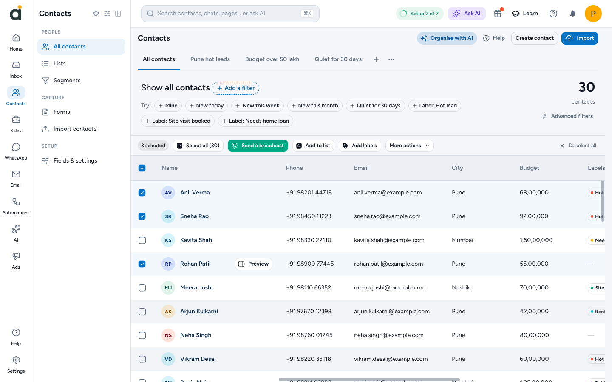
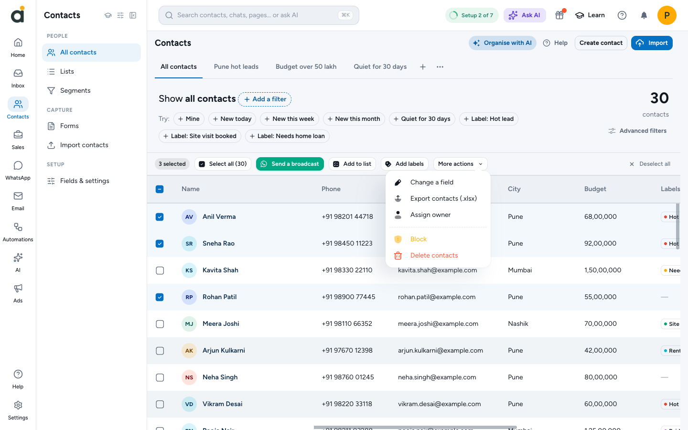
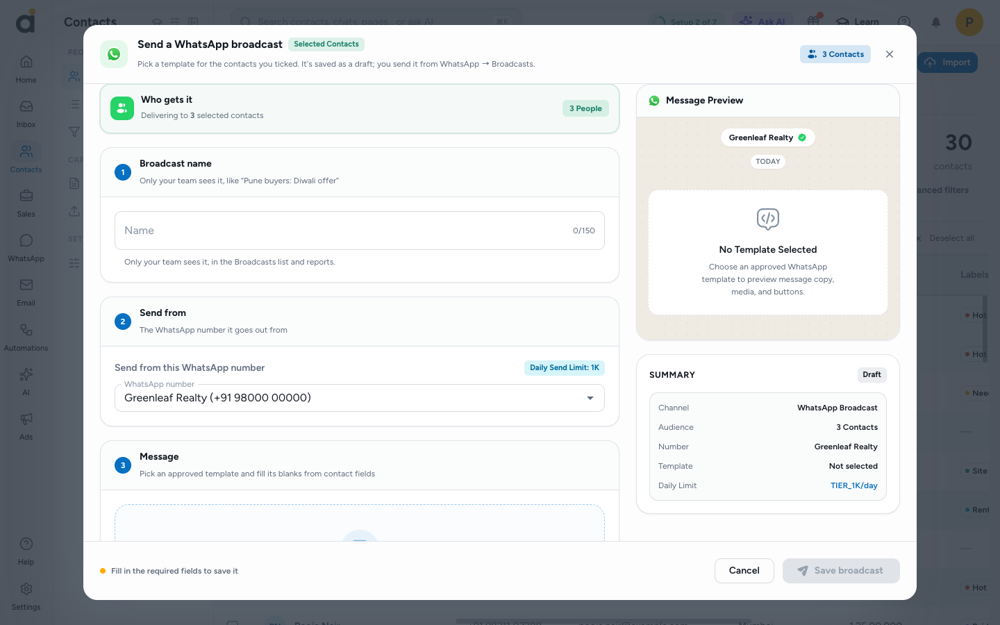
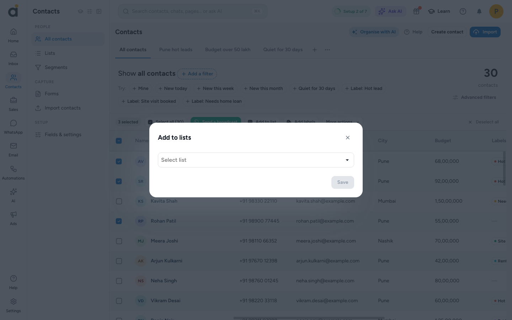
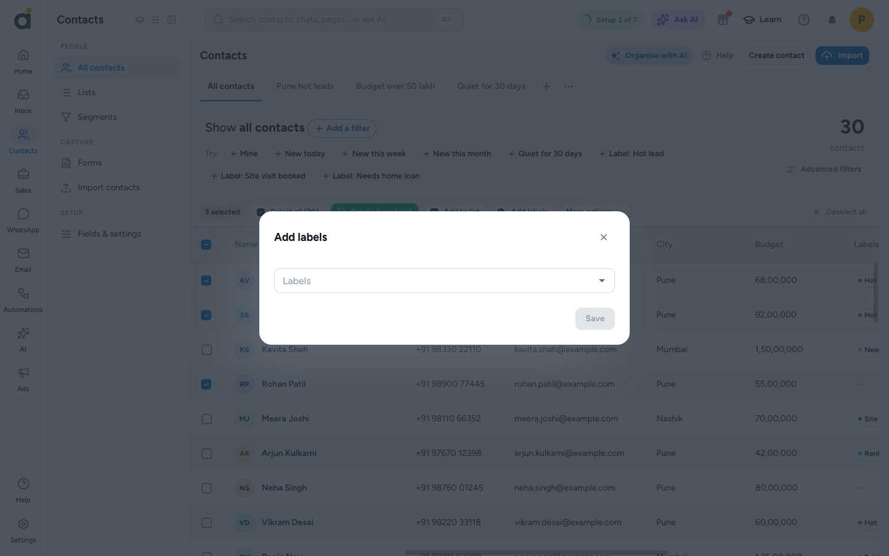
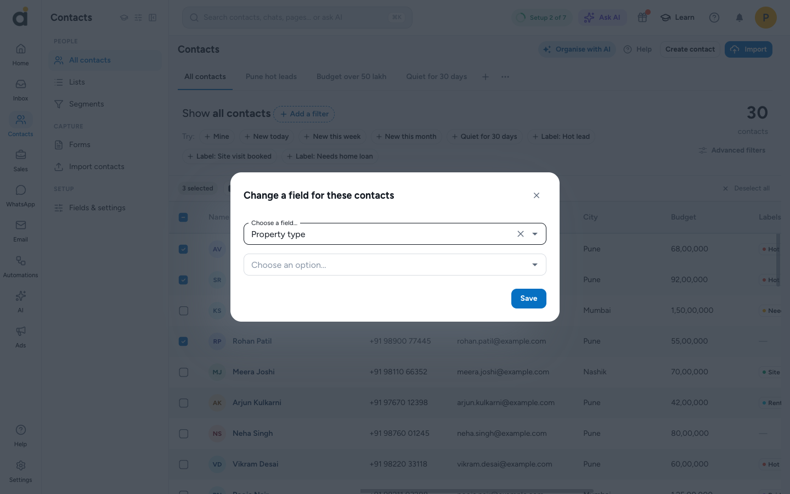
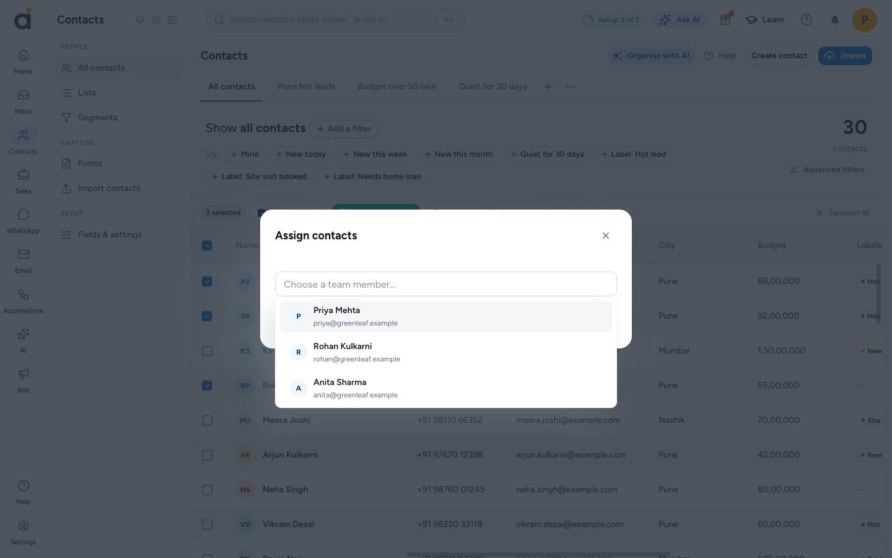
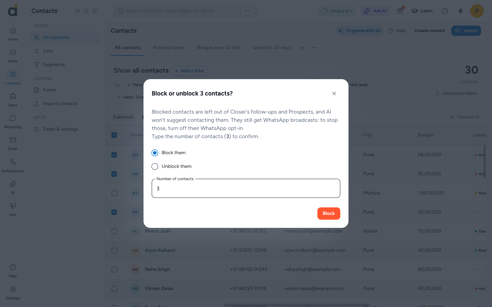
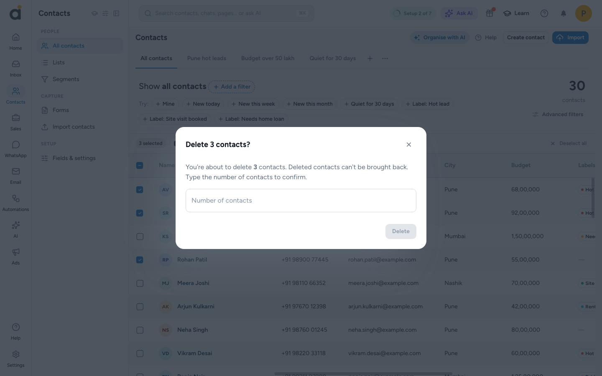

Tick contacts in the list and a bar of actions shows above it. Use it to tag the Pune leads in one go, give a batch to a salesperson, or send a broadcast to exactly these people.

**Where:** **Contacts → All contacts** (also on **Lists** and **Segments**): tick the box at the start of a row. [Open it →](https://app.adsera.in/dashboard/contact/list)

## Tick the right people

1. Narrow the list first if you like: for example **City contains Pune**. See [Filter contacts](/help/audiance/filters).
2. Tick the box on each row you want. The box at the top ticks every contact loaded on screen.
3. **Select all (N)** ticks every contact that matches the filter, including the ones not loaded yet.
4. **Deselect all** clears the ticks.

## The actions

| Button | What it does | Who can |
| --- | --- | --- |
| **Send a broadcast** | Saves a WhatsApp broadcast (draft) for exactly these people. | Anyone who can make broadcasts |
| **Add to list** | Puts them in one or more [lists](/help/audiance/list). They stay in lists they were in. | Contact edit |
| **Add labels** | Adds one or more [labels](/help/audiance/label). Labels they had stay. | Contact edit |
| **More actions → Change a field** | Sets one field (City, Budget, Property type…) to the same value for all of them. | Contact edit |
| **More actions → Export contacts (.xlsx)** | Downloads an Excel file of them. | Contact export |
| **More actions → Assign owner** | Gives them all to one team member. | Admins only |
| **More actions → Block** | Blocks or unblocks them (see below). | Contact edit |
| **More actions → Delete contacts** | Deletes them for good. | Contact delete |

## Send a broadcast to the people you ticked

<Steps>
<Step title="Click Send a broadcast">The **Send a WhatsApp broadcast** window opens with your contacts already in it.</Step>
<Step title="Fill it in">Give it a name your team will recognise, pick the WhatsApp number to send from and an approved template, and fill the template's blanks (from a contact field or the same text for everyone). **Send test** sends it to you first.</Step>
<Step title="Click Save broadcast">It's saved as a draft and you land on **WhatsApp → Broadcasts**.</Step>
<Step title="Send it">On the broadcast, choose **Send now**. See [Create a broadcast](/help/campaign/wa/create).</Step>
</Steps>

People whose **WhatsApp opt-in** is off are skipped when it sends. See [WhatsApp opt-in](/help/audiance/opt-in).

## Add to a list, add labels

Pick one or more and save. Nothing is taken away: people keep the lists and labels they had.

## Change a field for many

Pick one of your fields in **Choose a field…**, then the value (a dropdown field shows its choices; a Yes / No field shows Yes and No), and save. Phone and email are different for every person, so they can't be changed in bulk.

## Assign an owner

Pick the team member who looks after these contacts. Owners decide who sees a contact when an admin limits team members to their own contacts. Only admins can do this.

## Block

Pick **Block them** (or **Unblock them**), type the number of contacts to confirm, and click **Block**.

<Warning>
  **Block** leaves people out of Closer's follow-ups and Prospects, and AI won't suggest contacting them. It does **not** stop WhatsApp broadcasts. To stop broadcasts to someone, turn off their **WhatsApp opt-in** on their page or side panel.
</Warning>

## Delete

Type the number of contacts to confirm, then click **Delete**. Deleted contacts can't be brought back. Export them first if you're unsure.

## Export

Click **More actions → Export contacts (.xlsx)**. An Excel file named **AdsEra_Contact.xlsx** downloads with their details.

## Troubleshooting

| What you see | Why | What to do |
| --- | --- | --- |
| "Only admins can bulk-assign contacts" | Assigning many at once is for admins. | Ask an admin, or change the owner on each contact. |
| **Delete** stays grey | The number you typed doesn't match. | Type exactly the number shown in the title. |
| **Select all (500)** but only 50 show ticked | Only 50 load at a time. | It still acts on all 500. |
| Broadcast went to fewer people than ticked | Some opted out of WhatsApp or have no phone. | Check the broadcast's report: **Failed** shows why. |

## FAQ

<AccordionGroup>
  <Accordion title="How do I tag all my Pune leads as Hot lead?">
    Filter **City contains Pune**, click **Select all**, then **Add labels → Hot lead**.
  </Accordion>
  <Accordion title="Can I remove a label from many people?">
    Not from this bar: it only adds. Remove a label from a person on their page, or delete the label in Fields & settings → Labels to remove it from everyone.
  </Accordion>
</AccordionGroup>

## Related

<CardGroup cols={2}>
  <Card title="Filter contacts" icon="filter" href="/help/audiance/filters" />
  <Card title="WhatsApp opt-in" icon="bell-slash" href="/help/audiance/opt-in" />
  <Card title="Create a broadcast" icon="bullhorn" href="/help/campaign/wa/create" />
  <Card title="Lists and folders" icon="list" href="/help/audiance/list" />
</CardGroup>
