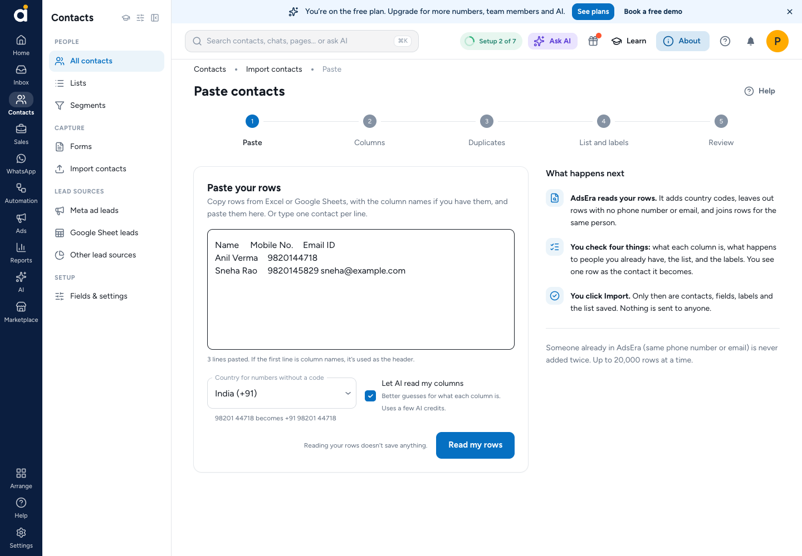

For a short list, pasting is the fastest way in. Copy the rows from Excel or Google Sheets and paste them. AdsEra then reads them exactly like an uploaded file: it adds country codes, leaves out rows with no phone number or email, joins rows for the same person, suggests what each column is, and finds people you already have. **Nothing is saved until you click Import.**

**Where:** **Contacts → Import contacts → Paste from a sheet**. [Open it →](https://app.adsera.in/dashboard/contact/import/copy-past)



## Paste, step by step

<Steps>
<Step title="Paste">
Copy the rows from your sheet, with the row of column names if you have one, and paste them in the box. Typed by hand? Put commas between the values, one person per line:

```
Name, Phone, Email
Anil Verma, 98201 44718, anil@example.com
Sneha Rao, 98450 11223,
```

The box says how many lines you pasted. Pick the **Country for numbers without a code**, keep **Let AI read my columns** ticked if you like, and click **Read my rows**. Reading them doesn't save anything.
</Step>
<Step title="Columns, Duplicates, List and labels, Review">
The same four checks as a file: what each column is, what happens to people you already have, the list and labels, then everything that will happen. See [Import contacts from a file](/help/audiance/file#import-step-by-step).

The bar at the bottom always says what an import would do right now, and **Nothing is saved yet**. Click **Import** on **Review**.
</Step>
</Steps>

## Good to know

- No row of column names? That's fine: a first line with a phone number or an email is read as a contact, and the columns are called Column A, Column B… Pick what each one is on **Columns**.
- The new list is called **Pasted contacts** and the date. Change the name on **List and labels**.
- Each new contact's timeline says **Added by pasting a list**.
- Up to 20,000 rows at a time. For more, [upload a file](/help/audiance/file).

## Troubleshooting

| What you see | Why | What to do |
| --- | --- | --- |
| *We couldn't find a phone number or email column* | No column looks like one. | Check the rows have phone numbers or emails. On **Columns**, set **Saves in AdsEra as** to **Phone number** or **Email**. |
| Everything is in one column | The values aren't split by tabs or commas. | Copy straight from the sheet, or put commas between values. |
| Fewer contacts than lines | Rows with no phone or email are left out, and the same person twice is joined. | The **Columns** step shows each count and why. |

## Related

<CardGroup cols={2}>
  <Card title="Import a file" icon="file-import" href="/help/audiance/file" />
  <Card title="Import from Google Sheets" icon="table" href="/help/audiance/google-sheets" />
</CardGroup>
