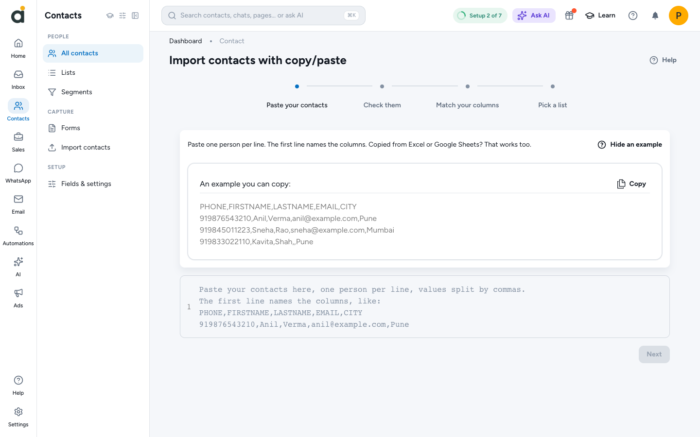
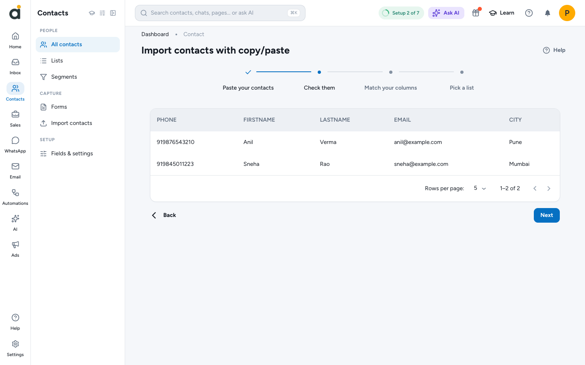

For a short list, pasting is the fastest way in. Copy the rows (with the heading row) from Excel or Google Sheets, paste, and follow four steps: **Paste your contacts → Check them → Match your columns → Pick a list**.

**Where:** **Contacts → Import contacts → Paste from a sheet**. [Open it →](https://app.adsera.in/dashboard/contact/import/copy-past)


<Warning>
  **Phone numbers need the country code**, like 919876543210. AdsEra removes +, spaces and dashes and adds 91 to a 10-digit number.
</Warning>

## Paste, step by step

<Steps>
<Step title="Paste your rows">
Copy the rows from your sheet, including the first row with the column names, and paste them in the big box. Typed by hand? Put commas between the values, one person per line.

**Show an example** shows the layout, and **Copy** copies it:

```
PHONE,FIRSTNAME,LASTNAME,EMAIL,CITY
919876543210,Anil,Verma,anil@example.com,Pune
919845011223,Sneha,Rao,sneha@example.com,Mumbai
```



Click **Next**.
</Step>
<Step title="Check them">
You see the rows as AdsEra read them. Something wrong? Click **Back** and fix the paste. Otherwise click **Next**.


</Step>
<Step title="Match your columns">Pick the field each column **Saves into**, and what happens to people you already have, exactly as for a file. See [Matching choices](/help/audiance/file#matching-choices). Click **Next**.</Step>
<Step title="Pick a list and import">Tick a list (or **Create a list**), click **Import**, then confirm with **Upload**.</Step>
</Steps>

## Good to know

- The first line names the columns. If it has **PHONE**, **EMAIL**, **FIRSTNAME** or **LASTNAME**, it's read as the heading row; other names (like **CITY**) are kept as they are.
- Without a heading row, the columns are called FIELD1, FIELD2… and you match them by hand.
- Each row needs a phone or an email.

## Troubleshooting

| What you see | Why | What to do |
| --- | --- | --- |
| Everything is in one column | The values aren't split by commas or tabs. | Copy straight from the sheet, or put commas between values. |
| "No valid email address or phone number detected in the data." | No row has a valid phone or email. | Check the PHONE and EMAIL columns: digits for phones, a proper email address. |
| Names like FIELD5 | No heading row. | Add the heading row, or match the columns by hand. |

## Related

<CardGroup cols={2}>
  <Card title="Import a file" icon="file-import" href="/help/audiance/file" />
  <Card title="Import from Google Sheets" icon="table" href="/help/audiance/google-sheets" />
</CardGroup>
