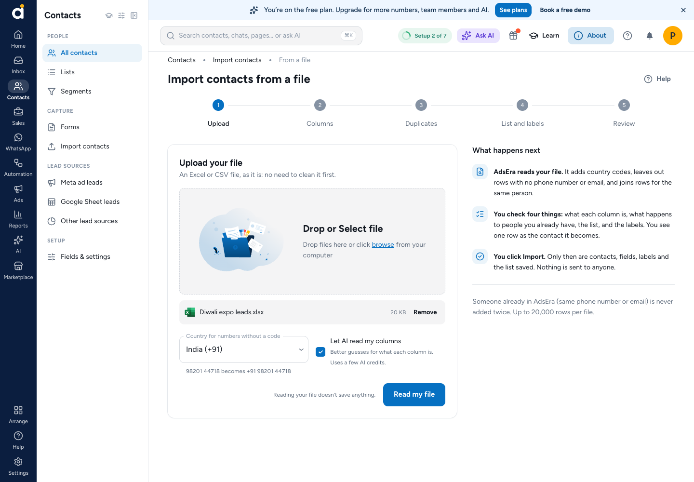
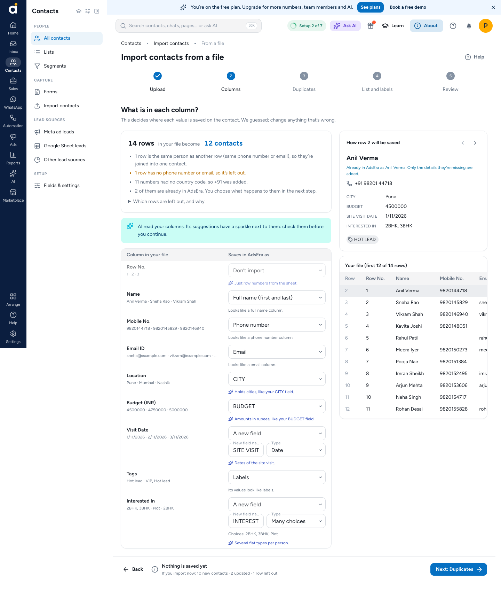
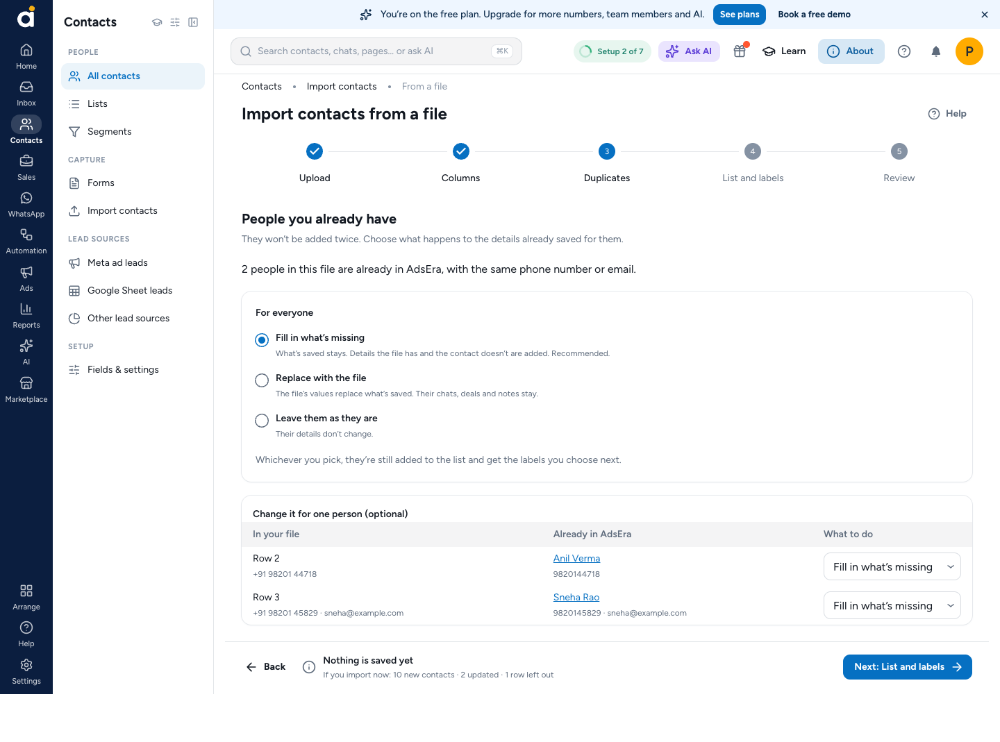
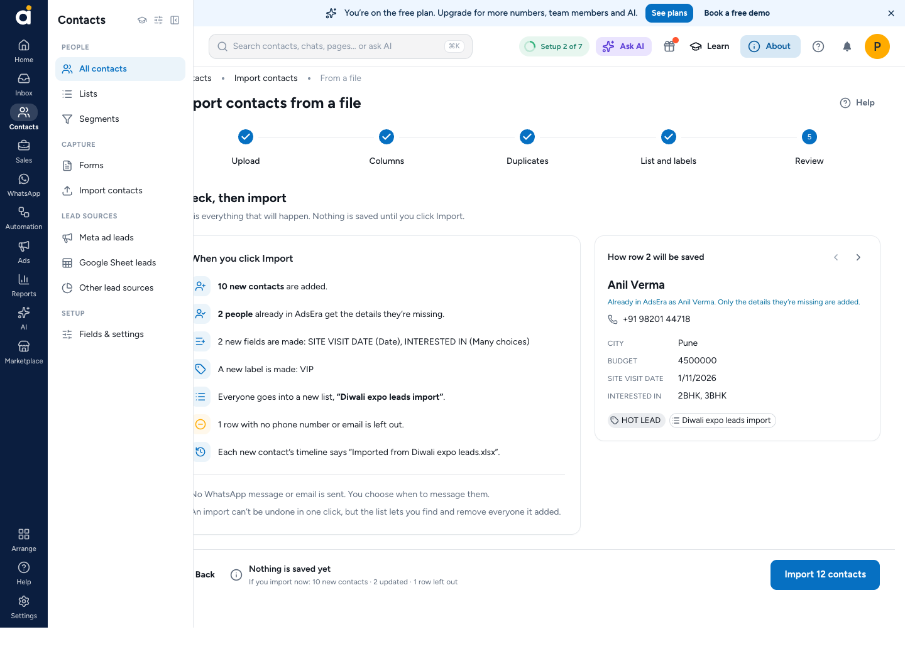
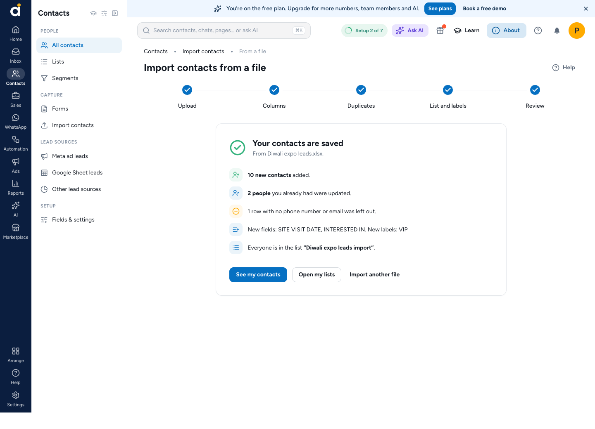

Have your leads in Excel? Upload the file as it is: you don't need to clean it first. AdsEra reads every row, fixes what it can, suggests what each column is, and shows you everything before it imports. **Nothing is created until you click Import.**

**Where:** **Contacts → Import contacts → Upload a file**. [Open it →](https://app.adsera.in/dashboard/contact/import/option)

## What AdsEra does for you

| Without you doing it | What happens |
| --- | --- |
| **Country codes** | A number without one gets the code you pick (India by default): *98201 44718* becomes *+91 98201 44718*. +, spaces and dashes are removed. |
| **Rows with no phone or email** | Left out, and listed with the reason, so you can fix them in your file. |
| **The same person twice in the file** | Rows with the same phone number or email become one contact; later rows fill in what the first is missing. |
| **People already in AdsEra** | Found by phone number (with or without the country code) or email, and never added twice. You choose what happens to them. |
| **What each column is** | Matched to a field you have, even with a different name (*Location* → **CITY**), or proposed as a new field with the right type: Text, Number, Date, One choice or Many choices. Columns of tags become labels; row numbers are left out. |

Reading the columns with **AI** uses a few AI credits. Untick **Let AI read my columns** and AdsEra matches columns by their names only, for free. With no AI credits left, the option is switched off for you (with **Top up AI credits**) and everything else works the same.

Prefer ChatGPT or Claude? See [Import with ChatGPT or Claude](/help/audiance/import-with-ai).

<Warning>
  Only import people who agreed to hear from you. Messaging people who never asked can get your WhatsApp number limited.
</Warning>

## Import, step by step

<Steps>
<Step title="Upload">
Drop your .xlsx, .xls or .csv file on the box. Pick the **Country for numbers without a code**, keep **Let AI read my columns** ticked if you want, and click **Read my file**. Reading the file doesn't save anything.

From here on, the bar at the bottom of the page always says what an import would do right now (*10 new contacts · 2 updated · 1 row left out*) and **Nothing is saved yet**, until you click **Import**.

</Step>
<Step title="Columns">
At the top, in plain words: how many rows your file has and how many contacts they become, which rows were joined (the same person twice), which were left out (open **Which rows are left out, and why**), how many numbers got a country code, and how many people you already have.

On the right, **How row 2 will be saved** shows one row of your file as the contact it becomes: name, phone number, email, fields and labels. Use the arrows, or click a row in **Your file** below it, to see another row. It changes as soon as you change a column, so you can see what your choice does.

For each column check **Saves in AdsEra as**:

| Saves in AdsEra as | What happens |
| --- | --- |
| **Phone number** / **Email** | One of them is needed: every contact has a phone number or an email. |
| **First name**, **Last name**, **Full name** | A full name is split into first and last name. |
| **Labels** | Each value becomes a label on that person (*VIP, Hot lead* gives two labels). |
| One of **Your fields** | The value goes into that field (City, Budget…). |
| **A new field** | Give it a name and a type. A date column becomes a **Date** field, an amount a **Number** field, a few repeated values **One choice**, several per cell **Many choices**. |
| **Don't import** | The column is left out. |

A sparkle next to a suggestion means AI made it. Change anything that's wrong, then click **Next: Duplicates**.

</Step>
<Step title="Duplicates">
People in your file who are already in AdsEra (the same phone number or email). Choose for everyone, then change it for one person if you like:

| Choice | What happens to that person |
| --- | --- |
| **Fill in what's missing** (recommended) | What's saved stays; details the file has and the contact doesn't are added. |
| **Replace with the file** | The file's values replace what's saved. Chats, deals and notes stay. |
| **Leave them as they are** | Nothing changes for them. |

Whichever you pick, they join the list and get the labels you choose next, and they're never added twice. The example contact on the **Review** step says when that row is someone you already have.

</Step>
<Step title="List and labels">
Add everyone to **A new list** (recommended: it's named after your file, and lets you find everyone this import added), **A list I have**, or **No list**. Labels are optional: pick labels for everyone, or type a new one and press Enter. Values from a labels column are shown too.

</Step>
<Step title="Review and import">
**When you click Import** lists everything that will happen: new contacts, people updated, new fields and labels, the list, rows left out. Next to it, the example contact now has its labels and list too. Nothing is sent to anyone. Click **Import**.

</Step>
</Steps>

**Your contacts are saved** then says what was done: new contacts, people updated, rows left out, new fields and labels, and the list everyone is in.

## After you import

- Each new contact's **timeline** starts with *Imported from a file* and the file's name, so you always know where someone came from. People who were updated show *Updated from the import of …*.
- Find everyone in their list: **Contacts → Lists**, or filter **List is …** on All contacts.
- To check a column came in, show it in **Edit columns**.

## Troubleshooting

| What you see | Why | What to do |
| --- | --- | --- |
| *We couldn't find a phone number or email column* | No column looks like one. | Check your file has a phone or email column, then on **Columns** set **Saves as** to **Phone number** or **Email**. |
| **Let AI read my columns** is greyed out | You have no AI credits left. | Columns are matched by name: check them. Top up in **AI → AI credits** to use AI.  |
| Fewer contacts than rows | Rows with no phone or email are left out; the same person twice is joined; people you already have are updated, not added. | The **Columns** step shows each count and why. |
| The import stopped with an error | The connection dropped while saving. Some contacts may be saved. | Import the same file again: people already saved are found by phone number or email and not added twice. |
| A number came in with the wrong country code | It had no code, and the country you picked was different. | Put the code in the file (for example +971) and import again with **Replace with the file**. |
| Budget can't be filtered by "more than" | The column became a Text field. | On **Columns**, make it a new field of type **Number**, or pick your Number field. |

## FAQ

<AccordionGroup>
  <Accordion title="Can I undo an import?">
    No. Import into a new list so you can find everyone it added (tick them all and delete if you need to).
  </Accordion>
  <Accordion title="Does AdsEra create fields or labels without asking?">
    No. It suggests them; the **Review** step lists every new field and label, and they're made only when you click **Import**.
  </Accordion>
  <Accordion title="How many AI credits does it use?">
    A few for each file: AI reads the column names and a handful of values per column, not every row.
  </Accordion>
  <Accordion title="Is there a size limit?">
    Up to 20,000 rows and 60 columns per file. Split bigger files.
  </Accordion>
  <Accordion title="Do imported people get a WhatsApp message?">
    No. Importing never sends anything. You choose when to send a broadcast.
  </Accordion>
</AccordionGroup>

## Related

<CardGroup cols={2}>
  <Card title="Find duplicates and merge" icon="code-merge" href="/help/audiance/merge-duplicates" />
  <Card title="Paste contacts" icon="paste" href="/help/audiance/copy" />
  <Card title="Import from Google Sheets" icon="table" href="/help/audiance/google-sheets" />
  <Card title="Fields" icon="table-list" href="/help/audiance/attribute" />
</CardGroup>
