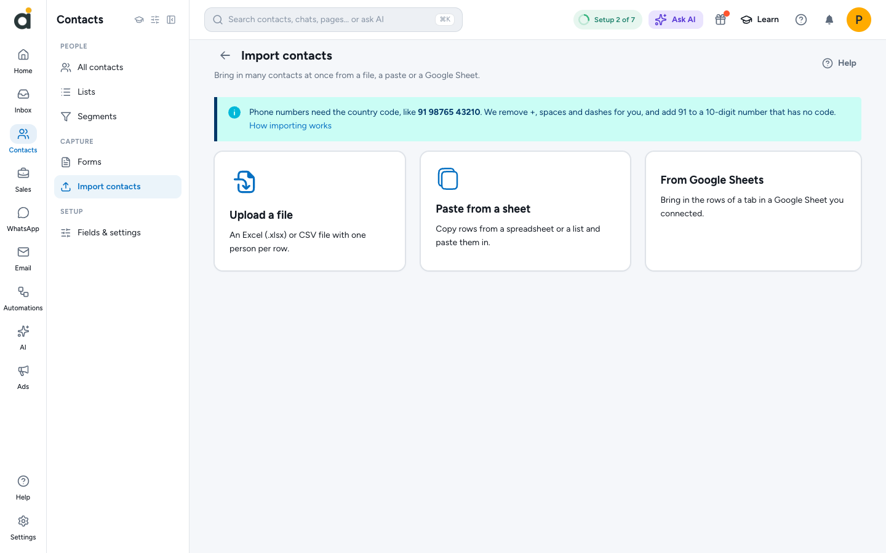
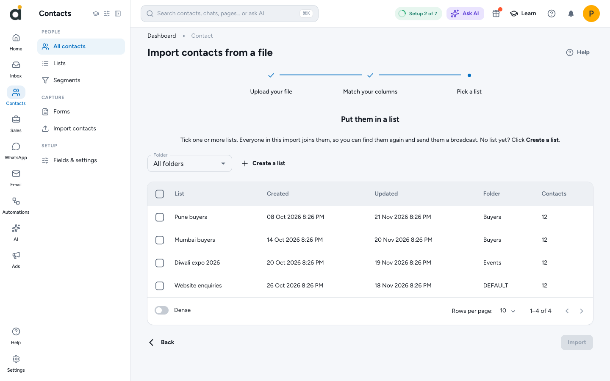
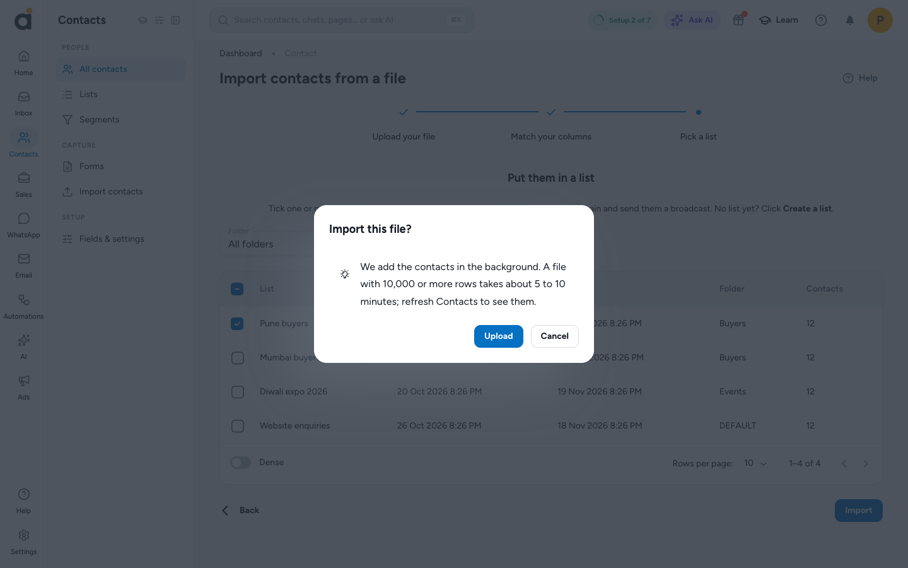

Have your leads in Excel? Upload the file and AdsEra adds everyone as contacts in three steps: **Upload your file → Match your columns → Pick a list**.

**Where:** **Contacts → Import contacts → Upload a file**. [Open it →](https://app.adsera.in/dashboard/contact/import/option)

<Warning>
  **Phone numbers need the country code**, like **91 98765 43210**. AdsEra removes +, spaces and dashes for you, and adds 91 to a 10-digit number that has no code. Only import people who agreed to hear from you: messaging people who never asked can get your WhatsApp number limited.
</Warning>

## Before you start

- **One person per row**, with the column names in the first row (Phone, First name, City…).
- Each row needs a **phone number** or an **email**. Rows with neither are skipped.
- Want to filter by an amount or a date later (like Budget or Site visit date)? Create that field as **Number** or **Date** in [Fields](/help/audiance/attribute) **first**. A column you don't match to a field becomes a new **Text** field, and a field's type can't be changed later.
- Make the list you want them in (or make it on the last step).

**Download sample file** on the upload step gives you a sheet set out the right way.

## Import, step by step

<Steps>
<Step title="Pick Upload a file">On **Import contacts**, click **Upload a file**.</Step>
<Step title="Upload your file">
Drop the file on the box, or click it to pick one. Excel (.xlsx, .xls) or CSV. Click **Next**.

</Step>
<Step title="Match your columns">
Each row is a column of your file. Under **Saves into**, pick the field it goes into. A green tick means it's matched; a blue plus means it will become a new field with the column's name. One column must be **Phone** or **Email**.

</Step>
<Step title="Choose what happens to people you already have">Under **If the contact is already in AdsEra**, pick for each column (table below). Click **Next**.</Step>
<Step title="Put them in a list">
Tick one or more lists. No list yet? Click **Create a list**. **Folder** narrows the lists shown. Click **Import**.

</Step>
<Step title="Confirm">
Click **Upload** in **Import this file?**. You go back to All contacts while they're added.

</Step>
</Steps>

## Matching choices

| Saves into | What happens |
| --- | --- |
| **Phone** | The WhatsApp number. Cleaned and given 91 if it has 10 digits. |
| **Email** | Their email (saved in small letters). |
| One of **Your fields** | The value goes into that field (City, Budget…). |
| **New field "COLUMN"** (nothing picked) | A new Text field is made with the column's name. |

Columns named like a field match by themselves: **First name**, **FIRST_NAME** and **firstname** all match **First name**.

| If the contact is already in AdsEra | What happens to that person |
| --- | --- |
| **Keep what they have** | Their value stays. A field they don't have yet is filled. |
| **Replace with the file's value** | The file's value replaces theirs. |
| **Fill it only if it's empty** | Only a blank value is filled. |

A contact "already in AdsEra" has the same phone number or email. They're updated, never added twice, and join the lists you ticked. The same person twice in your file is merged into one.

## After you import

- Small files are done in seconds; a file with **10,000 or more** rows takes about **5 to 10 minutes**. Refresh **All contacts** to see them.
- Everyone joins the lists you ticked. Find them with **Contacts → Lists**, or filter **List is …** on All contacts.
- To check a column came in, show it in **Edit columns**.

## Troubleshooting

| What you see | Why | What to do |
| --- | --- | --- |
| **Next** stays grey | No file yet, or it couldn't be read. | Use .xlsx, .xls or .csv with the column names in the first row. |
| **Import** stays grey | No list ticked. | Tick a list, or **Create a list**. |
| Fewer contacts than rows | Rows without a phone or email are skipped; repeated people are merged; people you already have are updated. | Check those rows in your file. |
| WhatsApp messages fail for some | A number without the right country code (for example a 10-digit number from another country). | Put the country code in the file and import again with **Replace with the file's value** on Phone. |
| Budget can't be filtered by "more than" | The column became a Text field. | Make a **Number** field, import again and pick it under **Saves into**. |
| New fields named in capitals (CITY) | New fields take the column name. | That's fine; they show as "City" on contacts. |

## FAQ

<AccordionGroup>
  <Accordion title="Can I undo an import?">
    No. Import into a new list so you can find everyone it added (tick them all and delete if you need to).
  </Accordion>
  <Accordion title="Can I add a label during the import?">
    Not during the import. Afterwards, filter **List is** (your list), click **Select all**, then **Add labels**.
  </Accordion>
  <Accordion title="Is there a size limit?">
    Very big files work but take longer (about 5 to 10 minutes for 10,000 rows). Split huge files into a few.
  </Accordion>
  <Accordion title="Do imported people get a WhatsApp message?">
    No. Importing never sends anything. You choose when to send a broadcast.
  </Accordion>
</AccordionGroup>

## Related

<CardGroup cols={2}>
  <Card title="Paste contacts" icon="paste" href="/help/audiance/copy" />
  <Card title="Import from Google Sheets" icon="table" href="/help/audiance/google-sheets" />
  <Card title="Fields" icon="table-list" href="/help/audiance/attribute" />
  <Card title="Lists and folders" icon="list" href="/help/audiance/list" />
</CardGroup>
