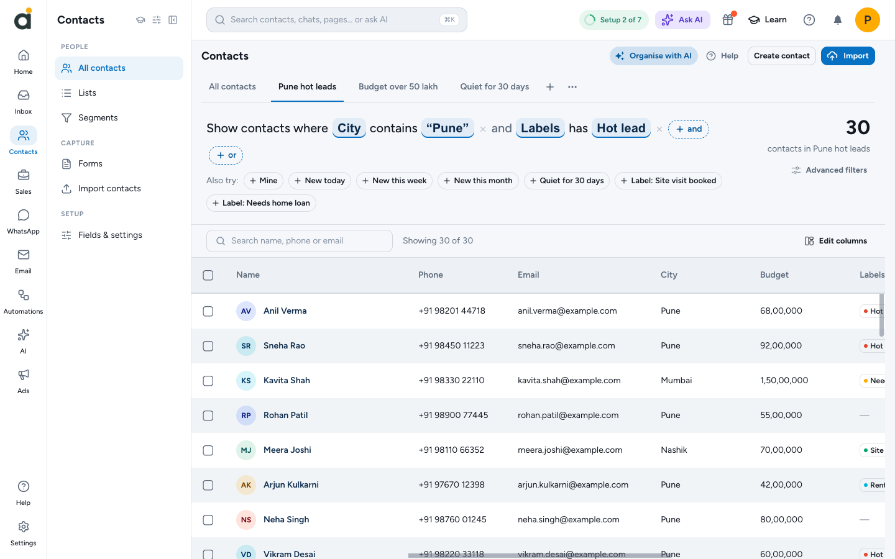
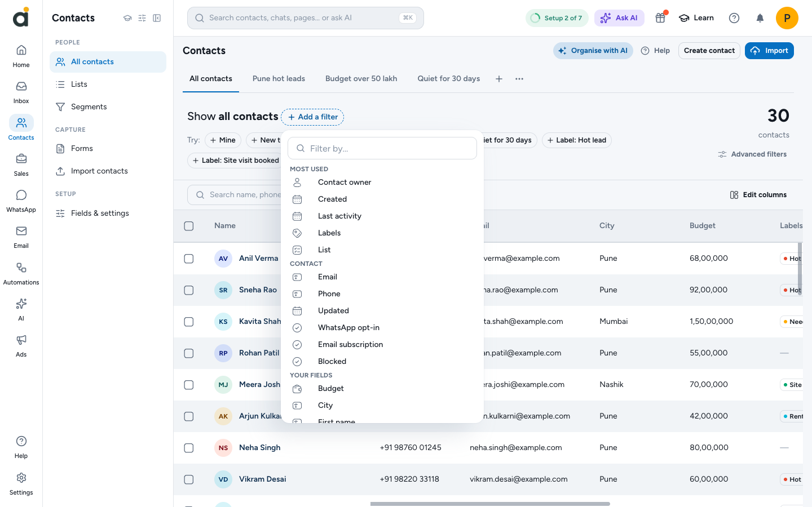
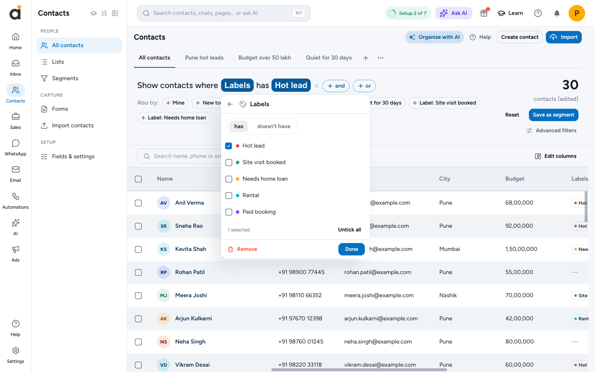
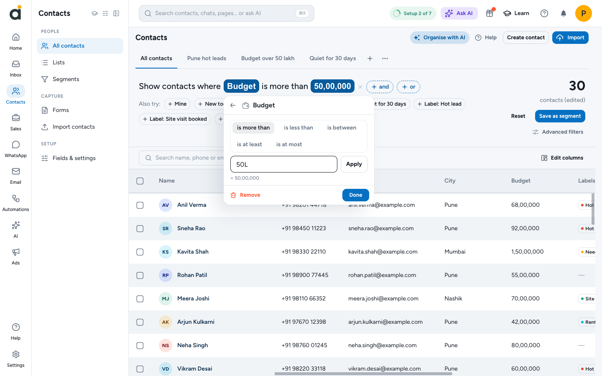
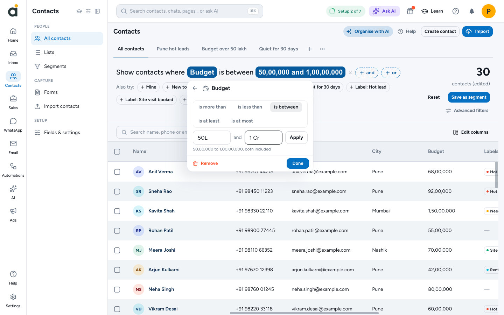
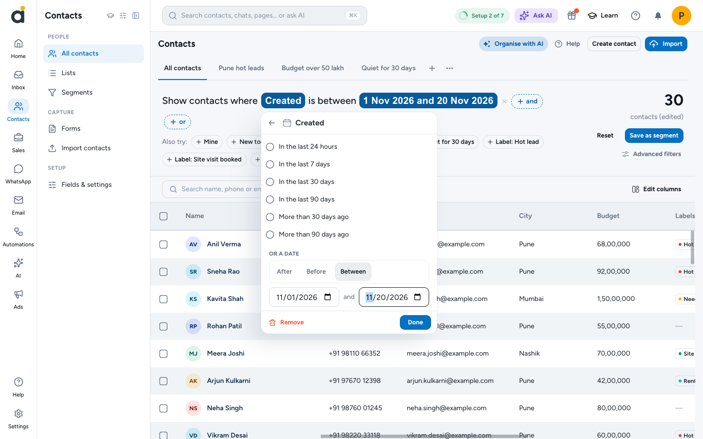
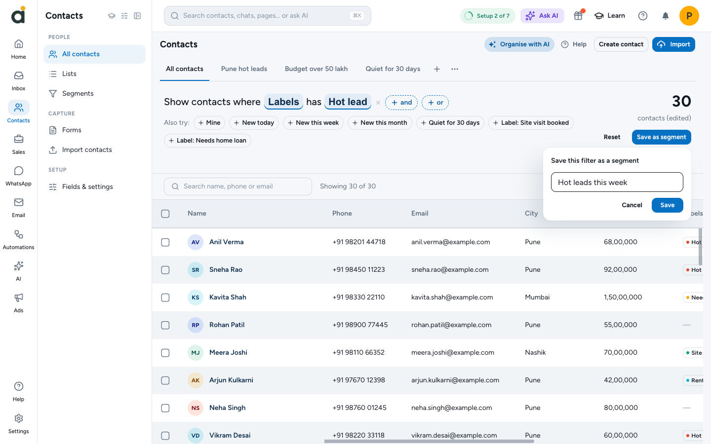
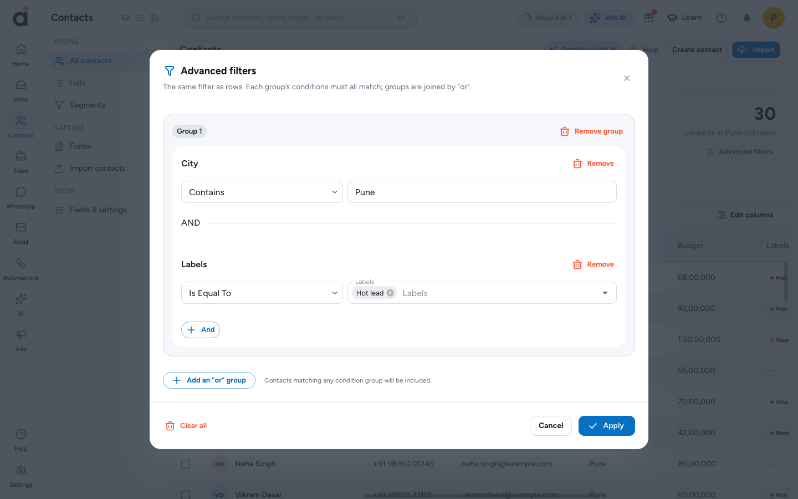

The filter on **All contacts** reads like a sentence: *"Show contacts where City contains Pune and Labels has Hot lead"*. You build it by clicking, and the list changes at once. The same sentence sits on **Lists** and **Segments**, where it narrows the list or segment you picked.

**Where:** **Contacts → All contacts**, above the list. [Open it →](https://app.adsera.in/dashboard/contact/list)

## Add a filter

<Steps>
<Step title="Click Add a filter">Next to "Show all contacts". A list of fields opens.</Step>
<Step title="Pick a field">
Like **City**, **Labels**, **Contact owner** or **Budget**. Type in **Filter by…** to find one fast.

</Step>
<Step title="Pick how it compares and the answer">
The choices depend on the kind of field (table below). Tick answers, or type one and press **Apply**. The list and the big number change straight away.

</Step>
<Step title="Click Done">The sentence now reads your filter. Click any green word to change it, or the ✕ after it to remove it.</Step>
</Steps>

## And, or

- **+ and** adds another condition to the same line: a contact must match **both**. ("City contains Pune **and** Labels has Hot lead.")
- **+ or** starts a new line: a contact can match **either** line. ("…**or** contacts where Labels has Site visit booked.")

The **Try:** buttons add an everyday filter in one click: **Mine** (contacts you own), **New today**, **New this week**, **New this month**, **Quiet for 30 days** (no activity for 30 days) and your first three labels.

## What each kind of field can do

| Kind of field | Examples | How it compares | The answer |
| --- | --- | --- | --- |
| Text | City, Project, Email, Phone | **contains**, **is**, **is not**, **is empty**, **is known** | Type a word and press **Apply** |
| Number | Budget | **is more than**, **is less than**, **is between**, **is at least**, **is at most** | Type an amount: 5000000, **50L**, **1.2 Cr**, **75,00,000** |
| Date | Created, Last activity, Updated, Site visit date | (pick one) | **In the last 24 hours / 7 / 30 / 90 days**, **More than 30 / 90 days ago**, or **Or a date**: **After**, **Before** or **Between** two days |
| Dropdown | Property type, Looking for | **is**, **is not** | Tick the answers |
| Labels | Labels | **has**, **doesn't have** | Tick the labels |
| List | List | **is**, **is not** | Tick the lists |
| Contact owner | Contact owner | **is**, **is not** | Tick team members |
| Yes / No | WhatsApp opt-in, Email subscription, Blocked, Home loan | is | **Yes** or **No** |

## Filter by an amount: "Budget more than 50 lakh"

<Steps>
<Step title="Add a filter → Budget">Pick your **Number** field.</Step>
<Step title="Pick is more than">Or **is less than**, **is between** (both ends included), **is at least**, **is at most**.</Step>
<Step title="Type 50L">It shows the amount it understood below the box ("= 50,00,000"). Press **Apply**, then **Done**.</Step>
</Steps>

For **is between**, type the two amounts in **From** and **To**:

<Warning>
  This works only for a field made as **Number**. A field made as **Text** compares words, so "more than" isn't offered. A column you import without picking a field becomes a Text field: make **Budget** a Number field in [Fields](/help/audiance/attribute) **before** you import, and pick it when you match the columns. A value that isn't a number (like "about 50L") is left out of number filters.
</Warning>

## Filter by a date

Pick a date field. Choose a moving window (**In the last 7 days**, **More than 30 days ago**…), which stays current in a saved segment, or a fixed day under **Or a date**: **After**, **Before** or **Between** two days (both days included).

## Keep a filter: save it as a segment

When the list shows the right people, click **Save as segment** under the big number, name it and click **Save**. It becomes a tab and keeps itself up to date. See [Segments](/help/audiance/segment).

## Advanced filters

**Advanced filters** (under the big number) shows the same filter as rows. Inside a **Group**, every condition must match; **Add an “or” group** adds another group (a contact can match either). Click **Apply** and the sentence shows it. Use it for long filters, or to change a condition that was made there (the sentence then says "This condition was made in Advanced filters").

## Troubleshooting

| What you see | Why | What to do |
| --- | --- | --- |
| No "is more than" for Budget | Budget was made as a Text field (for example by an import). | A field's type can't be changed. Make a new **Number** field and import the column into it again. |
| A number filter misses some people | Their value isn't a plain number (like "50 lakh approx"). | Change those values to numbers on the contact. |
| The list is empty | The conditions are too narrow, or "and" was meant as "or". | Remove a condition (✕), or use **+ or** for "either". |
| The search finds nobody | Search looks inside the current filter. | Clear the sentence (✕ on each condition), then search. |

## FAQ

<AccordionGroup>
  <Accordion title="Can I type 50 lakh or 1 crore?">
    Yes: **50L**, **50 lakh**, **1.2 Cr**, **1 crore**, **75,00,000** and **5k** all work. The box shows the amount it understood.
  </Accordion>
  <Accordion title="Does a filter change my contacts?">
    No. A filter only changes what you see. Nothing is saved until you click **Save as segment**.
  </Accordion>
  <Accordion title="Do my team members see my filter?">
    Only once you save it as a segment. Segments are shared with your team.
  </Accordion>
</AccordionGroup>

## Related

<CardGroup cols={2}>
  <Card title="Segments" icon="layer-group" href="/help/audiance/segment" />
  <Card title="Fields" icon="table-list" href="/help/audiance/attribute" />
  <Card title="All contacts" icon="users" href="/help/audiance/audiance" />
  <Card title="Act on many contacts" icon="list-check" href="/help/audiance/bulk" />
</CardGroup>
