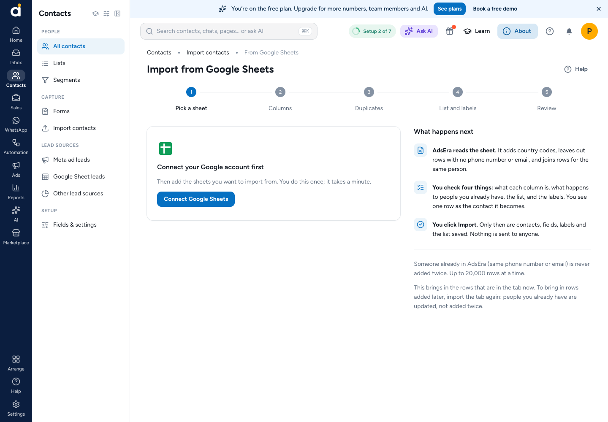

If your leads live in a Google Sheet (say, from an expo or a website form), bring them in without downloading a file. AdsEra reads every row of one tab and checks it exactly like an uploaded file: it adds country codes, leaves out rows with no phone number or email, joins rows for the same person, suggests what each column is, and finds people you already have. **Nothing is saved until you click Import.**

**Where:** **Contacts → Import contacts → From Google Sheets**. [Open it →](https://app.adsera.in/dashboard/contact/import/google-sheets)

## Before you start: connect Google Sheets

You do this once:

1. Open **Marketplace → Google Sheets** and connect your Google account.
2. Add the sheets you want to import from.

No account connected yet? The import page shows **Connect your Google account first** with a **Connect Google Sheets** button.

## Import, step by step

<Steps>
<Step title="Pick a sheet">
Pick the **Google account**, the **Sheet** and the **Tab**. Only sheets you added show here: **Add it in Google Sheets settings** adds another. The tab's first row should be the column names.

Pick the **Country for numbers without a code**, keep **Let AI read my columns** ticked if you like, and click **Read the sheet**. Reading it doesn't save anything.
</Step>
<Step title="Columns, Duplicates, List and labels, Review">
The same four checks as a file: what each column is, what happens to people you already have, the list and labels, then everything that will happen. See [Import contacts from a file](/help/audiance/file#import-step-by-step).

The bar at the bottom always says what an import would do right now, and **Nothing is saved yet**. Click **Import** on **Review**.
</Step>
</Steps>

## Good to know

- The new list is named after the sheet and tab, for example **Expo leads - Sheet1 import**. Change the name on **List and labels**.
- Each new contact's timeline says **Added from Google Sheets** with the sheet and tab.
- This brings in the rows that are in the tab now. To bring in rows added later, import the tab again: people you already have are updated, never added twice.
- AdsEra only reads the sheet. Up to 20,000 rows at a time.

## Troubleshooting

| What you see | Why | What to do |
| --- | --- | --- |
| *That Google account isn't connected any more* | The connection was removed or expired. | Connect it again in **Marketplace → Google Sheets**. |
| *Google Sheets didn't let AdsEra read that tab* | The sheet was deleted, or the Google account can't open it any more. | Open the sheet in Google with that account, then try again. |
| *The sheet is empty* | The tab has no rows. | Pick the right tab. |
| **Read the sheet** stays grey | No tab picked. | Pick the account, sheet and tab. |

## Related

<CardGroup cols={2}>
  <Card title="Import a file" icon="file-import" href="/help/audiance/file" />
  <Card title="Paste contacts" icon="paste" href="/help/audiance/copy" />
  <Card title="Broadcast from a Google Sheet" icon="bullhorn" href="/help/campaign/wa/google-sheet" />
</CardGroup>
