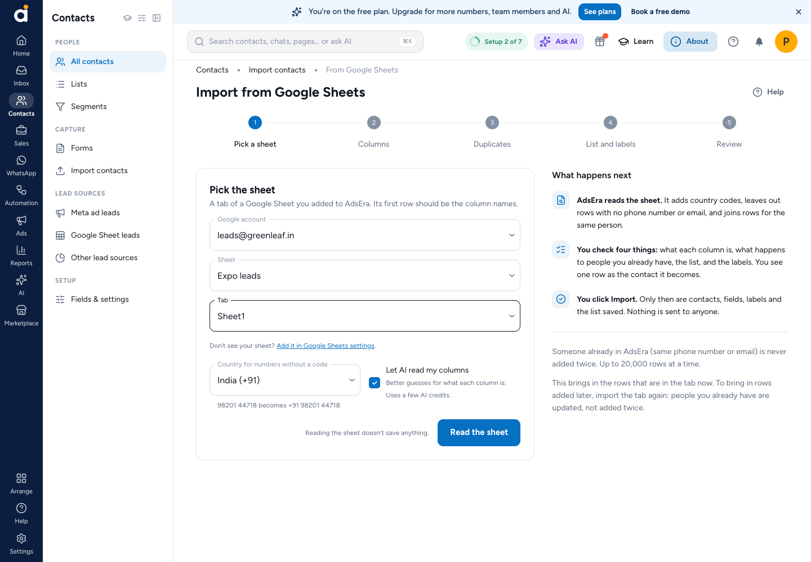

If your leads live in a Google Sheet (say, from an expo or a website form), you can bring them in without downloading a file. Each import reads every row of one tab; run it again later to bring in new rows.

**Where:** **Contacts → Import contacts → From Google Sheets**. [Open it →](https://app.adsera.in/dashboard/contact/import/google-sheets)

## Before you start: connect the sheet

The sheet must be connected first, with its columns picked:

1. Open **Automations → Apps & integrations → Google Sheets** and connect your Google account.
2. Add the sheet, and for each tab pick the **Mobile Number Column (For WhatsApp)**, the **Email column (optional)** and which column goes into which field.

No account connected yet? The import page says **No Google account is connected yet** with a **Connect Google Sheets** button.

## Import, step by step

<Steps>
<Step title="Pick the Google account">The account you connected.</Step>
<Step title="Pick the Sheet and the Tab">Only sheets added in the connection show here.</Step>
<Step title="Check Columns it reads">The **Phone** and **Email** columns. To change them, open the Google Sheets connection.</Step>
<Step title="Click Import contacts">When it finishes you see "Imported N contacts".</Step>
</Steps>

## What happens

- Every row with a phone number or an email becomes a contact. Rows with neither are skipped.
- Phone numbers are cleaned (+, spaces and dashes removed). Put the country code in the sheet: unlike a file import, 91 is **not** added for you here.
- People you already have (same phone, else same email) are **updated**: the sheet's values replace theirs, and a blank cell never wipes what they have.
- Everyone joins a list named **"(sheet) - (tab)"**, for example "Expo leads 2026 - Day 1" in the folder **Google Sheets** (made the first time).
- New rows added to the sheet later come in when you run the import again.

## Troubleshooting

| What you see | Why | What to do |
| --- | --- | --- |
| "No data found in Google Sheet Tab: …" | The tab has no rows under the heading row. | Pick the right tab. |
| "Google Account not connected" | The connection was removed or expired. | Connect it again in Automations → Apps & integrations → Google Sheets. |
| Contacts without names | The name columns aren't matched to fields in the connection. | Match them in the Google Sheets connection, then import again. |
| **Import contacts** stays grey | No tab picked. | Pick the account, sheet and tab. |

## Related

<CardGroup cols={2}>
  <Card title="Import a file" icon="file-import" href="/help/audiance/file" />
  <Card title="Paste contacts" icon="paste" href="/help/audiance/copy" />
  <Card title="Broadcast from a Google Sheet" icon="bullhorn" href="/help/campaign/wa/google-sheet" />
</CardGroup>
