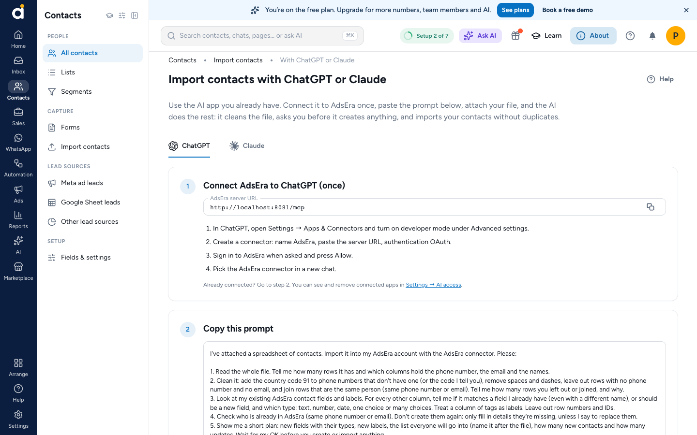

Already use ChatGPT or Claude? Let it import your contacts. You add AdsEra to it as a plugin once, copy a ready-made prompt, and attach your file in a chat. The AI reads the file, cleans it, shows you a plan, and imports only after you say OK.

**Where:** **Contacts → Import contacts → With ChatGPT or Claude**. [Open it →](https://app.adsera.in/dashboard/contact/import/with-ai)

## Step by step

<Steps>
<Step title="Add AdsEra as a plugin in your AI app (once)">
Pick **ChatGPT** or **Claude** at the top. Copy the **AdsEra server URL (MCP)**, then add it as a plugin. Both apps now call an added MCP server a **plugin**; older versions said **connector**.

| App | Do this |
| --- | --- |
| **Claude** | **Customize → Plugins** (Connectors in some versions) → **Add → Custom → Web** (older: **Add custom connector**). Name it AdsEra, paste the server URL, click **Connect**, sign in to AdsEra and press **Allow**. |
| **ChatGPT** | On the web, **Settings → Plugins** → add a custom MCP server named AdsEra with the server URL and **OAuth**, sign in to AdsEra and press **Allow**. (Older versions: **Apps & Connectors**, with **developer mode** on under Advanced settings.) |

You only do this once. Connected apps are listed (and can be removed) in **Settings → AI access**. See [Connect AI apps to AdsEra](/help/ai/connect-ai-apps).
</Step>
<Step title="Copy the prompt">
Click **Copy the prompt**. It asks the AI to read the whole file, add the country code (91; change it in the prompt for another country), leave out rows with no phone or email, join rows for the same person, match columns to your fields or suggest new ones with their types, treat tags as labels, update people you already have instead of adding them twice, and **show you a plan and wait for your OK**.
</Step>
<Step title="Paste it with your file">
In ChatGPT or Claude, open a new chat and turn on the AdsEra plugin. Attach your Excel or CSV file, paste the prompt and send. Answer its questions, check the plan, and reply **OK**. It creates the fields, labels and list, imports in batches, and gives you a link to the list.
</Step>
</Steps>

## Good to know

- It runs on your **ChatGPT or Claude plan**, not your AdsEra AI credits.
- The AI can only do what your AdsEra role allows, and it checks duplicates the way AdsEra does: someone already saved by phone number (with or without +91) or email is updated, never added twice.
- New contacts appear in **Contacts** and in the list it made. Check a few before you send a broadcast.

<Tip>
Prefer to see every step on screen? [Upload a file](/help/audiance/file) does the same cleaning and checks inside AdsEra.
</Tip>

## Troubleshooting

| What you see | What to do |
| --- | --- |
| The AI says it can't reach AdsEra | Turn on the AdsEra plugin in that chat, or add it again (step 1). |
| *AI plugins (MCP) are switched off for this account* | Ask AdsEra support to switch them on, or use **Upload a file**. |
| It can't open the file | Save it as .xlsx or .csv and attach it again. |
