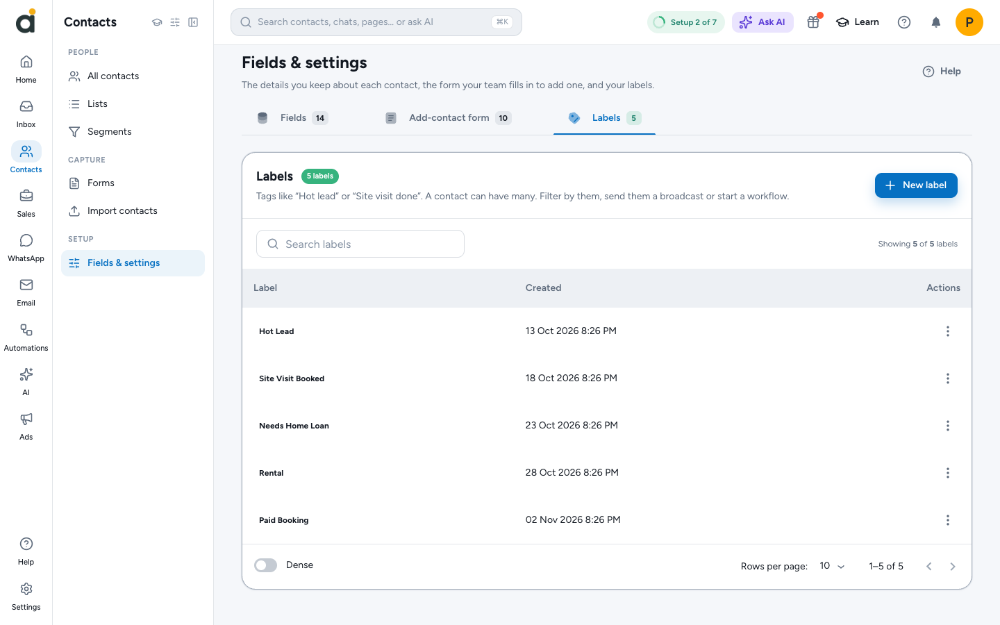
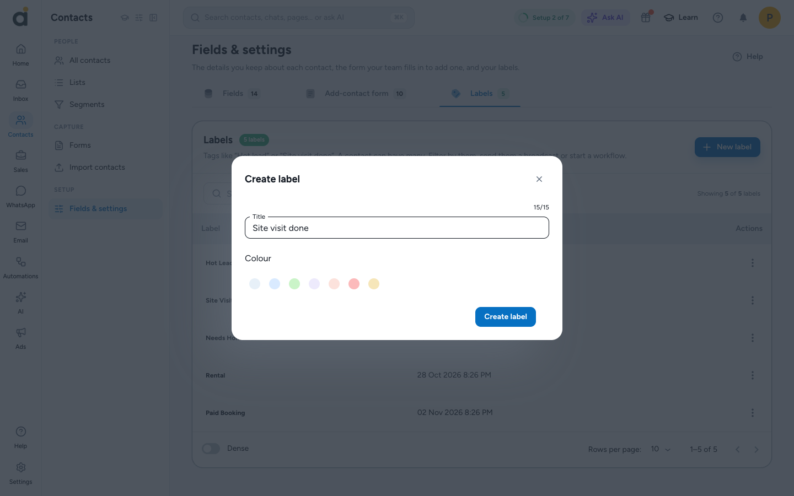

A **label** is a tag on a contact, like **Hot lead**, **Site visit booked** or **Paid booking**. One contact can have many labels. Use labels for anything you want to see at a glance in the list and the inbox.

**Where:** **Contacts → Fields & settings → Labels**. [Open it →](https://app.adsera.in/dashboard/contact/attributes) and click the **Labels** tab.

## Make a label

<Steps>
<Step title="Open the Labels tab">In **Fields & settings**.</Step>
<Step title="Click New label">Top right of the tab.</Step>
<Step title="Name it and pick a colour">
**Title**: up to 15 letters, like "Hot lead". Pick a colour so it stands out.

</Step>
<Step title="Click Create label">It's ready to use.</Step>
</Steps>

## The labels table

| Column | What it shows |
| --- | --- |
| **Label** | The label in its colour. |
| **Created** | When it was made. |
| **⋮** | **Edit** (name and colour) or **Delete**. |

**Search labels** finds one by name. Deleting a label removes it from everyone who had it; it can't be undone.

Some labels come with every account and can't be changed or deleted (their menu items are grey): **VIP**, **NEW CUSTOMER**, **NEW ORDER**, **PENDING PAYMENT**, **PAID**, **ORDER COMPLETE** and **ISSUE**. They're used by orders and payments.

## Put labels on people

- **Many at once:** on **All contacts**, tick people (or filter and **Select all**), then **Add labels**. See [Act on many contacts](/help/audiance/bulk).
- **One person:** click **Labels** on their page or side panel and tick the labels.
- **From a chat:** in the Inbox, add labels from the customer's details. See [Labels and lists in the inbox](/help/inbox/team).
- **From a form:** everyone who fills a [form](/help/sales/forms) can get labels you pick.

## Use labels

- **Filter:** **Add a filter → Labels → has** (or **doesn't have**). The first three labels also show as **Try:** buttons.
- **Segment:** save that filter as a [segment](/help/audiance/segment) to send it broadcasts again and again.
- **Inbox:** labels show on each chat, and you can filter chats by label.

## FAQ

<AccordionGroup>
  <Accordion title="Label or list?">
    A label is a tag on a person ("Hot lead"); a list is a group you send to ("Diwali expo 2026"). Many teams label people as they talk to them, then filter by the label when it's time to send.
  </Accordion>
  <Accordion title="How do I remove a label from many people?">
    Remove it on each person, or delete the label to remove it from everyone.
  </Accordion>
</AccordionGroup>

## Related

<CardGroup cols={2}>
  <Card title="Act on many contacts" icon="list-check" href="/help/audiance/bulk" />
  <Card title="Filter contacts" icon="filter" href="/help/audiance/filters" />
  <Card title="Fields" icon="table-list" href="/help/audiance/attribute" />
  <Card title="Segments" icon="layer-group" href="/help/audiance/segment" />
</CardGroup>
