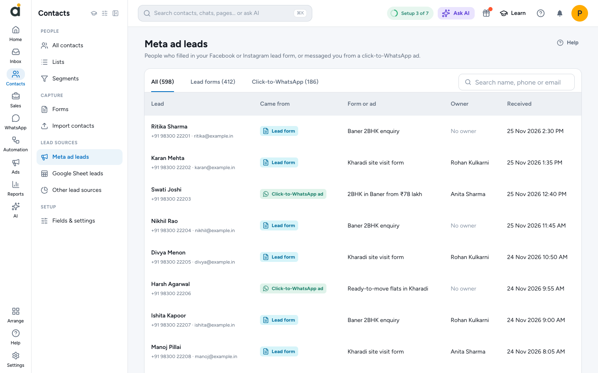
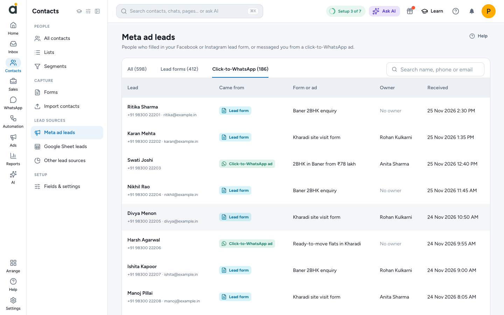
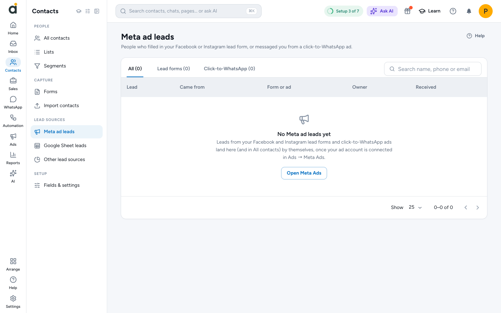
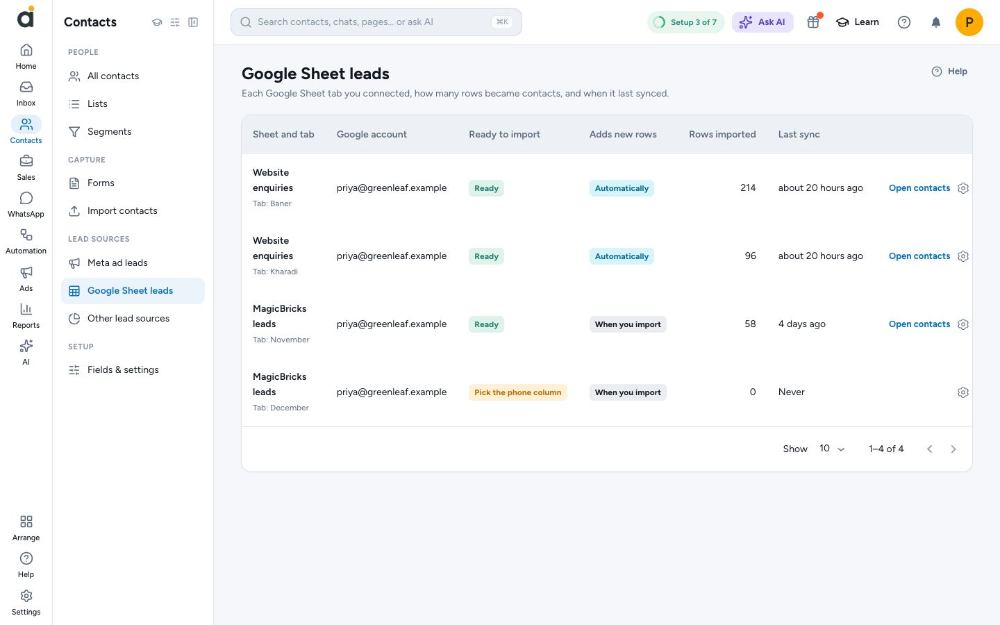
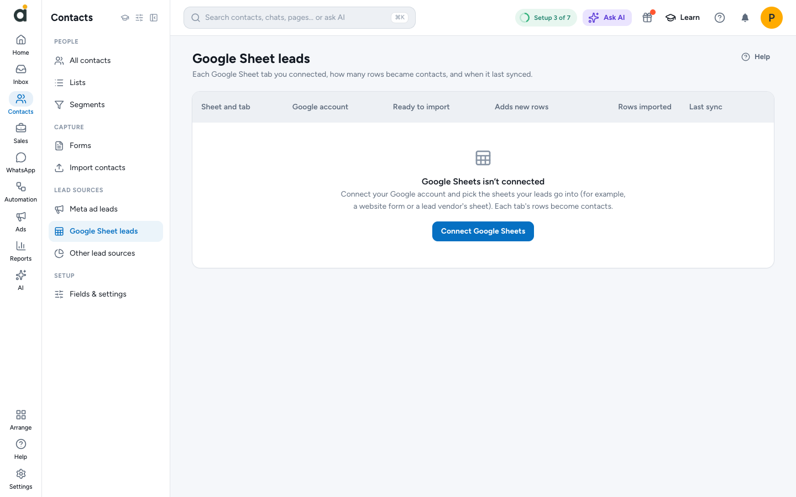
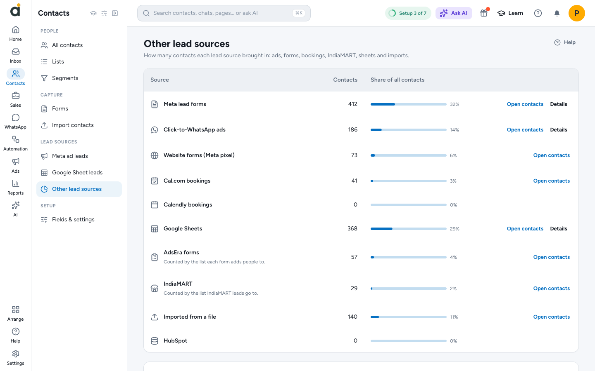

**Lead sources** shows where your contacts came from: your Meta (Facebook and Instagram) ads, the Google Sheets you connected, and every other source (website forms, bookings, AdsEra forms, IndiaMART, imports). Each table opens the contacts behind it.

Use it to see which ads bring leads, check that your sheets are still syncing, and find the leads nobody owns yet.

**Where:** **Contacts → Lead sources**, three pages: **Meta ad leads**, **Google Sheet leads** and **Other lead sources**.

<Note>These pages only read. Leads arrive by themselves from each source once it's connected; nothing here changes a contact.</Note>

## Meta ad leads

Everyone who filled in your Facebook or Instagram **lead form**, or messaged you from a **click-to-WhatsApp ad**. [Open it →](https://app.adsera.in/dashboard/contact/lead-sources/meta)

<Steps>
<Step title="Pick a tab">
**All**, **Lead forms** or **Click-to-WhatsApp**. Each shows its count.

</Step>
<Step title="Search">Type a name, phone number or email in **Search name, phone or email**.</Step>
<Step title="Open a lead">Click the row: their contact page opens, with the lead's form answers and the ad.</Step>
</Steps>

| Column | What it shows | Example |
| --- | --- | --- |
| **Lead** | Name, phone and email | Ritika Sharma, +91 98300 22201 |
| **Came from** | **Lead form** or **Click-to-WhatsApp ad** | Lead form |
| **Form or ad** | The lead form's name, or the ad's headline | Baner 2BHK enquiry |
| **Owner** | Who has the lead, or **No owner** | Rohan Kulkarni |
| **Received** | When the lead arrived | 25 Nov 2026 2:30 PM |

**No owner?** New lead-form leads get no owner unless you switch it on in [Lead handover](/help/crm/lead-handover). Team members who see only their own leads don't see them until then.

**No leads yet?** Connect your ad account in **Ads → Meta Ads** ([how](/help/ads/connect)). Lead-form leads arrive within a minute; **Sync leads** on the ad account's Leads tab fetches older ones.

## Google Sheet leads

Each tab of the Google Sheets you added in **Marketplace → Google Sheets**: how many rows became contacts and when it last synced. [Open it →](https://app.adsera.in/dashboard/contact/lead-sources/google-sheets)

| Column | What it shows | What to do |
| --- | --- | --- |
| **Sheet and tab** | The sheet's name and the tab | |
| **Google account** | The Google account it's read with | |
| **Ready to import** | **Ready**, or **Pick the phone column** | Pick the phone (or email) column on the sheet's settings |
| **Adds new rows** | **Automatically** (new rows become contacts as they come) or **When you import** | Switch it in the sheet's settings |
| **Rows imported** | How many rows are contacts now | |
| **Last sync** | When rows last came in, like "about 1 hour ago", or **Never** | |
| **Open contacts** | Opens those contacts in All contacts, as a tab of their own | |
| Gear | Opens Google Sheets in Marketplace | |

Imported rows go into the list **"Sheet name - Tab name"** (in the **Google Sheets** folder of Lists). See [Import from Google Sheets](/help/audiance/google-sheets).

## Other lead sources

How many contacts each source brought in, with its share of all your contacts. [Open it →](https://app.adsera.in/dashboard/contact/lead-sources/other)

| Source | Counted by |
| --- | --- |
| **Meta lead forms** | Contacts with a lead-form lead |
| **Click-to-WhatsApp ads** | Contacts who messaged from a click-to-WhatsApp ad |
| **Website forms (Meta pixel)** | Contacts from your website forms, sent through Pixel & events |
| **Cal.com bookings** / **Calendly bookings** | Contacts who booked through your booking page |
| **Google Sheets** | Contacts in any Google Sheets list |
| **AdsEra forms** | Contacts in the lists your forms add people to (a form that adds to no list isn't counted) |
| **IndiaMART** | Contacts in the list IndiaMART leads go to |
| **Imported from a file** | Contacts you imported from a CSV or Excel file |
| **HubSpot** | Contacts brought over from HubSpot |

- **Open contacts** opens that source's contacts in **All contacts**, as a tab of their own, which you can keep.
- **Details** opens Meta ad leads or Google Sheet leads.
- **Set up** / **Make a form** shows when a source isn't set up yet.

### The Lead Source field

AdsEra fills a contact field called **Lead Source** by itself with the **first** place a lead came from (**Meta Lead Form**, **Website Form**, **Website Cal.com**, **Website Calendly**) and never changes it. Click a value to see those contacts. Use the field in filters, segments and workflows.

<Note>A contact can count under two sources: a Meta lead who later filled in your website form counts under both. Contacts you added by hand, from a chat or through the API aren't in any row.</Note>

## Who sees what

Every page needs the **Contacts** permission. A team member sees only the contacts their role lets them see, so their counts can be lower than an admin's.

## Troubleshooting

| What you see | Fix |
| --- | --- |
| A sheet says **Pick the phone column** | Open its settings (gear) and pick the phone or email column. |
| **Last sync** is days ago on an automatic tab | Open Marketplace → Google Sheets and refresh the sheet, or reconnect the Google account. |
| IndiaMART shows 0 | Pick a default list in the IndiaMART connection: leads are counted by that list. |
| A Meta lead has **No owner** | Give it an owner on the contact, or switch on [Lead handover](/help/crm/lead-handover) for new ones. |

## Questions

<AccordionGroup>
<Accordion title="Why don't the numbers add up to all my contacts?">Some contacts came from no listed source (added by hand or from a chat), and some count under two.</Accordion>
<Accordion title="Can I export a source's contacts?">Click **Open contacts**, then export from All contacts.</Accordion>
<Accordion title="Where are leads per ad and per campaign?">In **Ads → Meta Ads**: open the ad account, then **Leads**.</Accordion>
</AccordionGroup>

## Related

<CardGroup cols={2}>
<Card title="Lead handover" href="/help/crm/lead-handover">Give new leads an owner.</Card>
<Card title="Import from Google Sheets" href="/help/audiance/google-sheets">Connect a sheet.</Card>
<Card title="Meta Ads" href="/help/integrations/meta-ads">Connect your ad account.</Card>
<Card title="Segments" href="/help/audiance/segment">Save a group of contacts.</Card>
</CardGroup>
