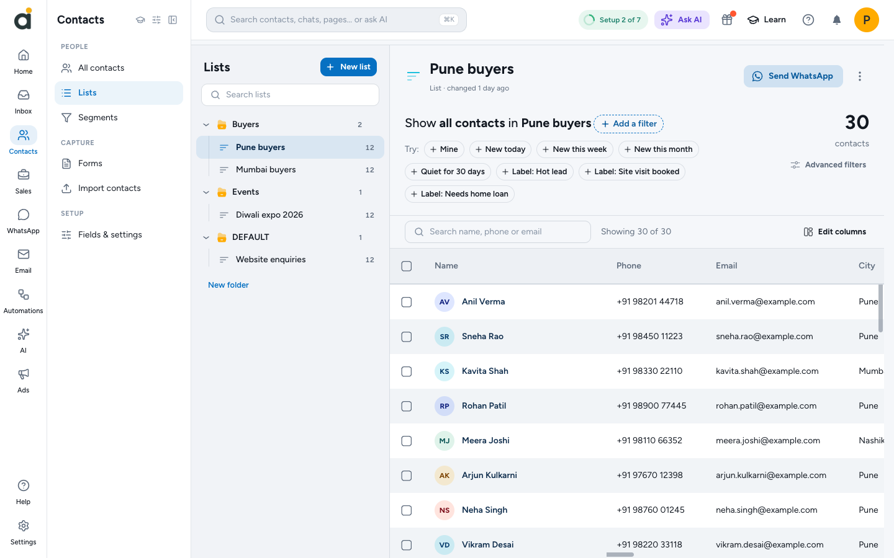
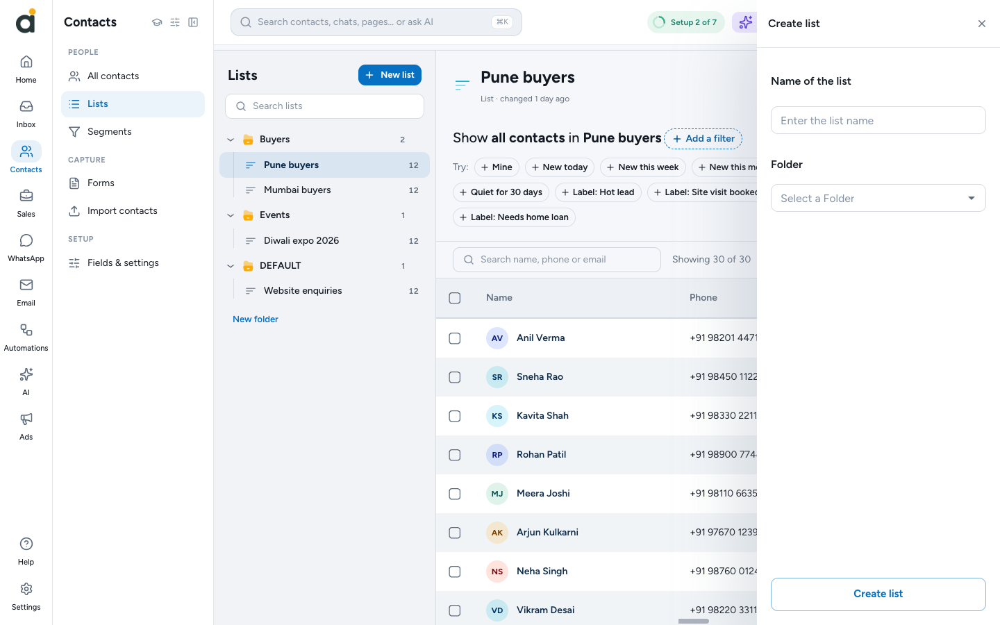
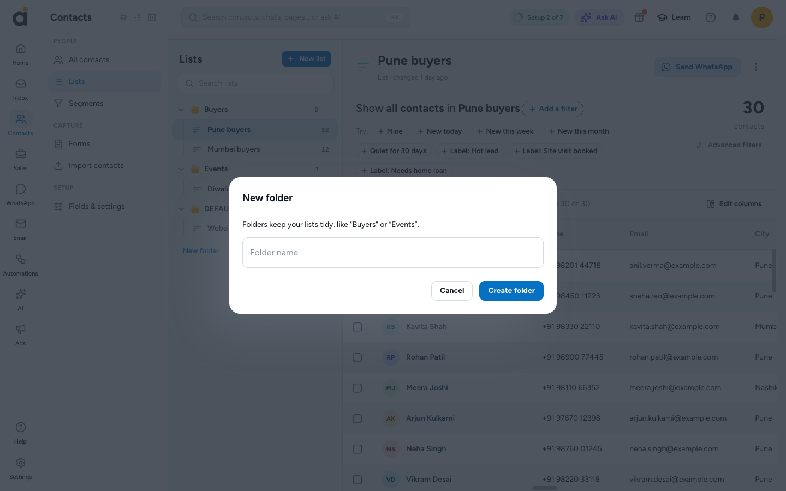
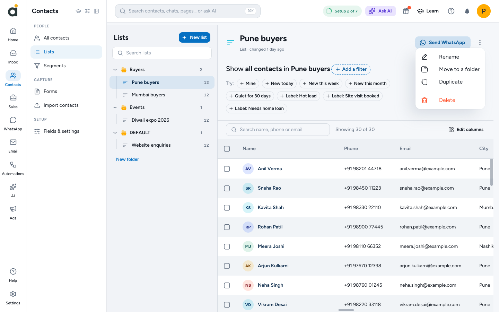
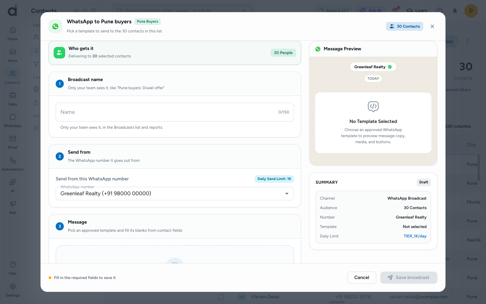
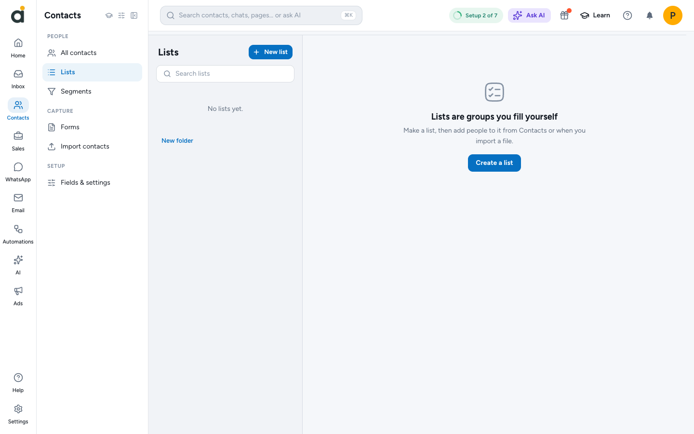

A **list** is a group of people you put together yourself, like "Diwali expo 2026" or "Mumbai buyers". People only join when you add them (by ticking them, importing a file into the list, or through a form). **Folders** keep many lists tidy.

**Where:** **Contacts → Lists**. [Open it →](https://app.adsera.in/dashboard/contact/list-listing)

## The page

| Part | What it does |
| --- | --- |
| **New list** | Make a list. |
| **Search lists** | Find a list by name. |
| Folders and lists | Click a folder to fold it open or shut; the number is how many lists are in it. Click a list to see its people; the number next to it is how many contacts it has. The pencil next to a folder renames it. |
| **New folder** | Make a folder. |
| **Send WhatsApp** | A broadcast to everyone in the picked list. |
| **⋮** | **Rename**, **Move to a folder**, **Duplicate**, **Delete**. |
| The sentence and the people | The list's people, as on All contacts. Add a filter to narrow them ("in Pune buyers where Labels has Hot lead"). |

## Make a list

<Steps>
<Step title="Click New list">Top of the left side.</Step>
<Step title="Name it">In **Enter the list name**, say who's in it, like "Diwali expo 2026".</Step>
<Step title="Pick a folder">Pick a folder, or **DEFAULT** if you don't need one.</Step>
<Step title="Click Create list">It shows on the left, empty.</Step>
</Steps>

Then add people:

- On **All contacts**, tick them and click **Add to list**. See [Act on many contacts](/help/audiance/bulk).
- Pick the list on the last step of an [import](/help/audiance/file).
- In a [form](/help/sales/forms), pick it under "Everyone who fills it in".

## Folders

Click **New folder**, type the **Folder name** (like "Buyers" or "Events") and click **Create folder**. Pick the folder when you make a list or **Move to a folder** later. Point at a folder to see the pencil that renames it.

Imports from Google Sheets go into a folder called **Google Sheets** by themselves.

## The ⋮ menu

| Item | What it does |
| --- | --- |
| **Rename** | A new name for the list. |
| **Move to a folder** | Puts the list in another folder. |
| **Duplicate** | A new list with the same people, under a new name. |
| **Delete** | Removes the list. The people stay in your contacts. |

## Send a broadcast to a list

<Steps>
<Step title="Pick the list">Click it on the left.</Step>
<Step title="Click Send WhatsApp">The window shows how many contacts are in it.</Step>
<Step title="Pick the template">Pick your WhatsApp number and an approved template, fill its blanks and click **Save broadcast**. It's saved as a draft broadcast.</Step>
<Step title="Send it">In **WhatsApp → Broadcasts**, choose **Send now** on it.</Step>
</Steps>

## A list as a tab on All contacts

On **All contacts**, click **+** next to the tabs, choose **Add a list as a tab** and pick the list. It shows as a tab like a segment.

## No lists yet

The page says **Lists are groups you fill yourself** with **Create a list**.

## FAQ

<AccordionGroup>
  <Accordion title="List or segment?">
    A list holds the people you put in it and never changes by itself. A segment is a filter that updates as details change. See [Segments](/help/audiance/segment#segment-list-or-label).
  </Accordion>
  <Accordion title="How do I take someone out of a list?">
    The app can't remove one person from a list yet. A contact's **Lists** tab shows the lists they're in. If you need a clean list, make a new one with the right people (filter, tick, **Add to list**) and delete the old one.
  </Accordion>
  <Accordion title="Does deleting a list delete the contacts?">
    No. Only the list goes.
  </Accordion>
</AccordionGroup>

## Related

<CardGroup cols={2}>
  <Card title="Segments" icon="layer-group" href="/help/audiance/segment" />
  <Card title="Import a file" icon="file-import" href="/help/audiance/file" />
  <Card title="Act on many contacts" icon="list-check" href="/help/audiance/bulk" />
  <Card title="Create a broadcast" icon="bullhorn" href="/help/campaign/wa/create" />
</CardGroup>
