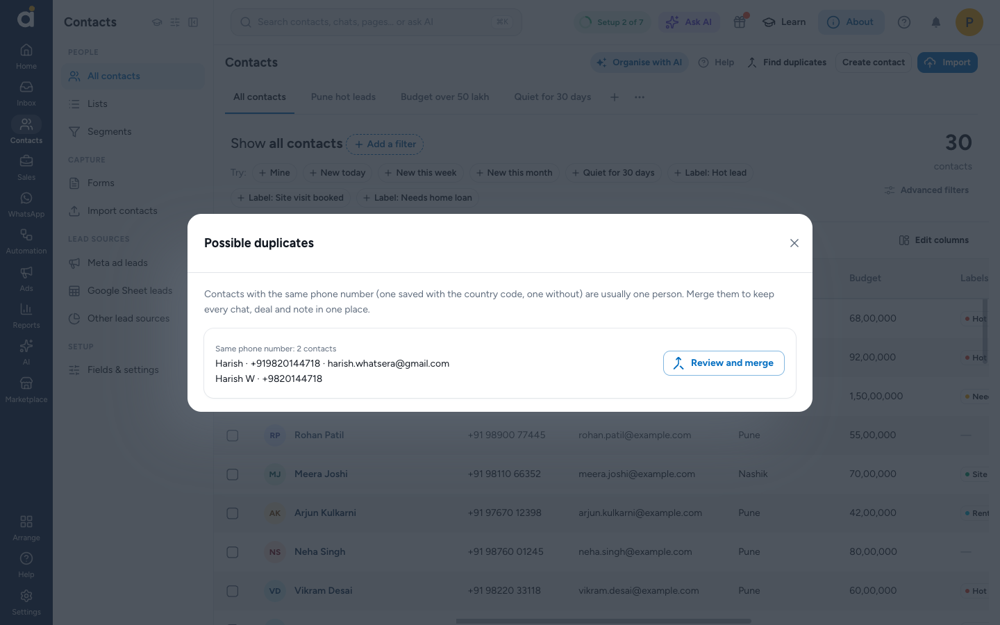
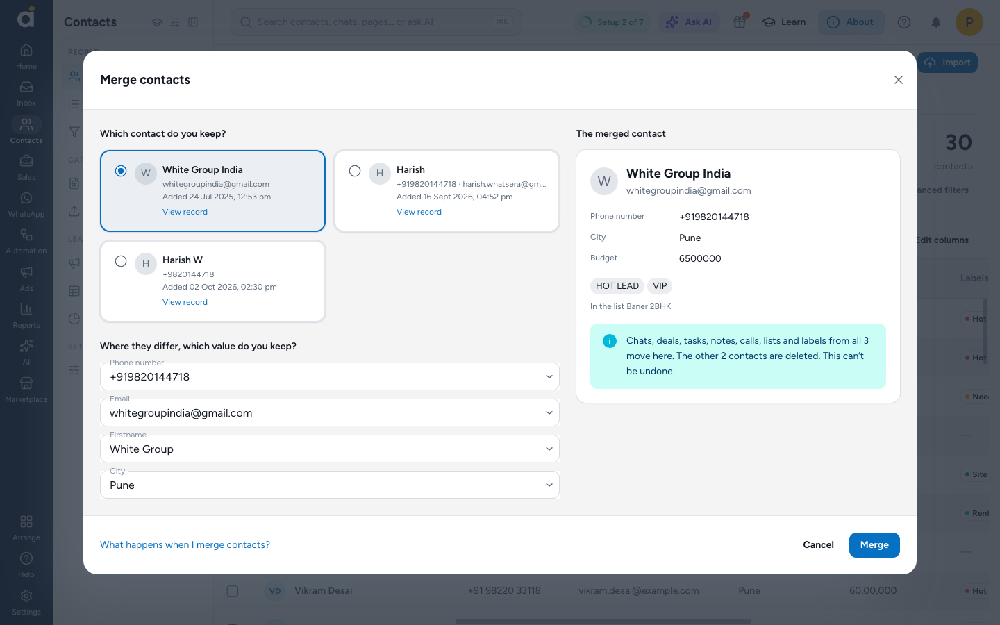

AdsEra never adds the same phone number or email twice. But older contacts may have been saved once with the country code and once without (*919820144718* and *9820144718*), or someone may have two records with different details. Merge them into one: everything from all of them stays, on one contact.

## Find duplicates

On **Contacts**, click **Find duplicates** at the top. It lists every group of contacts that look like the same person (the same phone number, with or without the country code). Click **Review and merge** on a group.

A contact's own page also tells you when it looks like the same person as another (*This looks like the same person as …*), with **Review and merge**.

## Merge two or more contacts

You can also merge any contacts yourself: on **Contacts**, tick 2 to 10 of them and click **Merge** in the bar at the top.

<Steps>
<Step title="Pick the contact to keep">The oldest is picked for you: it usually has the most history. **View record** opens one in a new tab to check.</Step>
<Step title="Pick the values to keep">Where they differ (phone number, email, city, budget…) pick the value to keep. Anything only one of them has is kept.</Step>
<Step title="Check the merged contact">On the right: the merged contact with every value, its labels and lists.</Step>
<Step title="Merge">Click **Merge**.</Step>
</Steps>

## What happens when you merge

| What | Where it goes |
| --- | --- |
| Chats and messages, deals, tasks, notes, calls, bookings, ad leads, broadcast history, workflow runs | Move to the contact you keep. |
| Lists and labels | The contact you keep is in every list and has every label any of them had. |
| Details (fields) | The values you picked; anything only one of them had is kept. |
| The phone number you didn't keep | Saved in the field **SECONDARY_PHONE**. |
| The other contacts | Deleted. The kept contact's timeline says what was merged into it. |

<Warning>
  A merge can't be undone. Check the merged contact on the right before you click **Merge**.
</Warning>

## FAQ

<AccordionGroup>
  <Accordion title="Who can merge?">
    Members whose role can merge contacts (admins can). A team member can only merge contacts they can see.
  </Accordion>
  <Accordion title="Why does Find duplicates show nothing, though I see two Anils?">
    It looks for the same phone number. Two people with the same name but different numbers may be different people: tick both and click **Merge** if they're the same.
  </Accordion>
  <Accordion title="How do I stop duplicates coming in?">
    You don't need to: adding a contact, importing a file and Google Sheets all check the phone number (with or without the country code) and email first, and update the person you already have.
  </Accordion>
</AccordionGroup>

## Related

<CardGroup cols={2}>
  <Card title="Import contacts from a file" icon="file-import" href="/help/audiance/file" />
  <Card title="A contact's page" icon="user" href="/help/audiance/view" />
</CardGroup>
