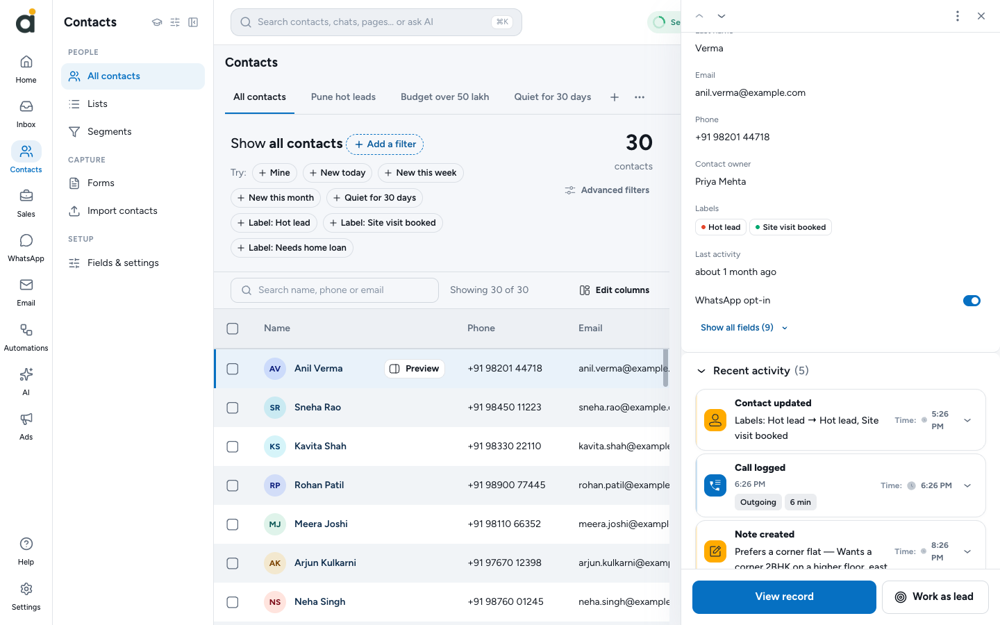

Every contact has a **WhatsApp opt-in** switch. **On** means you can message them on WhatsApp. **Off** means broadcasts skip them and the Inbox has no reply box for them. Respecting it keeps your WhatsApp number in good standing with Meta.

**Where:** on a contact's page and in the side panel, under **About**. In the add-contact form it's **WhatsApp Subscription** (**Subscribe** / **Unsubscribe**).

## What it changes

| | Opted in (on) | Opted out (off) |
| --- | --- | --- |
| Broadcasts | Sent | Skipped. The report shows "Contact is unsubscribed!" for them. |
| Replying in the Inbox | Works | No reply box: "This contact opted out of WhatsApp messages… If they send START, you can chat again." |

## How someone opts out

- **They ask:** they send your opt-out word (like **STOP**). Set the words in **WhatsApp → Numbers & profile → Automation → Opt-in & opt-out keywords**. See [Opt-in and opt-out](/help/channel/whatsapp/opt).
- **Meta tells us:** if they stop marketing messages from your business inside WhatsApp, they're opted out.
- **You switch it off:** on their page or in their side panel (one person at a time).

## Change it

<Steps>
<Step title="Open the contact">Click their row (side panel) or their name (page).</Step>
<Step title="Switch WhatsApp opt-in">Under **About**. It saves at once.</Step>
</Steps>

## Find who opted out

On **All contacts**, **Add a filter → WhatsApp opt-in → No**. To see it as a column, add **Subscribed** in **Edit columns**.

## Opt-in vs Block

**Block** (in **More actions**) leaves people out of Closer and Prospects, but **not** out of broadcasts. To stop broadcasts, switch off WhatsApp opt-in. See [Act on many contacts](/help/audiance/bulk#block).

## FAQ

<AccordionGroup>
  <Accordion title="Someone opted out by mistake. Can I opt them in again?">
    Only if they ask you to. Switch it on, or ask them to send your opt-in word (like START).
  </Accordion>
  <Accordion title="Do imported contacts start opted in?">
    Yes. Only import people who agreed to hear from you.
  </Accordion>
</AccordionGroup>

## Related

<CardGroup cols={2}>
  <Card title="Opt-in and opt-out words" icon="hand" href="/help/channel/whatsapp/opt" />
  <Card title="Act on many contacts" icon="list-check" href="/help/audiance/bulk" />
</CardGroup>
