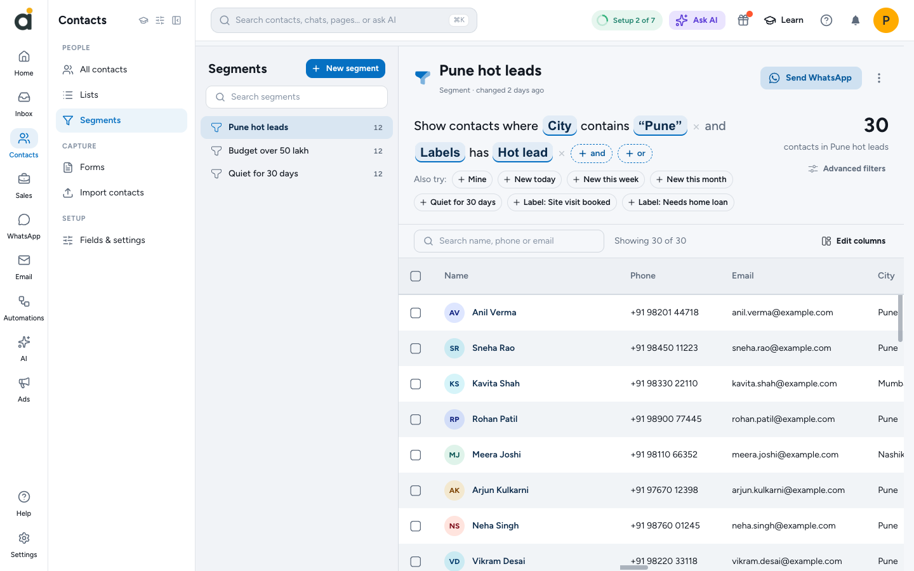
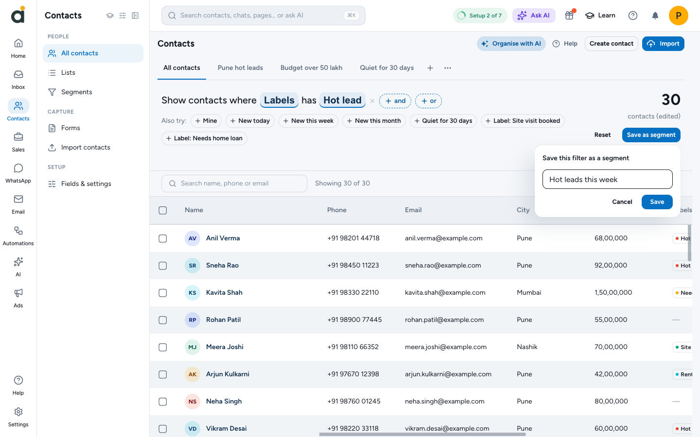
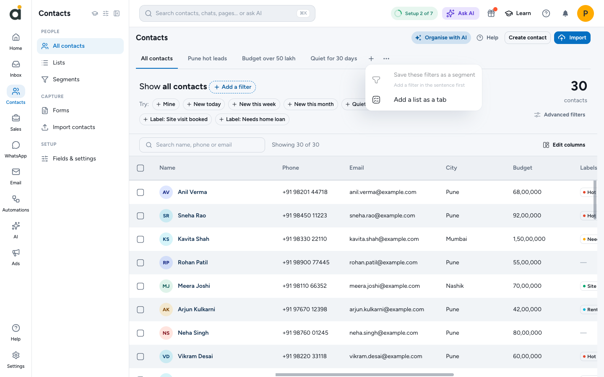
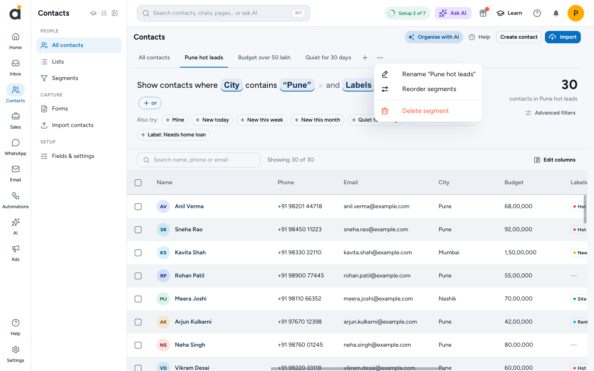
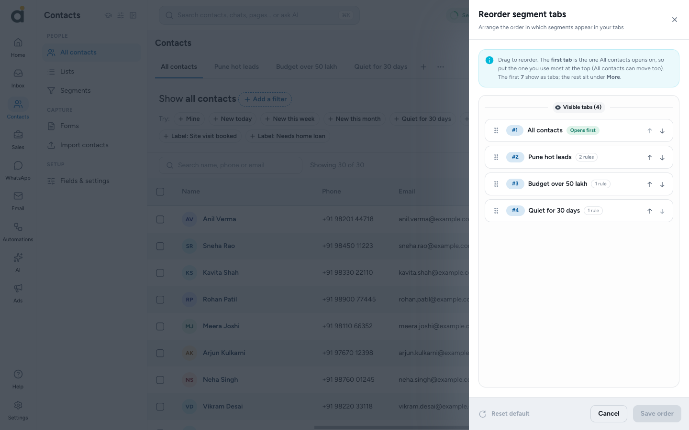
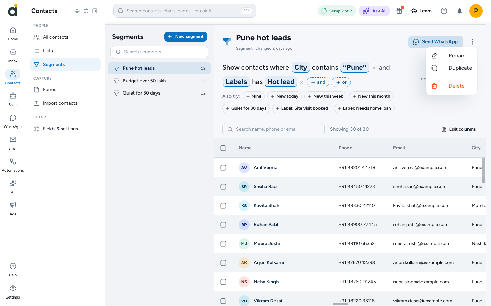
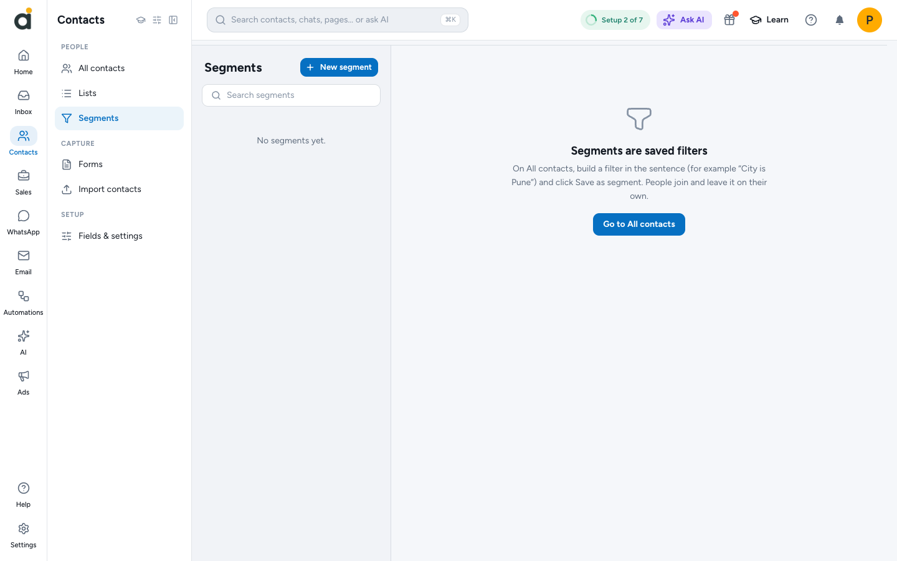

A **segment** is a saved filter, like *"City contains Pune and Labels has Hot lead"* or *"Budget is more than 50 lakh"*. You don't add people to it: they join and leave by themselves as their details change. Use segments for groups you message again and again.

**Where:** your segments show in two places:
- As **tabs** above **Contacts → All contacts**. [Open it →](https://app.adsera.in/dashboard/contact/list)
- On **Contacts → Segments**, with how many people are in each. [Open it →](https://app.adsera.in/dashboard/contact/segments)

## Make a segment

<Steps>
<Step title="Build the filter">On **All contacts**, click **Add a filter** and build the sentence. See [Filter contacts](/help/audiance/filters).</Step>
<Step title="Click Save as segment">Under the big number.</Step>
<Step title="Name it and click Save">
Like "Pune hot leads". It opens as a new tab.

</Step>
</Steps>

**New segment** on the Segments page takes you to **All contacts** to do this.

## Tabs on All contacts

| Button | What it does |
| --- | --- |
| A tab | Shows that segment's people. **All contacts** shows everyone. |
| **+** (Add a tab) | **Save these filters as a segment** (needs a filter first) or **Add a list as a tab** (pick one of your [lists](/help/audiance/list)). |
| **⋯** (Segment options) | **Rename** the open segment, **Reorder segments**, **Delete segment**. |
| **More (N)** | Shows the tabs that don't fit on screen. |
| **Keep as tab** | Shows when you opened a list or a report's people from another page: keeps it as a tab. |

**Reorder segments** opens **Reorder segment tabs**: drag the tabs or use the arrows, pick which one opens first, then **Save order**. **Reset default** sorts them by the date they were made.

## Change a segment

Open its tab (or pick it on the Segments page) and change the sentence. The count says "(edited)" and three buttons show:

| Button | What it does |
| --- | --- |
| **Save segment** | Keeps the change in this segment. |
| **Save as new** | Makes another segment from it; this one stays as it was. |
| **Reset** | Goes back to the saved filter. |

## The Segments page

| Part | What it does |
| --- | --- |
| The list on the left | Every segment with how many people match now. **Search segments** finds one. |
| **Send WhatsApp** | Makes a broadcast to everyone in the segment. See [below](#send-a-broadcast-to-a-segment). |
| **⋮** | **Rename**, **Duplicate** (a copy you can change), **Delete**. |
| The sentence and list | The segment's people, exactly as on All contacts. |

Deleting a segment never deletes the people in it.

With no segments yet the page says **Segments are saved filters** with **Go to All contacts**.

## Send a broadcast to a segment

<Steps>
<Step title="Pick the segment">On **Contacts → Segments**.</Step>
<Step title="Click Send WhatsApp">A window opens for the people in it.</Step>
<Step title="Pick the template">Pick your WhatsApp number and an approved template, fill its blanks and click **Save broadcast**. It's saved as a draft broadcast.</Step>
<Step title="Send it">Open **WhatsApp → Broadcasts** and choose **Send now** on it. See [Create a broadcast](/help/campaign/wa/create).</Step>
</Steps>

You can also pick a segment as the audience inside **WhatsApp → Broadcasts → New broadcast**.

## Segment, list or label?

| | Segment | List | Label |
| --- | --- | --- | --- |
| Who's in it | Anyone who matches the filter, now | Only people you add | Anyone you tag |
| Changes by itself | Yes | No | No |
| Good for | "Pune buyers over 50 lakh" | "Diwali expo 2026 visitors" | "Hot lead", "Paid booking" |

## FAQ

<AccordionGroup>
  <Accordion title="Someone's details changed. When do they join the segment?">
    Straight away: a segment is worked out every time you open it or send to it.
  </Accordion>
  <Accordion title="Can I export a segment?">
    Open it, tick the top box (or **Select all**), then **More actions → Export contacts (.xlsx)**.
  </Accordion>
  <Accordion title="Can Closer or a broadcast use a segment?">
    Yes. Pick it as the audience in **WhatsApp → Broadcasts → New broadcast**, or as Closer's leads in **AI → Closer**.
  </Accordion>
</AccordionGroup>

## Related

<CardGroup cols={2}>
  <Card title="Filter contacts" icon="filter" href="/help/audiance/filters" />
  <Card title="Lists and folders" icon="list" href="/help/audiance/list" />
  <Card title="Create a broadcast" icon="bullhorn" href="/help/campaign/wa/create" />
  <Card title="All contacts" icon="users" href="/help/audiance/audiance" />
</CardGroup>
