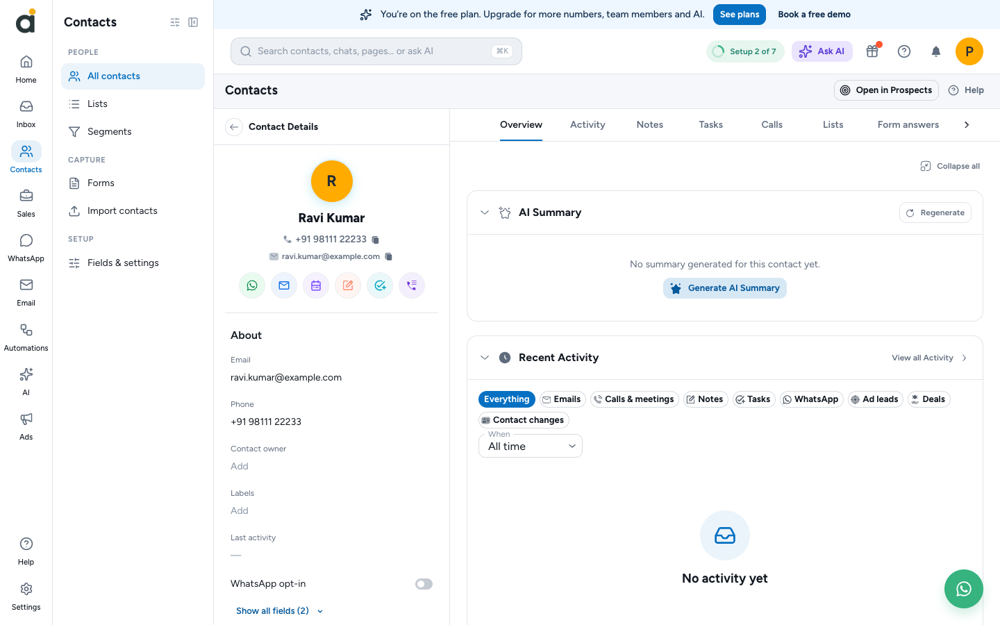
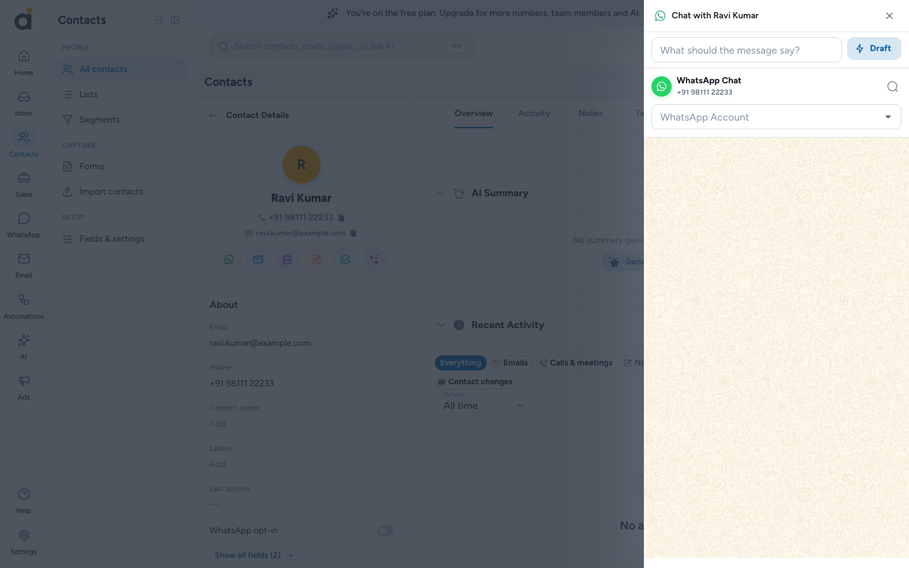

Click any contact in **Contacts** to open their page. It uses the same layout as a lead in [Prospects](/help/sales/prospects), so you always know where things are.

The page has three columns:

- **Left: the person.** Name, phone, email, quick actions, and all their details.
- **Middle: their record.** An AI summary, their activity, notes, tasks and more, in tabs.
- **Right: the WhatsApp chat.** On wide screens it sits beside the record. On a laptop, click the green WhatsApp button at the bottom right to open it.

At the top right:

- **Open in Prospects** works this person as a lead: an AI brief, a planned next step, and one-tap outcomes after a call or chat.
- **Help** explains the page and shows a short demo.

---

## The person (left)

#### Quick actions
Under the name, one click each:
- **WhatsApp** opens the chat.
- **Email** writes an email from your connected mailbox.
- **Meeting** books a meeting or logs one you had.
- **Note**, **Task** and **Call log** add one to their record.

#### About
Their details: email, phone, owner, labels, last activity and WhatsApp opt-in. Click **Show all fields** to see every field, including your own [fields](/help/audiance/attribute). Click a field to change it; it saves as soon as you're done. These are the same fields, edited the same way, as in Prospects and in the Contacts preview.

Below the fields you can see and change the **lists** they're in.

---

## Their record (middle)

| Tab | What it shows |
| --- | --- |
| **Overview** | An AI summary of the person (click **Generate AI summary**), their recent activity, and their latest notes and tasks. |
| **Activity** | Everything that happened, newest first: messages, emails, calls, meetings, ad leads, deal changes and edits. Filter by kind or by date. |
| **Notes** | Private notes your team wrote. The contact never sees them. |
| **Tasks** | Follow-ups for this person, with due date, owner and status. |
| **Calls** | Calls you logged, with direction, result and length. |
| **Lists** | The lists they're in. |
| **Form answers** | Answers they gave in WhatsApp Flows and forms. |
| **Media** | Photos, videos and files from your chats with them. |
| **Ad leads** | The Meta ads and lead forms that brought them in. |

---

## The WhatsApp chat (right)

The chat shows your whole conversation with them. Reply, attach files, or send a template or quick reply.

Not sure what to say? Type what the message should do in **What should the message say?** and click **Draft**. AI writes a reply from the conversation and puts it in the message box for you to check and send.

