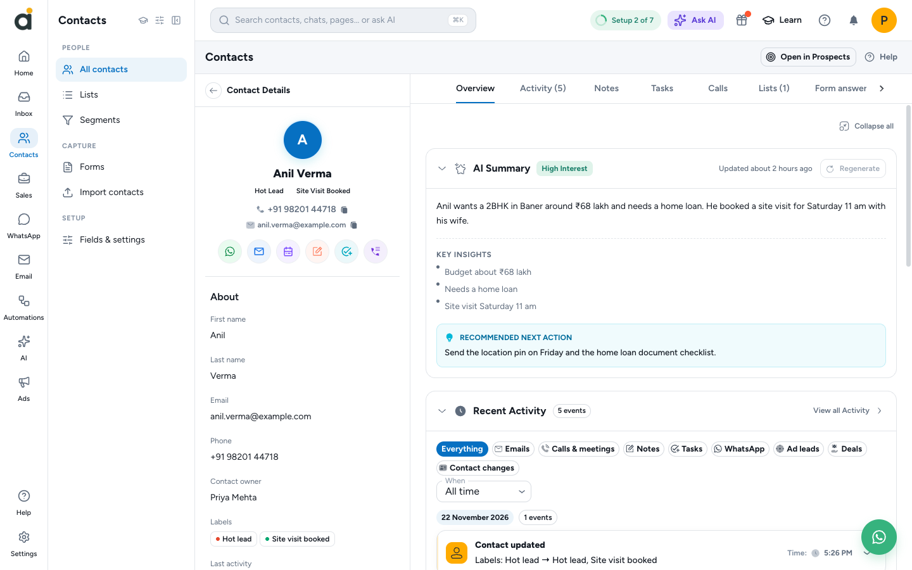
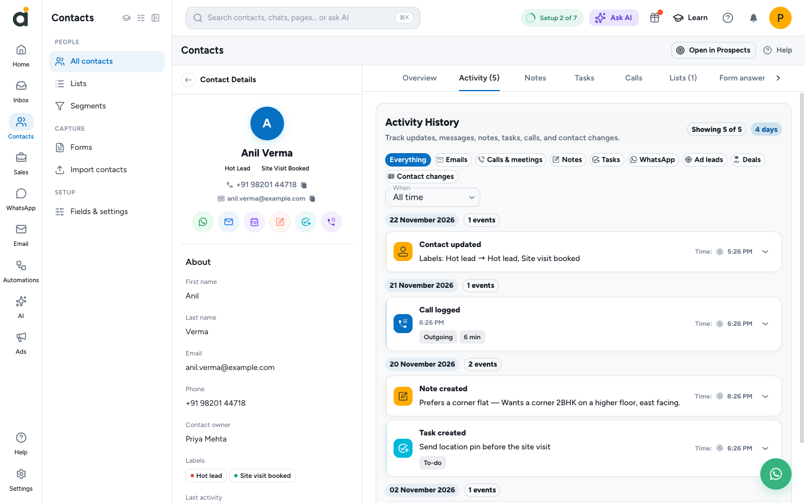
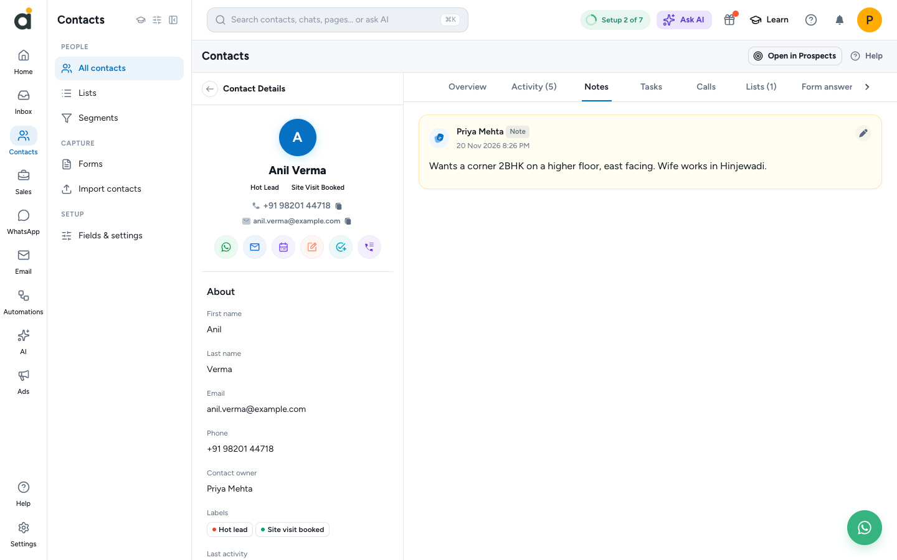
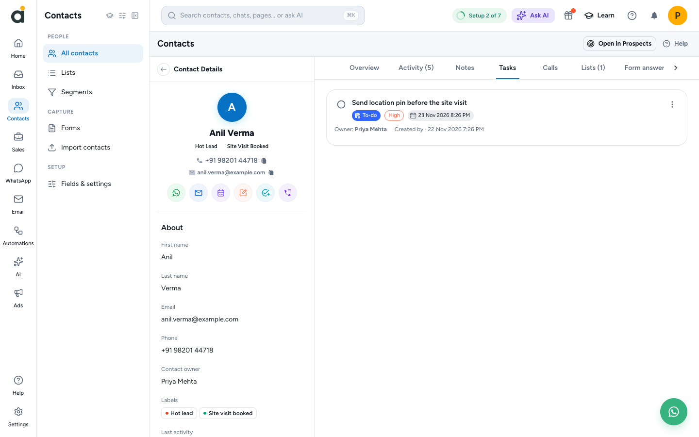
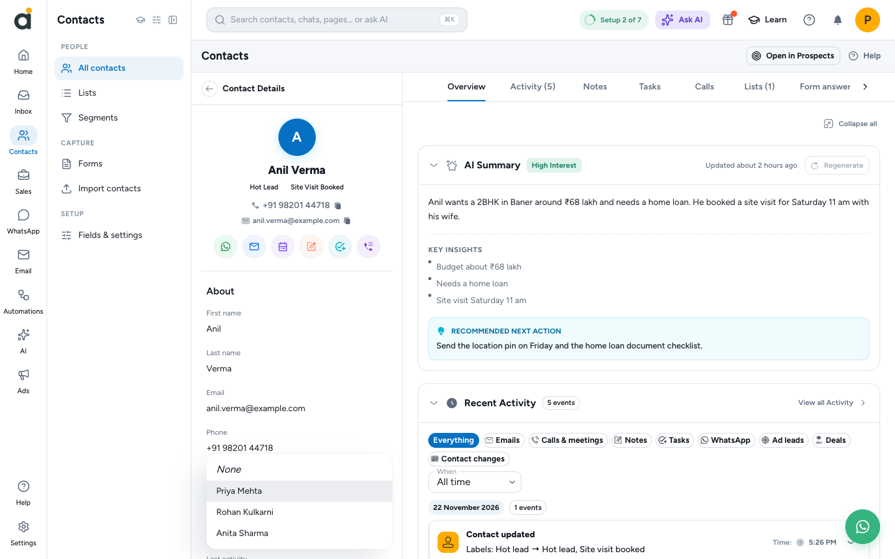

A contact's page shows everything about one person in one place, so anyone on your team can pick up where the last person left off.

**Where:** **Contacts → All contacts**, then click a person's name (or **View record** in the side panel). Prospects and the Inbox open the same page.

## The left side: who they are

| Part | What it does |
| --- | --- |
| **←** (Back to Contacts) | Back to the list. |
| Name, labels, phone, email | Copy the phone or email with the copy icons. |
| Round buttons | **WhatsApp** (opens their chat), **Email**, **Meeting**, **Add Note**, **Add Task**, **Log Call**. |
| **About** | Every detail: name, email, phone, **Contact owner**, **Labels**, **Last activity**, **WhatsApp opt-in** and your fields. Click a detail to change it; it saves when you press Enter or click away. |
| **Show all fields** | Shows empty and less-used fields too. Drag a field by its grip to move it up. |

## Open in Prospects

**Open in Prospects** (top right) works this person as a lead: an AI brief, the next step and one-tap outcomes. See [Prospects](/help/sales/prospects).

## The tabs

| Tab | What's in it |
| --- | --- |
| **Overview** | The **AI Summary**, **Recent Activity**, **Recent Notes**, **Recent Call Logs** and **Tasks**, each with a button to add one and **View all**. **Collapse all** folds the cards. |
| **Activity** | Everything that happened, newest first: messages, emails, calls and meetings, notes, tasks, ad leads, deals and contact changes. Filter with the chips and **When**. |
| **Notes** | Notes your team wrote. **Add Note**. |
| **Tasks** | Follow-ups with a due date and who does them. **New Task**. Tick one to mark it done. |
| **Calls** | Logged phone and WhatsApp calls. **Log Call**. |
| **Lists (N)** | The lists they're in. |
| **Form answers** | What they filled in your [forms](/help/sales/forms) and WhatsApp Flows. |
| **Media** | Photos, videos and files from their WhatsApp chat. |
| **Ad leads** | The Meta lead forms they filled, with the ad they came from. |

## The AI summary

The **AI Summary** card reads their chats and history and gives:

- a mood: **High Interest**, **Positive**, **Needs Attention**, **At Risk**, **Cold** or **Neutral**,
- **Key insights** (budget, needs, dates they mentioned),
- a **Recommended next action**.

Click **Generate AI Summary** (or **Regenerate**) to make a new one after new messages. It uses AI credits and can be made once a day per contact.

## Add a note, task or call

<Steps>
<Step title="Click the button">**Add Note**, **New Task** or **Log Call** (on Overview or its own tab, or the round buttons on the left).</Step>
<Step title="Fill it in">A note: a title and what you learned. A task: what, when and who. A call: when, how long, the outcome and notes.</Step>
<Step title="Save">It shows on the contact and in **Activity**. Tasks also show in your task list.</Step>
</Steps>

## Change their details

Click any detail under **About**: type the new value, or pick from the choices, and press Enter. The owner is picked from your team; labels are ticked from your labels. Turn **WhatsApp opt-in** off when someone asks you to stop messaging them.

## FAQ

<AccordionGroup>
  <Accordion title="Can I change someone's phone number?">
    Yes, click **Phone** under About. The number must not belong to another contact.
  </Accordion>
  <Accordion title="Why is Regenerate grey?">
    A summary can be made once a day per contact. Hover over it to see when the next one is possible.
  </Accordion>
  <Accordion title="Where do I see their WhatsApp messages?">
    Click the WhatsApp button under their name: their chat opens on the right of the page.
  </Accordion>
</AccordionGroup>

## Related

<CardGroup cols={2}>
  <Card title="All contacts" icon="users" href="/help/audiance/audiance" />
  <Card title="WhatsApp opt-in" icon="bell-slash" href="/help/audiance/opt-in" />
  <Card title="Prospects" icon="bullseye" href="/help/sales/prospects" />
  <Card title="Tasks" icon="list-check" href="/help/sales/tasks" />
</CardGroup>
