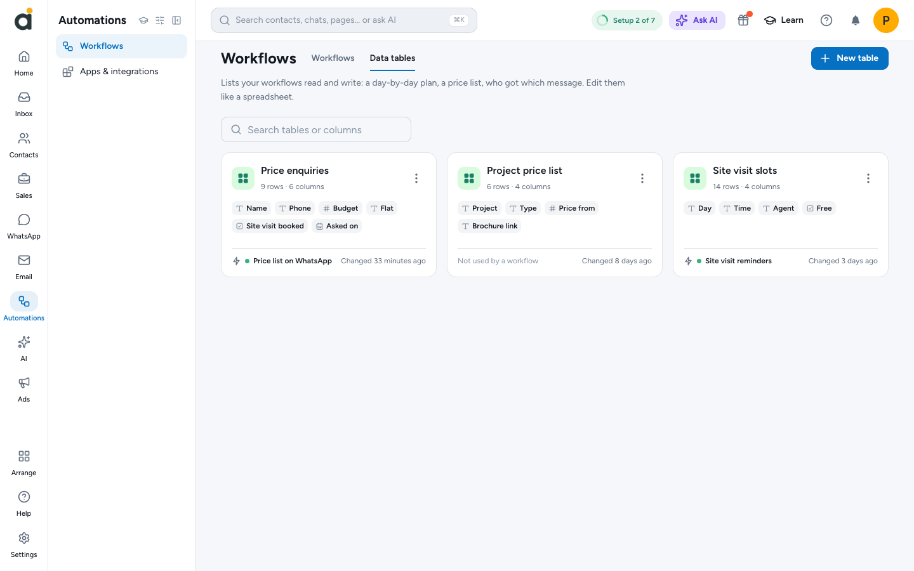
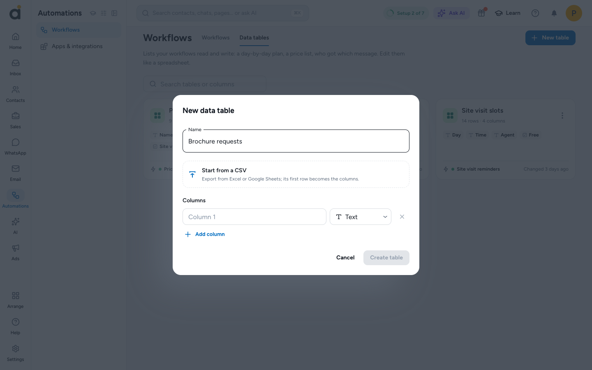
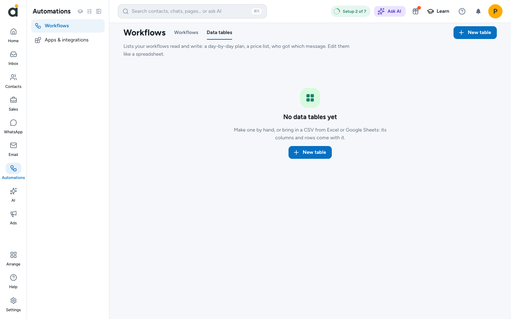
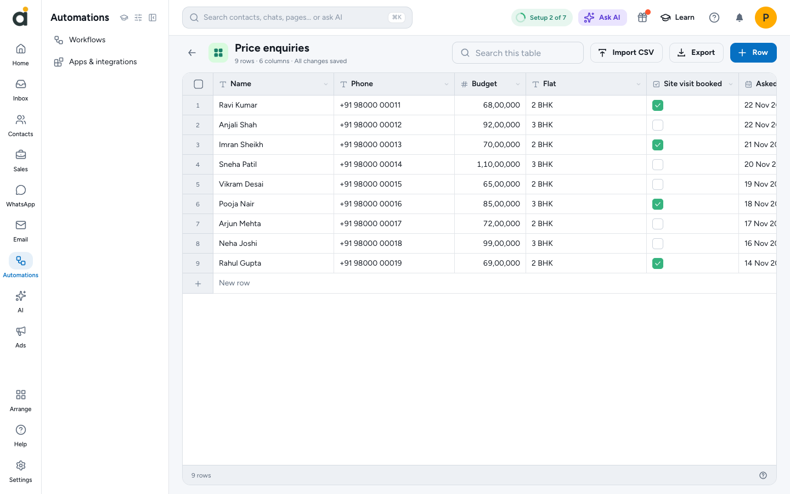
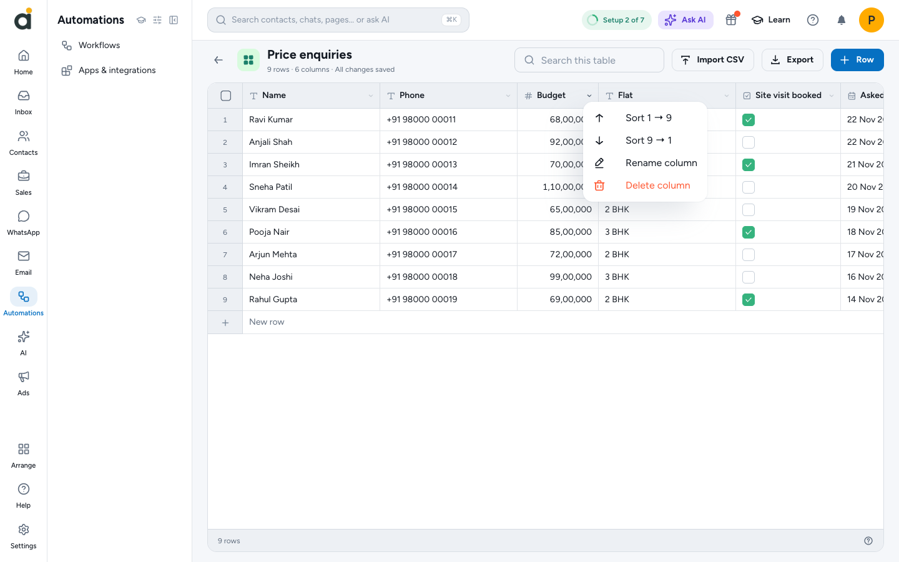
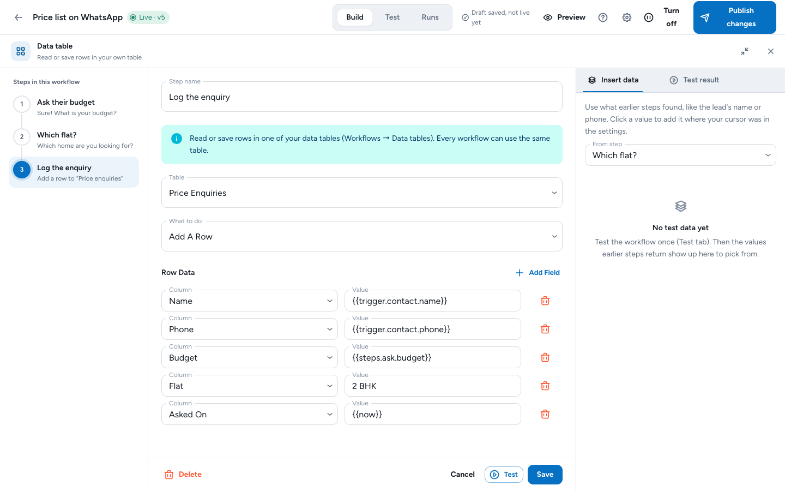

A **data table** is your own list that workflows can read and write, edited like a spreadsheet. For example:

- a **price list** per project, so a workflow sends the right one;
- a **log of every price enquiry** (name, phone, budget, flat), filled by a workflow;
- **site visit slots** your team keeps up to date.

**Where:** **Automations → Workflows**, the **Data tables** tab. [Open it →](https://app.adsera.in/dashboard/flow/list)

<Note>
Data tables need the **Integrations & data tables** permission (Settings → Team members). Without it, the tab doesn't show. Admins have it.
</Note>

Each card shows the table's name, how many rows and columns it has, its columns, which workflows use it (**Not used by a workflow** if none) and when it last changed. **Search tables or columns** finds a table by its name or a column. The card's **⋮** has **Open** and **Delete**.

## Make a table

<Steps>
<Step title="Click New table">

</Step>
<Step title="Name it">
Like *Price enquiries*.
</Step>
<Step title="Add the columns">
Each column has a name and a kind:

| Kind | For | Example |
| --- | --- | --- |
| **Text** | Words, phone numbers, links | Ravi Kumar, +91 98000 00011 |
| **Number** | Amounts and counts (sortable, can be compared) | 6800000 |
| **Yes / no** | A tick box | Site visit booked |
| **Date** | A day | 22/11/2026 |

**Add column** adds another; the × removes one.
</Step>
<Step title="Or start from a CSV">
Click **Start from a CSV** and pick a CSV file (in Excel or Google Sheets: *File → Download → CSV*). Its first row becomes the column names, AdsEra guesses each kind, and the button says how many rows will come in. Remove a column you don't want (it's skipped).
</Step>
<Step title="Click Create table">
(Or **Create with … rows** for a CSV.) The table opens.
</Step>
</Steps>

When you have no tables yet, the tab says **No data tables yet** with **New table**:

## Edit a table

| To… | Do this |
| --- | --- |
| Change a value | Click the cell and type. **Enter** saves; arrows and **Tab** move; **Delete** clears; **Esc** cancels |
| Paste from Excel or Google Sheets | Copy the cells there, click the first cell here and press **Ctrl+V** (**Cmd+V** on Mac). New rows are added if needed |
| Add a row | **Row** at the top right, or **New row** under the last row |
| Delete rows | Point at a row number and tick it (or tick all at the top), then **Delete** |
| Add a column | The **+** after the last column |
| Rename, sort or delete a column | The column's menu: **Sort A → Z / Z → A** (or 1 → 9, oldest first…), **Rename column**, **Delete column** |
| Find rows | **Search this table** |
| Rename the table | Click its name at the top |
| Add rows from a file | **Import CSV**: it shows which columns are **Filled in** and which are **Left out (no column with that name)** before importing |
| Download it | **Export** (CSV) |

<Warning>
**Delete column** removes its value from every row, and workflow steps that read it get nothing. Deleting a table that workflows use warns you first: those steps fail until you change them.
</Warning>

A table page shows up to 10,000 rows.

## Use a table in a workflow

Add the **Data table** step (in **Contacts and CRM**):

| What to do | Example |
| --- | --- |
| **Find rows** | Find the price list row for the flat they picked, then send its brochure link |
| **Add a row** | Log each enquiry: name, phone, budget from Insert data |
| **Change a row** | Mark a slot as taken |
| **Change a row, or add it if it isn't there** | Keep one row per phone number up to date |
| **Delete a row** | Remove a slot once it's past |

See [the Data table step](/help/automation/steps#data-table) for every field.

## Related

<CardGroup cols={2}>
<Card title="Workflows" icon="diagram-project" href="/help/automation/workflows">Make and manage workflows.</Card>
<Card title="Every step" icon="list-check" href="/help/automation/steps">All 22 steps.</Card>
</CardGroup>
