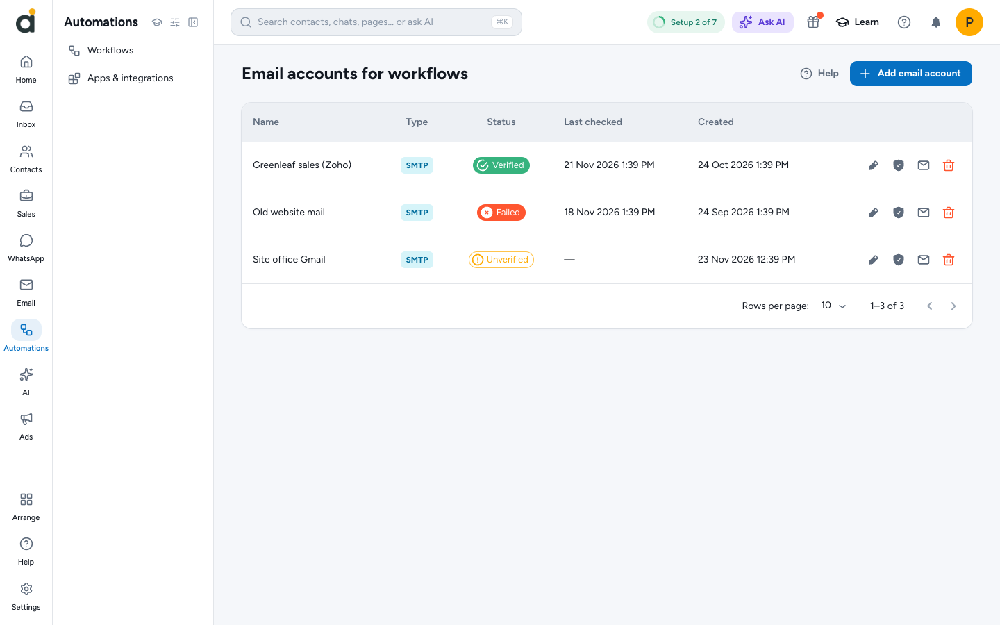
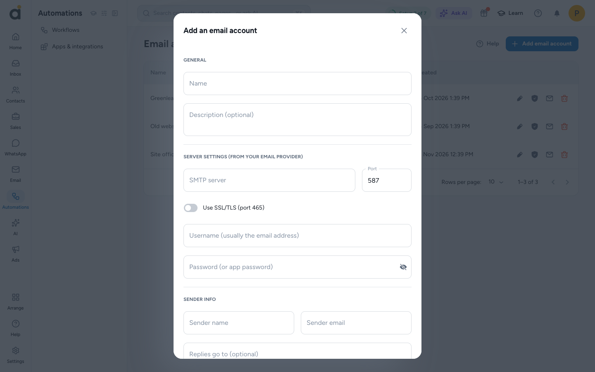

A workflow's **Send an email** step can send from three places: your **mailbox** (Email → Mailboxes), a **ZeptoMail** sender, or an **email account** added here with its SMTP settings (the server details your email provider gives you). Use an email account when your address is on another provider, like your website's hosting.

**Where:** **Automations → Apps & integrations → Email account (SMTP)**, or **Connect a new email account** inside a Send an email step.

## Add an email account

<Steps>
<Step title="Click Add email account">

</Step>
<Step title="Fill in the settings">
| Field | What it is | Example |
| --- | --- | --- |
| **Name** | Only your team sees it. Needed | Greenleaf sales (Zoho) |
| **Description (optional)** | A note | For workflow emails |
| **SMTP server** | From your provider's help page | smtp.zoho.in, smtp.gmail.com |
| **Port** | Usually 587, or 465 with SSL | 587 |
| **Use SSL/TLS (port 465)** | Turn on for port 465 | Off |
| **Username (usually the email address)** | Your sign-in | sales@greenleafrealty.in |
| **Password (or app password)** | Gmail and Zoho need an **app password** made in your Google/Zoho security settings | •••••••• |
| **Sender name**, **Sender email** | What the contact sees | Greenleaf Realty, sales@greenleafrealty.in |
| **Replies go to (optional)** | Where replies land | priya@greenleafrealty.in |
</Step>
<Step title="Save, then check it">
Click the shield button (**Check it works**). **Verified** means AdsEra signed in; **Failed** shows why when you point at it. The envelope sends a test email.
</Step>
</Steps>

| Status | Meaning |
| --- | --- |
| **Verified** | AdsEra signed in to the server. It can send |
| **Failed** | It couldn't sign in. Point at it to read why (often a wrong password, or you need an app password) |
| **Unverified** | Not checked yet, or the server settings changed. Click **Check it works** |

The pencil edits an account (changing the server settings makes it **Unverified** until checked again). The bin deletes it: workflows sending with it fail until you pick another account in their step.

## Related

<CardGroup cols={2}>
<Card title="The Send an email step" icon="envelope" href="/help/automation/steps#send-an-email">Send with, template, To.</Card>
<Card title="ZeptoMail" icon="paper-plane" href="/help/integrations/zeptomail">Email from your own domain with tracking.</Card>
</CardGroup>
