After the [trigger](/help/automation/triggers), a workflow runs its **steps** one after another, for each person.

## Add a step

<Steps>
<Step title="Click a + on a line">
Every line on the canvas has a **+**. A **+** between two steps puts the new one in between; the **+** above **END** adds one at the end of that path.
</Step>
<Step title="Pick the step">
**Choose a step** opens on the right. Search (like “wait” or “deal”) or pick from the groups.

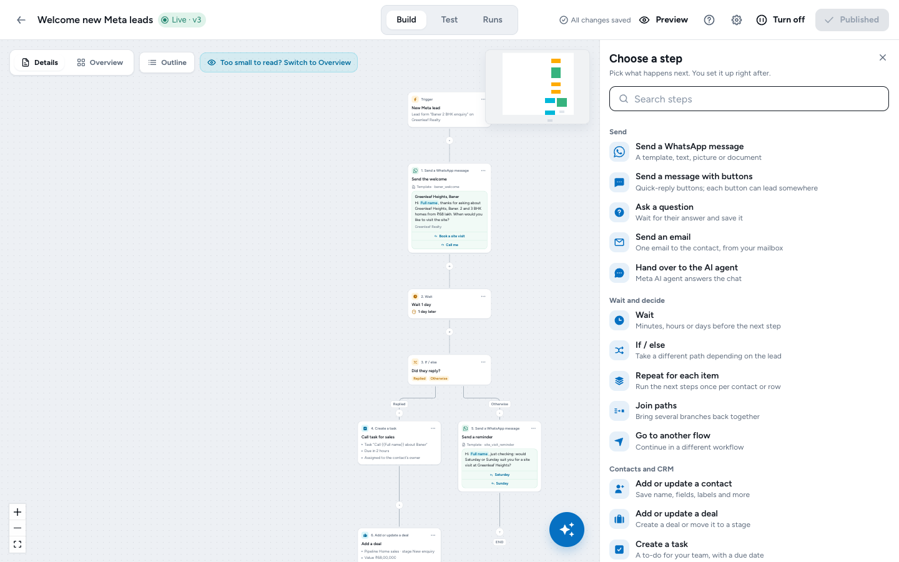
</Step>
<Step title="Set it up and Save">
Its settings open straight away. Small steps (like **Wait**) open beside the canvas; most open as a full page with your steps on the left and **Insert data** on the right.
</Step>
</Steps>

To change a step later, click it. To delete one, click its **⋯** → **Delete**: the steps before and after join up again (if it had branches, connect what comes next yourself).

## Insert data: use the lead's own details

Almost every box can hold values from earlier steps: the lead's name in a message, their phone in a task, their budget in a branch.

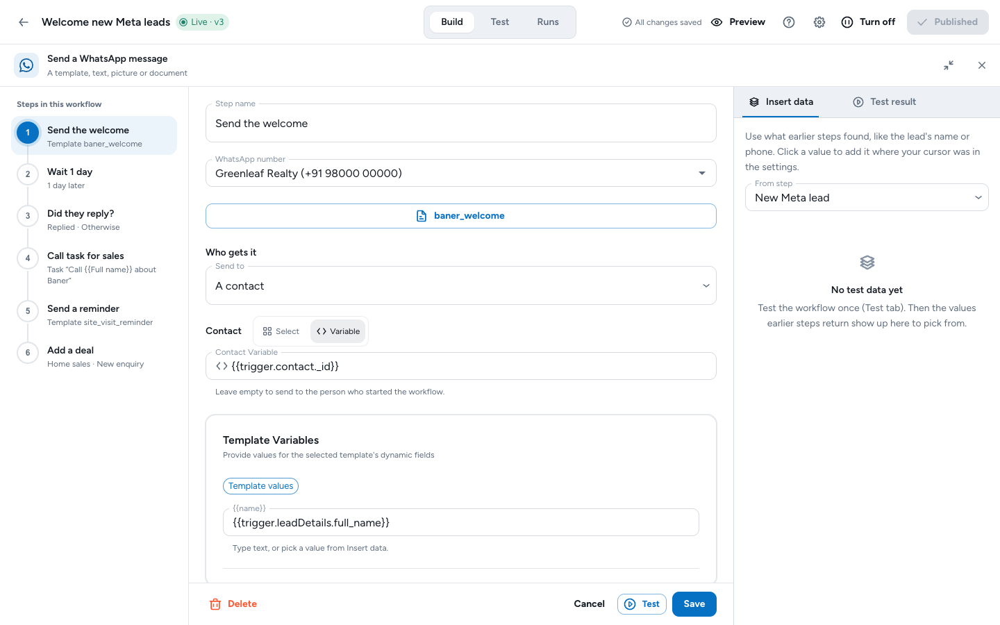

1. Click in the box where the value should go.
2. On the right, **Insert data** → **From step**: pick the step (the trigger holds the lead's details).
3. Click a value. It goes in as a placeholder like `{{trigger.leadDetails.full_name}}` and is filled in for each person.

Values show here after you [test the workflow](/help/automation/test-and-runs#test-a-workflow) once (or after its first real run). Until then it says **No test data yet**.

Every full-page step also has **Test** (bottom) to try just that step, and a **Test result** tab.

## Every step at a glance

| Group | Step | What it does |
| --- | --- | --- |
| Send | [Send a WhatsApp message](#send-a-whatsapp-message) | A template (any time) or a message within 24 hours |
| Send | [Send a message with buttons](#send-a-message-with-buttons) | Buttons; each button leads to its own path |
| Send | [Ask a question](#ask-a-question) | Waits for their answer and saves it |
| Send | [Send an email](#send-an-email) | One email to the contact |
| Send | [Hand over to the AI agent](#hand-over-to-the-ai-agent) | Meta's AI agent takes the chat (or gives it back) |
| Wait and decide | [Wait](#wait) | For a while, or until a date |
| Wait and decide | If / else | A different path depending on the lead |
| Wait and decide | [Repeat for each item](#repeat-for-each-item) | The next steps once per contact or row |
| Wait and decide | [Join paths](#join-paths) | Brings branches back together |
| Wait and decide | [Go to another flow](#go-to-another-flow) | Continues in another workflow |
| Contacts and CRM | [Add or update a contact](#add-or-update-a-contact) | Name, fields, labels |
| Contacts and CRM | [Add or update a deal](#add-or-update-a-deal) | A deal in a pipeline stage |
| Contacts and CRM | [Create a task](#create-a-task) | A to-do for your team |
| Contacts and CRM | [Find a contact / Find many contacts](#find-a-contact-and-find-many-contacts) | Look people up |
| Contacts and CRM | [Match a lead to their WhatsApp](#match-a-lead-to-their-whatsapp) | Did they message you from a certain ad? |
| Contacts and CRM | [Check a payment request](#check-a-payment-request) | Its status and amount |
| Contacts and CRM | Cal.com booking | Get, cancel, mark no-show, or send a booking link |
| Contacts and CRM | [Data table](#data-table) | Read or save rows in your own table |
| Advanced | [Call another app (HTTP)](#developer-steps) | For developers |
| Advanced | [Reshape data](#developer-steps) | For developers |
| Advanced | [Custom code](#developer-steps) | For developers |

## Send

### Send a WhatsApp message

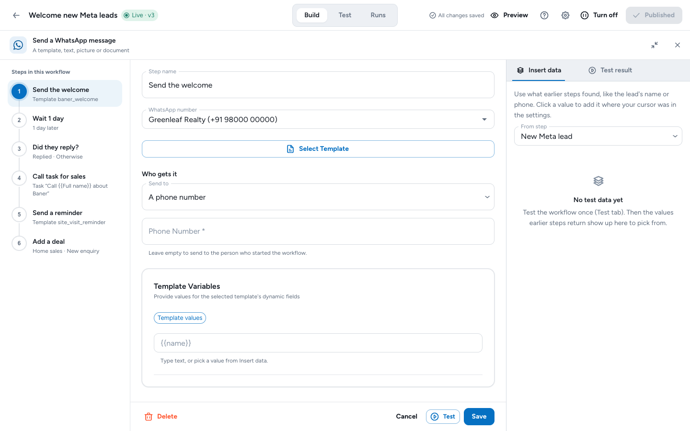

| Field | What it does | Example |
| --- | --- | --- |
| **Step name** | Only your team sees it | Send the welcome |
| **WhatsApp number** | The number it sends from | Greenleaf Realty (+91 98000 00000) |
| **Select Template** | Pick an approved template. Its variables (like the name) and header file appear under **Template values**: fill them from Insert data | baner_welcome |
| **Who gets it** → **Send to** | **A contact** (normally the person who started the workflow) or **A phone number** (like your manager, for an alert) | A contact |

<Warning>
A person who hasn't messaged you in the last 24 hours can only get an approved **template**. Leads from ads, forms and imports haven't messaged you yet. If Meta pauses or rejects the template, this step fails (see [Runs](/help/automation/test-and-runs#runs)).
</Warning>

### Send a message with buttons

Sends a WhatsApp message with buttons (or a list), and gives each button its own path on the canvas.

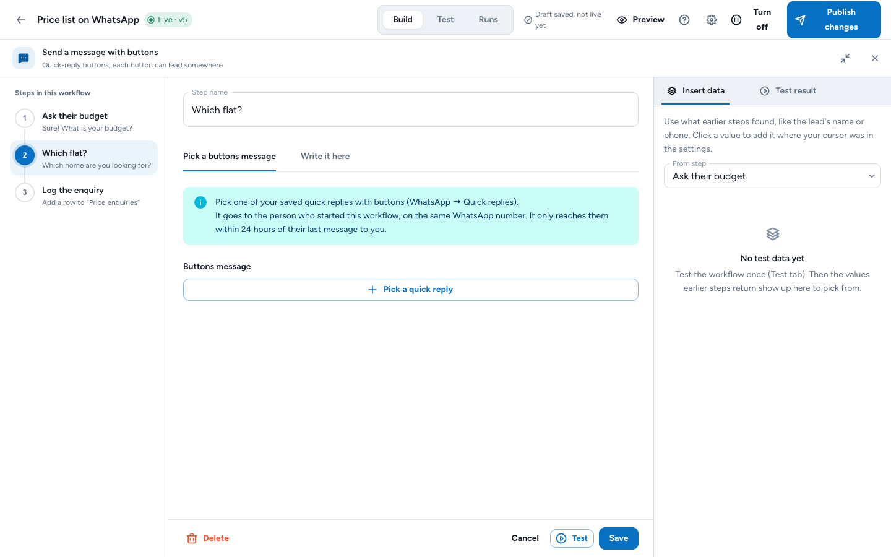

- **Pick a buttons message**: one of your [quick replies](/help/snippet/list) with buttons (**Pick a quick reply**).
- **Write it here**: write the message and its buttons just for this step.

On the canvas each button gets a line (like **2 BHK**, **3 BHK**) plus **Anything else** (they typed something instead). Add the next step under each.

It only reaches the person within 24 hours of their last message to you: put it after a WhatsApp trigger or after they reply.

### Ask a question

Sends a question and waits for the answer.

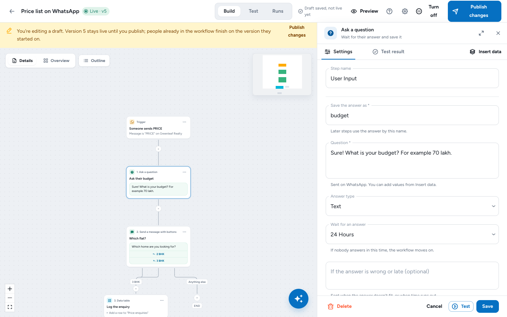

| Field | What it does | Example |
| --- | --- | --- |
| **Save the answer as** | A short name later steps use for the answer | budget |
| **Question** | What it sends on WhatsApp | What is your budget? For example 70 lakh. |
| **Answer type** | **Text**, **Email**, **Phone**, **Number** or **Option** (one of your choices, shown as buttons) | Text |
| **Wait for an answer** | How long before it moves on without one | 24 hours |
| **If the answer is wrong or late (optional)** | What to reply when the answer doesn't fit the type | Please type a number, like 70 lakh |

Like buttons, it needs the 24-hour window.

### Send an email

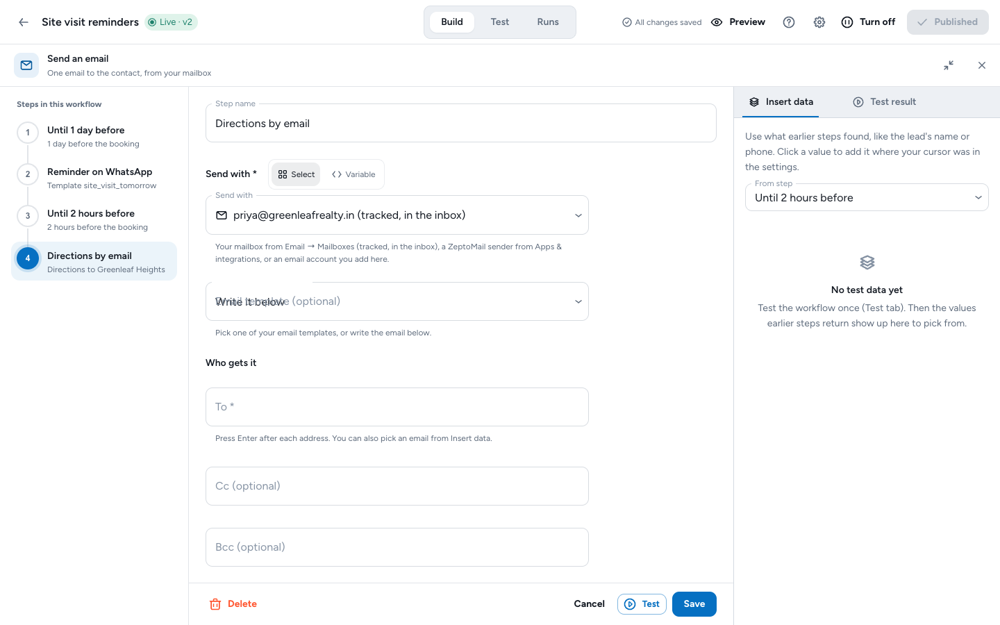

| Field | What it does |
| --- | --- |
| **Send with** | Your mailbox from **Email → Mailboxes** (tracked, and it shows in your inbox), a **ZeptoMail** sender ([ZeptoMail](/help/integrations/zeptomail)), or an [email account](/help/automation/email-accounts) (**Connect a new email account**) |
| **Email template (optional)** | One of your [email templates](/help/email/templates), or **Write it below** |
| **Subject**, **Message** | When you write it here. **Format**: **HTML** or **Plain text** |
| **To**, **Cc (optional)**, **Bcc (optional)** | Press Enter after each address. Insert the contact's email from Insert data |
| **Sender name**, **Sender email**, **Replies go to** (optional) | Override the sender's own |
| **Try again if it fails** / **Times to try again** | Retry when the email server is briefly down |

It's one email to one person, not a mass mailing: AdsEra doesn't send email campaigns.

### Hand over to the AI agent

For numbers using Meta's AI agent (AI → Meta AI agent). **Operation**: **Send an event to the AI agent** (tell it what happened, in **What happened (the agent reads this)**), **Hand the chat back to the AI agent**, or **Take the chat over from the AI agent**. Pick the **WhatsApp number**.

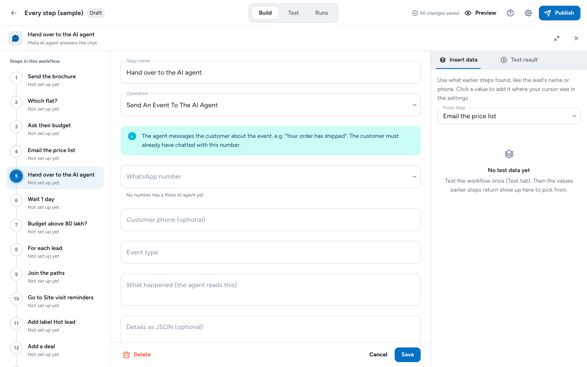

## Wait and decide

### Wait

A sentence you change by clicking the blue words.

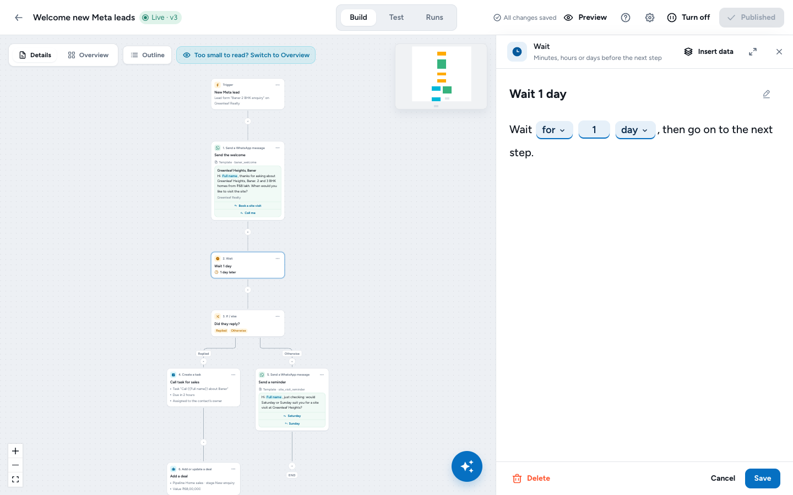

- **for** 1 **day**: waits a set time. Units: minutes, hours, days.
- **until** a date: **exactly at**, or some time **before** / **after** a date. Pick a date, or a time from an earlier step, like a booking's **startTime**.
- **If that time has already passed**: **go on right away** or skip this person.

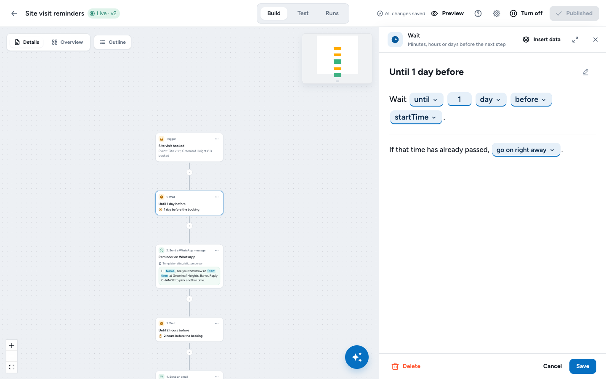

People on a wait show as **On a wait step** in Runs.

### If / else

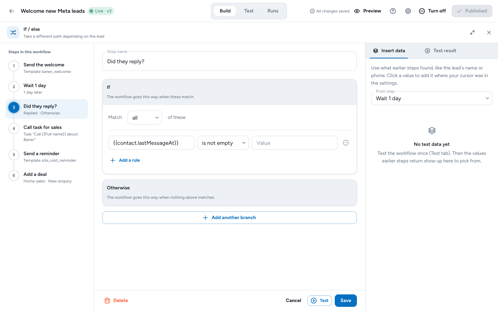

| Part | What it does |
| --- | --- |
| **If** | People who match its rules go this way |
| **Match all / any of these** | Every rule must be true, or any one |
| A rule | A value (from Insert data), a comparison and what to compare with. Comparisons: **is**, **is not**, **contains**, **doesn't contain**, **starts with**, **ends with**, **is more than**, **is less than**, **is empty**, **is not empty**, **is one of**, **is not one of**, **has any of**, **has all of**, **has none of** |
| **Add a rule** | Another rule in the same path |
| **Otherwise** | Everyone who matched nothing above |
| **Add another branch** | A third (or fourth) path, checked in order |

After saving, add steps under each path on the canvas.

### Repeat for each item

Runs the steps on its **For each item** line once per item of a list (for example each contact a **Find many contacts** step found, or each row of a data table), then continues on **When done**. Pick the list under **The list to go through**.

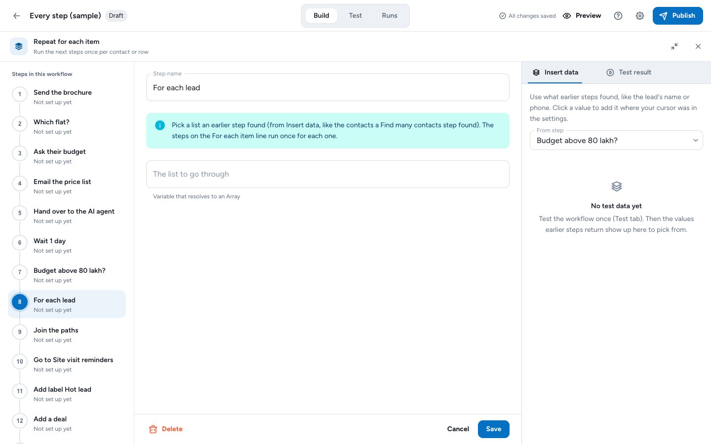

### Join paths

Brings two or more paths back into one, so you don't build the same steps twice.

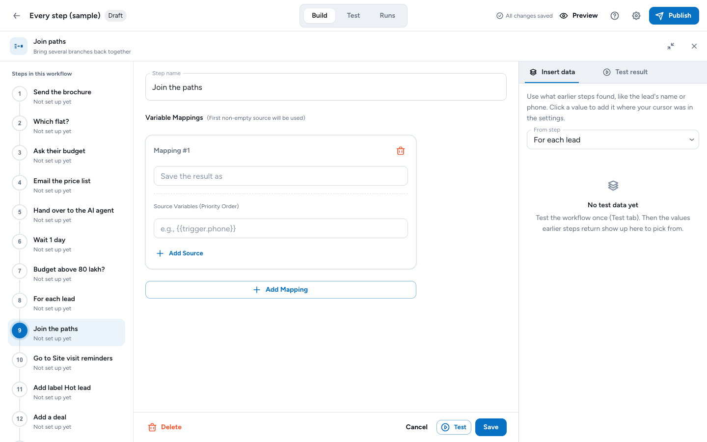

### Go to another flow

Continues in another workflow with the same person: pick **Workflow to go to**, and optionally **Start at step**. You can pass values (**Name in the other workflow** / **Value from this workflow**).

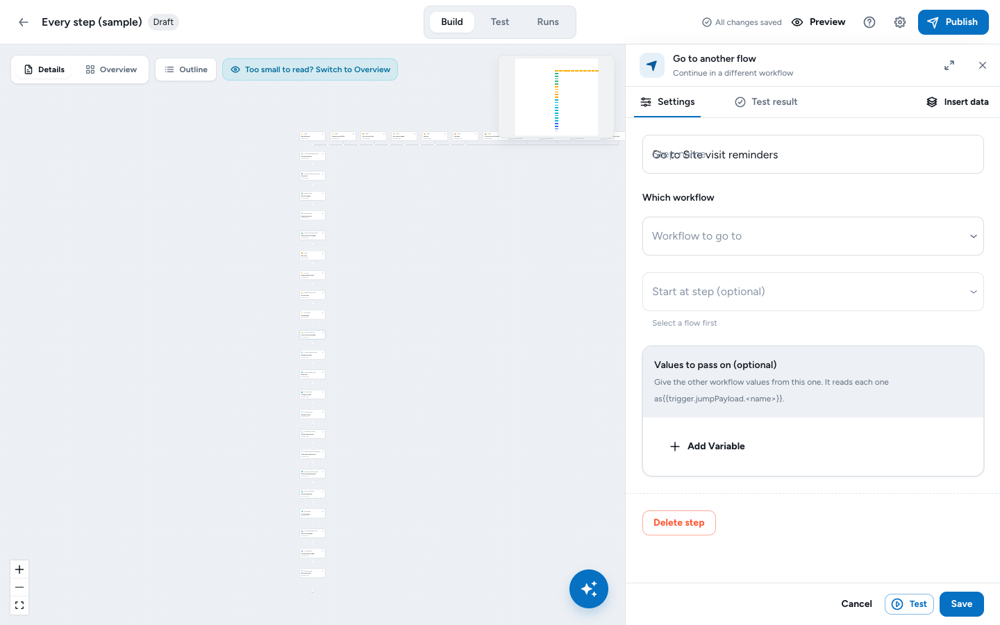

## Contacts and CRM

### Add or update a contact

Finds the contact by email, phone or contact id, and adds them if they're new. Then sets their name, fields and labels (and can remove fields).

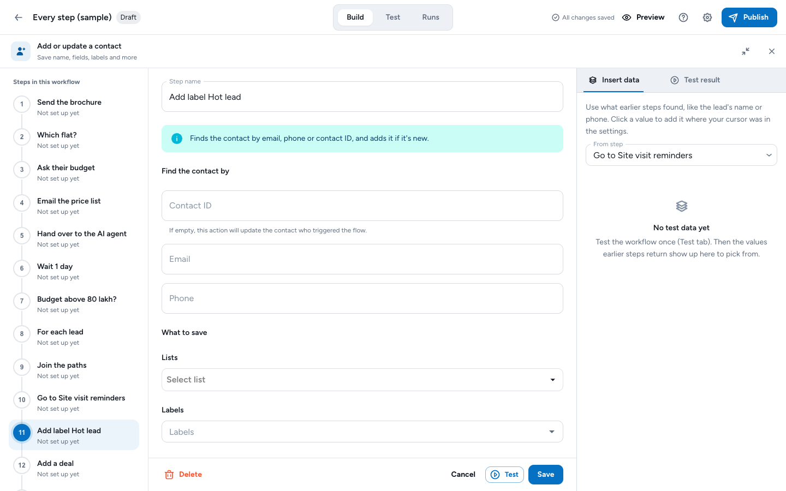

### Add or update a deal

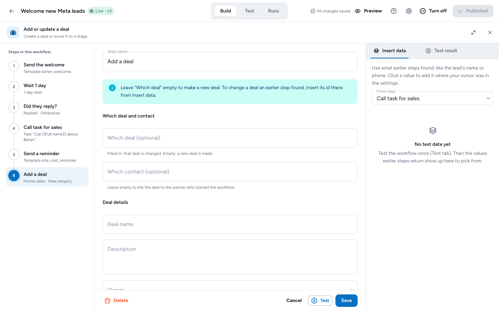

| Field | What it does |
| --- | --- |
| **Which deal (optional)** | Empty: a new deal is made. Filled (an id from Insert data): that deal is changed |
| **Which contact (optional)** | Empty: the person who started the workflow |
| **Deal name**, **Description** | Like “Ravi Kumar, 2 BHK Baner” |
| **Owner**, pipeline and stage, **Close date** | Who it belongs to and where it sits |
| Products, **Qty**, **Discount**, **GST**, totals | The deal's value, like on a deal you make by hand |

### Create a task

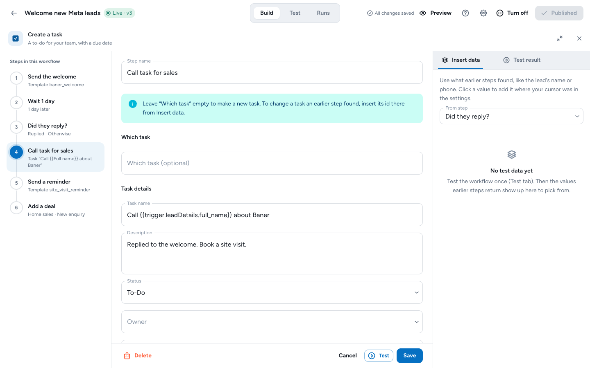

| Field | What it does |
| --- | --- |
| **Which task (optional)** | Empty: a new task. Filled: change that task |
| **Task name**, **Description** | Like “Call {name} about Baner” |
| **Status**, **Owner**, **Collaborators** | Who does it |
| **Due date** | A date, or **Take the due date from an earlier step** |

### Find a contact and Find many contacts

- **Find a contact** looks one person up by **Phone**, **Email** or contact id. **Try again if no contact is found** waits and retries (useful right after a form).
- **Find many contacts** gets everyone who matches your filters (empty: every contact). Use it with **Repeat for each item**, or after an **On a schedule** trigger.

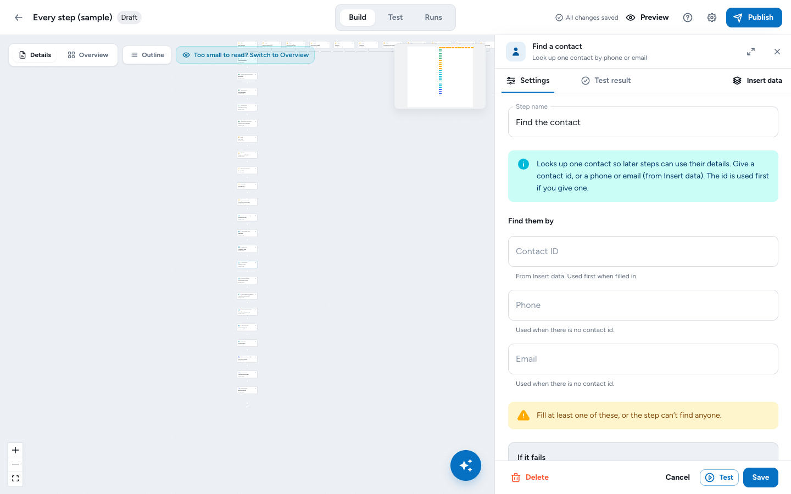

### Match a lead to their WhatsApp

Checks whether this person messaged you on WhatsApp from a certain Meta ad (Click-to-WhatsApp): it finds the contact by **Phone** and looks for that ad (**Meta Ad ID**) in their messages within the **Look back (minutes)** window.

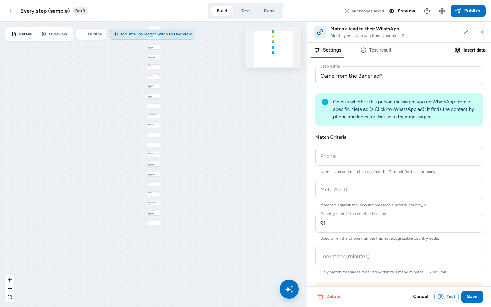

### Check a payment request

Reads a payment request's status and amount (**Payment request id** from Insert data), so you can thank payers or remind the rest.

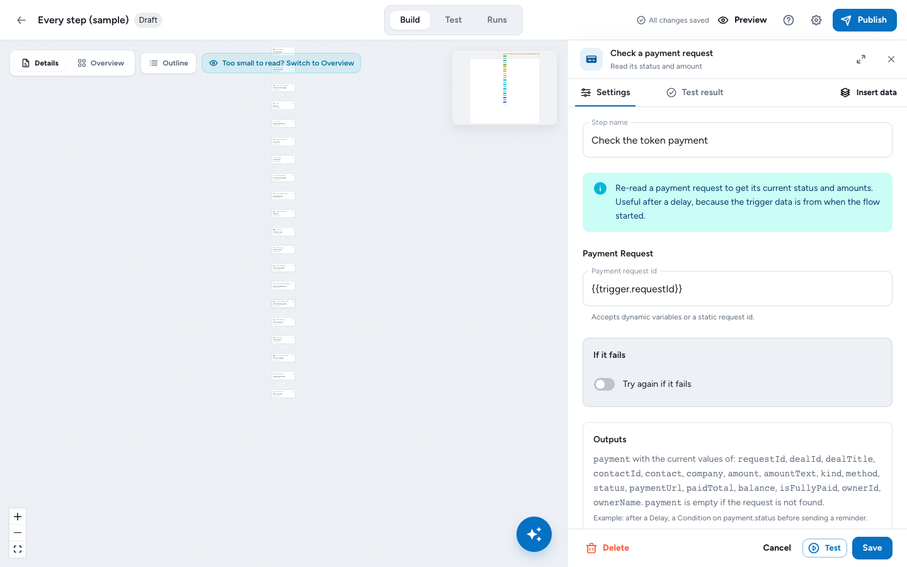

### Cal.com booking

Works with your connected [Cal.com](/help/integrations/calcom) account. **Operation**: **Get booking**, **Cancel booking**, **Mark no-show**, or **Booking or reschedule link** (a **New booking**, **Reschedule** or **Cancel** link to send). Test runs don't call Cal.com: they show what would happen.

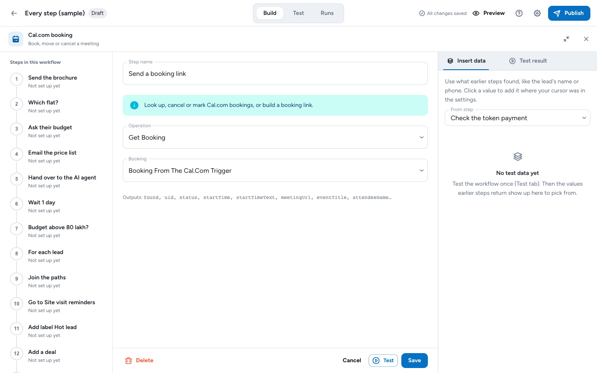

### Data table

Reads or saves rows in one of your [data tables](/help/automation/data-tables).

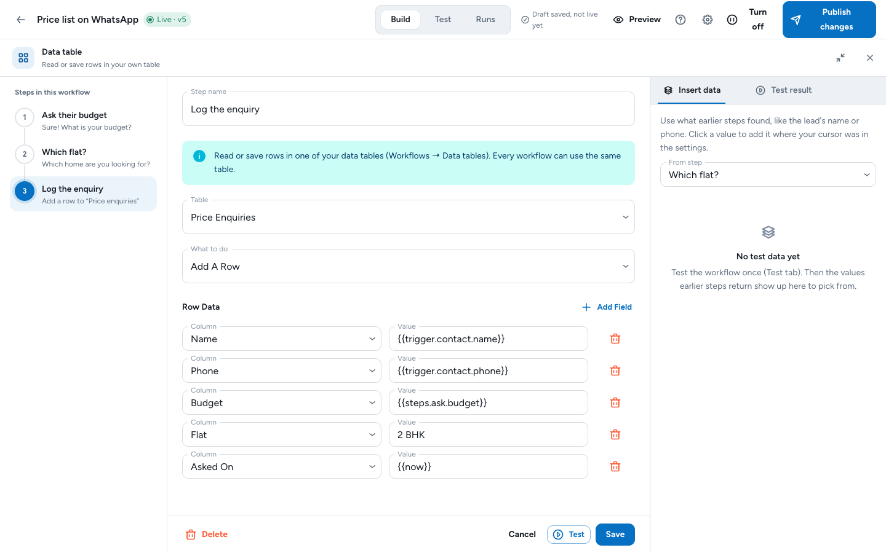

| Field | Choices |
| --- | --- |
| **Table** | One of your data tables |
| **What to do** | **Find rows**, **Add a row**, **Change a row**, **Change a row, or add it if it isn't there**, **Delete a row** |
| **Which row (optional)** | A row an earlier step found; empty: pick rows with the filter |
| **Column** / **Value** | What to save in each column, or what to look for |
| **Limit** | Up to how many rows **Find rows** returns |

## Developer steps

For your developer. You don't need them for normal follow-ups.

- **Call another app (HTTP)**: calls another app's web address (API). **GET / POST / PUT / PATCH / DELETE**, **Query parameters**, **Headers**, **Body**, **Sign in** (**No sign-in**, **A token (Bearer)**, **Username and password**, **An API key in a header**) and **If it fails** (**Give up after**, **Try again if it fails**).
- **Reshape data**: change a value for later steps: Uppercase, Lowercase, Capitalize, Trim, Substring, Regex Replace, Parse Int, Parse Float, Add, Subtract, Multiply, Divide, Round, Math Expression. **Save the result as** names it.
- **Custom code**: a short JavaScript that runs safely on its own (no internet or files), for anything else.

## Related

<CardGroup cols={2}>
<Card title="Every trigger" icon="bolt" href="/help/automation/triggers">What starts a workflow.</Card>
<Card title="Test, publish and runs" icon="play" href="/help/automation/test-and-runs">Try it, publish it, fix failures.</Card>
</CardGroup>
