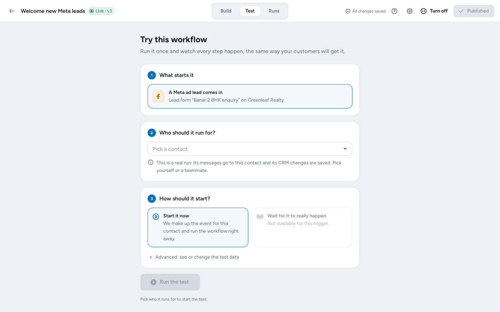
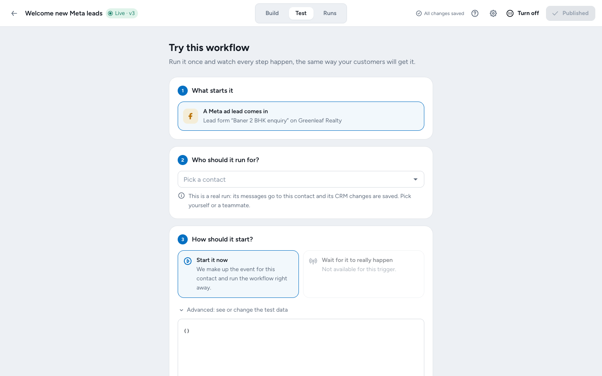
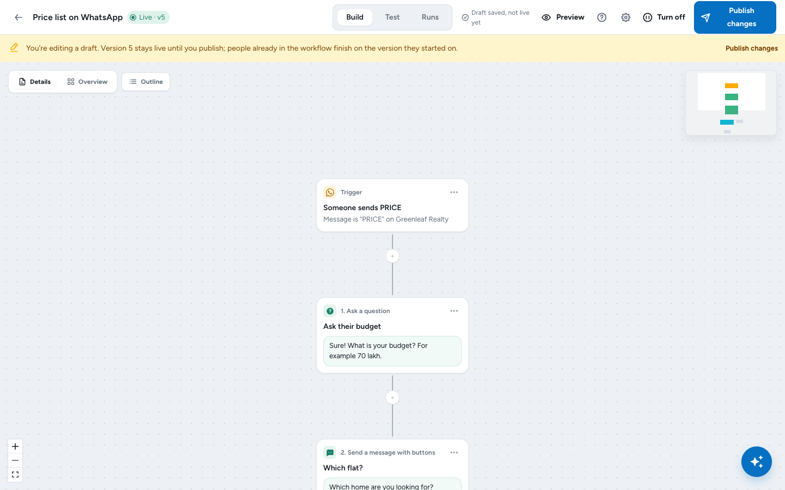
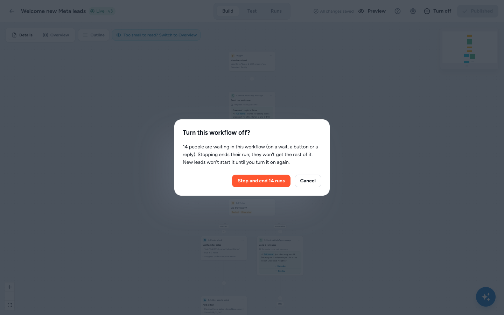
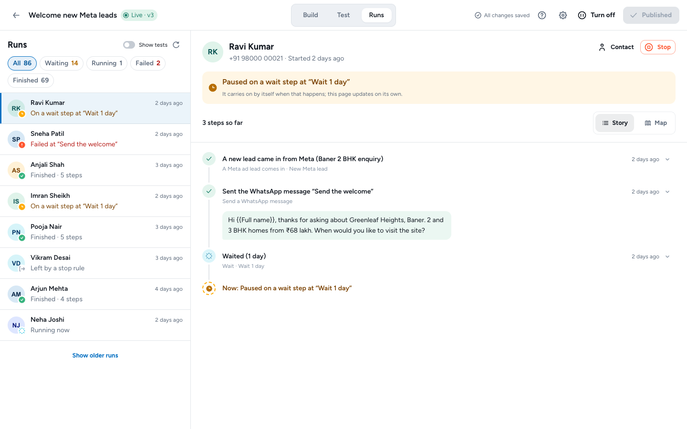
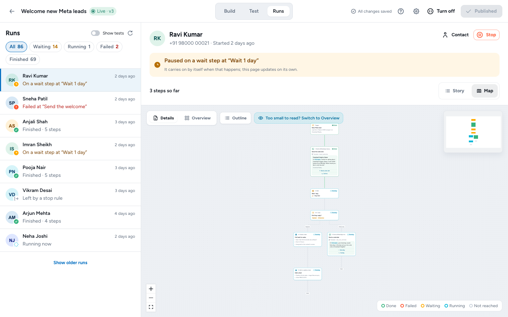
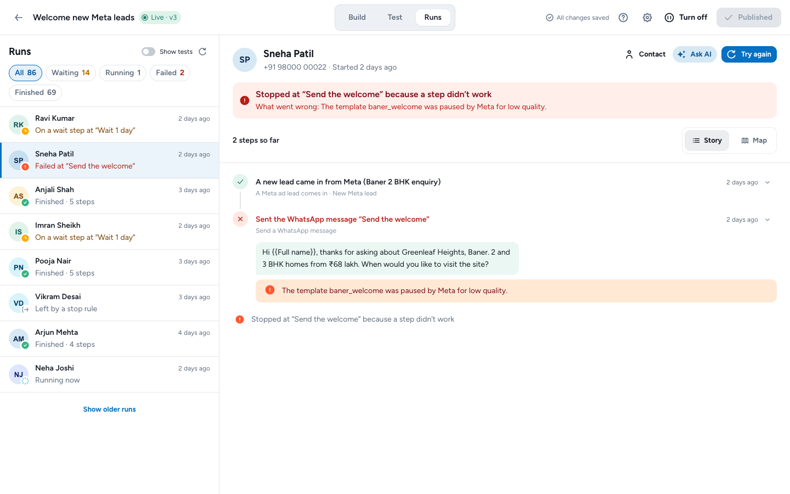
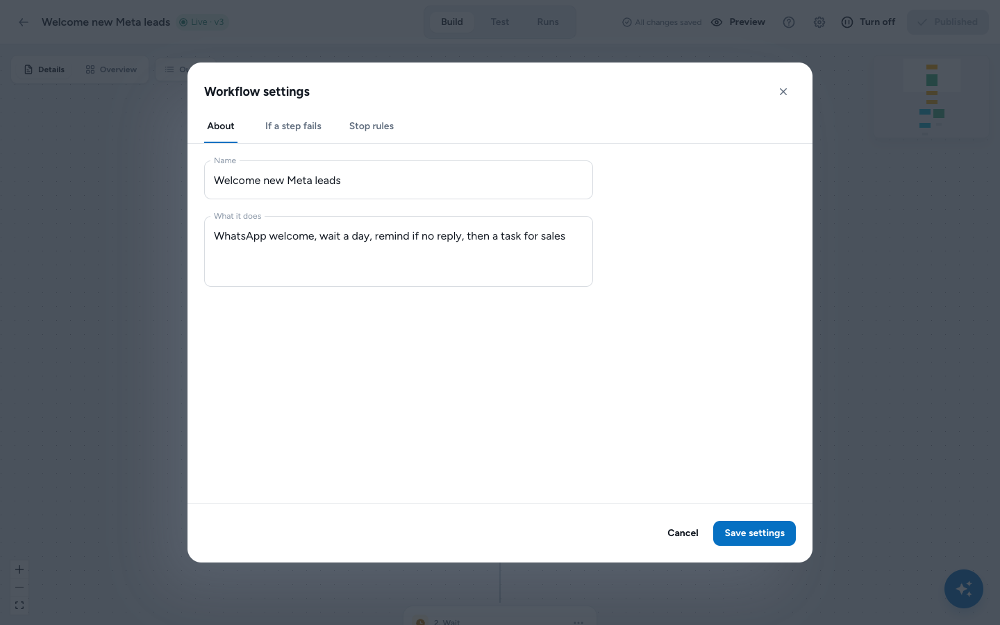
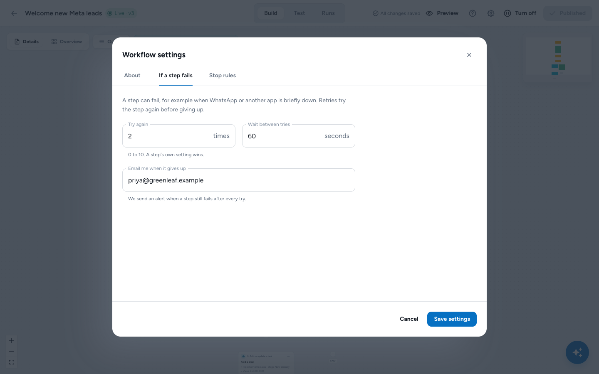
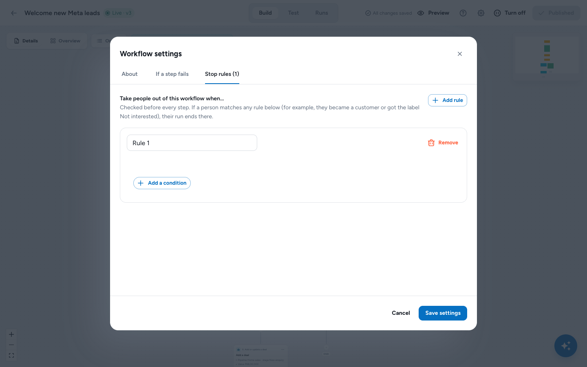

## Test a workflow

Run it once on yourself (or a teammate) and watch every step happen, exactly as a customer would get it.

<Steps>
<Step title="Open the workflow and click Test">
At the top of the editor.

</Step>
<Step title="1. What starts it">
The trigger. If the workflow has several, click the one to test.
</Step>
<Step title="2. Who should it run for?">
**Pick a contact**: yourself or a teammate.

<Warning>
A test is a real run: its WhatsApp messages and emails really go to this contact, and its CRM changes (deals, tasks, labels) are really saved.
</Warning>

For **A WhatsApp message arrives**, **What they send on WhatsApp** is the message that starts it: change it to try another keyword. Schedule and webhook triggers don't start from a person: picking a contact is optional.
</Step>
<Step title="3. How should it start?">
- **Start it now**: AdsEra makes up the event (the lead, the booking, the message) for this contact and runs the workflow at once.
- **Wait for it to really happen**: you do it for real within a minute (send the keyword from that contact's phone, fill the form, book the meeting). Not available for every trigger.

**Advanced: see or change the test data** shows what the trigger “received”. Change it to try other cases, like a different budget; **Reset** goes back.

</Step>
<Step title="Click Run the test">
The run opens and each step ticks as it happens. **New test** starts another.
</Step>
</Steps>

## Publish and versions

Every change you make saves by itself, into a **draft**. Customers only ever get a **published version**.

| You see | What it means |
| --- | --- |
| **Draft** chip, **Publish** button | Never published. Nothing runs until you click **Publish** |
| **Live · v3**, **Published** (greyed) | Live on version 3, and you haven't changed anything since |
| **Live · v5**, yellow bar *You're editing a draft…*, **Draft saved, not live yet**, **Publish changes** | You changed a live workflow. Version 5 keeps running until you click **Publish changes** |
| **Off · v3** | Switched off. **Publish** switches it on again |

- **Publish** switches the workflow on (version 1, or the next version).
- **Publish changes** makes your draft the next version. **People already inside finish on the version they started**; new people get the new one.
- If something blocks publishing, a red message says what, like “Add a trigger…” or “Connect … to the first step”. A warning (in yellow) lists steps that nothing leads to: they never run.

### Turn a workflow off

Click **Turn off** in the editor (or the switch on the Workflows list). It first says how many people are waiting in it (on a wait, a button or a reply):

**Stop and end … runs** ends their runs: they won't get the rest. New people stop starting it. Nothing is deleted.

## Runs

**Runs** lists everyone who went through the workflow, newest first. Click one to see what happened to them, step by step.

| Part | What it does |
| --- | --- |
| **All / Waiting / Running / Failed / Finished** | Filter the list; the numbers count each |
| **Show tests** | Add your test runs to the list |
| Refresh | Load the newest runs |
| **Show older runs** | Load more |
| **Story** | Each step in words: “Sent the WhatsApp message “Send the welcome””, with the message itself |
| **Map** | The same run on the canvas: the path it took |
| **Contact** | Open the person's contact page |
| **Stop** | End a run that's still going (asks first) |

### Run statuses

| Status | What it means |
| --- | --- |
| **Finished** | Went through every step on its path |
| **Failed** | A step didn't work. The run says which and why |
| **Running** | Working through its steps right now |
| **Starting** | About to start |
| **On a wait step** | On a **Wait** step; it carries on by itself |
| **Waiting for a reply** | Sent buttons or a message and waits for them to answer |
| **Waiting for an answer** | On an **Ask a question** step |
| **Left by a stop rule** | Matched a [stop rule](#stop-rules) and left early |
| **Restarted by the person** | They started the same workflow again (for example sent the keyword again), so this run was left and a new one began |
| **Continued in a new run** | Carried on as a new run (for example after **Try again**); open the newer run |

### Fix a failed run

1. Click **Failed** and open the run. The story says which step failed and why, like *The template baner_welcome was paused by Meta for low quality*.
2. Fix the cause: pick another template, reconnect the app, fill a missing field.
3. Click **Try again** to run it again from there, or **Ask AI** to explain the error and help fix it.

| Common error | Fix |
| --- | --- |
| The template was paused or rejected by Meta | Pick another approved template in the step, or fix the template (WhatsApp → Templates) |
| Outside the 24-hour window | Use a template instead of a free message, buttons or a question |
| The contact has no phone / email | Make sure the trigger gives one, or add a **Find a contact** step |
| An app needs reconnecting (Cal.com, ZeptoMail, an email account) | Fix it under Connected tools, then **Try again** |

## Workflow settings

Click the settings wheel at the top of the editor. **Save settings** saves all three tabs.

### About

**Name** and **What it does**.

### If a step fails

| Field | What it does | Example |
| --- | --- | --- |
| **Try again** | How many times to retry a failed step (0 to 10). A step's own setting wins | 2 times |
| **Wait between tries** | Seconds between tries | 60 seconds |
| **Email me when it gives up** | We email this address when a step still fails after every try | priya@greenleafrealty.in |

### Stop rules

*Take people out of this workflow when…*: checked before each step. A person who matches any rule leaves the workflow there (their run shows **Left by a stop rule**). Use it so people stop getting follow-ups once they buy or say no.

Click **Add a stop rule**, name it, and add the conditions (like *Labels has Not interested*). **Add rule** adds another; rules are joined with **or**.

## FAQ

<AccordionGroup>
<Accordion title="I published changes. Do people already inside get them?">
No. They finish on the version they started. New people get the new version.
</Accordion>
<Accordion title="Does a test cost anything?">
Test runs send real messages, so WhatsApp's normal message charges apply, and AI steps use credits, like any run.
</Accordion>
<Accordion title="How long are runs kept?">
Runs stay listed under Runs; use the filters and **Show older runs** to go back.
</Accordion>
</AccordionGroup>

## Related

<CardGroup cols={2}>
<Card title="Workflows" icon="diagram-project" href="/help/automation/workflows">Make and manage workflows.</Card>
<Card title="Every step" icon="list-check" href="/help/automation/steps">All 22 steps.</Card>
</CardGroup>
