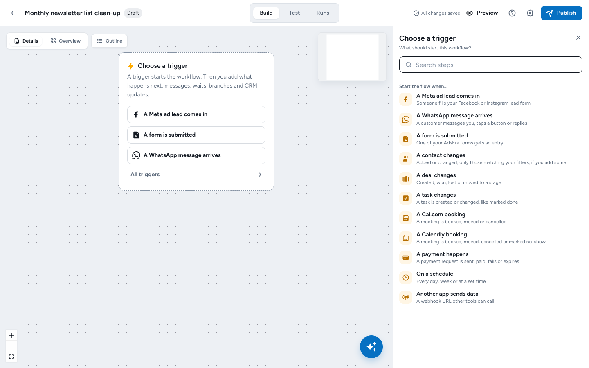
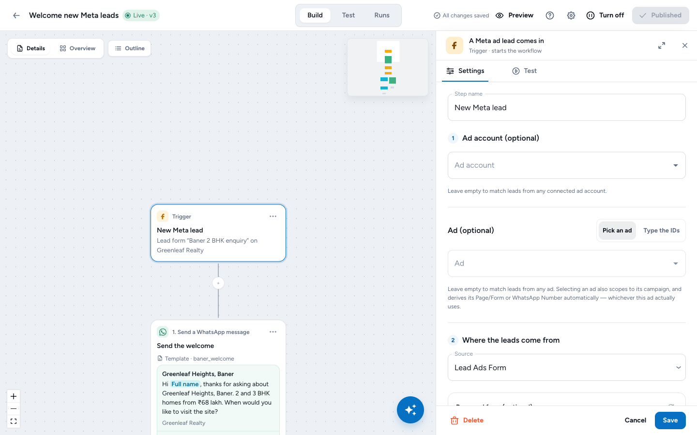
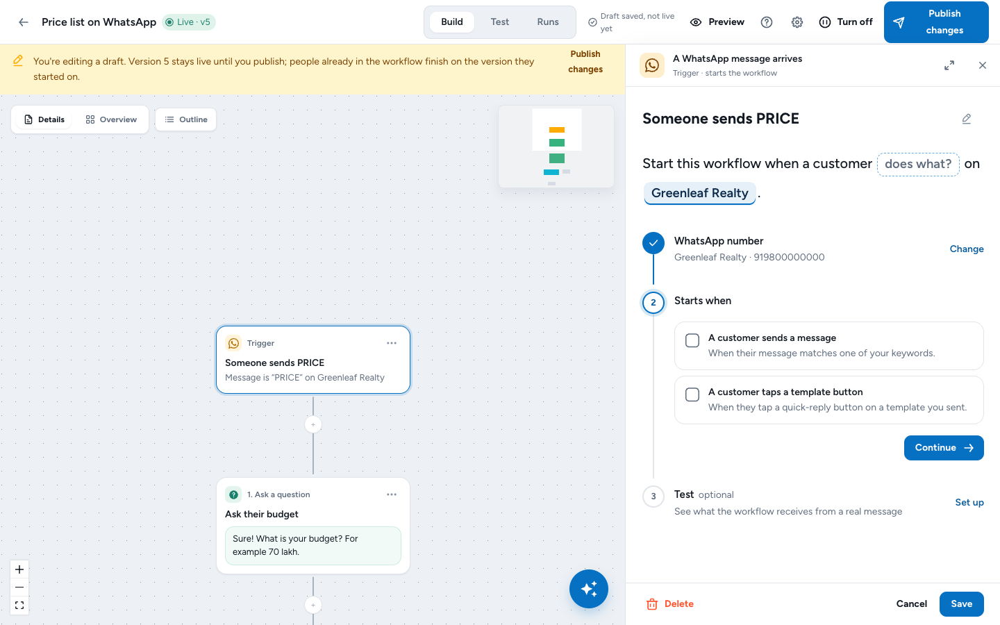
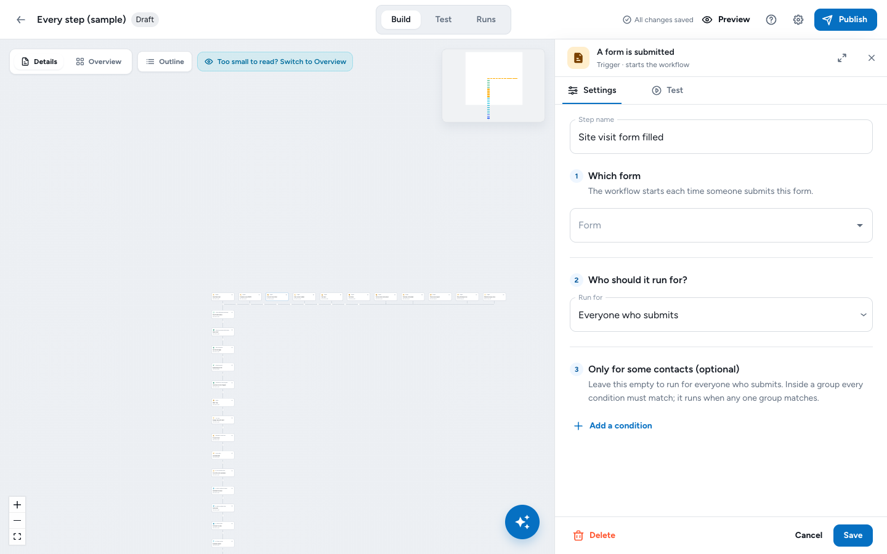
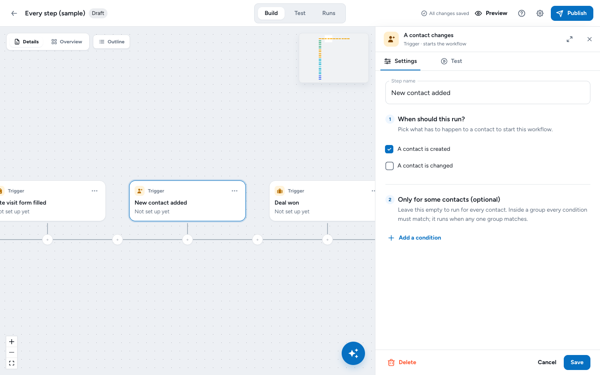
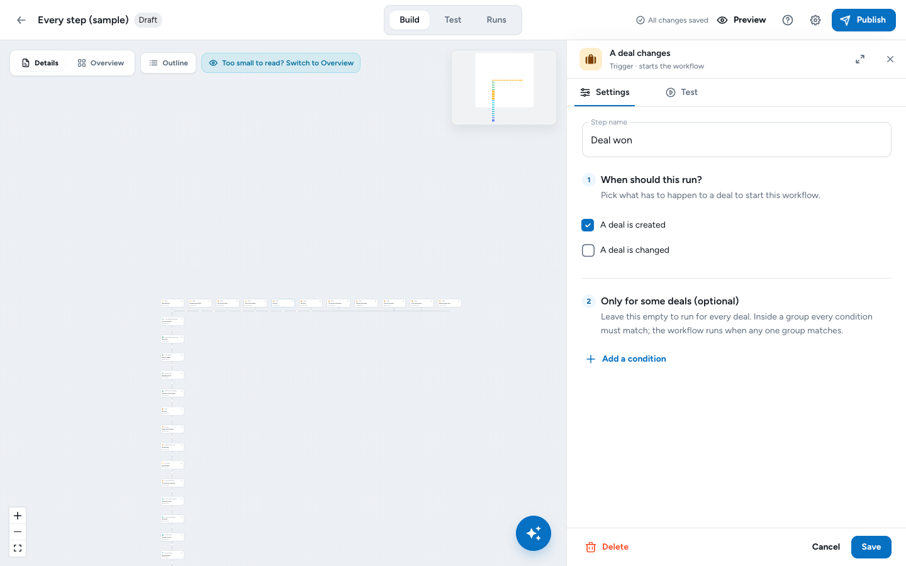
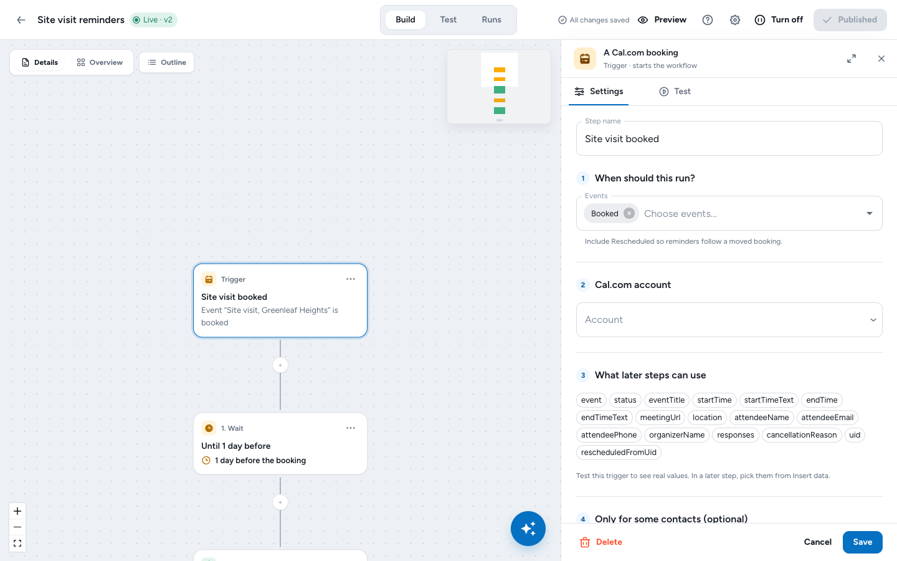
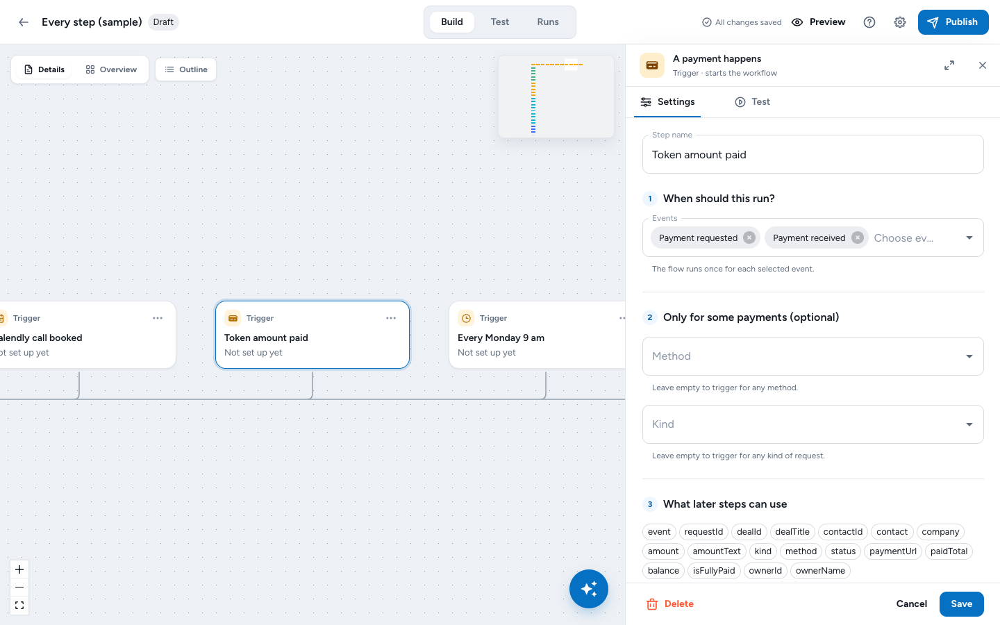
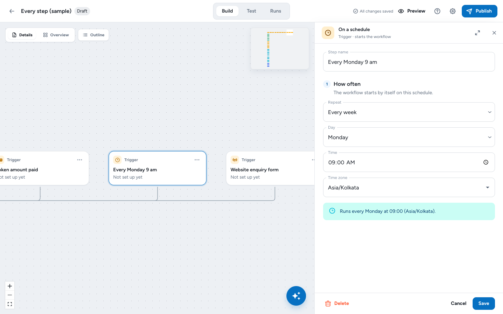
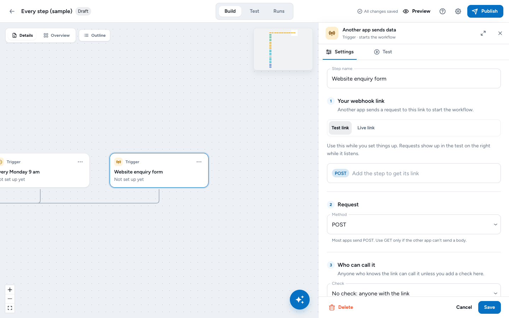

A **trigger** starts a workflow for one person (or, for a schedule, at a set time). Every workflow needs at least one. It sits at the top of the canvas, above step 1.

**Where:** open a workflow (**Automation → Workflows**, click it). A new workflow shows **Choose a trigger**; any other time, click a **+** at the top or the trigger's own card.

| Trigger | Starts when | Good for |
| --- | --- | --- |
| [A Meta ad lead comes in](#a-meta-ad-lead-comes-in) | Someone fills your Facebook or Instagram lead form, or messages you from a Click-to-WhatsApp ad | Welcome every ad lead in seconds |
| [A WhatsApp message arrives](#a-whatsapp-message-arrives) | A customer sends a keyword, or taps a button on a template you sent | Answer PRICE, LOCATION, BROCHURE |
| [A form is submitted](#a-form-is-submitted) | Someone fills one of your AdsEra forms | Thank them and book a call |
| [A contact changes](#a-contact-changes) | A contact is added or changed (optionally only those matching filters) | Welcome IndiaMART or imported leads |
| [A deal changes](#a-deal-changes) | A deal is added or changed (optionally only some deals) | Thank-you on Won; nudge on a stage |
| [A task changes](#a-task-changes) | A task is added or changed | Tell the customer when a task is done |
| [A Cal.com booking](#a-calcom-or-calendly-booking) | A Cal.com meeting is booked, moved, cancelled… | Reminders before a site visit |
| [A Calendly booking](#a-calcom-or-calendly-booking) | A Calendly meeting is booked, moved, cancelled or marked no-show | Same, for Calendly |
| [A payment happens](#a-payment-happens) | A payment request is sent, paid, fails, expires or is cancelled | Thank payers; chase unpaid |
| [On a schedule](#on-a-schedule) | Every day, week, month, hour or minute, at your time | A daily report or clean-up |
| [Another app sends data](#another-app-sends-data) | Another app calls the workflow's own web address (a webhook) | For developers |

<Tip>
A workflow can have more than one trigger: each one starts the same steps. Set up and **Save** each trigger in the panel on the right. Its **Test** tab (next to **Settings**) shows what it receives.
</Tip>

## A Meta ad lead comes in

Starts for each new lead from your Meta (Facebook / Instagram) ads. Your ad account must be connected under **Ads → Meta Ads**.

| Field | What it does | Example |
| --- | --- | --- |
| **Step name** | Only your team sees it | New Meta lead |
| **Ad account (optional)** | Only leads from this ad account. Empty: any connected account | Greenleaf Realty ads |
| **Ad (optional)** | **Pick an ad** or **Type the IDs**: only leads from this ad (and its campaign) | Baner launch, Nov |
| **Source** | **Lead Ads Form** (an instant form on Facebook/Instagram) or **Click-to-WhatsApp** (the ad opens a WhatsApp chat) | Lead Ads Form |
| **Page**, **Form** | The Facebook page and the lead form. **Refresh forms from Meta** gets new ones | Baner 2 BHK enquiry |
| **Field types (optional)** | Tell AdsEra which form answers are a phone, email or name | |
| **Test Contact (optional)** | Who a test run is for | Priya Mehta |

What later steps get: the lead's answers (full name, phone, email and your own questions) and the form's name.

## A WhatsApp message arrives

Starts when a customer messages your WhatsApp number with a keyword, or taps a button on a template you sent.

It reads like a sentence: *Start this workflow when a customer **does what?** on **your number***. Then three short parts:

| Part | What to choose |
| --- | --- |
| **1 WhatsApp number** | Which of your numbers |
| **2 Starts when** | **A customer sends a message** (it matches one of your **Keywords**) or **A customer taps a template button** (pick the template and its **Button**) |
| **Keywords** | Type a word and press Enter after each, like PRICE, RATE, BROCHURE. **How it should match**: **Contains** (anywhere in the message), **Is exactly**, **Is close to** (spelling mistakes are fine), **Matches a pattern** (for developers) |
| **3 Test** (optional) | Send yourself the keyword and see what the workflow receives |

<Warning>
An auto-reply for the same keyword (WhatsApp → Auto-replies) answers too. Use one or the other for a keyword.
</Warning>

## A form is submitted

Starts each time someone fills one of your [AdsEra forms](/help/sales/forms).

| Field | What it does |
| --- | --- |
| **Form** | Which form |
| **Run for** | **Everyone who submits**, **Only new people (the form creates the contact)** or **Only people already in your contacts** |
| Conditions (optional) | Only when the answers match, like *City is Pune*. Inside a group every condition must match; it runs when any group matches |

## A contact changes

Starts when a contact is added or changed: by hand, by an import, by IndiaMART, by a form or by another workflow.

| Field | What it does |
| --- | --- |
| **When should this run?** | Tick **A contact is created**, **A contact is changed**, or both |
| Filters (optional) | Only contacts that match, like *Label is IndiaMART* or *City is Pune* |

<Tip>
“Changed” runs on every change to the contact. Add a filter so it only runs for the change you care about, or it may start more often than you expect.
</Tip>

## A deal changes

| Field | What it does | Example |
| --- | --- | --- |
| **When should this run?** | **A deal is created** and/or **A deal is changed** | Changed |
| **Only for some deals (optional)** | Rules on a **Field**: Amount, Deal Name, Stage, Pipeline, Closing Date, Owner, Payment status, Payment paid, Payment balance. Compare with **is**, **contains**, **is not**, **is filled in**, **is more than / less than / at least / at most**, **is on / after / before** | Stage is Won |
| **Deal to test with** | A deal for test runs | |

## A task changes

Same as deals: **A task is created** and/or **A task is changed**, with optional rules on **Title**, **Description**, **Status**, **Scheduled for** or **Assigned to**. Example: *Status is Done* → tell the customer their documents were checked.

## A Cal.com or Calendly booking

Starts when a meeting is booked on your Cal.com or Calendly page. Connect the app first under [Connected tools](/help/integrations/calcom).

| Field | What it does |
| --- | --- |
| **When should this run?** → **Events** | Cal.com: **Booked**, **Requested (needs confirmation)**, **Rescheduled**, **Cancelled**, **Rejected**, **No-show updated**, **Meeting ended**, **Paid**. Calendly: **Booked**, **Rescheduled**, **Cancelled**, **Marked no-show**, **No-show removed** |
| **Account** | Which connected account |
| **Event types** | Only these meeting types. Empty: any |
| **What later steps can use** | The booking's details (start time, event, meeting link, the attendee's name, email, phone and answers) |

<Tip>
Pick **Booked** and **Rescheduled** together, so reminders follow a moved booking. Use the start time with a **Wait until … before** step.
</Tip>

## A payment happens

Starts when a payment request (from a deal or a chat) changes.

| Field | Choices |
| --- | --- |
| **Events** | **Payment requested**, **Payment received**, **Payment failed**, **Link expired**, **Request cancelled** |
| **Kind** (optional) | **Full**, **Advance**, **Balance**, **Custom** |
| **Method** (optional) | **Pay now** (inside WhatsApp) or **Payment link** |

## On a schedule

Starts by itself at set times. It doesn't start from a person, so steps that message someone need [Find a contact or Find many contacts](/help/automation/steps#find-a-contact-and-find-many-contacts) first.

| Field | Choices |
| --- | --- |
| **Repeat** | **Every day**, **Every week**, **Every month**, **Every hour**, **Every minute**, **Custom (cron, for developers)** |
| **Day** / **Day of the month** | For weekly and monthly |
| **Time**, **Time zone** | Like 09:30, Asia/Kolkata |

## Another app sends data

For developers: the workflow gets its own web address (a **webhook**). Another app sends a request to it to start the workflow, with its data.

| Field | What it does |
| --- | --- |
| **Your webhook link** | **Copy link** and give it to the other app |
| **Request** → **Method** | Most apps send **POST**. GET only if the app can't send a body |
| **Who can call it** | **No check: anyone with the link**, **A secret header**, **Username and password**, or **Signed token (JWT)** |

## Troubleshooting

| What you see | Why, and what to do |
| --- | --- |
| **No trigger yet** on the Workflows list | Open it and pick a trigger |
| Publish says “Add a trigger…” | Same: a workflow can't go live without one |
| A Meta lead didn't start it | Check the ad account is connected (Ads → Meta Ads), the **Form** is the right one, and the workflow is **Live** |
| The keyword didn't start it | The workflow is off, the **How it should match** is too strict (try **Contains**), or another workflow/auto-reply took it |
| Cal.com bookings don't start it | Cal.com shows **Error** under Connected tools → Cal.com (replace the API key), or a team event needs **Sync team events** |

## Related

<CardGroup cols={2}>
<Card title="Every step" icon="list-check" href="/help/automation/steps">What happens after the trigger.</Card>
<Card title="Workflows" icon="diagram-project" href="/help/automation/workflows">Make, publish and manage workflows.</Card>
</CardGroup>
