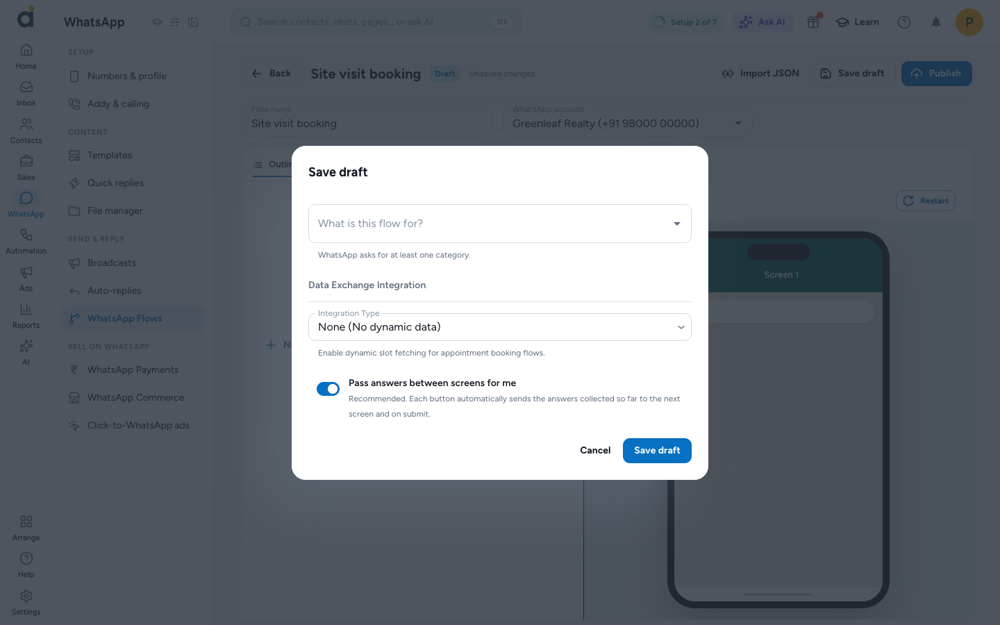
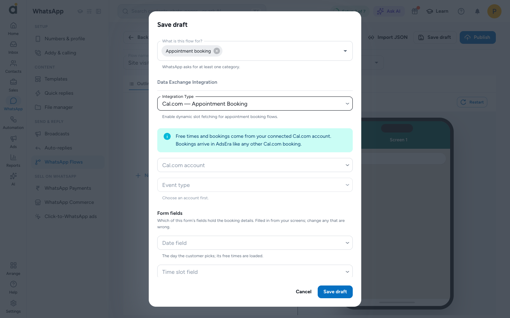
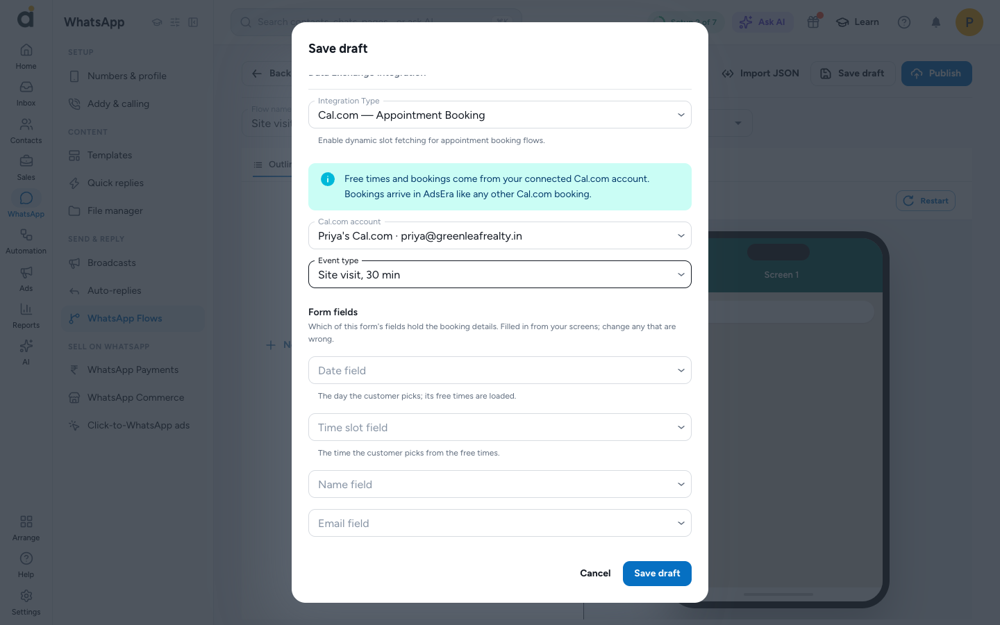

A booking flow shows people the free times from your calendar and books the one they pick, all inside WhatsApp. AdsEra talks to your calendar while the flow is open.

**Before you start:** connect Cal.com or Calendly in **Automation → Connected tools** ([Cal.com](/help/integrations/calcom), [Calendly](/help/integrations/calendly)), and build a flow with a date question and a time slot question. See [WhatsApp Flows](/help/automation/whatsapp-flows).

## Connect the flow to your calendar

<Steps>
<Step title="Open Save draft">
  In the flow editor, click **Save draft**.

  
</Step>
<Step title="What is this flow for?">Pick **Appointment booking**.</Step>
<Step title="Integration Type">
  Choose:

  | Option | Use it when |
  | --- | --- |
  | **None (No dynamic data)** | The flow only collects answers |
  | **Cal.com — Appointment Booking** | Your bookings are in Cal.com |
  | **Calendly — Appointment Booking** | Your bookings are in Calendly |
  | **Custom API** | Your developer has a booking system: they give the **Slots Endpoint URL**, **Booking Endpoint URL** and any **Custom Headers (JSON)** |
  | **Rules-Based Logic Engine** | Screens should change based on answers, written as **Flow Logic JSON** (for developers; **Generate with AI — Copy Prompt** copies a prompt to paste into the AI app you use) |
</Step>
<Step title="Pick the account and event type">
  For Cal.com or Calendly, a note says where the free times come from. Pick the connected account (**Cal.com account** or **Calendly account**), then the **Event type** (like “Site visit, 30 min”). The event type list stays empty until you pick an account.

  
</Step>
<Step title="Match the fields">
  Under **Form fields**, match **Date field**, **Time slot field**, **Name field** and **Email field** to the questions in your flow. **Detect automatically** picks them for you when the names are clear.

  
</Step>
<Step title="Save, then publish">Click **Save draft**, try it in the preview, then **Publish**.</Step>
</Steps>

## What the customer sees

1. They open the flow from a template button or chat.
2. They pick a date: the time slot question shows only the free times from your calendar.
3. They enter their name and email and submit.
4. The booking appears in your Cal.com or Calendly, and the answers are saved to their contact.

## Related

<CardGroup cols={2}>
  <Card title="WhatsApp Flows" icon="mobile-screen" href="/help/automation/whatsapp-flows">Build and publish flows.</Card>
  <Card title="Cal.com" icon="calendar" href="/help/integrations/calcom">Connect Cal.com.</Card>
</CardGroup>
