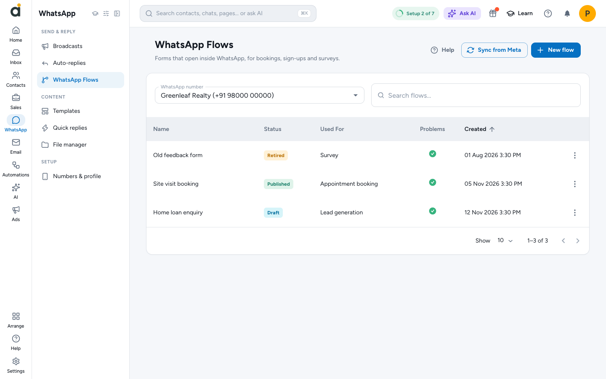
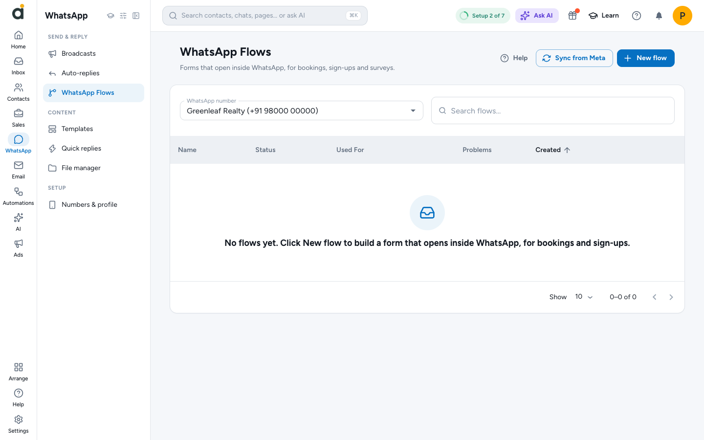
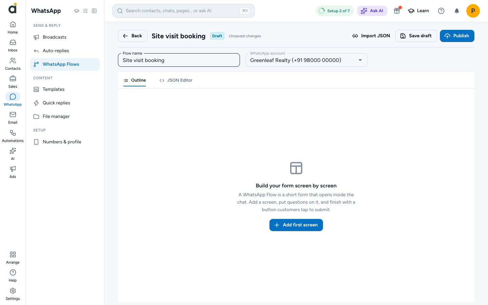
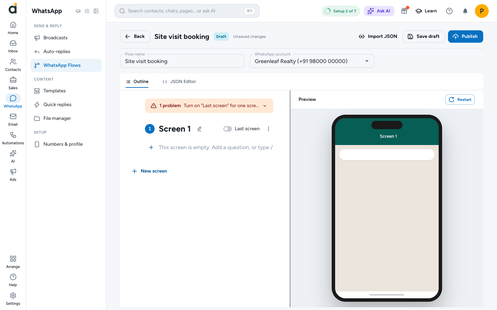
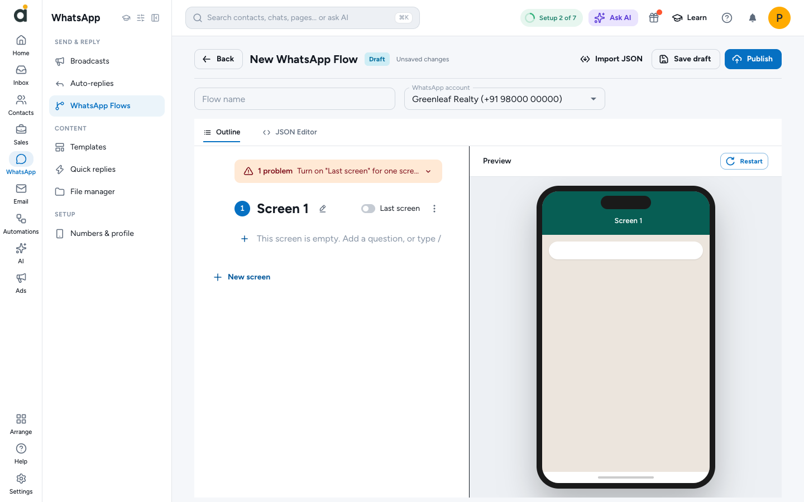
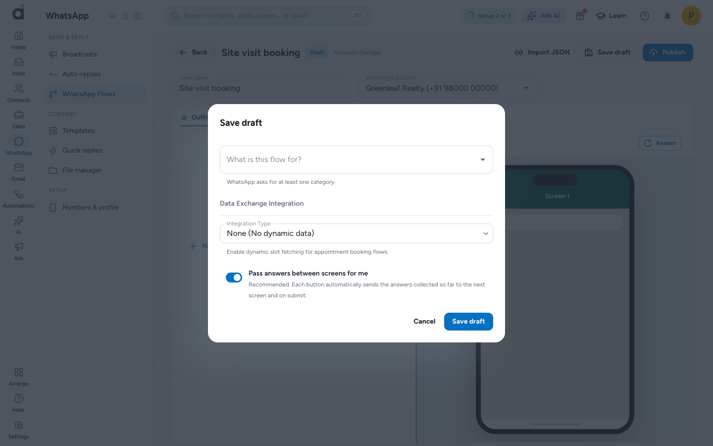
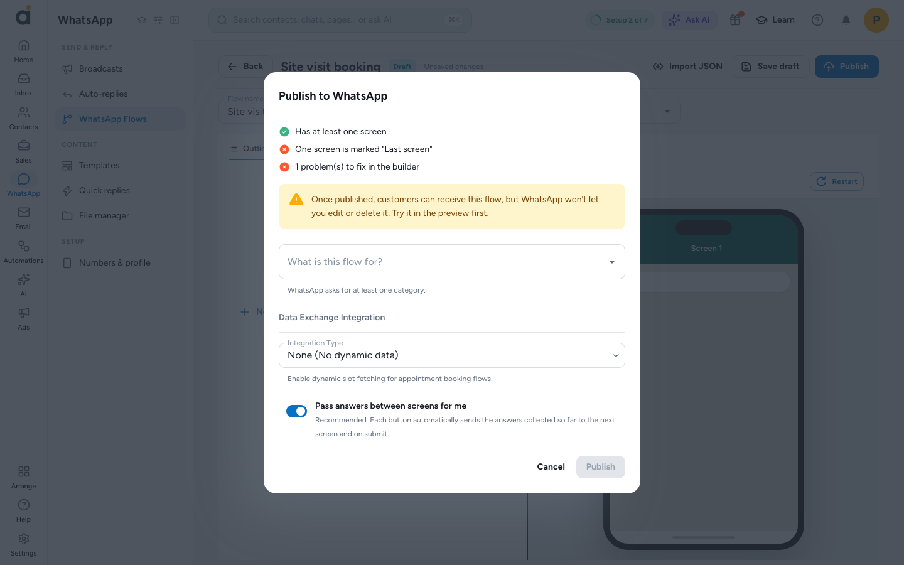
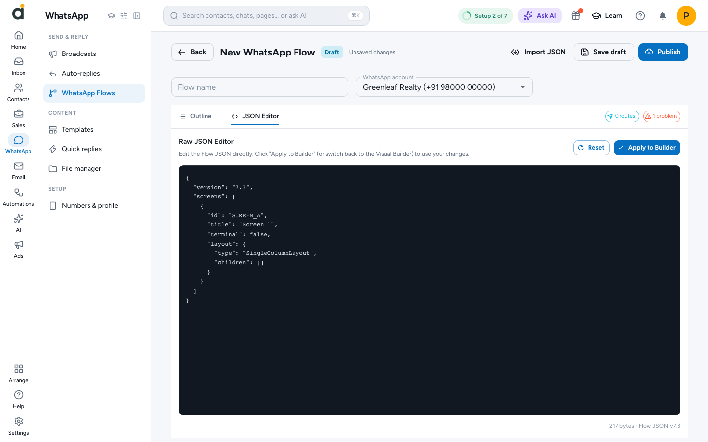
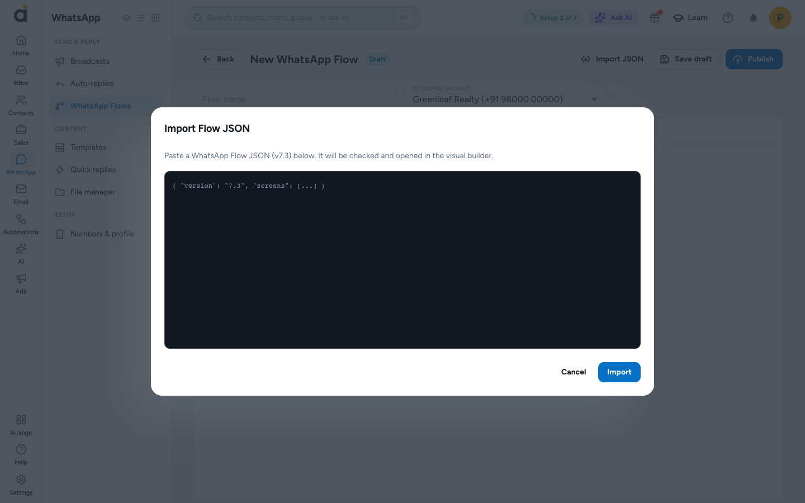
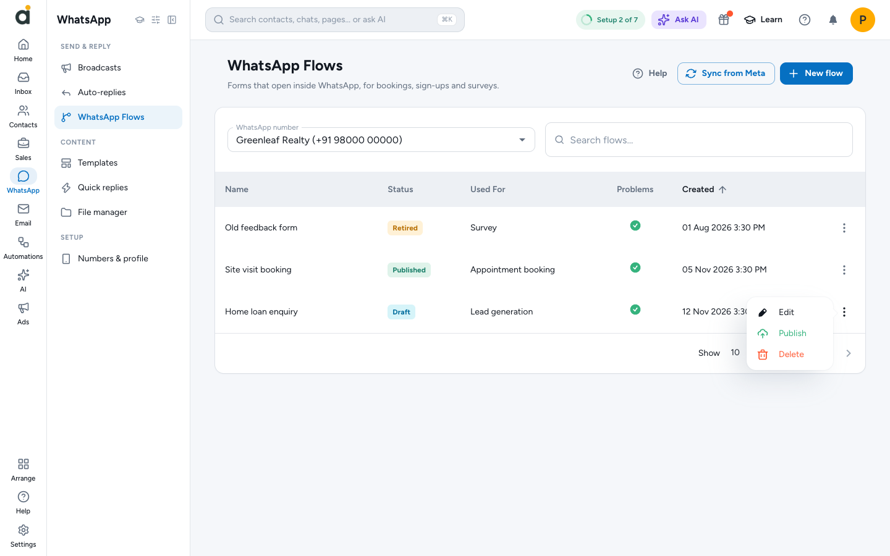

A **WhatsApp Flow** is a form that opens **inside the chat**. Customers fill in screens (text, dates, choices, photos, documents) without leaving WhatsApp, and their answers are saved to their contact. Use flows for site visit bookings, lead forms, admissions, surveys and sign-ups.

**Where:** **WhatsApp → WhatsApp Flows** (side menu, under **Send & reply**). [Open it →](https://app.adsera.in/dashboard/whatsapp/flow/list)

## The list

| Column / control | What it shows |
| --- | --- |
| **Filter by WhatsApp Account** | Flows belong to one WhatsApp Business account |
| **Search flows…** | Find by name |
| **Sync from Meta** | Bring in flows made in Meta’s Flow Builder |
| **New flow** | Start a new flow |
| Name, Status, Used for, Problems, Created | Status is **Draft**, **Published** or **Retired** (Meta's “deprecated”: it can't be sent any more); Problems shows what Meta found wrong |
| **⋮** | **Edit**, **Publish** (drafts), **Deprecate** (published), **Delete** |

## Build a flow

<Steps>
<Step title="New flow">
  Click **New flow**. Type the **Flow name** (only your team sees it) and pick the **WhatsApp account**.

  
</Step>
<Step title="Add a screen">
  Click **Add first screen**. Each screen is one page of the form; **New screen** adds more. The screen’s ⋮ menu can **Rename screen**, mark it **Last screen**, **Duplicate screen** or **Delete screen**.

  
</Step>
<Step title="Add questions and text">
  Click “This screen is empty. Add a question, or type /” (or **Add a component**) and pick one. Use **Move up** / **Move down** to reorder.

  
</Step>
<Step title="Mark the last screen">
  Switch on **Last screen** on the final screen. Its button sends the answers. The red **problem** box lists anything left to fix; when it says “No problems found”, the flow is ready.
</Step>
<Step title="Try it">
  The phone **Preview** shows the flow as customers see it. Click through it; **Restart** starts again.
</Step>
<Step title="Save draft">
  Click **Save draft**. Pick **What is this flow for?** (Meta asks for at least one), choose an integration if it needs live data (see [Book appointments](/help/automation/whatsapp-flows-booking)), keep **Pass answers between screens for me** on, and click **Save draft**.

  
</Step>
<Step title="Publish">
  When it is ready, click **Publish** (in the editor or the list’s ⋮ menu). The checklist must be all green: has at least one screen, one screen is the last screen, no problems.

  
</Step>
</Steps>

<Warning>A **published** flow can’t be edited or deleted: WhatsApp doesn’t allow it. To change it, build a new flow (you can paste its JSON with **Import JSON**) and **Deprecate** the old one.</Warning>

## What you can add to a screen

| Group | Components |
| --- | --- |
| **Questions** | Short answer (name, email, phone, number), Long answer (message or address), Date, Calendar (a date or a range) |
| **Choices** | Dropdown, Checkboxes, Single choice, Consent checkbox (“I agree to…”), Chips |
| **Text** | Heading, Subheading, Paragraph, Small print, Formatted text (lists, links, tables), Link |
| **Media** | Image, Photo upload, Document upload, Image carousel |
| **Advanced** | Menu list, Show if… / Show by value… (show parts only for some answers), Form group |

**What is this flow for?** options: Lead generation, Appointment booking, Sign up, Sign in, Contact us, Customer support, Survey, Other.

## Outline and JSON Editor

The **Outline** tab is the visual builder. **JSON Editor** shows the flow as code for developers; **Apply to Builder** loads edited code back.

## Import a flow

Click **Import JSON**, paste a flow’s JSON (from a developer or Meta’s Flow Builder) and click **Import** (or **Replace flow** if the flow already has screens).

## Publish, deprecate, delete

| Action | What happens | Undo? |
| --- | --- | --- |
| **Publish** | It can be sent to customers. It can’t be edited or deleted any more. | No |
| **Deprecate** | It can’t be sent any more. People who already have it may still open it. | No |
| **Delete** | A draft is removed from WhatsApp and AdsEra. A published flow is deprecated instead. | No |

## Send a flow

- From a template: add a **WhatsApp Flow** button. See [Template buttons](/help/template/buttons).
- From a quick reply: interactive type **WhatsApp Flow (form)**. See [Interactive quick replies](/help/snippet/interactive).
- From a chat: attach a flow in the reply box (published flows only).

Answers are saved to the contact, and can start workflows.

## Related

<CardGroup cols={2}>
  <Card title="Book appointments with a flow" icon="calendar" href="/help/automation/whatsapp-flows-booking">Cal.com and Calendly.</Card>
  <Card title="Template buttons" icon="hand-pointer" href="/help/template/buttons">Send a flow in a template.</Card>
</CardGroup>
